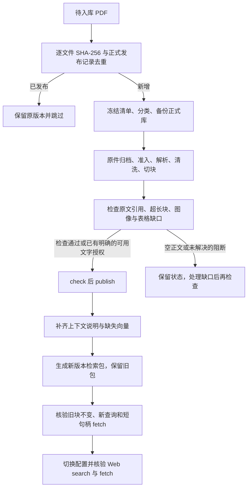

# 语料增量与维护操作说明

本文记录现有新链的实际入口和恢复边界，服务于 I5-2。命令只面向已明确的隔离目标或已获批准的维护窗口；不会自行选择生产库。

## 日常增量

### 新增研报的固定命令流程（2026-10-31，含 OCR）

本节是新批次的操作入口。下方 10 月 28 日的脚本仅是历史执行记录，不要重跑。
本流程仅构建新增清单中的文件，不重建历史研报。OCR 已接入原生读取器，详见
[生产 OCR 说明](guide/local-ocr-production.md)。目录不自动监听，放入 PDF 后仍需触发命令。

#### 1. 冻结新增清单与授权记录

先以 SHA-256 与活动发布记录去重；已发布 OCR 衍生版须同时核对父子来源关系，不能
把已处理的扫描原件误认为新文件。为本批单独建立目录，保留清单、授权、命令输出及备份。

`manifest.json` 示例（所有尖括号内容需替换；每份新增文件一项）：

```json
{
  "archive_root": "/home/administrator/FrontierAgent/data/corpus-archive",
  "sources": [{
    "path": "/home/administrator/FrontierAgent/data/corpus-incoming/<批次>/<文件>.pdf",
    "source_id": "<sha256sum 得到的完整64位小写哈希>",
    "original_name": "<文件>.pdf",
    "domain_hint": "company",
    "review_decision_ids": ["<本批唯一决定ID>"]
  }]
}
```

`authorization.json` 记录实际用户指令，不声明人工逐字校对。`operator` 是登记人，
`authorized_by` 是授权人，两者分开；时间带时区；引用可用本批保存的用户指令文件路径。

```json
{
  "operator": "<登记人>",
  "authorized_by": "<授权人>",
  "authorized_at": "<实际授权时间，如2026-10-31T12:00:00+08:00>",
  "authorization_ref": "<用户入库指令的可追溯引用>",
  "sources": [{
    "source_id": "<同一文件哈希>",
    "decision_id": "<与清单相同的决定ID>",
    "material_type": "research_report",
    "research_domain": "company"
  }]
}
```

领域为 `company`、`industry` 或 `macro`。材料类型必须如实填写；外部订阅/复盘使用
`personal_or_external_subscription`，不能为了通过准入而写成分析师研报。
标准 `v1-20260915` 政策只允许 `research_report`。若本批包含已获授权的订阅材料，
按已有 `v3-dev-20261021` 流程另存本批 `policy.json`，显式列出本批哈希：

```json
{
  "policy_rev": "v3-dev-20261021",
  "frozen": true,
  "scope": "dev",
  "auto_decision": {"enabled": false},
  "allowed_materials": ["research_report", "personal_or_external_subscription"],
  "dev_lane": {
    "lane_id": "<本批ID>",
    "sources": [{"source_id": "<本批来源哈希>"}]
  }
}
```

为这类清单添加 `"policy": "<本批policy.json绝对路径>"`，并显式设置
`CORPUS_DEV_LANE=1`。只对清单来源生效，不放宽其他历史来源。`admit` 登记授权，
实际是否准入仍由 `build` 的既有政策判定。

#### 2. 目标、备份、准入与构建

在仓库根目录执行。`CORPUS_TARGET_DB` 与 `CORPUS_I2_DSN` 必须指向已确认的语料库，
当前正式目标是 `postgres`，不能使用业务库 `apodex`。可通过受控环境或 `.env` 配置；
下列命令会加载 `.env`，无需将密钥复制进清单或命令日志。正式写入前按下方备份规程
备份指定语料库。`BATCH` 指向已创建的本批操作目录。

```bash
cd /home/administrator/FrontierAgent
BATCH=.scratch/corpus-incoming-<批次>

uv run --no-sync --env-file .env python -m plugins.corpus.cli admit \
  --manifest "$BATCH/manifest.json" --record "$BATCH/authorization.json"
uv run --no-sync --env-file .env python -m plugins.corpus.cli plan \
  --manifest "$BATCH/manifest.json" > "$BATCH/plan.json"
uv run --no-sync --env-file .env python -m plugins.corpus.cli build \
  --manifest "$BATCH/manifest.json" > "$BATCH/build.json"
```

逐条检查退出码后再执行下一条。相同授权记录可原样重跑；哈希、决定 ID、授权人等
冲突不会覆盖原记录。清单中的 `source_id` 在 plan/build 时重新核对，改过的文件必须
重新登记。未获准入的 build 返回非零，不能只看到命令执行结束就认定构建成功。

加载 OCR 配置后，plan/build 会调用本地 OCR 服务，服务可能写识别结果缓存；plan
不写语料数据库。原生文字保留，OCR 文字另带坐标、版本与 `ocr_unverified` 标记。
图表语义缺口不自动清除；服务失败、方向未知等状态不能伪装成识别完成。

#### 3. 检查、登记可用文字发布、正式发布

从 `build.json` 取每项 `build_id`，逐份执行：

```bash
uv run --no-sync --env-file .env python -m plugins.corpus.cli check --build <build_id>
```

无阻断缺口则直接进入 publish。对于用户已接受“仅发布可用文字”的图片/表格缺口：

```bash
uv run --no-sync --env-file .env python -m plugins.corpus.cli text-publication \
  --build <build_id> --out "$BATCH/<build_id>-text-publication.json"
```

模板只填写 `operator`、`authorized_at`、`authorization_ref` 三项，填入实际授权信息。
不要修改 source/build 指纹或缺口列表；不需要也不能冒签 `gap-review` 的人工完整性审核。
`--out` 不覆盖已有文件；重试时使用原凭证。然后执行：

```bash
uv run --no-sync --env-file .env python -m plugins.corpus.cli text-publication \
  --build <build_id> --record "$BATCH/<build_id>-text-publication.json"
uv run --no-sync --env-file .env python -m plugins.corpus.cli check --build <build_id>
uv run --no-sync --env-file .env python -m plugins.corpus.cli publish \
  --build <build_id> --operator <登记人>
```

凭证须覆盖该构建的完整阻断缺口清单。原始缺口、页码和原文保持不变，放行状态标记
为已接受且覆盖不完整；空正文、未知缺口、无效引用等仍拒绝。登记成功不代表已经发布。
若中断，用 `status --build <build_id>` 查实际状态，再继续对应步骤。

#### 4. 限定增量检索范围，补说明、向量并生成索引包

`CURRENT_INDEX` 必须填当前正式配置的 manifest 绝对路径；不是旧批次的固定路径。

```bash
CURRENT_INDEX=<当前CORPUS_NATIVE_INDEX的绝对路径>
uv run --no-sync --env-file .env python -m plugins.corpus.retrieval.cli scope \
  --native-index "$CURRENT_INDEX" --manifest "$BATCH/manifest.json" \
  --out "$BATCH/scope.json"
uv run --no-sync --env-file .env python -m plugins.corpus.retrieval.cli context-plan \
  --deployment release --source-scope "$BATCH/scope.json"
uv run --no-sync --env-file .env python -m plugins.corpus.retrieval.cli context-generate \
  --deployment release --source-scope "$BATCH/scope.json" --max-requests <本次请求上限>
uv run --no-sync --env-file .env python -m plugins.corpus.retrieval.cli context-status \
  --deployment release --source-scope "$BATCH/scope.json"
uv run --no-sync --env-file .env python -m plugins.corpus.retrieval.cli native-pack \
  --deployment release --source-scope "$BATCH/scope.json" \
  --max-requests <本次向量请求上限> --release-id <新发布ID> \
  --out data/corpus-native-context/<新批次>
```

`scope` 验证旧包和新增文件哈希，输出两者来源并集；不会自动纳入其他活动来源，也不
覆盖已有范围文件。正式部署的四个 context/pack 命令现在必须带 `--source-scope`。
范围中任一来源尚未发布或已撤回时明确失败，不静默丢掉它或扩大范围。只生成缺失说明、
复用已就绪向量；失败/结果不确定时先检查状态与日志，不盲目重发。说明或向量未齐全
不会生成可用新包。旧包仍保留，生成包不等于 Web 已切换。

#### 5. 验收与 Web 激活

用新 manifest 路径执行 `native-query --deployment release --native-index <新manifest>
--query '<新资料问题>'`，检查命中来源、正文和 OCR 标记。再用应用实际 `corpus_search`
返回的 `ref` 调用 `corpus_fetch` 核验原文；同时抽查旧句柄。确认旧来源活动 build 和
generation 未变、新范围符合 scope.json 后，再将 `CORPUS_NATIVE_INDEX` 指向新包。
无 queued/running 任务时按现有 Web 部署方式重启/激活，检查 healthz、readyz 和认证后的
search/fetch。这里不涉及业务数据库迁移，也不重建历史研报。

### 正式库入库流程（2026-10-28）

把 PDF 放进 `data/corpus-incoming/<批次>/` 只是待入库，**文件出现不等于已发布，
数据库发布也不等于 Web 已切换新索引**。本项目现行流程如下：



1. **清点与去重**：读取所有文件的哈希、页数和文字量，与正式库活动来源比对。
   文件名相同不能证明内容相同；重复文件不重新发布，也不重算说明和向量。
2. **冻结与备份**：记录输入清单、用户指令、材料类型、研究领域及现有发布指针，
   对明确目标 `postgres` 做备份。检索范围仅为旧允许清单与本批新来源的并集。
3. **构建正文**：使用 `plan_builds → execute_builds`，原字节按 SHA-256 存入
   `data/corpus-archive/<前两位>/<完整哈希>.pdf`，保留单元、页码、原文哈希及引用。
4. **处理覆盖缺口**：文字 PDF 中的行情截图不自动变成可搜索正文。按已授权的可用
   文字模式登记确切 build 的 `TextPublication` 后，仍走正常检查；不隐藏缺口。
   扫描件如使用 OCR，应另存衍生文件，名称注明 OCR，保存原件与衍生件的哈希关系，
   不将识别文字描述成人工校对原文。
5. **正式发布**：执行 `check_build_publishable → publish_build`。旧来源的活动版本
   和 generation 应逐条不变；待处理和失败构建不冒充已发布。
6. **更新检索包**：沿用当前上下文说明版本与 embedding profile，仅补齐缺失项。
   说明用于索引，返回证据仍来自正文；原 native 投影继续排除表格块。请求失败时
   先查看确切状态，不能清空失败记录后无条件重跑全部请求。
   本批有说明经受控重试后仍未通过数字／归属校验，随后逐段核对原文，只保留章节
   与讨论对象描述。这样的 Codex 校订须单独标记 `agent_source_review` 并保留原拒绝
   记录，仍通过同一校验器；不能冒充原供应商生成结果，也不能改正文来迁就说明。
7. **验收与切换**：比较旧块与旧向量；针对新资料执行查询，使用每段实际返回的
   `ref` 做 fetch 并逐字比对。验证成功后更新 `CORPUS_NATIVE_INDEX`。运行中的
   Web 应在没有 queued/running 任务时切换，并检查 `healthz`、`readyz` 和认证接口。
   业务数据库迁移属于独立事项。

本批可审计脚本位于 `.scratch/corpus-incoming-20261028/`。它是**绑定确切输入清单、
备份和范围的执行记录**，不是自动扫描所有目录的通用发布器；下一批应先重新清点和
冻结清单，不能直接替换文件后重跑旧 `prepare`。

```bash
cd /home/administrator/FrontierAgent
# 以下为本批实际阶段；按先后检查结果，不是无条件一键串行发布。
uv run --no-sync python .scratch/corpus-incoming-20261028/run.py prepare
uv run --no-sync python .scratch/corpus-incoming-20261028/run.py build
uv run --no-sync python .scratch/corpus-incoming-20261028/archive_ocr.py
# 检查 build-results.json，保留 OCR 父子溯源及图表缺口后：
uv run --no-sync python .scratch/corpus-incoming-20261028/run.py publish
uv run --no-sync python .scratch/corpus-incoming-20261028/run.py index
uv run --no-sync python .scratch/corpus-incoming-20261028/verify.py
# 验收通过，并确认现有 API 就绪且没有活动任务后切换：
uv run --no-sync python .scratch/corpus-incoming-20261028/activate.py
```

本批供应商传输结果不确定后的续跑记录在 `context-resume-before/after.json`，
第二次异常及未完成项保存在 `context-final-pending-before.json`、`pending-source-review.json`。
校订依据和结果在 `rejected-source-review.json`、`note-review-before.json` 与
`note-review-applied.json`。对应的 `resume_notes.py`、`apply_reviewed_notes.py` 和
`pack.py` 是绑定本批失败项的恢复步骤，不能当作任意新批次的自动重试入口。

本批逐份结果与 Web 验收见 [正式发布记录](corpus-native-release.md)。

### 2026-10-21 隔离试验记录

2026-10-21 新增 7 份资料的实际操作与逐份结果见
[本批执行说明](../.scratch/corpus-new7-20261021/report.md)。目标为
`vector_pilot_clean7_20261021`，其中 5 份按原生文字发布，2 份扫描件发布为标明来源的本地 OCR 衍生版。
活动范围为 25 份、1,076 块；OCR 文字未经人工逐字校验，原件及父子 SHA-256 关系保留。
这次资料发布没有切换生产库或日常检索默认配置。

本批新增了显式的可用文字发布记录 `TextPublication`：用户接受覆盖不完整时，通过
`Store.put_text_publication` 为确切 build 登记完整图像/表格缺口清单及授权依据，随后仍
执行正常 `check → publish`。记录不可覆盖；原文、默认缺口分级和缺口台账保留。
这不是 `human_gap_review`，不证明图中内容已识别或全文完整。未知缺口、空正文、
未完成阶段、无效引用及超长块继续拒绝。普通 `plan` 不读取 build 绑定的接受记录，
因此仍可能报告缺口；实际放行及依据以登记后的 `check/status` 为准。

本批订阅材料使用显式来源清单 `v3-dev-20261021`，保留真实材料类型；并未自动把所有
历史订阅文件改成已准入。英文长段落切分已升级为 `chunk-6`，跳过小数和常见缩写，
沿句界切分并保留原文引用，原有活动 build 不会因代码版本更新自动改变。

清单是显式 JSON，至少包含 `sources`，每项给出 `path`；可在清单中给出 `archive_root` 和 `policy`。先计划和预检，再构建、检查、发布：

```bash
uv run python -m plugins.corpus.cli plan --manifest <manifest.json> --dsn "$CORPUS_I2_DSN"
uv run python -m plugins.corpus.cli build --manifest <manifest.json> --archive-root <archive-root> --dsn "$CORPUS_I2_DSN"
uv run python -m plugins.corpus.cli check --build <build_id> --dsn "$CORPUS_I2_DSN"
uv run python -m plugins.corpus.cli publish --build <build_id> --operator <operator> --dsn "$CORPUS_I2_DSN"
uv run python -m plugins.corpus.cli status --build <build_id> --dsn "$CORPUS_I2_DSN"
```

`plan` 只做预检；`build` 不发布；只有 `check` 通过后才能 `publish`。CLI 不会隐式连接数据库：应显式提供 `--dsn` 或受控的 `CORPUS_I2_DSN`，并由目标守卫拒绝不在批准范围内的目标。命令没有 `--force` 旁路。

同一来源、相同内容和规则可重跑。解析检查点的读取器版本包含运行时依赖版本，因此旧的裸版本检查点会被安全地失效并重建一次；随后重跑复用检查点，保持相同 `parse_rev` 和 `build_id`。源内容、规则或索引版本改变时，预期会生成新的版本，不能把旧活动版本当作已更新。

## 失败恢复与交接

先查询失败版本，再由恢复计划定位阶段，而不是重新扫描或直接发布：

```bash
uv run python -m plugins.corpus.cli status --build <build_id> --dsn "$CORPUS_I2_DSN"
uv run python -m plugins.corpus.cli rebuild-plan --build <build_id> --dsn "$CORPUS_I2_DSN"
```

交接记录须附上 build ID、source ID、当前 generation、`status` 输出的 `gaps`/`gap_summary`/`recovery`、执行命令和退出码、清单及策略哈希、归档路径、操作者和活动版本。存在 blocking gap、目标守卫拒绝、来源或规则漂移时，停止在该状态；不要用旧表、旧句柄或默认检索绕过。

## 备份与恢复演练

以下是现有 `plugins.corpus.service` CLI 的真实命令。恢复会写入其 `--db` 目标；只能用于已经核验的隔离恢复库，不能把本文当作生产恢复授权。

```bash
uv run python -m plugins.corpus.service backup --out <backup-dir> --mode pg_dump --db "$CORPUS_I2_DSN"
uv run python -m plugins.corpus.service restore --src <backup-dir> --db "$ISOLATED_RESTORE_DSN"
```

`pg_dump` 模式没有客户端工具时会明确失败；`auto` 才允许 CSV 回退。恢复后比较备份 `manifest.json` 中的行数和列清单，并运行新链 `status`、`search`/`fetch` 的隔离验证。备份目录、恢复日志和核验结果应一并交接。

## 保留与 GC

当前没有语料 GC 命令。不得编造或执行“清理旧版本”的自动命令。原始归档、已发布或活动 build、准入/审核决定、检查点、备份和评测工件均是保留对象，不能由本说明删除。

若容量需要处理，只能由维护负责人提出精确对象清单、保留依据、恢复点和批准记录；先在隔离目标演练并留存结果。`_staging` 等执行暂存物也必须先确认未被任何未决 job、恢复计划或审计工件引用。没有这份清单和批准，GC 状态为不执行。

## 旧入口边界

正常写入入口是 preparation CLI 的 `plan`/`build`/`check`/`publish`。旧 `run_ingest` 和旧 evidence 写入已 fail-closed 退休。公开 `search`、`fetch`、`stats` 与文档列表使用活动的新链版本；未知或旧句柄不会回退到旧正文。

历史 claims/财务验证和 R2 仍有显式兼容读取能力，详见[退休矩阵](corpus-ingestion-retirement-matrix.md)。这不是公开读侧的 fallback，也不是运行常规增量的入口。
