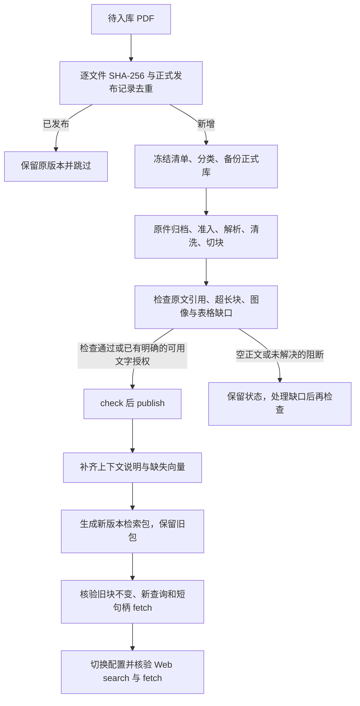

# 语料增量与维护操作说明

本文记录现有新链的实际入口和恢复边界，服务于 I5-2。命令只面向已明确的隔离目标或已获批准的维护窗口；不会自行选择生产库。

## 日常增量

> 2026-11-17 修复：批量/重试参数已接线，新增受累计次数限制的恢复、抽取式说明兜底、
> 完整备份与部分建包。实际命令见下节。**新链已禁止退回旧表 CSV 备份。**
> [固定命令发布流程设计](plan/corpus-release-command-workflow.md) 中的统一 `release`
> 命令仍未实现；本次修复不代表已经自动完成目录扫描、入库和 Web 激活。

### 已实现的故障恢复命令（2026-11-17）

以下在 WSL Ubuntu、仓库根目录运行。`BATCH`、`SCOPE`、`BASE` 和 `OUT` 使用本批已核对的
批次目录、来源范围、运行中旧包 manifest 和新的输出目录；不要复制历史批次目录冒充本批。
恢复失败记录无需改 SQL，也无需临时编写 Python。

1. **先做完整恢复前快照。** 本机没有 pg_dump 二进制，可使用已运行的 `pg` 容器中的客户端。
   数据库连接沿用当前配置；导出的快照必须来自同一实例，连错实例会失败。命令备份所有
   用户表（包括 `corpus.*`、`corpus_retrieval.*`）和归档文件，校验表覆盖、文件哈希并写清单。
   原始归档默认 `data/corpus-archive`，如本批采用其他归档根目录，必须传实际根目录。

   ```bash
   uv run --no-sync --env-file .env python -m plugins.corpus.service backup \
     --mode pg_dump --pg-container pg --archive-root data/corpus-archive \
     --out "$BATCH/recovery-backup"
   ```

   输出目录必须为空。备份清单标记 `restore_verified=false`，表示该份产物尚未逐份恢复演练；
   不能把归档目录校验冒称恢复演练。恢复命令仅允许新链备份写入**空数据库和新归档目录**：

   ```bash
   uv run --no-sync --env-file .env python -m plugins.corpus.service restore \
     --src "$BATCH/recovery-backup" --db "$RESTORE_DSN" \
     --pg-container pg --archive-out "$RESTORE_ARCHIVE"
   ```

2. **恢复说明。** 先对已拒绝说明做零模型请求的抽取式兜底；保留原文位置、文档哈希、
   独立策略版本和原拒绝原因。不会修改正文、chunk ID 或 fetch 句柄。

   ```bash
   uv run --no-sync --env-file .env python -m plugins.corpus.retrieval.cli context-generate \
     --deployment release --source-scope "$SCOPE" \
     --max-requests 0 --extractive-fallback
   ```

   有真正缺失的说明或需要重试的请求时执行：

   ```bash
   uv run --no-sync --env-file .env python -m plugins.corpus.retrieval.cli context-generate \
     --deployment release --source-scope "$SCOPE" --chunks-per-request 1 \
     --max-requests 40 --max-attempts 2 --retry-failed --retry-uncertain --extractive-fallback
   ```

   `--chunks-per-request` 现在真实覆盖环境配置；省略时沿用环境值。
   `--max-attempts 2` 指每个输入累计最多两次请求，跨命令重跑保持，不是每次可再发两次。
   未升级前已有失败记录按至少一次计算；过去已被覆盖的尝试历史无法恢复。
   `--retry-uncertain` 明确允许重发未知结果，可能产生重复费用；默认不重发。
   生成仍有缺项时退出码为 1；看 `missing` 和逐阶段状态，不可当作全部完成。
   `reported_tokens_this_run` 是本轮量；`recorded_attempt_tokens` 只累计升级后请求回执；
   `reported_total_tokens` 为旧兼容字段，表示最新说明行中的用量，不代表历史总费用。

3. **恢复向量并生成可发布包。**

   ```bash
   uv run --no-sync --env-file .env python -m plugins.corpus.retrieval.cli native-pack \
     --deployment release --source-scope "$SCOPE" --out "$OUT" \
     --max-requests 80 --max-attempts 2 --retry-failed --retry-uncertain \
     --partial-from "$BASE"
   ```

   已就绪向量直接复用。`--partial-from` 为可选：明确指定旧包后，缺说明/向量的新来源
   可整份隔离，其他来源继续建包；旧包的来源、发布版本、正文、句柄相关信息和向量不得
   被静默改变。旧来源有冲突仍阻断。省略该参数时保持原来的完整建包要求。
   包在临时目录验证后原子移入 `OUT`，校验失败不留下半成品。

   `partial=true` 时退出码为 1，但 `out` 指向经过验证的部分包；读取 `deferred_sources`
   保存待办后，可以进入下文 Web 激活流程。错误 JSON 只有 `error_code`、没有 `out` 时，
   不存在可发布包。不要用 `|| true` 无条件越过错误。

4. **仍须执行 Web 激活与认证 search/fetch 验收。** 建包结果明确返回
   `web_activated=false`。本轮没有新增自动激活命令，仍按下文现有切换、运行态检查、
   新来源覆盖和回滚规程完成交付；不得把部分包生成成功报告成 Web 已更新。

DOCX 读取器已升级为 `reader-docx-3`，空的 bookmarkStart/bookmarkEnd 不再成为正文缺口。
包含正文/图片的异常标记仍报缺口。只重建受影响的未发布 DOCX，历史活动资料不默认重建。

### 新增研报的固定命令流程（2026-11-17 修订，含 OCR 与 Web 验收）

本节是新批次的操作入口。下方 10 月 28 日的脚本仅是历史执行记录，不要重跑。
本流程仅构建新增清单中的文件，不重建历史研报。OCR 已接入原生读取器，详见
[生产 OCR 说明](guide/local-ocr-production.md)。目录不自动监听，放入 PDF 后仍需触发命令。

本节是当前操作规程；后面的日期章节都是历史记录。2026-11-17 执行偏差、核对证据与
本批续办顺序见 [流程复核与补救清单](corpus-ingestion-20261117-review.md)。
用户要求“入库并发布 Web”时，终点是运行中 Web 的认证检索和补读验收。
可继续处置的图片缺口、请求额度用完和构建完成都不是交付终点。

#### 0. 执行环境、证据与逐份状态

以下命令在 **WSL Ubuntu 的 Bash** 内执行。PowerShell 只用于进入 `wsl.exe -d Ubuntu`，
不要把带 `$build_id`、循环或多层引号的 Bash 命令再嵌进 PowerShell 字符串。
首次先执行一份、核对输出身份，再处理余下来源。未验证的循环不得直接跑整批。

执行前记录当前数据库目标、运行中 Web 的索引、配置中的索引和批次编号；配置与运行态
不同则先查清原因。DSN 和令牌只通过受控环境传入，不写入普通日志。
正式写入前保存备份完成证据及旧活动来源的 `source_id / active_build_id / generation`。
若本批已经写入，补做的是“恢复前快照”，不能冒称为“操作前备份”。

每份来源保留一行状态账，至少包含：文件路径与哈希、父/衍生哈希、已有活动 build、
Web 包成员关系、本次 build、最后成功阶段、下一步、失败原因、命令输出与退出码文件。
文件数、唯一哈希数、构建数、发布来源数、索引块数分开统计。每个文件有明确去向：

| 核对结果 | 下一步 |
|---|---|
| 同哈希或已核实衍生版已在 Web 生效 | 跳过重建与重复准入，保留现有版本 |
| 已发布、尚未进入当前允许的 Web 范围 | 核对本次授权范围后直接进入索引阶段 |
| 已构建未发布 | 查 `status`，从有效的 `check` 与缺口处置续办 |
| 真正新增且格式支持 | 准入、预检、构建、检查、发布 |
| 不支持格式、OCR 失败、不可接受的缺口 | 记录确切失败与恢复条件，继续其他独立来源 |

每次调用分别保存 stdout JSON、stderr 和**实际子进程退出码**。命令启动、进程退出、
输出文件存在或外层工具显示成功，都不能替代业务结果。长任务还在运行时记录进程与
最后完成来源；输出为空时不推进下一阶段。不要把缩进的多个 JSON 对象直接追加成
所谓 JSONL；每个来源、每次尝试各存一个 JSON，重试不覆盖失败证据。

成功需同时满足：退出码为 0、JSON 可解析且 `ok=true`、返回的来源/build 与输入一致。
`plan.ok=true` 仅表示计划完成，还要逐项查看 `entries[].precheck`；`status.ok=true`
仅表示状态可读取，发布状态须核对 `publication.active_build_id`。

| corpus CLI 退出码 | 执行动作 |
|---|---|
| 0 | 核对 JSON 和当前阶段所需字段后继续 |
| 2 | 输入/参数错误；修正清单或传参，不算来源质量失败 |
| 3 | 目标/守卫拒绝；停止共享该目标的写入并查明原因 |
| 4 | 门未通过；读取结构化缺口/阶段状态，对该来源分流 |
| 5 | 对象不存在/无可用版本；核对目标和句柄，禁止当成图片缺口 |
| 其他、异常栈、无有效 JSON | 执行异常；记录并定位，不能计为成功 |

不得用 `|| true` 吞掉退出码后统计“已检查/已发布”。来源独立失败只隔离该来源；
空 build 参数、目标不对等共同执行错误则先停止该阶段，修正后重新验证一份。

#### 1. 冻结新增清单与授权记录

先以 SHA-256 与活动发布记录去重；已发布 OCR 衍生版须同时核对父子来源关系，不能
把已处理的扫描原件误认为新文件。为本批单独建立目录，保留清单、授权、命令输出及备份。

去重依据是**全量活动发布记录 + 当前 Web 允许包 + 已验证的原件/衍生件关系**。
上一批 inventory 只是该批输入，不是历史全集；mtime 和文件名也不能替代哈希去重。
`source_reused=true` 只说明来源已登记，不能证明已发布；相反，一个新 build 也不代表
新研报。已有活动来源不得因本轮读取器或授权决定变化而默认换成刚生成的 build。

在任何准入、OCR 前先排除已覆盖来源，并检查扩展名与文件签名。当前原生读取器支持
PDF、DOCX、MD/Markdown，不支持直接输入 PNG。PNG 不混入可执行清单，也不能仅改扩展名。
每份待办来源准备单来源 manifest 与匹配的 authorization（沿用本批原始决定 ID、政策
与用户指令），避免一份格式/OCR 异常中断其他来源。批次总清单保留全部输入与去向。

`manifest.json` 示例（所有尖括号内容需替换；每份新增文件一项）：

```json
{
  "archive_root": "/home/administrator/FrontierAgent/data/corpus-archive",
  "sources": [{
    "path": "/home/administrator/FrontierAgent/data/corpus-incoming/<批次>/<文件>.pdf",
    "source_id": "<sha256sum 得到的完整64位小写哈希>",
    "original_name": "<文件>.pdf",
    "domain_hint": "company",
    "review_decision_ids": ["<本批唯一决定ID>"]
  }]
}
```

`authorization.json` 记录实际用户指令，不声明人工逐字校对。`operator` 是登记人，
`authorized_by` 是授权人，两者分开；时间带时区；引用可用本批保存的用户指令文件路径。

```json
{
  "operator": "<登记人>",
  "authorized_by": "<授权人>",
  "authorized_at": "<实际授权时间，如2026-10-31T12:00:00+08:00>",
  "authorization_ref": "<用户入库指令的可追溯引用>",
  "sources": [{
    "source_id": "<同一文件哈希>",
    "decision_id": "<与清单相同的决定ID>",
    "material_type": "research_report",
    "research_domain": "company"
  }]
}
```

领域为 `company`、`industry` 或 `macro`。材料类型必须如实填写；外部订阅/复盘使用
`personal_or_external_subscription`，不能为了通过准入而写成分析师研报。
标准 `v1-20260915` 政策只允许 `research_report`。若本批包含已获授权的订阅材料，
按已有 `v3-dev-20261021` 流程另存本批 `policy.json`，显式列出本批哈希：

```json
{
  "policy_rev": "v3-dev-20261021",
  "frozen": true,
  "scope": "dev",
  "auto_decision": {"enabled": false},
  "allowed_materials": ["research_report", "personal_or_external_subscription"],
  "dev_lane": {
    "lane_id": "<本批ID>",
    "sources": [{"source_id": "<本批来源哈希>"}]
  }
}
```

为这类清单添加 `"policy": "<本批policy.json绝对路径>"`，并显式设置
`CORPUS_DEV_LANE=1`。只对清单来源生效，不放宽其他历史来源。`admit` 登记授权，
实际是否准入仍由 `build` 的既有政策判定。

#### 2. 目标、备份、准入与构建

在仓库根目录执行。`CORPUS_TARGET_DB` 与 `CORPUS_I2_DSN` 必须指向已确认的语料库，
当前正式目标是 `postgres`，不能使用业务库 `apodex`。可通过受控环境或 `.env` 配置；
下列命令会加载 `.env`，无需将密钥复制进清单或命令日志。正式写入前按下方备份规程
备份指定语料库。`BATCH` 指向已创建的本批操作目录。

```bash
cd /home/administrator/FrontierAgent
BATCH=.scratch/corpus-incoming-<批次>
# 先设置为本批已核对的一份来源；每份/每次尝试使用独立输出目录。
SOURCE_MANIFEST="$BATCH/sources/<source_id>/manifest.json"
SOURCE_AUTH="$BATCH/sources/<source_id>/authorization.json"
ATTEMPT="$BATCH/sources/<source_id>/attempt-001"
mkdir -p "$(dirname "$ATTEMPT")"
mkdir "$ATTEMPT"  # 已存在则换新尝试编号，不能覆盖旧输出。

uv run --no-sync --env-file .env python -m plugins.corpus.cli admit \
  --manifest "$SOURCE_MANIFEST" --record "$SOURCE_AUTH" \
  > "$ATTEMPT/admit.json" 2> "$ATTEMPT/admit.stderr"
# 检查本条退出码、JSON、授权身份后再执行下一条；不是无条件连跑脚本。
uv run --no-sync --env-file .env python -m plugins.corpus.cli plan \
  --manifest "$SOURCE_MANIFEST" \
  > "$ATTEMPT/plan.json" 2> "$ATTEMPT/plan.stderr"
uv run --no-sync --env-file .env python -m plugins.corpus.cli build \
  --manifest "$SOURCE_MANIFEST" \
  > "$ATTEMPT/build.json" 2> "$ATTEMPT/build.stderr"
```

逐条检查退出码后再执行下一条。相同授权记录可原样重跑；哈希、决定 ID、授权人等
冲突不会覆盖原记录。清单中的 `source_id` 在 plan/build 时重新核对，改过的文件必须
重新登记。未获准入的 build 返回非零，不能只看到命令执行结束就认定构建成功。

加载 OCR 配置后，plan/build 会调用本地 OCR 服务，服务可能写识别结果缓存；plan
不写语料数据库。原生文字保留，OCR 文字另带坐标、版本与 `ocr_unverified` 标记。
图表语义缺口不自动清除；服务失败、方向未知等状态不能伪装成识别完成。

优先使用 CLI 的 `plan`，不要再另写读取器预检程序。当前 `plan` 可能因 OCR 的
`RuntimeError` 直接退出，不能假定总会返回逐项失败 JSON；因此按来源调用并保存 stderr。
成功 OCR 页可按服务版本、文件哈希、页码复用，`build` 按既有检查点规则恢复。
失败先查看 artifact 的 response/worker 日志，区分像素预算、超时、服务故障等；
未核实原因前不批量重试、不关 OCR 绕过、不清空成功缓存。OCR artifact 数量不是
已完成研报数。已有有效构建直接续办，不重新跑全目录的 OCR。

#### 3. 检查、登记可用文字发布、正式发布

从成功构建结果的 `outcomes[]` 取与当前来源对应的非空 `build_id`。先用
`status --build <build_id>` 核对该来源的活动版本；若已有版本，按去重结果处理，
不能把“最新构建”自动当成“待发布的新来源”。逐份检查示例（在 Bash 内）：

```bash
build_id='<从当前来源成功构建结果复制的64位小写哈希>'
[[ "$build_id" =~ ^[0-9a-f]{64}$ ]] || exit 2
if uv run --no-sync --env-file .env python -m plugins.corpus.cli check \
  --build "$build_id" > "$ATTEMPT/check.json" 2> "$ATTEMPT/check.stderr"; then
  check_rc=0
else
  check_rc=$?
fi
printf '%s\n' "$check_rc" > "$ATTEMPT/check.exit-code"
# 打开 check.json，核对 build_id/source_id、ok、publishable 及 gaps；按下表续办。
```

上面的退出码捕获方式也适用于 admit/plan/build/text-publication/publish/status；必须
紧接被记录的命令捕获，不能记录后续显示命令的退出码。若 shell 开启 `set -e`，
仍用 `if ...; then ...; else ...; fi` 捕获预期的门拒绝。

| 有效检查结果 | 后续动作 |
|---|---|
| `ok=true` 且 `publishable=true` | 正式 publish，再 status 确认活动 build |
| 有保留正文，阻断仅为下述允许的 PDF 图片/表格缺口，且已有可用文字授权 | 导出、填写、登记 text-publication，再 check → publish → status |
| OCR 构建失败、无保留正文、未知/未定位缺口、准入或阶段失败 | 保留阻断，按 recovery 处理，继续其他来源 |
| 参数为空、build 不存在、输出身份不匹配 | 修正执行错误，不登记 text-publication |

当前 `text-publication` 仅接受有合法页码的 `image_only_page`、
`image_region_unreadable`、`table_extraction_failed`、`table_lines_without_extraction`，
并要求该 build 存在保留正文且凭证覆盖全部阻断缺口。DOCX 图片/未知元素、
`local_ocr_unresolved` 等不能套用此凭证。最终是否通过仍以工具校验为准。

无阻断缺口则直接进入 publish。对于用户已接受“仅发布可用文字”的图片/表格缺口：

```bash
uv run --no-sync --env-file .env python -m plugins.corpus.cli text-publication \
  --build <build_id> --out "$BATCH/<build_id>-text-publication.json"
```

模板只填写 `operator`、`authorized_at`、`authorization_ref` 三项，填入实际授权信息。
不要修改 source/build 指纹或缺口列表；不需要也不能冒签 `gap-review` 的人工完整性审核。
`--out` 不覆盖已有文件；重试时使用原凭证。然后执行：

```bash
uv run --no-sync --env-file .env python -m plugins.corpus.cli text-publication \
  --build <build_id> --record "$BATCH/<build_id>-text-publication.json"
uv run --no-sync --env-file .env python -m plugins.corpus.cli check --build <build_id>
uv run --no-sync --env-file .env python -m plugins.corpus.cli publish \
  --build <build_id> --operator <登记人>
```

凭证须覆盖该构建的完整阻断缺口清单。原始缺口、页码和原文保持不变，放行状态标记
为已接受且覆盖不完整；空正文、未知缺口、无效引用等仍拒绝。登记成功不代表已经发布。
若中断，用 `status --build <build_id>` 查实际状态，再继续对应步骤。

用户已授权按“可用文字不完整”发布时，保留授权引用直接续办这一分支，不再次询问同一
授权，也不把原有 `image_only_page` 标记独自作为停止整个批次的理由。
OCR 成功与图片/图表覆盖完整是两件事，原缺口仍可保留。发布后需确认
`publish.active_build_id` 与 `status.publication.active_build_id` 均等于所选 build。
只有这类来源（及已发布待纳入 Web 的来源）才能进入 `published-manifest.json`；
被阻断、仅构建成功、误重建的旧来源不能混入。部分失败不阻止已通过来源继续发布 Web。

#### 4. 限定增量检索范围，补说明、向量并生成索引包

`CURRENT_INDEX` 必须填当前正式配置的 manifest 绝对路径；不是旧批次的固定路径。
`published-manifest.json` 沿用已核对的来源字段和文件哈希，必须依据实际活动发布状态
生成，不能直接复制原始输入清单。清单为空时不生成空包，报告实际阻断/已覆盖情况。

```bash
CURRENT_INDEX=<当前CORPUS_NATIVE_INDEX的绝对路径>
uv run --no-sync --env-file .env python -m plugins.corpus.retrieval.cli scope \
  --native-index "$CURRENT_INDEX" --manifest "$BATCH/published-manifest.json" \
  --out "$BATCH/scope.json"
uv run --no-sync --env-file .env python -m plugins.corpus.retrieval.cli context-plan \
  --deployment release --source-scope "$BATCH/scope.json"
uv run --no-sync --env-file .env python -m plugins.corpus.retrieval.cli context-generate \
  --deployment release --source-scope "$BATCH/scope.json" --max-requests <本次请求上限>
uv run --no-sync --env-file .env python -m plugins.corpus.retrieval.cli context-status \
  --deployment release --source-scope "$BATCH/scope.json"
uv run --no-sync --env-file .env python -m plugins.corpus.retrieval.cli native-pack \
  --deployment release --source-scope "$BATCH/scope.json" \
  --max-requests <本次向量请求上限> --release-id <新发布ID> \
  --out data/corpus-native-context/<新批次>
```

`scope` 验证旧包和新增文件哈希，输出两者来源并集；不会自动纳入其他活动来源，也不
覆盖已有范围文件。正式部署的四个 context/pack 命令现在必须带 `--source-scope`。
范围中任一来源尚未发布或已撤回时明确失败，不静默丢掉它或扩大范围。只生成缺失说明、
复用已就绪向量；失败/结果不确定时先检查状态与日志，不盲目重发。说明或向量未齐全
不会生成可用新包。旧包仍保留，生成包不等于 Web 已切换。

达到 `max-requests` 只表示本轮额度用完：查明 pending/rejected/uncertain 后按确切范围
续办。不要删除失败记录后盲目重跑，不把额度耗尽当作发布完成。保存新包 manifest、
scope、说明状态、向量就绪情况及旧块/旧向量对比结果。

**上下文向量的 uncertain 处理（当前实现限制）。** `native-pack` 对已有
`provider_transport_uncertain` 向量不会自动重试，并会以
`contextual_pack_vectors_pending` 拒绝生成包。当前 CLI 只为常规索引提供
`build --retry-uncertain`；它不能用于 `contextual-note-v1`。因此不得手改
`corpus_retrieval.embeddings` 状态或删除记录来绕过门禁。保存受影响的
`source_id/build_id/chunk_id/error_code`，保留旧 Web 包；待提供上下文向量的显式重试
命令后，从这些确切输入恢复，再重新执行 `native-pack` 和 Web 验收。

#### 5. 验收与 Web 激活

用新 manifest 路径执行 `native-query --deployment release --native-index <新manifest>
--query '<新资料问题>'`，检查命中来源、正文和 OCR 标记。再用应用实际 `corpus_search`
返回的 `ref` 调用 `corpus_fetch` 核验原文；同时抽查旧句柄。确认旧来源活动 build 和
generation 未变、新范围符合 scope.json 后，再将 `CORPUS_NATIVE_INDEX` 指向新包。
无 queued/running 任务时按现有 Web 部署方式重启/激活，检查 healthz、readyz 和认证后的
search/fetch。这里不涉及业务数据库迁移，也不重建历史研报。

验收逐层保存证据：

1. 每个拟新增来源的活动 build 与新包实际成员一致，检索范围等于核准来源并集；
   所有旧来源活动 build/generation、旧块和旧向量与操作前快照一致。
2. 用新资料的问题查询并核对目标来源，使用实际返回的 ref 补读并比对正文；
   短引用按实际会话/请求范围使用，不凭空构造或假定跨会话可复用。抽查历史稳定句柄。
3. 保存旧配置和运行方式；确认无 queued/running/waiting_approval 等活动任务后激活。
   有活动任务就等待维护窗口，不强杀任务，也不把“等待激活”写成“已发布 Web”。
4. 重启后核对运行态加载的包、认证 search/fetch 和新来源覆盖，并检查 healthz/readyz。
   仅健康接口 200 或 `.env` 改好不足以验收。运行态 index_id 如采用 live 合成规则，
   与磁盘包 ID 分开记录，结合来源/build/向量就绪状态验证，不强求不同算法的 ID 相等。
5. 任一 Web 验收失败，按保存的部署方式恢复旧索引配置并验证旧检索；保留新资料和
   待办记录，不用数据库全量恢复来代替索引回退。记录回退后状态和失败原因。

最终报告同时给出：已在 Web 的旧来源/衍生版数、本次正式库新增发布数、本次 Web
生效数、阻断数及原因、当前包路径、验收证据。各输入文件能与状态账对齐；不能以
构建数替代新增发布数。只有所有请求材料均有明确结果、可发布材料已完成 Web 验收，
才可说本轮执行结束；有阻断项时必须说明“可发布部分完成，仍有 N 份未完成”。

### 正式库入库流程（2026-10-28）

把 PDF 放进 `data/corpus-incoming/<批次>/` 只是待入库，**文件出现不等于已发布，
数据库发布也不等于 Web 已切换新索引**。本项目现行流程如下：



1. **清点与去重**：读取所有文件的哈希、页数和文字量，与正式库活动来源比对。
   文件名相同不能证明内容相同；重复文件不重新发布，也不重算说明和向量。
2. **冻结与备份**：记录输入清单、用户指令、材料类型、研究领域及现有发布指针，
   对明确目标 `postgres` 做备份。检索范围仅为旧允许清单与本批新来源的并集。
3. **构建正文**：使用 `plan_builds → execute_builds`，原字节按 SHA-256 存入
   `data/corpus-archive/<前两位>/<完整哈希>.pdf`，保留单元、页码、原文哈希及引用。
4. **处理覆盖缺口**：文字 PDF 中的行情截图不自动变成可搜索正文。按已授权的可用
   文字模式登记确切 build 的 `TextPublication` 后，仍走正常检查；不隐藏缺口。
   扫描件如使用 OCR，应另存衍生文件，名称注明 OCR，保存原件与衍生件的哈希关系，
   不将识别文字描述成人工校对原文。
5. **正式发布**：执行 `check_build_publishable → publish_build`。旧来源的活动版本
   和 generation 应逐条不变；待处理和失败构建不冒充已发布。
6. **更新检索包**：沿用当前上下文说明版本与 embedding profile，仅补齐缺失项。
   说明用于索引，返回证据仍来自正文；原 native 投影继续排除表格块。请求失败时
   先查看确切状态，不能清空失败记录后无条件重跑全部请求。
   本批有说明经受控重试后仍未通过数字／归属校验，随后逐段核对原文，只保留章节
   与讨论对象描述。这样的 Codex 校订须单独标记 `agent_source_review` 并保留原拒绝
   记录，仍通过同一校验器；不能冒充原供应商生成结果，也不能改正文来迁就说明。
7. **验收与切换**：比较旧块与旧向量；针对新资料执行查询，使用每段实际返回的
   `ref` 做 fetch 并逐字比对。验证成功后更新 `CORPUS_NATIVE_INDEX`。运行中的
   Web 应在没有 queued/running 任务时切换，并检查 `healthz`、`readyz` 和认证接口。
   业务数据库迁移属于独立事项。

本批可审计脚本位于 `.scratch/corpus-incoming-20261028/`。它是**绑定确切输入清单、
备份和范围的执行记录**，不是自动扫描所有目录的通用发布器；下一批应先重新清点和
冻结清单，不能直接替换文件后重跑旧 `prepare`。

```bash
cd /home/administrator/FrontierAgent
# 以下为本批实际阶段；按先后检查结果，不是无条件一键串行发布。
uv run --no-sync python .scratch/corpus-incoming-20261028/run.py prepare
uv run --no-sync python .scratch/corpus-incoming-20261028/run.py build
uv run --no-sync python .scratch/corpus-incoming-20261028/archive_ocr.py
# 检查 build-results.json，保留 OCR 父子溯源及图表缺口后：
uv run --no-sync python .scratch/corpus-incoming-20261028/run.py publish
uv run --no-sync python .scratch/corpus-incoming-20261028/run.py index
uv run --no-sync python .scratch/corpus-incoming-20261028/verify.py
# 验收通过，并确认现有 API 就绪且没有活动任务后切换：
uv run --no-sync python .scratch/corpus-incoming-20261028/activate.py
```

本批供应商传输结果不确定后的续跑记录在 `context-resume-before/after.json`，
第二次异常及未完成项保存在 `context-final-pending-before.json`、`pending-source-review.json`。
校订依据和结果在 `rejected-source-review.json`、`note-review-before.json` 与
`note-review-applied.json`。对应的 `resume_notes.py`、`apply_reviewed_notes.py` 和
`pack.py` 是绑定本批失败项的恢复步骤，不能当作任意新批次的自动重试入口。

本批逐份结果与 Web 验收见 [正式发布记录](corpus-native-release.md)。

### 2026-10-21 隔离试验记录

2026-10-21 新增 7 份资料的实际操作与逐份结果见
[本批执行说明](../.scratch/corpus-new7-20261021/report.md)。目标为
`vector_pilot_clean7_20261021`，其中 5 份按原生文字发布，2 份扫描件发布为标明来源的本地 OCR 衍生版。
活动范围为 25 份、1,076 块；OCR 文字未经人工逐字校验，原件及父子 SHA-256 关系保留。
这次资料发布没有切换生产库或日常检索默认配置。

本批新增了显式的可用文字发布记录 `TextPublication`：用户接受覆盖不完整时，通过
`Store.put_text_publication` 为确切 build 登记完整图像/表格缺口清单及授权依据，随后仍
执行正常 `check → publish`。记录不可覆盖；原文、默认缺口分级和缺口台账保留。
这不是 `human_gap_review`，不证明图中内容已识别或全文完整。未知缺口、空正文、
未完成阶段、无效引用及超长块继续拒绝。普通 `plan` 不读取 build 绑定的接受记录，
因此仍可能报告缺口；实际放行及依据以登记后的 `check/status` 为准。

本批订阅材料使用显式来源清单 `v3-dev-20261021`，保留真实材料类型；并未自动把所有
历史订阅文件改成已准入。英文长段落切分已升级为 `chunk-6`，跳过小数和常见缩写，
沿句界切分并保留原文引用，原有活动 build 不会因代码版本更新自动改变。

清单是显式 JSON，至少包含 `sources`，每项给出 `path`；可在清单中给出 `archive_root` 和 `policy`。先计划和预检，再构建、检查、发布：

```bash
uv run python -m plugins.corpus.cli plan --manifest <manifest.json> --dsn "$CORPUS_I2_DSN"
uv run python -m plugins.corpus.cli build --manifest <manifest.json> --archive-root <archive-root> --dsn "$CORPUS_I2_DSN"
uv run python -m plugins.corpus.cli check --build <build_id> --dsn "$CORPUS_I2_DSN"
uv run python -m plugins.corpus.cli publish --build <build_id> --operator <operator> --dsn "$CORPUS_I2_DSN"
uv run python -m plugins.corpus.cli status --build <build_id> --dsn "$CORPUS_I2_DSN"
```

`plan` 只做预检；`build` 不发布；只有 `check` 通过后才能 `publish`。CLI 不会隐式连接数据库：应显式提供 `--dsn` 或受控的 `CORPUS_I2_DSN`，并由目标守卫拒绝不在批准范围内的目标。命令没有 `--force` 旁路。

同一来源、相同内容和规则可重跑。解析检查点的读取器版本包含运行时依赖版本，因此旧的裸版本检查点会被安全地失效并重建一次；随后重跑复用检查点，保持相同 `parse_rev` 和 `build_id`。源内容、规则或索引版本改变时，预期会生成新的版本，不能把旧活动版本当作已更新。

## 失败恢复与交接

先查询失败版本，再由恢复计划定位阶段，而不是重新扫描或直接发布：

```bash
uv run python -m plugins.corpus.cli status --build <build_id> --dsn "$CORPUS_I2_DSN"
uv run python -m plugins.corpus.cli rebuild-plan --build <build_id> --dsn "$CORPUS_I2_DSN"
```

交接记录须附上 build ID、source ID、当前 generation、`status` 输出的 `gaps`/`gap_summary`/`recovery`、执行命令和退出码、清单及策略哈希、归档路径、操作者和活动版本。存在 blocking gap、目标守卫拒绝、来源或规则漂移时，停止在该状态；不要用旧表、旧句柄或默认检索绕过。

## 备份与恢复演练

以下是现有 `plugins.corpus.service` CLI 的真实命令。恢复会写入其 `--db` 目标；只能用于已经核验的隔离恢复库，不能把本文当作生产恢复授权。

```bash
uv run python -m plugins.corpus.service backup --out <backup-dir> --mode pg_dump --db "$CORPUS_I2_DSN"
uv run python -m plugins.corpus.service restore --src <backup-dir> --db "$ISOLATED_RESTORE_DSN"
```

`pg_dump` 模式没有客户端工具时会明确失败；`auto` 才允许 CSV 回退。恢复后比较备份 `manifest.json` 中的行数和列清单，并运行新链 `status`、`search`/`fetch` 的隔离验证。备份目录、恢复日志和核验结果应一并交接。

## 保留与 GC

当前没有语料 GC 命令。不得编造或执行“清理旧版本”的自动命令。原始归档、已发布或活动 build、准入/审核决定、检查点、备份和评测工件均是保留对象，不能由本说明删除。

若容量需要处理，只能由维护负责人提出精确对象清单、保留依据、恢复点和批准记录；先在隔离目标演练并留存结果。`_staging` 等执行暂存物也必须先确认未被任何未决 job、恢复计划或审计工件引用。没有这份清单和批准，GC 状态为不执行。

## 旧入口边界

正常写入入口是 preparation CLI 的 `plan`/`build`/`check`/`publish`。旧 `run_ingest` 和旧 evidence 写入已 fail-closed 退休。公开 `search`、`fetch`、`stats` 与文档列表使用活动的新链版本；未知或旧句柄不会回退到旧正文。

历史 claims/财务验证和 R2 仍有显式兼容读取能力，详见[退休矩阵](corpus-ingestion-retirement-matrix.md)。这不是公开读侧的 fallback，也不是运行常规增量的入口。
