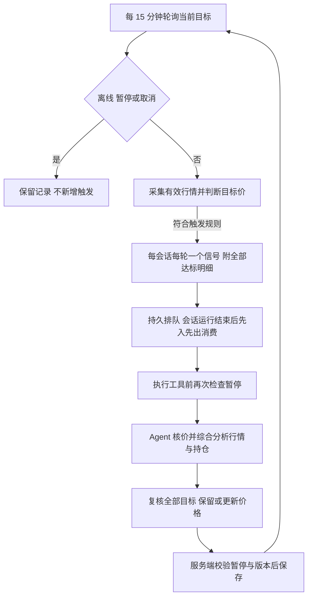

# Agent 驱动价格监控设计

| 项目 | 内容 |
|---|---|
| 日期 | 2026-10-30 |
| 版本与状态 | v0.5，增加采样穿越模式、报告路径修复、历史任务归档与原文复用；部署与验收记录见第 12 节 |
| 已确认需求 | 每会话最多 3 个目标；每 15 分钟轮询；默认每轮达标触发，可明确选择穿越触发；同会话同轮只发一个信号；运行结束后排队消费；关闭浏览器停止监控；Agent 核价、更新目标并综合持仓分析；工具前核验暂停；多次触发提醒 Agent |
| 适用范围 | Web 研究会话、价格监控、触发后的自动分析 |
| 关联设计 | [价格监控技术方案](monitoring-technical-plan.md)、[Web 业务资料 PRD](web-business-data-prd.md)、[业务数据契约](web-business-data-contract.md) |

Agent 根据行情和个股分析设定目标价格，程序在工作台在线时按 15 分钟轮询检查条件，同会话同轮达标后只提交一个分析信号。会话空闲时执行，运行中则持久排队，当前运行结束后依次消费。Agent 核验最新价格、审视全部目标、结合可用持仓分析，并通过工具回填目标价格。规则长期保留，一次触发或分析完成都不是结束信号；关闭浏览器后停止监控。

本次实现替代新规则的单次资格模型、分析前再次确认价格仍达标、三次分析后停止，以及按有无持仓拆成两类分析任务的行为。历史单次规则保留原语义，部署与使用方式见第 10 节。

## 1 已确认业务规则

| 事项 | 规则 |
|---|---|
| 目标数量 | 每会话最多三个当前监控目标，不要求凑满；人工与 Agent 共用名额 |
| 行情检查 | 每 15 分钟轮询；程序只按已保存目标价格及条件判断是否达标 |
| 首次采样 | 首个有效采样满足条件即触发，不要求先离开条件再穿越 |
| 后续采样 | 每轮 15 分钟检查只要满足条件即可再次触发，不要求价格离开后再次达到；已有分析按会话串行处理 |
| 触发后的价格变化 | 已触发就提交分析，最新价格核实由 Agent 完成；程序不能因为价格回去而取消分析 |
| 多目标处理 | 同会话同一轮询轮次最多一个信号；以达标目标中最早创建者为主目标，信号附带全部达标目标，Agent 复核全部目标 |
| 积压处理 | 当前会话运行期间信号持久排队；运行结束后按入队先后串行消费，不跨轮合并或因等待时间自动丢弃 |
| 浏览器关闭 | 所有工作台页面关闭、在线租约失效后停止监控；规则与记录保留 |
| 生命周期 | 长期运行，触发和分析完成均不自动结束目标，也不消耗永久性的单次触发资格 |
| 暂停 | 执行工具前核验暂停状态；已暂停则不执行该目标的监控动作，也不再触发 |
| Agent 设价 | 合法且获授权的目标价格应执行，不因程序认为重复触发或不值得监控而自行否决 |
| 多次触发 | 向 Agent 提供触发记录，提醒其评估该价格是否值得长期监控；不据此自动停用 |
| 分析内容 | Agent 根据目标、行情和可用持仓自行判断分析重点；有持仓时结合持仓分析，不拆成两个固定任务 |

“三个”只限制当前目标数量，不是分析次数上限。系统仍校验归属、权限、报价有效性、参数和服务健康，这些校验不替代 Agent 的研究判断。

## 2 目标与生命周期

### 2.1 数量与计数

一个目标采用现有独立规则模型，至少包含标的、报价口径、方向和阈值。三个目标可以属于同一股票，也可以属于不同股票，总数按会话计算。

| 情况 | 处理 |
|---|---|
| 运行中、已触发、分析中、分析完成 | 目标仍存在，占一个名额 |
| 人工暂停或运行环境暂不可用 | 目标保留，占一个名额，不自动释放 |
| 修改目标价格 | 更新原目标，保留历史，不增加名额 |
| 显式取消目标 | 释放名额，保留历史规则、事件和分析 |
| 已有三个时新增第四个 | 服务端明确拒绝，可读取现有目标，不静默覆盖 |
| 相同目标重复提交 | 相同请求返回已有结果；改名提交相同可执行条件会被拒绝，不重复占名额，不重置轮询进度 |

延续上一版的计数约定：一个区间条件占一个目标；两个独立端点条件占两个。若产品改为限制三个数值价位而非三个条件，需要另行调整此约定。

数量检查由所有写入口共用，在会话锁保护的事务内按最终目标集合执行。批量替换可以取消旧目标并新增目标，但最终数量不能超过三个；并发工具调用和人工操作也不能绕过上限。

### 2.2 长期运行与人工控制

目标的主要生命周期为运行、暂停、取消。触发、排队、分析成功或失败属于事件和执行记录，不作为目标的终态。Agent 明确保留某个价格时，该目标继续接受后续轮询，不需要为了恢复资格而修改价格或重建规则。

长期监控不强制设置失效日期；用户明确要求期限时才保存并执行，到期状态独立展示，历史保留。研究删除、归档等继续遵守现有生命周期联动。

人工暂停不得被 Agent 的更新隐式恢复。更新事务在目标行锁内重新检查暂停状态和版本，避免读取时未暂停、写入时已暂停的竞争。相同意图标识在取消后不能自动重建。工具提示禁止更换标识绕过人工决定；当前硬校验覆盖目标身份、意图标识与现有相同条件，不宣称可以识别任意改写后的研究语义。

暂停不撤回已经完成的工具结果或历史事件。尚未执行的监控工作停止；正在进行的工具调用无法假定可以即时撤销，下一工具边界必须阻止继续执行。暂停状态必须由受信执行模块检查，不能只要求模型自行读取一次。

## 3 价格触发与轮询

### 3.1 达标即提交分析

| 条件 | 有效采样 | 处理 |
|---|---|---|
| 向上达到 20.00 | 最新价大于或等于 20.00 | 符合价格条件 |
| 向下达到 18.50 | 最新价小于或等于 18.50 | 符合价格条件 |
| 位于 18.00 至 18.50 区间 | 最新价位于区间内，含端点 | 符合价格条件 |
| 任意条件 | 数据过期、来源时点不可靠或口径不匹配 | 等待有效报价，显示原因 |

以上价格仅说明规则结构。首次有效采样符合条件就保存目标的达标事实，在本轮会话判定完成后立即提交唯一信号，不把研究报告中的旧价格当成本轮采样。程序保留供应商观测时间、本地接收时间、轮询轮次、条件版本及触发价。

“立即”表示检测到条件成立即提交执行请求；同会话正在运行或执行资源占用时仍需串行排队。不能等下一个 15 分钟周期才提交已经发现的触发。创建和价格更新后的首次采样应有明确调度时间，不能只保存而未进入采集计划。

调度前检查在线状态、暂停、取消、归属和执行资源，但不再以“当前价格仍满足”为启动条件，也不以存在账户或成交记录作为统一前置条件。Agent 在运行中获取最新行情，解释触发价与分析时点价格的差异。

### 3.2 同轮只发送一个信号

合并范围为“会话 ID + 轮询轮次”，不按标的分别发信号。即使同轮三个不同股票的目标均达标，也只向该会话发送一个分析信号。各目标达标事实独立保留，作为信号的明细，不再各自创建一个待执行分析。

主触发目标选择规则：在本轮有效且达标的目标中，按目标创建时间升序选择；创建时间相同时按稳定的目标 ID 排序。修改目标价格不改变创建顺序，取消后新建则使用新目标的创建时间。主目标仅用于信号标题和定位，不赋予它排他的分析优先级。

15 分钟快照不能还原轮询间隙的真实触价先后，界面不能把主目标标为“盘中最先达到”。信号携带主目标、全部达标目标的价格与条件快照、观测时间、轮次和入队序号；Agent 还要读取全部当前目标及最新行情。如果三个目标都达标，应在同一次分析中审视三个目标并更新后续价格，不额外发送第二、第三个同轮信号。

工程上为会话轮次记录待判定目标集合，在各目标完成判定或明确记录取数失败后原子生成信号；上游取数超时必须有界，异常目标不能无限阻塞其他有效目标。通过会话轮次唯一约束及幂等派发保证只创建一个信号。晚到、重放或重复判定不追加第二个同轮信号，也不能靠生成新轮次绕过约束。

### 3.3 当前运行结束后排队消费

信号入队后分配服务端会话内递增序号。当前会话有手动或自动 Run 正在执行时，新信号只进入持久队列；当前 Run 终结后，按入队序号从早到晚领取下一个可执行信号。等待用户输入或审批且尚未终结的 Run 仍视为占用会话。所有启动入口共用会话串行约束，不以页面状态作为空闲依据。

不同轮次的信号不相互合并、覆盖或自动视为已经分析。队列中的信号不因当前价格回去、目标改价或等待超过 15 分钟而自动过期；Agent 执行时同时看到原始快照、入队等待时间及当前目标，负责判断信息变化。取消、删除等明确控制操作仍可使对应待办不再执行，并保留处置原因。

例如，10:00 开始分析；10:15 和 10:30 均达标，各产生一个信号。10:35 当前分析结束，先消费 10:15 的信号，该分析结束后再消费 10:30 的信号。即使第一轮分析已经更新目标价格，10:30 的既有信号仍保留并按顺序处理。

队列消费使用持久领取和幂等 Run 创建；重启或重复唤醒不能为同一信号启动两次业务分析。运行失败进入终态后可继续消费下一条；同信号的故障重试必须记录为重试，不伪装成新业务信号。容量异常须显示积压及故障原因，不能静默清队列、跨轮合并或套用旧事件时限丢弃已接收信号。

### 3.4 长期重复触发与技术去重

同一份行情的重复投递、服务重试或相同工具请求不能制造多个执行；后续新一轮有效采样的再次达标则是新的业务事实。新轮次必须对应实际采样，旧行情重放不能冒充新一轮观测。技术幂等和长期重复触发必须分开。

用户已明确：每轮满足即可再次触发。同一价格连续多轮达标时，每个新的 15 分钟轮次均可生成触发事件，不要求价格先离开条件再回来；已有分析按会话串行处理。首次已满足立即触发与长期后续触发采用同一价格条件。

工程上记录稳定目标身份、条件版本、轮次和观测标识。同轮重复处理只返回原事件；Agent 改写说明、重复提交或服务重启不能伪造新轮次。价格更新应持久登记下一次检查，工具调用本身不递归调用分析；新轮次实际达标时，Agent 设定的价格照常执行。

恢复在线或人工恢复后使用新的有效报价，不补造离线期间触价事实；恢复后的有效检查达标即可触发，不沿用旧版要求离开条件后再次达到的 `wait_requalify`。已有排队信号与恢复后的新信号按持久入队序号处理，不能让新采样跳过既有积压。

## 4 Agent 的分析与价格更新

每次监控分析的默认输入包含本轮达标目标、冻结价格条件、触发价与时点、等待时长、监控任务和设价依据，以及本轮最新持仓和业务快照。全部当前目标、版本及暂停状态通过 `get_watch_targets` 获取；最近人工研究上下文按需经 `research_history` 查询。默认输入不再附带三次历史复核全文或回放旧研究执行轨迹。

Agent 执行以下工作：

1. 执行工具前经过服务端暂停检查；已暂停的目标不继续执行监控动作。
2. 核验最新行情，比较触发时与当前的价格，重新审视全部目标。
3. 有持仓信息时结合实际持仓、成本和行情综合分析；无持仓时按现有研究信息分析，不强行索取并不存在的成交记录。
4. 仅当拟给出的结论依赖缺失的个人资料时请求补数；缺资料不阻止其他有依据的分析，也不能虚构持仓或资金。
5. 明确给出每个已审视目标的处理：保留原价、调整目标价，或在授权范围内取消。保留原价也是有效决定。
6. 调用工具更新监控模块，返回实际保存状态；分析正文不得替代规则落库。

复核结论单独保存并关联事件与规则。下一次分析按需读取这些结果，同时保持现有会话连续性约束：监控 Run 不覆盖人工回合的连续性载体。

### 4.1 多次触发时提醒 Agent

系统持久保留目标身份、各轮触发、价格变化、分析结论及价格调整记录。提醒按会话累计监控分析次数触发，第三次及以后提供次数与长期价值复核提醒，不再重复拼接最近三次报告；不是按单个价格设置次数预算。

达到提醒条件时，在分析上下文加入：

> 该监控目标已多次触发。请结合近期价格与已有分析，评估这个价格是否仍值得长期监控。可以保留，也可以调整目标；请说明理由。

提醒不自动暂停、取消或拒绝 Agent 的价格，不要求为了减少次数而修改条件。不存在“最多三次分析后停止”或必须人工重启周期的限制。

## 5 Agent 工具与服务端写入

研究会话设置是否允许 Agent 自动维护监控。开启后，合法目标在授权范围内自动保存；Agent 不能自行开启授权或提高目标数量。关闭自动维护只禁止新的 Agent 写入；已有目标是否继续运行由独立的监控暂停控制，界面明确区分。

已提供 `get_watch_targets` 与 `submit_watch_intents`。读取工具返回授权、目标列表、条件版本、暂停状态、剩余名额及最近触发时间；提交工具表达新增、修改或取消。未出现在本次提交中的目标不隐式删除。

| 字段 | 作用 |
|---|---|
| `intent_key` | 稳定监控目的，关联长期触发和调整记录 |
| `operation` | 明确新增、修改或取消 |
| `rule_id`、`expected_version`、生命周期校验信息 | 定位目标，防止覆盖并发修改或绕过暂停 |
| `symbol`、`market`、`currency`、`quote_basis` | 标的与报价口径 |
| `direction`、`threshold` | 条件及十进制字符串价格 |
| `expires_at` | 可选，仅有明确期限时设置 |
| `reason`、`evidence_refs` | 监控依据与变更理由，绑定真实来源 Run |
| 复核结果 | 保存在对应 Run 的输出中，由事件关联；不据此消费其他轮次的排队信号 |

用户身份、会话、来源 Run、运行代次由受信环境绑定，不接受模型任意指定。工具进入执行前检查暂停，服务端落库时再次检查；已有人工接管约束继续生效，不能擅自恢复人工暂停。

规则统一经过服务端写入模块，批量变更事务提交、名额与权限共用校验。技术去重返回已有结果，不禁止合法的新价格或后续轮次再次触发。

目标条件版本与说明更新分开。说明文字变化不影响已触发分析；价格变更保留旧事件的冻结条件，后续分析能同时读取旧触发事实和新目标。暂停、取消属于独立生命周期操作。

### 5.1 写入时机与回执

已选择受信工具即时回执：父进程为每个 Run 创建带随机能力令牌的 Linux abstract Unix socket，绑定真实用户、会话和 Run；worker 调用 `get_watch_targets`、`submit_watch_intents`，父进程校验后事务提交。成功返回 `applied`，逐项目结果可为 `unchanged`；失败返回 `ok=false`。通道随 Run 释放，不采用结束后才消费的意图文件。

写入前和写入事务内检查暂停、人工接管、版本、授权与三个名额。相同 Run 的相同批次使用幂等键，响应丢失后可安全重试。Agent 不得将正文建议表述为已保存。`evidence_refs` 保存研究引用供审计，目前不执行引用内容真实性校验。

页面区分已保存、等待有效行情、暂停、故障和正在运行。保存成功不代表后台已经取得有效行情。

## 6 执行、暂停与异常

暂停检查覆盖采样判定、提交分析、开始执行、监控 Run 的每个工具边界及规则写入事务。人工普通聊天不应因为某条价格规则暂停而整体被阻断。多目标中暂停一个时，其他未暂停目标仍可运行；被暂停目标的待执行动作必须剔除，不能由另一个目标的分析间接更新。

已触发事件不会因为后来价格不达标、没有持仓或单纯版本变化而被静默取消。明确暂停、取消、研究删除等控制动作可以阻止尚未执行的工作，并记录原因。失败分析保留事实，目标继续长期运行；同事件的技术重试有幂等身份，不等同于新一轮业务触发。

会话分析保持串行。执行超过一个轮询周期时，各新轮次仍按条件生成至多一个信号并持久排队；等待时间不构成自动清理理由。页面显示排队数量和最早等待时间，后续是否干预由用户和 Agent 根据实际情况判断，不能用旧版单次消耗或三次硬停解决积压。

### 6.1 关闭浏览器后停止监控

保留现有工作台在线租约：同一用户关闭所有工作台页面后，心跳停止；租约过期后停止为其会话采集监控行情、产生新信号和启动新的监控分析。关闭一个标签页而其他工作台页仍在线，不视为关闭监控。当前租约默认 120 秒，因此界面须说明停止可能有约两分钟检测延迟，不能承诺瞬时感知浏览器关闭。

执行约定：已经开始的分析继续完成；尚未消费的信号持久保留并挂起，规则和历史不删除。重新打开工作台、在线恢复后，在没有人工暂停或取消的前提下继续按原顺序消费积压，同时恢复新的轮询。这样既遵守离线停止，也不把用户要求排队消费的信号悄悄丢弃。人工暂停与浏览器离线分开记录：离线不将已运行分析强制中断，人工暂停仍执行工具边界检查。

后台在派发前再次检查在线状态；离线前发起但离线后才返回的采样只留取数记录，不生成新的监控信号。共享行情采集可能因其他在线会话继续，但不能用于唤起离线会话。

## 7 现有实现与需要改变的部分

| 模块 | 现有基础或限制 | 本次目标 |
|---|---|---|
| `server/config.py` | 默认一个目标、900 秒采样 | 三目标硬上限；保持 15 分钟轮询 |
| `server/watch_rules.py` | 单次模式；修改版本重新布防 | 长期规则、生命周期与说明更新分离、统一暂停检查 |
| `server/watch_eval.py` | 单次触发后 `armed=False` | 轮次与事件去重；支持长期后续触发，不消耗永久资格 |
| `server/store.py` 与迁移 | 单版本单事件约束及事件记录 | 支持同规则版本多轮达标明细、会话轮次唯一信号、队列序号及长期复核记录 |
| `server/watch_scheduler.py` | 启动前重新判断价格；业务资料前置；旧版本事件过期 | 每轮信号按先入先出消费，核价交 Agent，离线挂起；不因等待时长、改价或跨在线周期丢弃信号 |
| Agent 工具、profile 与 worker | 无监控写入工具 | 读取、提交、执行前暂停门、实际回执与来源归属 |
| 会话监控页面 | 单目标及单次触发文案 | 三目标列表、长期运行状态、单轮信号明细、积压数量、离线停止、暂停和价格变更 |

现有单次规则应通过显式迁移或启用新模式转换，不静默把历史已结束规则全部重新激活。实施前检查存量规则、部署配置和事件唯一约束，更新文档并完成回归，不能只把数量配置从一改成三。

长期规则通过独立轮次通路执行，在线恢复后继续消费旧信号；旧版单次规则仍沿用原调度通路。报价获取与数据库事务分离，通过轮次租约和令牌防止重入；采样结果落库前再次锁定目标、检查暂停和版本变化。

## 8 本版工程约定

以下约定不改变长期监控方向：

| 事项 | 当前状态或建议 |
|---|---|
| 多次触发提醒 | 会话第三次及后续监控分析提示 Agent 评估当前价格的长期价值，携带次数而不附报告全文；仅提醒，不自动停止 |
| 写入时机 | 受信工具即时事务提交，返回真实保存结果 |
| 人工取消后重新授权 | 相同 intent_key 不能自动恢复；用户可手动新增规则，取消不等于永久禁止同股票同价位 |
| 自动维护开关 | 每会话默认关闭；开启后允许 Agent 创建和维护自己管理的目标；人工编辑后交由人工维护 |
| 已入分析队列后取消全部关联目标 | 尚未启动的 Run 终止、派发记录关闭，避免永久占住会话；暂停则继续挂起等待恢复 |
| 支持行情范围 | 当前行情源支持的人民币沪深 A 股最新成交价；不接受无法采集的市场或价格口径 |

## 9 验收清单

| 场景 | 预期结果 |
|---|---|
| 创建三个目标、并发新增第四个 | 最终不超过三个，拒绝结果明确 |
| 首次有效采样达标 | 立即保存事件并提交分析，不等待重新穿越 |
| 排队时价格回去 | 不被价格二次筛选取消，Agent 核价并解释变化 |
| 目标触发、分析成功或失败 | 目标仍长期存在，不因单次事件自动结束 |
| 连续多轮价格一直达标 | 每个新的 15 分钟轮次均可产生新事件，同版本继续执行；技术重放同轮报价不重复执行 |
| 同轮三个目标均达标，包括不同标的 | 只发送一个会话信号，主目标按创建时间和 ID 确定，附带全部达标明细 |
| 同轮目标重复、乱序或晚到 | 不创建第二个同轮信号，也不伪造新的轮次 |
| 会话分析跨过两个轮询周期 | 两轮信号分别排队，当前运行终结后按入队序号逐条串行消费 |
| 前一分析已经改价，或队列等待超过旧事件时限 | 后续已接收信号仍保留并消费，由 Agent 核验当前价格和条件变化 |
| 队列消费时服务重启或重复唤醒 | 同一信号不重复创建业务 Run，保留原入队顺序 |
| Agent 决定保留原价或合法更新价格 | 均执行，不要求改价才能继续监控 |
| 同价多次触发 | 提供历史和长期价值提醒，不自动停止或设三次上限 |
| 工具前暂停、读取后写入前暂停 | 执行门和事务检查均阻止该目标动作，不被 Agent 更新恢复 |
| 三个目标中只暂停一个 | 不触发被暂停目标，其他目标正常处理 |
| 无持仓信息 | 仍可分析行情和目标价，不被统一账户门槛阻断 |
| 有实际持仓 | Agent 读取并综合分析；依赖缺失数据的结论按需补数 |
| 说明或价格更新发生在触发之后 | 历史事件保留，说明更新不取消分析；条件变化可供 Agent 对照 |
| 刷新、重启、重复工具调用或工件重读 | 不重复落库、伪造轮次或丢失暂停状态 |
| 关闭所有工作台页面 | 租约过期后停止新采样、新信号及新监控分析；已经运行的分析继续，排队信号保留挂起 |
| 重新打开工作台 | 恢复新报价检查并按原队列顺序消费，人工暂停或取消仍有效，不补造离线触价 |
| 只关闭一个标签页，或离线后共享行情仍返回 | 其他页面在线则继续；真正离线后不得被共享行情重新唤起 |

## 10 实现、验证与上线

实现入口：

- `server/monitor_longterm.py`：会话轮次、报价审计、同轮单信号、FIFO 分析、离线与暂停门。
- `server/watch_agent.py`、`server/watch_bridge.py`、`server/watch_observer.py`：授权写入、父进程工具通道、工具前暂停检查。
- `plugins/tools/watch_targets.py`：读取目标和批量提交工具，由 Web worker 注入。
- `server/routes/monitor.py`：会话自动维护开关、目标及队列状态。
- `web/src/components/business/SessionMonitor.vue`：三个目标、自动维护开关、积压信息及触发明细。
- `server/alembic/versions/0024_continuous_monitoring.py`：新增会话配置、轮次与目标来源，调整历史事件唯一约束。

验证结果（2026-10-30）：

| 检查 | 结果 |
|---|---|
| 监控行为、上下文继承、工具注册、行情源、派发恢复及排队停止回归 | 104 项通过 |
| 新功能 PostgreSQL 验收，含并发争抢最后名额和并发采样 | 15 项通过 |
| 原 PostgreSQL 规则、判断、调度、监控管线回归 | 67 项通过 |
| 浏览器组件验收 | 自动维护开关成功写入；连续保存三个自动分析目标，无必填持仓或到期时间；第四个入口隐藏 |
| 前端 TypeScript、变更文件 Ruff、新模块类型检查 | 通过 |
| 两阶段 import smoke、符号闭包、真实模型 preflight | 通过 |
| 全仓 Pyright | 未通过：19 项现存错误，涉及 gradio 缺失、语料检索、清理脚本和旧监控通路的可空类型；新增模块检查通过 |

上述回归使用独立 PostgreSQL 数据库 `frontier_monitor_impl_test`、测试 Redis 与浏览器模拟接口。回归测试见 `tests/test_monitor_longterm.py`、`tests/pg/test_monitor_longterm.py` 和 `web/tests/monitor-longterm.cjs`；随后经用户授权，执行了下述本机部署。

上线需要执行 `uv run alembic -c server/alembic.ini upgrade head`，更新前后端并重启 Web 与监控工作进程。部署环境如显式设置 `SERVER_MONITOR_SESSION_LIMIT=1`，需调整为 `3`；保持 `SERVER_MONITOR_POLL_SECONDS=900`，并保留行情有效性和在线租约配置。Agent 工具通道依赖 Linux abstract Unix socket，需沿用当前 Web worker 的共享网络命名空间。

用户在会话监控面板开启「允许 Agent 自动维护监控」后，后续研究分析即可写入目标。现有规则不会自动重新激活；新建规则默认使用 `continuous`，也可明确选择 `crossing`。编辑保留原模式，只有明确选择才转换。

### 10.1 本机部署记录

2026-10-30 12:14（北京时间），按用户授权部署到当前 WSL 环境：

- 业务数据库 `apodex` 从 `0023_capital_trade_plans` 升级至 `0024_continuous_monitoring`。
- 数据库与原配置已备份至 `/home/administrator/.local/share/frontier-agent/backups/continuous-monitor-20261030T041435Z/`；自定义格式数据库备份通过 `pg_restore --list` 检查。
- 生效配置为每会话三个目标、900 秒轮询；沿用 120 秒在线租约。
- API 已重启，`frontier-monitor.service` 已重新启动，collector、delivery、scheduler 心跳正常且无错误。
- 前端类型检查及生产构建通过；当前网页继续沿用现有 Vite 入口 `http://localhost:5173`，直接提供更新后的源码。
- `/healthz`、`/readyz` 正常，Windows 侧网页返回 200。没有运行中的研究被中断，部署前后现有监控规则数量均为五条。

这次部署针对当前本机网页测试环境，未发布到外部服务器。用户刷新网页后可开始验收。

## 11 监控输入精简（2026-10-30）

依据用户提供的 Run `67fefde948ce466d9ca16b7cecab8db9`，对模型实际输入与来源文件进行了离线对照。

| 内容 | 原始情况 | 处理 |
|---|---|---|
| 本轮信号正文 | 7,755 字符 | 精简到 745 字符，减少约 90.4% |
| 最近三次复核报告 | 5,125 字符，重复行情、持仓、策略和未完成事项 | 删除默认拼接；报告历史仍保留 |
| 达标目标与当前目标 | 两份完整对象分别约 1,282、1,171 字符，身份和条件重复 | 输入只保留触发事实；实时目标通过工具读取 |
| UI 与调度字段 | `armed`、轮询时间、抑制原因、创建策略、内部代次等混入目标对象 | 从分析输入投影中删除，数据库审计仍保留 |
| 人工研究执行轨迹 | 64 条历史消息；回放记录估算 53,663 token，含任务板、旧工具结果、失败重试及收尾提示 | 监控独立起轮，不默认重放；最近人工研究载体通过已有历史查询工具按需读取 |
| 业务快照 | 旧快照在历史里，本轮又提供最新快照 | 默认只携带本轮完整快照，保留金额、持仓、来源与时点，避免陈旧持仓覆盖新数据 |
| 跨模式上下文文件 | 磁盘上约 12 万字符 | 此次同模式运行未把它再次注入模型，不能将其文件大小计为重复输入；精简后用作按需检索的数据源 |

包含最新业务快照的本轮指令由 12,744 字符变为 5,734 字符。以上均为字符计量，不代表同等比例的 token 或费用下降；新方案可能在需要旧证据时增加按需查询。

保留的触发事实包括：标的、方向、区间边界、触发价、观测时间、规则身份与版本、复核任务、设价依据和证据引用。离线对照确认 `[43,47.5]`、`45.86` 及原始时点未改变；完整原始轨迹没有改写或删除。人工对话的原生上下文继承规则也保持不变。

另外，这次目标的程序条件为「区间内」，但任务描述是「触及 43 支撑或 47.5 成本区」。二者存在语义差异：45.86 在区间内成立，并不代表触及边界。本次仅明确 prompt 中的区别，未替用户改变监控价格或方向。

实现入口为 `server/monitor_prompt.py` 与 `server/worker.py`。124 项监控、上下文、跨模式、派发及工具注册回归通过；新增测试先复现历史全文重复拼接及原生轨迹重放，再验证精简、历史可检索与人工载体不被改写。

2026-10-30 13:47（北京时间）已重启独立监控服务加载新调度逻辑，新启动的 worker 读取新的上下文策略；API 未重启，正在运行的研究未中断。监控角色心跳和 API 就绪检查正常。新生成的监控分析采用精简输入，已生成的旧任务及历史轨迹不追溯改写。

## 12 触发语义与多轮执行优化（2026-10-30）

依据 Run `6aca33af336d454385f7f4834c0b92c3`：修改监控耗时 399.92 秒，19 轮模型调用、20 次工具调用；其中 14 次处理旧报告和证据，清单提交 6 次。本轮未刷新行情。以下配置区分替代前文未区分模式的描述。

### 12.1 两种长期触发模式

| 模式 | 首次有效采样 | 后续有效采样 | UI 表达 |
|---|---|---|---|
| `continuous`（默认，保留原业务） | 满足条件立即触发 | 每轮满足均可触发 | 大于等于／小于等于／处于区间；每轮达标触发 |
| `crossing` | 满足条件立即触发 | 上次低于阈值、本次达到或高于；下穿反之；区间为从外到内 | 上穿／下穿／进入区间；穿越时触发 |

穿越模式连续停留同侧不重复触发，离开后再次进入可重新触发；仍长期执行，不消耗单次资格。两种模式共用轮询、同轮信号合并、FIFO、暂停检查、在线租约、报价时效校验。穿越只表示采样之间观察到的转变，不保证捕获采样间的所有穿越。网页离线后恢复时，对已有穿越目标先重建基线，不虚构离线期间的穿越；新建、改版和显式恢复时按首次采样规则处理。

新建默认 `continuous`，Agent 对明确的上穿/下穿、减少同侧重复请求选择 `crossing`。更新未指定模式时保留原值；已有规则不根据名称自动转换。UI 明确选择并展示模式，编辑保留已有模式。首次达标立即触发仍适用。

暂停保护按操作区分：人工发起的研究可按本轮明确替换要求取消由 Agent 维护的暂停目标，再原子创建替代目标；监控触发的研究不能这样取消暂停目标。暂停目标不能被自动恢复，取消后的旧意图不能自动重建。名额仍按未取消目标最多三个计数。

### 12.2 报告路径与交付状态

文件工具在沙箱的 `/outputs` 写入；Python 清单校验在宿主 worker 执行。worker 现在分别设置沙箱输出路径和可信宿主输出根，清单读取将同一个逻辑路径映射到本运行真实目录。保留路径越界、符号链接逃逸、类型、大小与文件哈希检查；拆分不存在和超限错误，避免无意义改名重试。

最终表达区分原文证据及送达核验、报告引用对应核验。报告引用不匹配不能表述成原文全部错误；证据预检通过仍为 `pending_report`，只有绑定报告或最终正文通过核验才是交付通过。

### 12.3 本轮范围与证据复用

- Web 单 Agent 恢复旧任务 ID 时归档，不加入本轮未完成计数，也不触发旧任务的进度催办。明确继续或确为本轮依赖时可以重新激活。当前请求范围约束也提供给团队协调者。
- 只改监控时默认交付保存结果与依据，不自动重做旧报告、旧仓位测算和清单修复。重新判断走势关键价前要求刷新行情，并核对价格、比较条件与解释文字一致。
- 消费账本从经过验证的原生回放中恢复配对的 `corpus_search`／`corpus_fetch` 原文。仅有摘要、无对应工具调用、被裁剪的内容不能凭历史引用自动取得完整证据资格；最终仍核验来源和原文。
- 单 Agent 的工具边界对同版本、同参数、成功且完整的 `corpus_fetch` 做上下文复用。返回短回执与原引用，不再执行后台 fetch 或再次塞入正文；原文离开上下文即不命中，`force_refresh=true` 可重新读取。暂停及授权检查优先于复用。
- `corpus_search` 的历史原文可直接用于证据核验，已有充分原文时不要求再次检索。此次没有加入跨轮全库搜索缓存：相同查询可能因新增发布或权限变化产生不同结果，最新资料需求仍需重新搜索。
- 原生消息不重写，不把展示层 `turns` 再次拼入 prompt；只继承历史原文不自动要求本轮重交旧报告清单。监控仍走第 11 节的按需历史读取。

### 12.4 验收与本机部署

新增测试先复现再修复。314 项相关 Python 回归通过；前端模式标签测试、隔离 HTTP 浏览器新建/编辑验收、类型检查及生产构建通过。修改范围 Ruff、Pyright、两阶段导入检查、符号闭合检查通过。真实模型预检调用遇到供应商 `APITimeoutError`，不能据此声称真实模型端到端已通过。

2026-10-30 16:18（北京时间），等待正在执行的研究结束后重载本机 API 和独立监控服务。`/healthz`、`/readyz` 返回 200；数据库仍为 `0024_continuous_monitoring`，不需要迁移；部署前后监控规则总数均为 14，未转换现有目标模式。网页沿用 `http://localhost:5173`，刷新后可选择“穿越时触发”。
