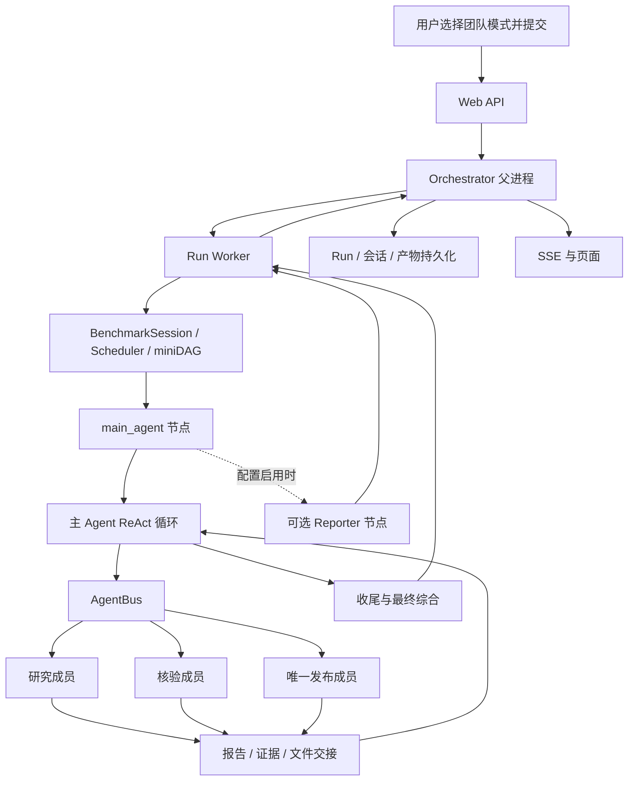
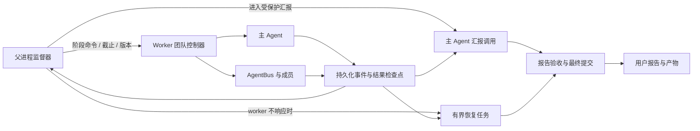
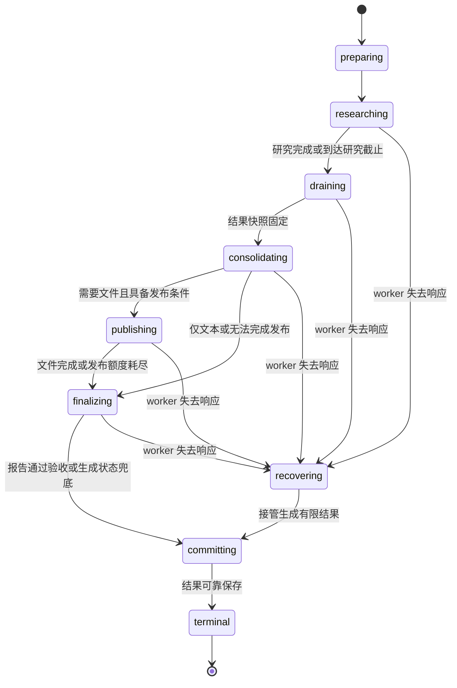

# Agent Team 全流程、独立监督与可靠交付设计

> 日期：2026-10-25。状态：设计草案，尚未实现本文提出的独立监督与交付协议。
>
> 依据：当前工作区代码，包含尚未提交的团队链路修复及 CLI 配置对齐。
> 本文只梳理和设计，不代表已经通过真实模型故障、进程故障或完整恢复验收。
>
> 实施顺序确认（2026-10-26）：先完成并验收团队执行、收尾和 Web 交付的基础链路，
> 再考虑扩展现有 Orchestrator 的执行监管能力。全文保留目标设计，当前范围以 §13 为准。

## 1. 目标、范围与阅读方式

目标是让一次 Web 团队研究在有限预算内可靠结束：主 Agent 有受保护的资源整理结果；
研究未完成时如实报告已完成内容、缺口、原因和文件状态；内部协议、日志、原始工具输出
不能直接替代最终用户报告。模型无法综合时，系统仍应尽可能提供可读的状态说明。

本文中：

- **现有**：已在当前代码中找到实现；不意味着所有故障场景都已验收。
- **缺口**：现有机制不能覆盖的情况或需要补足的契约。
- **建议**：目标设计，按 §13 分期推进；字段、事件和模块名称均非已上线 API。

范围限定为用户发起的 `agent_team` Run。账户、计划计算暂缓，主 Agent 保留历史查询，
主/子 Agent 的基本提示词和工具复用 CLI。单 Agent 的执行、提示词、预算和上下文语义
保持既有契约。本文的“监督”是执行监管，不是行情监控、Watch 或自动投资任务。

相关依据：

- [Web 团队模式方案 §20.15](../plan/web-agent-team-run-mode.md#2015-web-团队角色提示词与-cli-对齐2026-10-25)：当前角色与工具边界。
- [Agent Team 工作流说明](../../workflows/agent_team/README.md)：工作流与配置。
- [Web 运行与轨迹修复记录](../plan/web-runtime-trace-repair-report.md)：持久化和恢复背景。

### 1.1 保证的边界

“保证主 Agent 输出”应拆成可验收的工程要求：

| 要求 | 能承诺的范围 |
|---|---|
| 研究不能吃掉汇报资源 | 程序控制任务准入、阶段截止和并发配额；不能只靠提示词 |
| 正常模型和运行环境下进入汇报 | 到达边界强制切换为有限的汇报阶段，并记录是否实际开始调用 |
| 成员失败不导致整体没有交代 | 从持续保存的结果生成部分完成报告 |
| 最终模型不可用 | 已有程序生成的最低限度说明；完善为有执行事实依据的状态报告，不能冒称是主 Agent 综合结论 |
| 主机、存储或网络整体不可用 | 无法保证即时送达；服务和存储恢复后整理已持久化结果，不承诺断点续跑或恢复已丢失数据 |
| 答案正确且文笔稳定 | 不能绝对保证；靠证据约束、核验、格式验收降低风险 |

工具站点失败、材料不足、内部流程异常也可能导致研究不完整。它们都不能成为直接向用户
倾倒原始日志的理由。没有足够证据时，可以只报告执行事实，不能编造研究结论。

## 2. 当前真实架构：五层职责

| 层 | 主要入口 | 当前职责 |
|---|---|---|
| Web/API | `server/routes/runs.py::submit_run` | 身份、会话、模式和输入检查，提交 Run |
| 父进程 | `server/orchestrator.py::Orchestrator` | 会话排队、启动 worker、转发控制、消费事件、硬超时和持久化 |
| Worker | `server/worker.py::run_once` | 环境和挂载、上下文、工具配置、执行工作流、导出结果 |
| 图调度 | `Scheduler.execute` + `workflows/agent_team/spec.py` | miniDAG 节点执行和状态流转 |
| 节点内部团队 | `main_agent_node` + AgentBus | 主 Agent 循环、动态成员、工具调用、报告回收、最终综合 |

关键区别：**子 Agent 不是每个都对应一个 miniDAG 节点。** 当前大量并发工作发生在
`main_agent` 节点内部，由 AgentBus 管理成员会话和任务。因此只观察图节点开始/结束，
看不到成员是否卡住，也无法及时控制主 Agent 在节点内部的长等待。

默认 `tui` 配置为 `planning_mode=false`、`reporter=false`、`team_effort=max`。
主 Agent 在一个循环里规划和协调，并承担文本综合。规格中虽然有 `agent_team_reporter`
节点，默认路由不经过它。不能把“图上存在 Reporter”当成“已经独立保障最终汇报”。



## 3. 正常执行链路：从发送问题到下一轮继承

### 3.1 提交与启动

**现有**：API 校验团队模式和后端可用性；Orchestrator 按会话安排运行，选择模式对应
的时间上限，暂存原生会话、跨模式上下文和历史查询数据，再启动独立 worker。

**关键点**：排队、worker 启动、模型执行是不同时间段。建议启动时生成唯一预算计划，
明确哪一时刻开始计费/计时，所有阶段从该计划派生，不能每层重新领取一份完整预算。
排队时间另设上限，不混入 Agent 研究时间而不给出解释。

### 3.2 Worker 装配执行环境

**现有**：worker 配置 `/inputs`、`/workspace`、`/outputs`、轨迹、审批、停止与追加指令
通道，加载 `tui` profile 和 Web 覆盖。原始业务数据仅给主 Agent；分派使用独立整理的
`_subagent_original_question`，不自动把账户快照给成员。

CLI 对齐后的主 Agent 工具为协调工具、grep/glob 和 Web 的 `research_history`。
成员使用 CLI 的搜索、抓取、读文件、代码、文件生成、`publish_handoff`、`submit_report`
等工具。Web 不再另外给主 Agent 语料、行情和账户计算工具。

**关键点**：提示词、实际工具 schema、权限检查必须一致。路径说明来自实际挂载。
团队的 `fs_mode` 是科学题指南开关，不是挂载开关，不能为了文件任务强制打开。

### 3.3 主 Agent 规划、建板和分派

**现有**：`get_main_system_prompt` 要求先理解范围，再 `add_task` 建任务板；
`create_subagent` 创建角色，`assign_task` 启动任务。同一成员串行接收后续任务，
多个成员可并行执行。规划、分派、等待的选择主要由模型完成。

**建议的分派契约**：每个子任务明确目标、输入引用、验收条件、依赖、截止、允许产物。
例如“核对退款表中重复记录并返回行号和计算依据”，比“深入研究订单问题”更容易验收。
主 Agent 不应在尚未派发前完成一遍完整研究。

任务板是工作目标，成员是执行者，任务结果是证据载体，三者不能混为同一状态。
一个成员结束，不代表它承担的所有目标都已经验收。

### 3.4 子 Agent 执行及中间结果

**现有**：每个成员运行 ReAct 内核，经过模型与工具超时、权限和 sandbox 检查。
AgentBus 有活动记录，Web Bridge 可以为成员创建独立 observer，轨迹保存实际工具行为。

**缺口**：轨迹和活动记录并不等同于“已提交、可恢复的阶段结论”。一项工作可能已执行
许多工具，但没有来得及调用 `submit_report`；取消时只能留下零散观察或恢复文本。

**建议**：在工具结果落定、关键发现形成、候选文件产生时，持续提交检查点。执行事实
由运行时填写；语义发现由成员提交并带证据引用。运行时不能仅根据工具成功就推断事实已核验。

### 3.5 报告回收与信息交接

**现有**：`AutoFanInObserver` 在回合边界自动回收报告；`collect_reports` 排空就绪结果，
必要时等待下一份，并按剩余研究时间缩短等待。等待期间有进度心跳。
`<attach agent="name"/>` 把指定成员最近报告插入后续任务。

**现有文件交接**：成员私有 `/workspace` 不能当成其他成员可读路径。
大结果通过 `publish_handoff` 生成有版本的只读引用，报告 `attachments` 携带引用，
下游按原引用读取。候选文件不能因此被视为正式交付。

**建议**：把“报告已生成、已持久化、已回收、已用于最终综合”分别记录。回收要幂等，
允许重放，不能因主 Agent 重启或自动回收与显式回收并发而重复累计结论。
迟到结果保留审计，但不得无版本地替换已经提交的用户报告。

### 3.6 核验与唯一发布者

**现有**：普通研究角色、`local_verifier`、`final_verifier` 复用工作流提示词。
只有携带结构化 `output_paths` 的唯一发布者获得相应正式输出权限。进入发布阶段后，
普通研究/核验派发被限制，避免它们继续竞争发布时间。

**关键点**：发布者仍然是成员，仍受当前继承的研究截止约束。现有总收尾预留不会自动
成为发布者可用时间。因此建议方案若把发布放在研究截止以后，必须显式增加发布阶段额度，
同时关闭普通研究成员的额度；不能只移动图示中的时间段。

正式交付应区分：manifest 已确定 → 文件存在 → 内容/格式检查通过 → artifact 已登记
→ 用户可读取。文件存在只证明写盘，不能证明计算正确或下载可用。

### 3.7 当前收尾和恢复

**现有**：主循环停止后执行 `wind_down_team`：冻结派发、终止排队工作、有限等待运行中
成员并回收结果，生成完整度检查点；随后按配置执行 `force_final_answer` 或 Reporter。

`force_final_answer` 会尝试一次无工具的干净上下文综合。失败后可能采用已有草稿、
拼接 `<report>` 块或生成最低限度说明。成员也可能保留原始工具观察。

`components/finalization/recovery.py::minimal_best_effort_answer` 已提供无需模型的程序
兜底。当前要补的是事实字段、报告验收和异常路径覆盖，而不是从零增加兜底模板；它仍要求
进程能执行到该分支，不能独自覆盖 worker 被强杀或整机故障。

**缺口**：这些策略偏重保全信息，尚未形成统一的用户报告验收。长报告截断、协议标记、
成员语言不一致、工具原始输出，都可能进入最终正文。不能把“非空文本”当成收尾成功。

### 3.8 结果提交、页面和下一轮

**现有顺序**：worker 获取最终答案、导出跨模式上下文后发送 `run_finished`；父进程
回填聊天、更新 Run 并发布终态事件。worker 在后续清理后写 `summary.json`；父进程结束
清理中另做 artifact 登记、用量记录、会话上下文入库。这些并非一个原子提交。

**缺口**：即使 Run 行已持久化，文件索引和下一轮上下文仍可能尚未提交；worker 在终态帧
之后、summary 写入之前崩溃时，也需要处理结果副本不一致。本文不把这些风险等同于每次
都发生的页面故障，但交付协议必须覆盖这些窗口。

**上下文原则**：继续使用原生 opaque payload、portable context 和历史归档；`turns` 是
展示和审计，不得重建历史文本注入 prompt。部分完成报告应携带完整度和来源进入下一轮，
不能被后续对话当成已经核验的完整答案。故障时保留旧的有效上下文，不能用空快照覆盖。

## 4. 现有监控能力与待补闭环

| 能力 | 现状 | 下一步缺口 |
|---|---|---|
| 模型首包、逻辑调用、纯推理限时 | 已有 | 与阶段剩余时间及汇报配额统一 |
| 工具超时与取消 | 已有 | 处理取消后仍在执行的线程/子进程及迟到写入 |
| 主、子 Agent 活动和轨迹 | 已有 | 稳定结果检查点、进展定义和独立监管视图 |
| `collect_reports` 截止和心跳 | 已有 | 在阶段切换时立即唤醒，不能只等工具自行结束 |
| 无进展和未分派提醒 | 已有 | 不是阶段控制权，不能保证按时汇报 |
| 工作流时间提醒 | 已有，部分在回合边界触发 | 独立时钟和新工作准入检查 |
| wind-down 与完整度 | 已有 | 跨进程恢复、全部任务要求的完整度判定 |
| 发布单向限制 | 已有 | 发布额度与普通研究额度解耦 |
| 外部强制停止和终态恢复 | 已有 | 从持久化事实生成可读结果，而不只恢复已有 summary |
| 页面实时/回放 | 已有 | 统一阶段和结果版本、明确交付就绪状态 |

`team_completeness` 和 wind-down 统计不能单独证明用户任务完整；它们首先反映回收边界。
完整交付还必须检查必需任务、核验证据、manifest 和最终正文。相反，非必要的探索成员
失败也不应直接否定已经独立完成的全部必需任务。

## 5. 建议架构：外部监督、内部执行、持久化事实

### 5.1 监督器职责与部署边界

本节属于后续扩展，基础链路通过 §13 的第一阶段验收后再评估实施。
届时建议扩展现有 Orchestrator 的执行监管能力，复用团队工作流的阶段控制接口。
监督器是程序，不增加新的模型 Agent。它不判断投资结论或替研究员推理，只依据状态、
时间、任务契约和检查点做控制决策。



worker 内部协程负责及时控制；父进程负责 worker 整体失去响应时的接管。仅增加一个同
事件循环的监控协程，不能抵御该事件循环阻塞。若 API 父进程也故障，依靠持久化记录
和服务重启后的恢复；后续监管扩展也不要求引入独立集群调度服务。

### 5.2 谁拥有控制权

| 参与者 | 可以决定 | 不可以决定 |
|---|---|---|
| 主 Agent | 拆分目标、选角色、提出补查、解释证据 | 自行延长硬截止或挪用保留额度 |
| 子 Agent | 在任务范围内选工具、提交发现和缺口 | 自行扩大权限、替其他成员发布 |
| 团队控制器 | 准入、阶段切换、冻结分派、回收与取消 | 把未核验结论自动标成事实 |
| 外部监督器 | worker 存活判定、接管、恢复、最终提交版本 | 从日志推测缺失的研究结论 |
| 页面 | 展示状态、请求停止/追加指令 | 用连接断开推断任务完成 |

控制命令必须有 `run_id`、`execution_epoch`、`command_id`、期望阶段和确认结果。
重复命令幂等；旧 worker 的命令、迟到结果不得覆盖新一代执行。前述字段是拟新增契约。

## 6. 阶段状态机与受保护预算

### 6.1 建议状态机

这些是新的执行阶段，不直接替换现有 Run 状态枚举。



进入 `draining` 后关闭新研究准入。`consolidating` 只整理已有证据、固定报告和发布输入，
不可重新启动开放式研究；尚未完成的核验写成缺口。进入 `publishing` 后只允许既定 manifest
的发布与有界修正。`finalizing` 的主 Agent 调用不开放研究和文件工具。

用户停止是独立控制：立即撤销执行权限并保留检查点；默认不因“必须汇报”继续发起耗费较大
的模型调用。必要时程序即时生成停止说明。人工审批等待也需单独标记，不可误判为模型挂死；
预算是否暂停必须有明确产品规则，不能无限延长。

### 6.2 当前预算，不应误读

| 当前参数 | 默认值/来源 | 含义 |
|---|---|---|
| Web 团队总上限 | 1050 秒，`server/config.py` | 产品执行上限，可被部署配置覆盖 |
| 团队研究/执行窗 | 720 秒，`server/profile.py` | 当前包含成员研究和正式发布 |
| 收尾预留 | 至少 300 秒，运行时还做可行性计算 | 覆盖临近截止工具等待、wind-down、综合 |
| 普通工具外层配置 | 135 秒 | 并非每个工具实际都需要这么久，另有清理余量 |
| 最终综合配置 | 120 秒 | 配置上限，实际还需受剩余总时间约束 |
| 模型首包 / 逻辑调用 | 45 / 180 秒 | 单次调用保护，不能等同于整个 Run 上限 |
| Worker 外层等待 | `args.wall_time + 30` | 外层取消保护 |
| 父进程泵等待 | `wall + stop_grace_period_s` | 默认 grace 为 30 秒，之后还有清理路径 |

1050 秒是目标总预算，当前多层 grace/清理意味着实际进程退出时间不一定精确为 1050 秒。
Agent Team 声明 `TASK_WALL_TIME_MODE="soft_research"`，Scheduler 默认尊重该语义；
显式传入图级硬上限仍会取消图执行。设计时不能误以为 miniDAG 已独立保证所有收尾阶段。

### 6.3 建议预算模型

在准备阶段生成一份绝对截止计划，分为研究、回收、整理、发布、最终文本、提交额度。
下面仅是 1050 秒下的说明性方案，**未修改当前配置，也不是实测推荐值**：

| 时间段 | 用途 | 必须遵守的边界 |
|---|---|---|
| 0～600 秒 | 理解、研究、必要核验 | 成员按任务截止工作 |
| 600～660 秒 | 冻结研究、提交部分结果、回收 | 不再启动新研究 |
| 660～780 秒 | 主 Agent 整理证据和发布输入 | 不重新搜索或增加验证波次 |
| 780～900 秒 | 可选文件发布、回读 | 只有唯一发布者获该阶段额度 |
| 900～1020 秒 | 最终用户报告与格式验收 | 主 Agent 独享收尾额度 |
| 1020～1050 秒 | 固定模板兜底、持久化、终态 | 不再等待模型 |

纯文本任务可以跳过发布，提前完成。提前进入下一阶段不意味着研究可借走最终汇报额度。
准备、审批、重试、退避、排队、模型生成、工具清理都要计入明确的阶段，不能藏在额外等待中。

任务准入至少满足：

```text
实际调用截止 = min(调用配置截止, 所属阶段截止, Run 总截止)
可启动条件 = 阶段允许该动作
          且剩余时间足以容纳调用和清理的上界
          且 token/调用次数预算与并发额度可用
```

时间估算可用于优先级，不能代替硬上界。剩余不足时应拒绝新工作，告知主 Agent进入收尾。
短任务可缩短超时后准入；不能仍给予完整 180 秒调用额度，再指望下一轮发现超时。

### 6.4 预留的不只是时间

最终汇报还需要独立的模型请求并发名额、输入窗口、输出 token 和总费用额度。
研究成员不能占满应用可控的模型并发队列，使主 Agent 有时间却无法开始请求。
供应商限流仍属于外部约束，需要计入最终调用预算并触发兜底，不能无界重试。

汇报输入使用固定版本的结果快照：用户问题、重要约束、任务覆盖、证据、冲突、文件状态。
不把所有原始日志重新塞入模型。长材料保留引用和归档，不能因为输入预算有限而物理删除。

## 7. 监督主 Agent 与子 Agent：事件、规则和取消

### 7.1 分别观察存活、活动和进展

| 指标 | 回答的问题 | 不能推出的结论 |
|---|---|---|
| worker 心跳 | 进程是否可响应 | 研究正在前进 |
| 最近模型输出/首包 | 请求是否开始、是否停滞 | 输出是有效证据 |
| 工具开始/完成/错误 | 当前阻塞在哪里 | 工具成功代表任务完成 |
| 新证据、计算检查点 | 是否取得可恢复成果 | 所有发现都已核验 |
| 报告、验收、发布进展 | 是否接近用户要求 | 有文件就是完整交付 |

监督视图建议包含主 Agent 与每个成员的 role、job、阶段、截止、最近活动、最近有效进展、
当前工具、失败分类、检查点版本和产物状态。不要将隐藏推理正文作为监督协议的必需输入；
执行事件和可见检查点足以支持监管。

### 7.2 干预规则

| 触发 | 首次处理 | 升级处理 |
|---|---|---|
| 主 Agent 长时间未分派 | 提醒提交可检查计划并派发 | 限制继续规划的预算；到边界进入部分汇报 |
| 同一成员重复失败且无新证据 | 指出失败次数和剩余预算 | 停止该任务，记录缺口；有预算时才允许替代路径 |
| 模型有 token 但长期无完成回合 | 纯推理/逻辑调用保护 | 取消该调用，保留已提交成果 |
| `collect_reports` 长等待 | 返回当前成员状态 | 收尾命令立即唤醒，不再等待所有成员 |
| worker 心跳消失 | 结合外部进程状态检查 | 超过宽限仍无确认则隔离、接管 |
| 文件发布停滞 | 检查当前 manifest 和已落盘项 | 截止时报告部分文件，不扩大 manifest |

阈值按角色和工具类别设定并测试，不能用统一“30 秒没有 token”判所有工具异常。
检测失败原因时保留证据：`member_deadline`、`tool_timeout`、`provider_timeout`、
`worker_unresponsive`、`budget_admission_denied` 等应区分；不把框架主动截止一律说成模型错误。

### 7.3 取消必须有完成确认

`asyncio` 取消不保证底层线程、网络请求和 shell 子进程立刻停止。设计需要：

1. 撤销旧阶段的新工作准入，发出停止命令并等待有界确认。
2. 收集最后一个已提交检查点，标记仍不确定的调用。
3. 隔离仍运行的成员或子进程；必要时由外部监管结束 worker。
4. 使用执行代次与发布权令牌拒绝旧执行者的迟到提交。
5. 只有确认旧发布者停止或隔离后才转移正式发布权。

仅在数据库拒收旧结果，还不足以防止旧进程继续写同一输出路径。后续实现应使用隔离的
候选/暂存位置和受控提交，或确认进程组结束后再接管；不得让两代发布者同时写正式文件。

## 8. 结果检查点：让已做工作可被恢复

建议在 Run 目录内增加专门的执行日志和结果快照；名称与存储格式待实现时确定。
原始轨迹继续保留，不把它改造成需要模型重新理解才能恢复的唯一数据库。

| 数据 | 写入者 | 必要字段或语义 |
|---|---|---|
| 执行事实事件 | runtime/工具边界 | run、epoch、agent、job、事件序号、操作、状态、错误分类 |
| 任务契约 | 主 Agent + 运行时校验 | 目标、必需/可选、依赖、验收条件、输入和截止 |
| 成员阶段结果 | 成员提交，runtime 封装 | 已完成事项、发现、证据引用、未解决项、候选文件 |
| 核验结果 | 核验成员 + 检查器 | 核验对象版本、方法、结果、仍有争议的部分 |
| 文件状态 | sandbox/产物服务 | manifest、存在性、哈希、格式检查、登记和访问状态 |
| 最终快照 | 控制器 | 截止时刻、采用哪些检查点版本、排除哪些迟到结果 |

关键事件写入需要可确认；高频 token 活动可以合并或丢弃，不得反向阻塞主执行。
检查点写入失败属于存储降级，必须被看见，不能继续显示“已可靠保存”。
记录文本只按数据处理，不能把网页或工具结果中的指令提升为监督器命令。

重启恢复采用持久化的时间信息和执行代次，不能复用另一个进程的 monotonic 数值。
同一进程用单调时钟控制截止；跨进程记录墙钟截止、预算和代次，恢复时保守重建剩余额度。

## 9. 主 Agent 汇报与可读兜底

### 9.1 有工具的团队执行，与无研究工具的汇报分开

建议继续复用 CLI 的团队执行提示词。进入 `finalizing` 后给主 Agent 一个有限汇报任务，
使用同一用户身份和模型配置，但输入为固定结果快照，工具列表关闭研究/派发能力。
这不是让主 Agent 再经历一遍开放式规划。

建议汇报契约：

```text
回答本轮用户问题，继承明确的用户约束。
只使用所提供快照中的发现、证据和已确认文件状态。
区分已确认、尚未核验和仍有冲突的结论。
明确哪些必需工作没有完成，为什么没有完成，影响哪些结论。
只列出实际存在且状态已确认的产物；草稿不得说成最终文件。
使用用户语言，不输出内部协议、工具日志或调用标记。
不发起新的研究，不因证据不足编造补全内容。
```

模型输出需要有限验收：空内容、仅协议标记、明显截断、重复循环、与权威产物状态冲突，
均不能直接发布为完整报告。有预算时最多执行有界修正，否则使用程序模板。
格式检查不等于事实核验；禁止靠另一次无预算限制的模型调用“检查一切”。

### 9.2 三层结果

| 输出层 | 触发条件 | 来源标记 |
|---|---|---|
| 完整综合报告 | 必需任务和交付检查满足 | 主 Agent 综合 + 对应证据版本 |
| 部分完成报告 | 有成果但存在必需缺口 | 主 Agent 综合，明确部分完成 |
| 程序状态报告 | 模型不可用、输出不合格或已无调用时间 | 系统生成，不能冒充研究综合 |

程序模板只渲染可信的结构化字段。没有结构化结论时，只展示“读取了哪些文件、执行了哪些
检查、有哪些产物、哪些未完成”等事实，不临时用正则从任意日志中拼凑研究结论。
原始 `<report>`、JSON、堆栈继续归档为诊断材料，不作为用户正文兜底。

### 9.3 示例：订单对账未完成

> 本次对账部分完成。已读取订单表和退款表，完成订单编号匹配；重复退款检查尚未完成，
> 因此当前净额不能作为最终对账结论。
>
> 已完成：两份材料读取、订单匹配、汇总草稿生成。
>
> 未完成：重复退款核验；对应成员到达研究截止时尚未提交结果。
>
> 文件：汇总草稿已保存，尚未通过完整核验；正式报告未生成。
>
> 后续可从已保存的匹配结果继续核对，无需重新上传原材料。

最后一句只有在材料和检查点确实可继续读取时才允许显示。若综合模型失败，则开头还需明确
“以下为系统根据执行记录生成的状态说明”，不能声称已完成主 Agent 的综合分析。

### 9.4 输出质量与执行状态分开

建议分别记录 execution outcome、任务覆盖、核验状态、文件交付状态、report source 和
delivery status。先作为结果契约扩展，不仓促替换所有现有状态字段。

例如“运行已结束、结果部分完成、报告已提交、一个文件尚未生成”是正常可表达的组合。
不能把页面能显示文字、HTTP 200、工具 `ok=true` 或进程退出码 0 当成研究完整度。
反过来，有非关键探索失败也不必将已满足全部必需条件的交付降成失败。

## 10. 可靠提交、页面与跨轮上下文

### 10.1 建议提交协议

1. 固定最终快照版本，停止旧执行者修改本次交付。
2. 原子保存最终报告、结构化完整度、证据/产物引用；写入失败不宣布交付成功。
3. 校验用户需要的文件并登记 artifact；失败明确列入交付缺口。
4. 保存或关联本轮上下文载体，保留原有有效会话头；失败可重试且必须可观测。
5. 父进程按 `run_id + execution_epoch + result_version` 幂等提交 Run/聊天结果。
6. 提交确认后发布最终 UI 事件；重连从持久化版本恢复。

文件系统和数据库无法用一个普通事务覆盖。建议使用“持久化准备记录 → 数据库提交 →
提交确认”协议，并给未完成提交留恢复入口。重复终态、进程重启、确认丢失都复用同一
结果版本。单进程的 `handle._finished` 可以保留，但不应是跨重启幂等性的唯一保证。

会话上下文入库未完成时，不能让下一轮静默使用过期上下文。应完成恢复后再派发，或明确
报告连续性不可用；不能宣称“完整继承”却从空上下文执行。只读 Watch Run 继续不覆盖人类
会话头，不能因为新增监督机制而改变此规则。

### 10.2 页面展示

页面新增阶段描述可以先映射到现有运行状态：研究中 → 回收结果 → 整理报告 → 文件发布
→ 保存结果。流式文字是草稿，最终回答以已提交的版本为准。

成员轨迹与最终报告分区展示；部分完成标注缺口，模型异常说明原因，不直接展示内部栈。
SSE 断开显示连接状态并查询 Run；不得直接判任务完成。重连后按稳定 agent/job/事件序号
去重，不能把成员结束事件提升为整个 Run 结束。

## 11. 故障与恢复决策表

| 场景 | 监督动作 | 用户结果 |
|---|---|---|
| 单个成员到截止 | 截止、保存检查点、回收其余成员 | 部分报告；已完成必需条件时可完整报告 |
| 工具卡住 | 有界取消/隔离，记录不确定副作用 | 已完成事项 + 未完成检查 |
| 主 Agent 一直等报告 | 唤醒 fan-in、冻结研究、切入汇报 | 现有证据综合 |
| 发布文件只完成一部分 | 停止新增写入，核对已存在文件 | 列出已生成/未验证/缺失文件 |
| 模型 API 超时或限流 | 阶段内有限重试；有余量才使用已配置 fallback | 主 Agent 报告或系统状态报告 |
| 最终输出只有协议/截断残片 | 有界修正，失败用模板 | 可读状态报告，原文留诊断 |
| worker 事件循环阻塞 | 外部停止并确认隔离，接管持久化结果 | 有预算则恢复综合，否则模板 |
| 父进程重启 | 按持久化阶段、执行代次和提交记录协调恢复 | 不重复交付，不重新开放已冻结研究 |
| 浏览器断线 | 执行继续，恢复持久化状态 | 同一版本的报告和产物 |
| 存储不可写 | 停止宣称持久化成功，尽力发送降级说明 | 明确保存失败，不承诺下轮可恢复 |
| 用户主动停止 | 立即停止工作，保留可确认结果 | 简洁停止说明，默认不再启动长模型综合 |

外部恢复不是简单重跑整个问题。它应使用已存检查点，只处理收尾，遵守原总预算或明确的
恢复策略。原预算已经耗尽时，默认采用无模型模板；不偷偷开启另一个长研究 Run。

## 12. 对应项目代码的落点

以下新增组件名称只是建议，实施前需确定接口；保留现有框架与业务层边界。

| 位置 | 复用能力 | 建议增加 |
|---|---|---|
| [server/orchestrator.py](../../server/orchestrator.py) | 子进程、硬停止、终态、恢复 | 外部监督、命令确认、恢复接管、幂等提交 |
| [server/worker.py](../../server/worker.py) | 环境、控制输入、结果导出 | 阶段控制入口、独立心跳、准备/提交协议 |
| [server/profile.py](../../server/profile.py) | CLI 复用、Web 预算 | 团队专属阶段预算配置，不改单 Agent |
| [main_agent.py](../../workflows/agent_team/nodes/main_agent.py) | 协调循环、观察器、汇报调用 | 可中断的研究/汇报边界、固定结果快照 |
| [lifecycle.py](../../workflows/agent_team/lifecycle.py) | freeze、drain、完整度检查点 | 有界阶段切换、取消确认与恢复输入 |
| [subagent_runtime.py](../../workflows/agent_team/subagent_runtime.py) | 成员循环、截止、异常恢复 | 阶段额度、增量检查点、结构化部分结果 |
| [AgentBus](../../frontier_agent/components/agent_bus/bus.py) | 会话/任务、派发、等待、停止 | 中立的阶段准入钩子、唤醒、结果版本和幂等回收 |
| [assign_task.py](../../plugins/tools/assign_task.py) | 发布权限、任务校验、attach | 阶段准入及发布权代次验证 |
| [collect_reports.py](../../plugins/tools/collect_reports.py) | 限时等待、心跳 | 阶段命令唤醒和检查点引用 |
| [finalization](../../frontier_agent/components/finalization) | 剩余预算、恢复输入 | 共用的预算约束；团队用户报告策略仍放工作流 |
| [artifacts.py](../../server/artifacts.py) | 扫描、哈希、路径检查 | 发布版本就绪与恢复登记 |
| [relay.py](../../server/relay.py) / [runs.ts](../../web/src/stores/runs.ts) | 实时/回放、去重、断线协调 | 阶段事件、提交版本、部分交付展示 |

建议先在 `workflows/agent_team/` 增加团队阶段控制与最终报告模块，服务器持有外部监管和
持久化协议；不要把订单、账户、报告语言等语义塞进 ReAct 内核或 AgentBus。
miniDAG 继续承担图编排，第一版无需将所有动态成员改造成图节点。

## 13. 实施顺序与验收

### 13.1 确认的分期：先基础链路，再扩展监管

**第一阶段：完成现有执行路径内的基础闭环。** 沿用 miniDAG、AgentBus、worker 和
Orchestrator 的现有职责；所需的结果提交修正可以涉及 server，但不新增外部监督器、
接管协议或自动恢复执行。基础链路包括正常执行，也包括进程仍可响应时的有限失败收尾。

| 顺序 | 工作 | 完成标准 |
|---|---|---|
| S1 | 结果契约与现有程序兜底完善 | 完整/部分/系统报告来源清晰；缺口有事实依据；原始协议不进入用户正文 |
| S2 | 团队内部结果与交接 | 分派、工具执行、报告回收、附件交接、核验、唯一发布可贯通；已提交结果及引用可保存、读取 |
| S3 | 工作流内阶段预算与收尾 | 研究和发布有明确边界；有限回收后实际进入主 Agent 综合，模型失败时走程序兜底 |
| S4 | 正常提交、页面与连续性 | 报告、文件、完整度、会话载体先保存再确认终态；页面与刷新结果一致，下一轮可继承 |
| S5 | 基础链路隔离验收 | 正常文本/文件任务、成员失败、模型失败、用户停止和跨模式回归通过，并有真实模型运行证据 |

S2 的保存与读取不等于 worker 重启后续跑；S3 的工作流内控制不等于事件循环阻塞时仍能
强制汇报；S4 不宣称已覆盖所有跨进程崩溃窗口。这些边界必须在验收记录中明确。
基础阶段仍应处理能捕获的保存失败，不能把失败伪装成成功交付或完整上下文继承。

**第二阶段：基础验收完成后，再评估并实施 S6——Orchestrator 执行监管扩展。**

该阶段包含独立存活/进展监视、命令确认、worker 隔离与安全接管、执行代次与迟到写入防护、
跨重启的检查点恢复与幂等提交，以及相应故障注入验收。§5 的外部监督架构、§7 的外部干预、
§8 的跨进程恢复及 §10 的完整崩溃恢复协议属于该阶段；其基础数据和正常提交部分可在第一
阶段按实际需要实现，不能反过来要求先建完整监管系统才能验证团队链路。

当前下一项是 S1：核对现有最终答案的各条回退路径，补齐用户报告的来源、完整度和缺口契约，
复用已有程序兜底。第一阶段完成后仍不能宣布已经实现完整监控旁路。
采用团队专属开关灰度；回退不能丢弃已保存结果或覆盖已提交结果。

### 13.2 必须验证的场景

下表保留完整目标。第一阶段覆盖正常链路、可响应进程内的失败收尾、页面重连和上下文回归；
worker 卡死/被杀后的外部接管、两代执行者的迟到写入隔离、提交中途重启恢复留给第二阶段。
取消测试在第一阶段必须记录仍未确认停止的操作，不能因此宣称已通过后续安全接管验收。

| 测试 | 必须观察到的事实 |
|---|---|
| 正常文本团队 | 分派、独立证据、报告回收、主 Agent 综合、提交完整 |
| 正常文件团队 | 候选交接、唯一发布、回读、artifact、实际下载哈希一致 |
| 一个成员没有提交最终报告 | 已提交检查点仍可用；缺口明确，其他成员不被拖垮 |
| 截止前启动长工具 | 准入拒绝或缩短调用，不能吃掉最终汇报额度 |
| `collect_reports` 长等待 | 收尾命令及时生效；主 Agent 实际获得模型调用机会 |
| 子 Agent 占满并发 | 主 Agent 收尾配额不会因本应用的成员队列饥饿 |
| 最终模型失败、返回空/协议文本 | 系统生成可读状态报告，不拼原始 report/tool output |
| 取消后工具仍运行 | 迟到写入不能破坏新发布版本 |
| worker 卡住或被杀 | 外部接管；有界恢复；最终只提交一个结果版本 |
| 准备落盘后、DB 提交前重启 | 恢复提交，不丢答案、不重复聊天消息 |
| DB 提交后、通知前断线 | 页面重连得到同一报告和产物状态 |
| 上下文入库失败 | 不用空/过期载体伪装成功继承，恢复后再继续 |
| 用户停止/审批等待 | 停止及时，审批不误判，预算政策一致 |
| 单 Agent 与跨模式回归 | 单 Agent 提示词、工具、预算及历史细节访问不受破坏 |

现有 `test_web_team_cli_parity.py`、`test_agent_team_timeout_wiring.py`、
`test_agent_team_file_handoff.py`、`test_agent_team_wind_down.py`、`test_web_m1.py`、
`test_context_inheritance.py` 可以作为基础；上一轮 197 项通过证明的是已有链路和角色对齐，
不能当成本文新监督方案的验收结果。

### 13.3 需要采集的指标

至少记录首次派发时间、阶段切换与确认耗时、成员最后有效进展、最终综合实际开始时间、
汇报并发等待时间、冻结后的违规派发数、部分结果覆盖率、用户报告来源、未登记产物数、
提交恢复次数、上下文入库结果。最终汇报是否有机会开始必须直接观测，不能只看配置写了
多少秒 reserve。

故障注入测试要求：冻结后的研究准入为零；每个最终结果有来源和完整度；一次 Run 只有
一个权威提交版本；不会输出内部协议作为正常报告。自然语言质量还需真实模型人工审阅，
不能靠固定脚本测试替代。

## 14. 尚待决策的参数

按 §13 先推进基础链路；外部监管参数不作为第一阶段启动的前置条件。
以下参数应在对应阶段实施前用隔离实验确定：阶段预算比例、主 Agent
汇报 token 配额、不同工具的进展阈值、审批等待计时规则、检查点落盘频率、报告验收的
修正次数，以及发布阶段是否需更严格的暂存提交机制。

本次交付仅为流程与设计文档，不修改执行逻辑、时间配置、提示词或线上服务。
