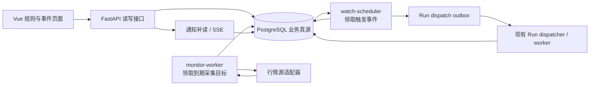

# 价格监控层技术方案与研究计划

| 项 | 内容 |
|---|---|
| 版本 / 状态 | v0.1 · 候选技术方案，尚未生产放行 |
| 日期 | 2026-10-14 |
| 需求依据 | [Web 业务资料 PRD §7](web-business-data-prd.md#7-价格监控与自动分析) · PR-WATCH-01—04 · AC-11—16/21/24 |
| 实施依据 | [数据任务 DATA-09—15](../plan/web-business-persistence-tasks.md#4-监控事件与自动分析) · [页面任务 UI-08—11](../plan/web-business-ui-tasks.md#ui-08-监控配置与管理) |
| 外部技术调研 | [监控技术选项一手资料](../research/monitoring-technical-options.md) |
| 本文职责 | 冻结生产化架构、模块接口、状态与验证顺序；不重新定义产品需求，不宣称已有代码已上线 |

## 1. 已理解的需求与硬约束

监控层不是“定时问一次 Agent”，而是一条无模型行情判定链，在可靠触发后才创建普通分析 Run。
以下约束同时成立：

1. 规则属于用户和研究，可绑定该研究的计划；创建、改版、暂停、恢复、取消及历史可追溯。
2. 浏览器关闭不停止监控；本机休眠、后台停机或行情中断必须明确显示，不能继续声称“实时”。
3. 常态行情采集、时效校验和阈值判断不调用 LLM；提醒规则永远不创建模型任务。
4. 触发事件、自动分析派发、Run 运行和分析结果是不同状态；分析失败不能恢复规则的单次触发资格。
5. 价格判断使用精确十进制，记录供应商观测时间和本地接收时间；过期、乱序、重复、休市、停牌、
   口径不符及缺少可靠时点的报价不得伪装成有效实时触发。
6. 第一阶段只交付单次规则；创建时已满足、断线恢复和普通穿越分别执行已保存策略。
7. 自动分析在真正调度时重新检查规则、研究、权限、有效期、资料、队列和预算，再冻结不可变快照。
8. 同研究的手动 Run 与自动 Run 串行；事件到 Run 幂等，崩溃恢复不能重复创建或并行执行。
9. 触发价与分析开始价分别保存；达到预算、缺资料、排队过期及后台故障都保留触发事实。
10. 通知先持久化再推送，支持游标补读；SSE 断线不丢事实，也不作为后台在线的证明。

## 2. 当前代码基线与生产缺口

仓库已有可复用骨架：

| 已有模块 | 已有能力 |
|---|---|
| `server/watch_rules.py` | 单次规则、不可变版本、幂等写入、暂停/恢复/取消 |
| `server/watch_eval.py` | `Decimal` 判断、观测去重/乱序过滤、初始越线/断线恢复、原子创建事件 |
| `server/watch_scheduler.py` | 事件校验、次数预算、缺资料请求、Run/快照/outbox 原子创建、终态对账 |
| `server/dispatch_outbox.py` | Run 派发租约、研究串行和崩溃恢复 |
| `server/business_events.py` | 持久通知、已读/隐藏/设置、游标回放与 SSE |
| `BusinessMonitorCenter.vue` | 规则创建、暂停/恢复/取消和事件列表 |

这些代码证明状态模型可行，但还不能打开生产监控：

1. `monitor_loop` 和 `scheduler_loop` 挂在 FastAPI lifespan。多 API 实例会重复拉行情；API 重启也会中断监控。
2. 当前真实行情适配器把供应商时点标为 `time_source=unknown`、价格经过 `float`；判定函数仍可能采用它触发。
   这违反“缺可靠观测时间不得冒充实时触发”的需求，是首要放行阻断项。
3. 活跃规则按固定排序截取前 `max_rules`，标的再截取前 `max_symbols`，没有 `next_due_at`、公平游标或租约；
   规则数超过批次后可能长期饿死。
4. 行情拉取是同步接口，直接运行在异步循环中；慢供应商会阻塞同进程的 API、通知和调度。
5. 行情批次只按 symbol 合并，没有把 provider、market、quote basis 和权限域作为完整采集键。
6. 自动调度循环没有独立事件领取租约；多实例虽靠事件行锁和幂等约束兜底，但会重复扫描、争锁和合并。
7. 预算只落实每规则版本 `max_runs`；用户级并发、周期次数、token 预留/结算仍缺。
8. UI 仍显示“后台状态待接入”；没有 worker 心跳、规则监控延迟、行情源故障或恢复缺口的可读状态。
9. 真实供应商的权限、盘中更新频率、时点语义、限频、停牌/复权与容量尚未完成受控实测。
10. `watch_observations` 持续增长，但保留、压缩、删除和事件证据永久化策略尚未冻结。

## 3. 推荐架构

### 3.1 结论

第一阶段采用 **PostgreSQL 真源 + 独立后台进程 + 可恢复领取**。继续使用现有业务库中的规则、事件、
Run outbox 和通知，不在第一阶段引入 Redis、Kafka、Celery 或 Temporal。

理由：触发事件、预算、快照和 Run 必须与现有业务对象保持事务一致；当前目标是中低频、有限标的的
单次规则，PostgreSQL 已是系统真源，也已有 outbox/唯一约束/行锁基础。先把正确性、供应商能力、
公平调度和后台可运维性做实，比增加第二套队列更有价值。

FastAPI 内嵌循环只保留为显式的本地开发模式。生产部署拆成三个进程，同镜像、不同命令：



- `monitor-worker`：只做目标领取、批量取价、规范化、质量门禁和确定性判定，不导入 LLM。
- `watch-scheduler`：只消费已持久触发事件，校验后创建 Run；不直接调用模型。
- 现有 `dispatch_outbox`：继续负责研究串行、worker 派发和运行恢复。
- API：规则操作、状态查询、通知流；不承担生产常驻监控的存活责任。

### 3.2 处理语义

系统采用 **至少一次采集/调度 + 数据库幂等收敛**，不声称端到端 exactly-once：

- 行情可能重复获取；观测身份使用 provider + instrument + quote basis + vendor sequence/event id，
  缺少序号时再使用可靠观测时间、价格和口径组成稳定摘要。
- 判定与“消耗单次资格 + 创建事件”在一个事务中，唯一约束保证同一规则版本只产生一个单次事件。
- 事件到 Run 以 `(event_id, generation)` 唯一；调度重试复用同一 Run，用户明确重新分析才增加代次。
- 外部行情请求与 LLM 请求无法纳入数据库事务；每次尝试必须留痕，网络不确定不能被记作“未调用”。

## 4. 深模块与接口

复杂度集中在以下深模块，调用方不需要理解供应商字段、时区、租约或状态机细节。

### 4.1 行情观测模块

```python
class ObservationSource(Protocol):
    async def capabilities(self) -> SourceCapabilities: ...
    async def fetch(self, batch: TargetBatch) -> ObservationBatch: ...
```

`ObservationBatch` 返回原始字符串价格、标准标的、market、currency、quote basis、供应商观测时间、
本地接收时间、序号、市场阶段、停牌状态、来源和错误。模块内部负责限频、超时、重试退避和字段映射。

存在两个真实 adapter 后再固定该 seam：真实供应商 adapter 与脚本化测试 adapter。不要为尚不存在的
第二种消息队列提前增加 queue adapter。

### 4.2 采集计划模块

```python
async def claim_due_targets(now, limit, worker) -> list[TargetLease]: ...
async def finish_target(lease, outcome) -> None: ...
```

采集目标按 `(provider, permission_scope, market, instrument, quote_basis)` 聚合，多条规则共享一次报价。
模块隐藏 `next_poll_at`、退避、租约、fence token、公平排序和失败计数。领取使用数据库时间，完成写入必须
匹配 fence token，过期 worker 不能覆盖新 worker 状态。

### 4.3 判定模块

```python
async def evaluate_observation(target_id, observation) -> EvaluationResult: ...
```

接口保持一条观测进、一份确定结果出；内部在事务中锁定相关规则，应用质量门、时序门和状态机，落观测、
更新基线并创建事件。固定时钟和脚本行情通过同一接口测试，不从模块内部创建时钟或行情客户端。

### 4.4 事件调度模块

```python
async def claim_events(now, limit, worker) -> list[EventLease]: ...
async def schedule(lease) -> ScheduleOutcome: ...
async def reconcile(limit) -> ReconcileStats: ...
```

内部处理规则有效性、研究状态、资料、用户/规则预算、最新快照、合并、过期和 Run outbox。调用方只循环
领取和报告结果，不能自行拼 Run 或绕过业务准入。

### 4.5 健康模块

```python
async def monitoring_health(user_id=None) -> MonitoringHealth: ...
```

统一给 UI 和运维返回 worker 心跳、行情源状态、最近成功观测、规则预计间隔、实际延迟、积压、最近缺口
和退化原因。健康状态来自持久心跳和指标，不以 SSE 连接或 API 存活代替。

## 5. 数据模型增量

在现有 `watch_rules / watch_rule_revisions / watch_observations / watch_events / watch_event_runs /
watch_budget_usage` 上增加：

| 数据 | 关键字段 | 目的 |
|---|---|---|
| `watch_targets` | provider、权限域、market、instrument、quote_basis、next_poll_at、backoff_until、lease/fence、last_success、failure_count | 合并相同行情请求、公平领取、恢复和退避 |
| `watch_target_rules` | target_id、rule_id、rule_version、active | 规则改版后明确换目标，旧版本不继续判定 |
| `background_workers` | kind、instance_id、started_at、heartbeat_at、version、config_digest、last_error | UI/运维可判断后台是否在线及加载哪版配置 |
| `watch_budget_reservations` | user/rule/event/generation、次数、token 上限、状态、实际用量 | 用户级与规则级原子预留、幂等结算、不确定尝试 |

触发事件必须永久保存其判定证据；普通未触发观测按配置保留并可分区清理。建议将“用于事件的观测”通过
外键或完整快照固定，不依赖后续会删除的普通观测行。保留期限在容量实测后冻结，不先写死产品值。

## 6. 行情质量门

生产触发前必须全部通过：

1. 标的、市场、币种、quote basis 与规则版本完全一致。
2. 价格来自十进制字符串或供应商最小报价单位；只提供二进制浮点的 adapter 不具备生产触发能力。
3. `observed_at` 来自供应商或交易所，并通过最大陈旧、未来时钟偏差和单调序号检查。
4. `time_source=unknown` 只更新“检查失败/待核定”和后台健康，不能更新触发基线或创建事件。
5. 行情处于允许的市场阶段；休市、集合竞价、停牌、熔断及盘后价是否可用由 quote basis 明确配置。
6. 供应商发生复权口径、合约换月、拆并股或代码映射变化时，目标进入 `needs_review`，不静默改阈值。
7. 断线恢复记录 gap；不能用恢复后的一个报价推断断线期间发生过的穿越。

首批市场只开放通过能力矩阵验证的 `market + quote basis` 组合。页面选择项由后端 capability 返回，
不把当前三个静态下拉选项当成真实支持承诺。

## 7. 单次与重复触发状态机

### 7.1 Phase C：单次

保留现有 `armed + baseline` 模型，但补齐显式原因：

- 首次有效观测：按 `trigger_now / wait_requalify`。
- 正常连续观测：仅有效穿越触发。
- 断线恢复：按 `trigger_once / wait_requalify`，事件带 gap。
- 触发后：`armed=false`，无论分析成功或失败都不重新布防。
- 改版/恢复：清空旧基线，以新版本策略处理首个有效观测。

### 7.2 Phase D：重复

在供应商和单次链路通过后再增加 `waiting_requalify / armed / cooldown`：

- 重新布防必须先越过独立的 rearm boundary，再出现新的正向穿越。
- 冷却结束本身不触发，也不自动重新布防。
- 冷却期间穿越只记抑制原因；到期不补发旧穿越。
- hysteresis 支持绝对价格或 bps，但必须按资产 tick size 校验。

## 8. 自动分析与预算

调度顺序固定为：

1. 领取事件并获得 fence token。
2. 检查规则版本/状态、研究、用户授权、有效期和最大分析延迟。
3. 原子预留用户 + 规则的次数、并发和 token 上限。
4. 检查账户/主计划/必要字段；缺失则创建持久补数请求并保持事件关联。
5. 获取并保存“分析开始行情”；若不满足时效策略则过期或降级，不复用触发价冒充当前价。
6. 使用执行时最新有效资料构建不可变快照，创建 Run + `watch_event_runs` + dispatch outbox。
7. Run 终态后幂等结算预算和通知；失败保留原 Run，可明确创建下一代分析。

首阶段预算至少支持：每规则版本最大 Run 数、每用户每日自动 Run 数、每用户自动 Run 并发数。
token 预算在真实用量计量稳定后开放；预留值与实际值分列，不把模型重试或超时调用当成免费。

## 9. 部署、恢复与可观测性

### 9.1 部署模式

| 模式 | 用途 | 限制 |
|---|---|---|
| embedded | 本地开发与确定性测试 | 只允许一个 API 实例，UI 明示非持续监控 |
| worker | 生产候选 | API、monitor、scheduler、dispatcher 独立进程；可水平扩展并靠租约协调 |

优雅退出先停止领取，再在租约期限内完成或释放；强制退出由租约过期恢复。数据库恢复模式阻止行情消费、
事件调度和 Run 派发；恢复后按规则状态、事件有效期和 fence token 重新裁决。

### 9.2 必备指标

- 行情：请求数、批大小、延迟、429/5xx、超时、陈旧/乱序/未知时点、每目标最新有效观测延迟。
- 规则：active 数、due 积压、p50/p95/p99 polling lag、公平性、触发/抑制/去重原因。
- 事件：pending 年龄、schedule lag、expired/merged/needs_input/blocked_budget、事件到 Run 延迟。
- Run：自动 Run 排队/运行/成功/失败/超时、每研究队列深度、预算预留与实际用量。
- worker：心跳、lease 丢失、fence 拒绝、循环耗时、配置摘要和版本。

结构化日志统一携带 `user_id_hash / research_id / rule_id / rule_version / target_id / event_id / run_id /
worker_id / fence_token`，不写完整资金、持仓或凭据。

## 10. 技术选型边界

| 方案 | 当前决定 | 重新评估条件 |
|---|---|---|
| FastAPI 内嵌循环 | 仅开发模式 | 不作为生产常驻方案 |
| PostgreSQL 领取 + outbox | Phase C 推荐 | 先完成容量与锁竞争实验 |
| Celery/Redis | 暂不引入 | 已有 PG 领取在目标规模下无法满足延迟，且独立 broker 的运维成本可接受 |
| Temporal | 暂不引入 | 多日、多阶段人工/外部回调工作流显著增加；不用于高频行情 tick 入口 |
| Kafka/NATS/流平台 | 暂不引入 | 多供应商流式行情、数万目标或多消费者回放需求经实测出现 |
| WebSocket 行情 | 研究项 | 供应商提供可靠序号/重连协议且轮询无法满足所需时效时启用 |

迁移决策以观测数据为准，不以“分布式更先进”为理由。建议设重新评估信号：数据库领取 p95 超过目标、
锁等待持续增长、供应商推送成为唯一满足 SLA 的方式，或单库事件保留/吞吐触及容量门。

## 11. 值得研究的实验

### R1 供应商能力与真实性（最高优先级）

- 在开盘、休市、停牌和异常网络窗口采样；核对 vendor observed time、received time、序号、价格口径、
  批大小、权限、429、更新频率和数据修订。
- 与供应商官方字段定义和可复核行情对照；给每个 `market + quote basis` 形成 capability 结论。
- 退出标准：无法得到可靠观测时点或十进制价格的组合不开放自动触发。

### R2 公平调度与容量

- 以 10/100/1,000/10,000 个规则、不同标的复用率和采样间隔压测。
- 测量供应商请求量、数据库 CPU/锁等待、polling lag、事件调度延迟和观测增长量。
- 验证任何到期目标不会因批次上限长期饥饿。

### R3 确定性状态机

- 固定时钟脚本覆盖穿越、一直越线、阈值附近抖动、乱序、重复、未来时间、陈旧报价、断线恢复、
  创建时已满足、暂停/改版/取消竞争、复权口径变化。
- 每条序列同时断言事件数、触发原因、基线、资格和通知，模型调用数必须为零。

### R4 崩溃与多实例

- 在取价后/落观测前、事件提交后/调度前、Run 创建事务中、outbox 领取后分别强杀进程。
- 两个 monitor 和两个 scheduler 并行运行，验证租约、fence、唯一约束与公平性。
- 恢复后不重复创建事件或 Run，不启动已取消/过期规则。

### R5 自动分析价值与成本

- 对相同事件比较：仅通知、立即自动分析、延迟合并分析。
- 记录触发到分析延迟、成功率、缺资料率、超时率、token/费用、用户是否实际查看或继续操作。
- 只有自动分析带来可用增量且预算可控时，才扩大默认开放范围。

## 12. 分期实施与放行门

### P0：真实性与进程拆分

- 修复 `unknown` 时点仍可触发；定义供应商 capability 和质量门。
- 新增公平的 `watch_targets` 领取、worker 心跳、独立进程命令和健康接口。
- 完成 R1、R2 的小规模基线。此阶段不开放用户生产规则。

### P1：单次提醒闭环

- 单市场、通过验证的一种 quote basis、单次规则、notify-only。
- 完成多实例、断线、乱序、崩溃和通知补读验收。
- UI 显示采样频率、最新可靠观测、后台健康和退化原因。

### P2：单次自动分析

- 开放 `auto_analyze`，补齐用户级预算、分析开始行情、缺资料续接、Run 状态回写。
- 与手动 Run 共同验证研究串行、超时、预算、快照和成本。

### P3：重复规则与扩展

- 完成 rearm/hysteresis/cooldown 状态机后再开放 repeat。
- 根据 R2 数据决定是否引入推送行情、分区表或外部消息系统。

每一阶段都必须有真实 PostgreSQL、脚本行情、多实例故障注入和浏览器证据。模拟源通过只证明状态机，
真实源通过只证明供应商链路；两者不能互相替代。

## 13. 尚待产品/运维冻结的参数

1. 首批 market、quote basis 和供应商权限范围。
2. 用户可选采样档位及其展示文案；不得先承诺“实时”。
3. 最大报价陈旧、未来时钟偏差、断线 gap、最大分析延迟。
4. 每用户/规则次数、并发和 token 预算及调整入口。
5. 普通观测、触发事件、通知、Run/产物的保留期限。
6. 自动分析失败后的人工重试权限与下一代分析上限。
7. 本机部署休眠、断网和升级窗口的服务承诺。

这些参数必须由供应商实测、容量实验和运营约束共同决定，不从示例数字直接升级为默认配置。
