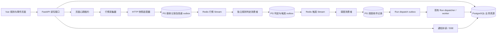

# 价格监控技术方案：HTTP 第一版草案

| 项 | 内容 |
|---|---|
| 版本 / 状态 | v1.0-draft · 第一版范围已确认：HTTP 取价 + Redis Streams + PostgreSQL；待实施与验收 |
| 日期 | 2026-10-14 |
| 需求依据 | [Web 业务资料 PRD §7](web-business-data-prd.md#7-价格监控与自动分析) · PR-WATCH-01—04 · AC-11—16/21/24 |
| 实施依据 | [数据任务 DATA-09—15](../plan/web-business-persistence-tasks.md#4-监控事件与自动分析) · [页面任务 UI-08—11](../plan/web-business-ui-tasks.md#ui-08-监控配置与管理) |
| 外部技术调研 | [监控技术选项一手资料](../research/monitoring-technical-options.md) |
| 本文职责 | 冻结生产化架构、模块接口、状态与验证顺序；不重新定义产品需求，不宣称已有代码已上线 |

## 0. 第一版决策与交付边界

本版落实用户确认：先复用现有 HTTP 行情能力，隔离上游接入与下游消费，为 WebSocket 升级保留明确
接口。选型及业务范围作为第一版设计基线；下面标注“试运行建议”的数值仍须实测，不代表当前已部署。

| 项目 | 第一版决定 |
|---|---|
| 使用规模 | 少量用户、单机；不做用户并发配额，保留身份/数据隔离 |
| 行情来源 | 现有 HTTP 快照接口；先核验来源时间、精确价格、权限与市场口径 |
| 监控含义 | 定时检查有效快照是否符合保存的阈值/穿越策略，不保证发现两次采样间短暂触价 |
| 采样周期 | 试运行建议 900 秒（15 分钟），服务端配置；创建/恢复时安排一次有效检查建立基线 |
| 生命周期 | 研究工作台在线心跳控制监控；离线租约过期暂停，规则保留；已创建 Run 继续 |
| 消费通道 | Redis Streams：行情与触发分别消费，业务落库后确认；有重领、隔离、对账与保留策略 |
| 持久记录 | PostgreSQL：已接收行情、判定回执、触发事件、调度请求、Run 与审计 |
| 执行 | 触发后向原研究会话提交新分析；沿用现有 dispatcher，研究串行，总执行并发建议从 1 起步 |
| 交付范围 | 单市场、已验证报价口径、单次规则，支持提醒或自动分析；P0—P2 构成完整第一版 |
| 后续范围 | WebSocket 行情、重复布防规则、多 worker/用户配额；通过增量接口及迁移升级 |

第一版不启用 WebSocket 采集器，不要求前端直连供应商。HTTP 定时器仅负责产生采集任务；
判定、触发和 Run 模块均不依赖 HTTP、轮询周期或供应商原始字段。

## 1. 已理解的需求与硬约束

监控层不是“定时问一次 Agent”，而是一条无模型行情判定链，在可靠触发后才创建普通分析 Run。
以下约束同时成立：

1. 规则属于用户和研究，可绑定该研究的计划；创建、改版、暂停、恢复、取消及历史可追溯。
2. 当前按页面在线监控设计：后端以页面心跳租约决定采集及触发资格，关闭/休眠后超时暂停；
   规则和历史保留，已创建 Run 继续执行。暂停前已接收但尚未触发的行情仍留处理记录，不补造离线触发。
3. 常态行情采集、时效校验和阈值判断不调用 LLM；提醒规则永远不创建模型任务。
4. 触发事件、自动分析派发、Run 运行和分析结果是不同状态；分析失败不能恢复规则的单次触发资格。
5. 价格判断使用精确十进制，记录供应商观测时间和本地接收时间；过期、乱序、重复、休市、停牌、
   口径不符及缺少可靠时点的报价不得伪装成有效实时触发。
6. 第一阶段只交付单次规则；创建时已满足、断线恢复和普通穿越分别执行已保存策略。
7. 自动分析在真正调度时重新检查规则、研究、权限、有效期、资料、队列和预算，再冻结不可变快照。
8. 同研究的手动 Run 与自动 Run 串行；事件到 Run 幂等，崩溃恢复不能重复创建或并行执行。
9. 触发价与分析开始价分别保存；达到预算、缺资料、排队过期及后台故障都保留触发事实。
10. 通知先持久化再推送，支持游标补读；SSE 断线不丢事实，也不作为后台在线的证明。

### 1.1 当前规模与升级边界（2026-10-14）

当前只服务少量用户，以有限资源、单机部署为基线。首版暂缓用户级并发配额、按用户加权调度和
用户级周期预算平台；不把多租户容量或水平扩容作为上线前提。用户身份、所有权校验及数据隔离仍须完整。

- 用统一的系统 Run 总并发上限保护机器和模型供应商额度，手动与自动 Run 共用执行准入；保守起步为 1，
  经测量后调整。行情请求另设有限并发、超时和供应商限频，不占模型执行槽。
- 待执行队列有容量上限和最大等待时间。队列满时自动触发事件仍持久保存并显示延期原因，过期则明确终止；
  手动请求给出可操作回执。缺资料和等待队列的任务不占执行槽，不能无限积压或静默丢弃。
- 研究级串行、事务/唯一约束、幂等、租约与过期 worker 防护、行情质量门、备份恢复和事件补读不降级。
  即使只运行一个实例，也要防止重启或部署交接时重复执行。
- 总并发、队列容量、轮询批量、采样间隔和保留期限使用配置；保留 user/research/event/run 身份与用量，
  将准入策略集中在调度边界。暂不创建通用用户配额表或插件框架，以便未来通过增量迁移扩展。

升级条件与执行步骤见 §14；本节是范围约束，不是已实现能力声明。

## 2. 当前代码基线与生产缺口

仓库已有可复用骨架：

| 已有模块 | 已有能力 |
|---|---|
| `server/watch_rules.py` | 单次规则、不可变版本、幂等写入、暂停/恢复/取消 |
| `server/watch_eval.py` | `Decimal` 判断、观测去重/乱序过滤、初始越线/断线恢复、原子创建事件 |
| `server/watch_scheduler.py` | 事件校验、次数预算、缺资料请求、Run/快照/outbox 原子创建、终态对账 |
| `server/dispatch_outbox.py` | Run 派发租约、研究串行和崩溃恢复 |
| `server/business_events.py` | 持久通知、已读/隐藏/设置、游标回放与 SSE |
| `BusinessMonitorCenter.vue` | 规则创建、暂停/恢复/取消和事件列表 |

这些代码证明状态模型可行，但还不能打开生产监控：

1. `monitor_loop` 和 `scheduler_loop` 挂在 FastAPI lifespan。多 API 实例会重复拉行情；API 重启也会中断监控。
2. 当前真实行情适配器把供应商时点标为 `time_source=unknown`、价格经过 `float`；判定函数仍可能采用它触发。
   这违反“缺可靠观测时间不得冒充实时触发”的需求，是首要放行阻断项。
3. 活跃规则按固定排序截取前 `max_rules`，标的再截取前 `max_symbols`，没有 `next_due_at`、公平游标或租约；
   规则数超过批次后可能长期饿死。
4. 行情拉取是同步接口，直接运行在异步循环中；慢供应商会阻塞同进程的 API、通知和调度。
5. 行情批次只按 symbol 合并，没有把 provider、market、quote basis 和权限域作为完整采集键。
6. 自动调度循环没有独立事件领取租约；多实例虽靠事件行锁和幂等约束兜底，但会重复扫描、争锁和合并。
7. 预算只落实每规则版本 `max_runs`；还需验证手动/自动共用的总并发准入、有界队列及用量记录。
   用户级并发和周期预算属于后续升级；token 硬预算在计量可靠后实现，不作为当前已具备能力。
8. UI 仍显示“后台状态待接入”；没有 worker 心跳、规则监控延迟、行情源故障或恢复缺口的可读状态。
9. 真实供应商的权限、盘中更新频率、时点语义、限频、停牌/复权与容量尚未完成受控实测。
10. `watch_observations` 持续增长，但保留、压缩、删除和事件证据永久化策略尚未冻结。

## 3. 推荐架构

### 3.1 结论

第一阶段采用 **HTTP 定时取价 + Redis Streams 消费通道 + PostgreSQL 业务真源 + 独立采集/判定与 Run 执行**。
Redis 在本期承担行情及触发通知的缓冲、消费者确认、待处理查询和重领；PostgreSQL 保存接收记录、
规则、判定结果、触发事件、消费回执与 Run outbox。完整性通过两者配合实现，不依赖内存日志或 Redis
持久化单独保证。暂不引入 Celery、Kafka 或 Temporal。

选型原因是用户要求对长达半小时的 Run 场景提供可查询、可重试、可恢复的完整消费路径；
不是假定当前已经有高吞吐瓶颈。消息接收/处理确认与 Run 执行完成分开，边界见 §15。

FastAPI 内嵌循环只保留为显式的本地开发模式。当前采用单机上的独立后台角色，各角色单实例，
与 API 分离生命周期并由进程管理器拉起；复用现有 Run dispatcher，不要求多机或容器编排：



- 采集器：目标领取、HTTP 批量取价、规范化、接收记录与可靠投递，不导入 LLM；未来替换驱动接入订阅。
- 判定消费者：消费行情 Stream，校验质量与规则状态，持久保存结果后确认；不等待 Run。
- `watch-scheduler`：消费触发 Stream 并持久接收，之后按研究串行与资源条件创建 Run；不直接调用模型。
- 现有 `dispatch_outbox`：继续负责研究串行、worker 派发和运行恢复。
- API：规则操作、状态查询、通知流；不承担生产常驻监控的存活责任。

### 3.2 处理语义

系统采用 **至少一次采集/调度 + 数据库幂等收敛**，不声称端到端 exactly-once：

- 行情可能重复获取；观测身份使用 provider + instrument + quote basis + vendor sequence/event id，
  缺少序号时再使用可靠观测时间、价格和口径组成稳定摘要。
- 判定与“消耗单次资格 + 创建事件”在一个事务中，唯一约束保证同一规则版本只产生一个单次事件。
- 事件到 Run 以 `(event_id, generation)` 唯一；调度重试复用同一 Run，用户明确重新分析才增加代次。
- 外部行情请求与 LLM 请求无法纳入数据库事务；每次尝试必须留痕，网络不确定不能被记作“未调用”。
- PostgreSQL outbox 向 Redis 投递采用至少一次语义；业务 ID 去重与消费回执关闭跨存储故障窗口。
  Redis 接受消息不代表消费已完成，定期对账修复缺失投递；`LISTEN/NOTIFY` 只可作为辅助唤醒。
- 用户级 SSE 使用持久事件 ID 续读；断线后按 `Last-Event-ID` 或等价游标补读，游标已过保留期时
  返回 `reset_required` 并重取快照，不能假装没有缺口。

## 4. 深模块与接口

复杂度集中在以下深模块，调用方不需要理解供应商字段、时区、租约或状态机细节。

### 4.1 行情接入与标准观测

```python
class HttpQuoteSource(Protocol):
    async def capabilities(self) -> SourceCapabilities: ...
    async def fetch(self, batch: TargetBatch) -> ObservationBatch: ...

async def accept_observations(
    batch: ObservationBatch, *, source_epoch: str
) -> AcceptanceReceipt: ...
```

`ObservationBatch` 返回原始字符串价格、标准标的、market、currency、quote basis、供应商观测时间、
本地接收时间、序号、市场阶段、停牌状态、来源和错误。模块内部负责限频、超时、重试退避和字段映射。

`HttpQuoteSource` 只属于 HTTP 驱动；判定消费者不调用它。`accept_observations` 是稳定接收边界，
校验标准信封并在 PG 同一事务保存接收记录及 outbox，返回 accepted/duplicate/rejected 和原因。
后续 WebSocket 驱动把订阅消息规范化后调用同一接收接口，无需模拟轮询 `fetch`。

| 标准信封字段 | 约束 |
|---|---|
| schema_version、observation_id、target_id、trace_id | 稳定业务标识；重投沿用 observation_id，Redis ID 不充当业务身份 |
| provider、permission_scope、instrument、market、currency、quote_basis | 完整采集键；来源明确，不借用规则值掩盖供应商缺失或口径不符 |
| price、observed_at、received_at、time_source | 精确十进制字符串；缺失观测时间显式标记 unknown，禁止 now 兜底触发 |
| source_event_id、source_sequence、source_epoch | 供应商序号可空；epoch 区分接入切换/重连，序号按供应商作用域解释 |
| quality、market_phase、raw_evidence_ref | 质量及证据可追溯，unknown/gap 等状态不能伪装为正常行情 |

用户/研究绑定从持久规则映射解析，单个共享报价不携带一个固定用户身份。处理时校验适用规则版本及
有效时段，早于规则生效或属于已停用 epoch 的观测保留回执但不得触发新版本规则。

当前代码只验证到 HTTP 快照接入；WebSocket 支持、权限、数据粒度、断线补发和序号尚待供应商核验。
拉取与订阅统一输出观测信封，接收通道再负责持久化及投递；不将 HTTP 每 15 分钟采样称为完整触价流。

### 4.2 采集计划模块

```python
async def claim_due_targets(now, limit, worker) -> list[TargetLease]: ...
async def finish_target(lease, outcome) -> None: ...
```

采集目标按 `(provider, permission_scope, market, instrument, quote_basis)` 聚合，多条规则共享一次报价。
模块隐藏 `next_poll_at`、退避、租约、fence token、公平排序和失败计数。领取使用数据库时间，完成写入必须
匹配 fence token，过期 worker 不能覆盖新 worker 状态。

调度边界从上一计划时点推进，避免慢请求造成永久漂移。停机恢复采用 `latest_only`：恢复后获取最新可靠
行情并按断线策略处理，不逐个补跑停机期间本应发生的轮询，也不虚构漏掉的穿越。

第一版采样细则：

- 创建/恢复后按供应商限流安排首次检查，此后按配置周期推进；错过多个周期只安排当前一次采样。
- 同一目标只允许一个在途采集；同权限/口径下可将多个到期标的合并成供应商支持的批次。
  请求超时、限流与有限重试只影响采集状态，不能创建重叠请求队列；周期内重试须有总耗时上限。
- 同步 HTTP 代码通过有界线程池隔离或改成异步客户端，不能直接阻塞 API/消费事件循环；
  实际网络超时需生效，取消等待不等于底层请求已停止。
- 页面在线租约按认证用户聚合，任一研究工作台标签页在线时，该用户已启用规则可监控；
  多标签页共享目标，不重复取价。心跳建议 30 秒、租约建议 120 秒，试运行校准；后台页定时器
  延迟或休眠导致租约失效时明确展示暂停，不能声称浏览器打开就始终有效。
- 自动离线暂停与用户手动暂停分开；重新在线仅恢复自动暂停规则。已有其他在线用户使用同一目标时，
  仅暂停离线用户的判定资格，不停掉共享采集。判定提交及 Run 创建均复核当前租约，关闭不是瞬时停止。

### 4.3 判定模块

```python
async def evaluate_observation(target_id, observation) -> EvaluationResult: ...
```

接口保持一条观测进、一份确定结果出；内部在事务中锁定相关规则，应用质量门、时序门和状态机，落观测、
更新基线并创建事件。固定时钟和脚本行情通过同一接口测试，不从模块内部创建时钟或行情客户端。

### 4.4 事件调度模块

```python
async def claim_events(now, limit, worker) -> list[EventLease]: ...
async def schedule(lease) -> ScheduleOutcome: ...
async def reconcile(limit) -> ReconcileStats: ...
```

内部处理规则有效性、研究状态、资料、规则次数预算、系统队列准入、最新快照、合并、过期和 Run outbox。调用方只循环
领取和报告结果，不能自行拼 Run 或绕过业务准入。

### 4.5 健康模块

```python
async def monitoring_health(user_id=None) -> MonitoringHealth: ...
```

统一给 UI 和运维返回 worker 心跳、行情源状态、最近成功观测、规则预计间隔、实际延迟、积压、最近缺口
和退化原因。健康状态来自持久心跳和指标，不以 SSE 连接或 API 存活代替。

## 5. 数据模型增量

在现有 `watch_rules / watch_rule_revisions / watch_observations / watch_events / watch_event_runs /
watch_budget_usage` 上增加：

| 数据 | 关键字段 | 目的 |
|---|---|---|
| `watch_targets` | provider、权限域、market、instrument、quote_basis、next_poll_at、backoff_until、lease/fence、last_success、failure_count | 合并相同行情请求、公平领取、恢复和退避 |
| `watch_target_rules` | target_id、rule_id、rule_version、active | 规则改版后明确换目标，旧版本不继续判定 |
| `background_workers` | kind、instance_id、started_at、heartbeat_at、version、config_digest、last_error | UI/运维可判断后台是否在线及加载哪版配置 |

首版复用 `watch_budget_usage` 及 Run/outbox 保存规则次数和尝试用量；执行槽的租约与归还语义
由统一 dispatcher 管理，不新增用户并发预留表。后续启用跨用户周期或 token 硬预算时，再增量增加
`watch_budget_reservations`（scope、owner、event/generation、预留/实际值、状态），并补齐幂等结算。

触发事件必须永久保存其判定证据；普通未触发观测按配置保留并可分区清理。建议将“用于事件的观测”通过
外键或完整快照固定，不依赖后续会删除的普通观测行。保留期限在容量实测后冻结，不先写死产品值。

## 6. 行情质量门

生产触发前必须全部通过：

1. 标的、市场、币种、quote basis 与规则版本完全一致。
2. 价格来自十进制字符串或供应商最小报价单位；只提供二进制浮点的 adapter 不具备生产触发能力。
3. `observed_at` 来自供应商或交易所，并通过最大陈旧、未来时钟偏差和单调序号检查。
4. `time_source=unknown` 只更新“检查失败/待核定”和后台健康，不能更新触发基线或创建事件。
5. 行情处于允许的市场阶段；休市、集合竞价、停牌、熔断及盘后价是否可用由 quote basis 明确配置。
6. 供应商发生复权口径、合约换月、拆并股或代码映射变化时，目标进入 `needs_review`，不静默改阈值。
7. 断线恢复记录 gap；不能用恢复后的一个报价推断断线期间发生过的穿越。

首批市场只开放通过能力矩阵验证的 `market + quote basis` 组合。页面选择项由后端 capability 返回，
不把当前三个静态下拉选项当成真实支持承诺。

## 7. 单次与重复触发状态机

### 7.1 Phase C：单次

保留现有 `armed + baseline` 模型，但补齐显式原因：

- 首次有效观测：按 `trigger_now / wait_requalify`。
- 正常连续观测：仅有效穿越触发。
- 断线恢复：按 `trigger_once / wait_requalify`，事件带 gap。
- 触发后：`armed=false`，无论分析成功或失败都不重新布防。
- 改版/恢复：清空旧基线，以新版本策略处理首个有效观测。

### 7.2 Phase D：重复

在供应商和单次链路通过后再增加 `waiting_requalify / armed / cooldown`：

- 重新布防必须先越过独立的 rearm boundary，再出现新的正向穿越。
- 冷却结束本身不触发，也不自动重新布防。
- 冷却期间穿越只记抑制原因；到期不补发旧穿越。
- hysteresis 支持绝对价格或 bps，但必须按资产 tick size 校验。

## 8. 自动分析与预算

调度顺序固定为：

1. 领取事件并获得 fence token。
2. 检查规则版本/状态、研究、用户授权、有效期和最大分析延迟。
3. 检查系统队列容量和规则次数限额；不在此时占用执行槽或扣减尚未创建的 Run 次数。
4. 检查账户/主计划/必要字段；缺失则创建持久补数请求并保持事件关联。
5. 获取并保存“分析开始行情”；若不满足时效策略则过期或降级，不复用触发价冒充当前价。
6. 原子复核队列容量、规则次数限额并记账，构建不可变快照，创建 Run + `watch_event_runs` + dispatch outbox。
   dispatcher 真正启动时统一取得系统执行槽及研究锁，并复核资料/行情时效；快照失效时不得静默执行。
7. Run 终态后幂等记录用量、释放执行槽并通知；失败保留原 Run，可明确创建下一代分析。

首阶段必须支持每规则版本最大 Run 数、系统总并发上限、有界队列、执行超时和有限重试，记录所有
实际调用尝试与用量。不确定调用先对账；不能仅因租约到期就认定旧进程已停止并释放资源或重启付费任务。
每用户每日自动 Run 数、用户级并发及 token 预留/结算延至 §14 的升级阶段；token 硬预算依赖可靠计量。

## 9. 部署、恢复与可观测性

### 9.1 部署模式

| 模式 | 用途 | 限制 |
|---|---|---|
| embedded | 本地开发与确定性测试 | 只允许一个 API 实例，UI 明示非持续监控 |
| worker | 小规模生产候选 | 单机，API 与后台角色独立生命周期，各角色单实例；保留租约以支持安全重启及后续扩容 |

优雅退出先停止领取，再在租约期限内完成或释放；强制退出由租约过期恢复。数据库恢复模式阻止行情消费、
事件调度和 Run 派发；恢复后按规则状态、事件有效期和 fence token 重新裁决。

### 9.2 必备指标

- 行情：请求数、批大小、延迟、429/5xx、超时、陈旧/乱序/未知时点、每目标最新有效观测延迟。
- 规则：active 数、due 积压、p50/p95/p99 polling lag、公平性、触发/抑制/去重原因。
- 事件：pending 年龄、schedule lag、expired/merged/needs_input/blocked_budget、事件到 Run 延迟。
- Run：手动/自动 Run 排队/运行/成功/失败/超时、总执行槽占用、队列深度/最老任务年龄、规则次数与实际用量。
- worker：心跳、lease 丢失、fence 拒绝、循环耗时、配置摘要和版本。
- 消费通道：各 Stream 未读积压、pending 数/最老年龄、重领次数、投递失败、业务接收与判定延迟、
  隔离消息、outbox 未完成数、Redis 内存/磁盘/AOF 错误及保留余量；Run 执行时长独立展示。

结构化日志统一携带 `user_id_hash / research_id / rule_id / rule_version / target_id / event_id / run_id /
worker_id / fence_token`，不写完整资金、持仓或凭据。

## 10. 技术选型边界

| 方案 | 当前决定 | 重新评估条件 |
|---|---|---|
| FastAPI 内嵌循环 | 仅开发模式 | 不作为生产常驻方案 |
| PostgreSQL 领取 + outbox | Phase C 推荐 | 先完成容量与锁竞争实验 |
| Redis Streams | 本期纳入选型，消费通道见 §15 | 需通过确认边界、断电/重启、积压/保留及对账恢复验证 |
| Celery | 暂不引入 | 通用后台任务体系显著扩展且确需统一任务框架 |
| Temporal | 暂不引入 | 多日、多阶段人工/外部回调工作流显著增加；不用于高频行情 tick 入口 |
| Kafka/NATS/流平台 | 暂不引入 | 多供应商流式行情、数万目标或多消费者回放需求经实测出现 |
| HTTP 行情 | 第一版确定采用 | 数据能力核验通过后以 15 分钟可配置采样试运行 |
| WebSocket 行情 | 后续升级，边界见 §16 | 供应商提供符合要求的订阅、时间/序号与恢复能力，并有更高时效需求 |

迁移决策以观测数据为准，不以“分布式更先进”为理由。建议设重新评估信号：数据库领取 p95 超过目标、
锁等待持续增长、供应商推送成为唯一满足 SLA 的方式，或单库事件保留/吞吐触及容量门。

## 11. 值得研究的实验

### R1 供应商能力与真实性（最高优先级）

- 在开盘、休市、停牌和异常网络窗口采样；核对 vendor observed time、received time、序号、价格口径、
  批大小、权限、429、更新频率和数据修订。
- 与供应商官方字段定义和可复核行情对照；给每个 `market + quote basis` 形成 capability 结论。
- 退出标准：无法得到可靠观测时点或十进制价格的组合不开放自动触发。

### R2 公平调度与容量

- 首版以少量用户、实际预期规则数及其数倍突发负载验证，记录标的复用率与采样间隔；
  1,000/10,000 规则档作为未来扩容实验，不作为本期放行门槛。
- 测量供应商请求量、数据库 CPU/锁等待、polling lag、事件调度延迟和观测增长量。
- 验证任何到期目标不会因批次上限长期饥饿。

### R3 确定性状态机

- 固定时钟脚本覆盖穿越、一直越线、阈值附近抖动、乱序、重复、未来时间、陈旧报价、断线恢复、
  创建时已满足、暂停/改版/取消竞争、复权口径变化。
- 每条序列同时断言事件数、触发原因、基线、资格和通知，模型调用数必须为零。

### R4 崩溃与多实例

- 在取价后/落观测前、事件提交后/调度前、Run 创建事务中、outbox 领取后分别强杀进程。
- 两个 monitor 和两个 scheduler 并行运行，验证租约、fence、唯一约束与公平性。
- 恢复后不重复创建事件或 Run，不启动已取消/过期规则。
- 在 Redis 投递成功但 PG 未更新、PG 消费提交但 XACK 失败、Redis 数据回退/丢失时注入故障；
  依靠持久接收记录、outbox 和回执对账重投，不重复触发。
- 模拟 Run 持续 30 分钟且新行情持续进入，验证采集/判定不中断；队列满、消息重领与隔离均可查询。

### R5 自动分析价值与成本

- 对相同事件比较：仅通知、立即自动分析、延迟合并分析。
- 记录触发到分析延迟、成功率、缺资料率、超时率、token/费用、用户是否实际查看或继续操作。
- 只有自动分析带来可用增量且预算可控时，才扩大默认开放范围。

## 12. 分期实施与放行门

### P0：真实性与进程拆分

- 修复 `unknown` 时点仍可触发；定义供应商 capability 和质量门。
- 交付 HTTP 驱动、标准观测信封与接收边界，记录接口批量/限流/更新时间的实测结果。
- 新增公平的 `watch_targets` 领取、worker 心跳、独立进程命令和健康接口。
- 建立页面在线租约、PG 接收/outbox/回执及 Redis Streams 通道，冻结容量、持久化和恢复配置。
- 完成 R1、R2 的小规模基线。此阶段不开放用户生产规则。

### P1：单次提醒闭环

- 单市场、通过验证的一种 quote basis、单次规则、notify-only。
- 完成多实例、断线、乱序、崩溃和通知补读验收。
- UI 显示采样频率、最新可靠观测、后台健康和退化原因。

### P2：单次自动分析

- 开放 `auto_analyze`，补齐系统总并发/队列准入、规则次数控制、分析开始行情、缺资料续接、Run 状态回写。
- 与手动 Run 共同验证研究串行、超时、预算、快照和成本。
- 原会话显示独立的监控触发消息与新 Run 状态，带 event_id、规则版本、触发价/时间和研究归属；
  标记来源为监控，不伪装用户手动输入。刷新后从持久记录重建，通知丢失不能丢会话运行记录。
- “发起新一轮对话”在本版指关联原会话的新 Run：研究对象、分析意图、计划/账户快照与触发证据
  显式传入。沿用仓库规定，watch Run 不读写普通聊天的连续上下文载体；未来变更须另行设计，
  不通过把历史 turns 拼成提示词来补齐。

### P3：重复规则与扩展

- 完成 rearm/hysteresis/cooldown 状态机后再开放 repeat。
- 根据 R2 数据决定是否引入推送行情、分区表或扩展现有 Redis 消费实例。

每一阶段都必须有真实 PostgreSQL、脚本行情、多实例故障注入和浏览器证据。模拟源通过只证明状态机，
真实源通过只证明供应商链路；两者不能互相替代。

## 13. 尚待产品/运维冻结的参数

1. 首批 market、quote basis 和供应商权限范围。
2. 初始采样建议 15 分钟，及服务端允许的调整范围、在线心跳/租约；页面注明定时检查，不承诺逐笔触价。
3. 最大报价陈旧、未来时钟偏差、断线 gap、最大分析延迟。
4. 系统总并发、队列容量/最大等待、每规则次数、执行超时与重试上限；用户级配额及 token 硬预算后续冻结。
5. 普通观测、触发事件、通知、Run/产物的保留期限。
6. 自动分析失败后的人工重试权限与下一代分析上限。
7. 本机部署休眠、断网和升级窗口的服务承诺。
8. Redis 版本、AOF/备份策略、Stream 保留与内存上限、消费超时/重领及隔离阈值；
   PG 接收日志的恢复窗口和供应商无法补发时的缺口处理。

这些参数必须由供应商实测、容量实验和运营约束共同决定，不从示例数字直接升级为默认配置。

## 14. 可执行的升级路径

升级以持续排队、行情检查延迟、资源占用和实际使用分布为依据，阈值随首批容量基线冻结。

| 阶段 / 触发信号 | 执行动作 | 验证与回退 |
|---|---|---|
| 当前：少量用户、单机 | Redis Streams + PG 记录，各后台角色单实例；系统总并发与有界队列 | 验证满载/消息重领/双存储故障/重启；界面能追踪投递和执行 |
| 资源有余量但持续排队 | 先调整总并发、批量、采样档位；按供应商限额逐档增加 | 对比等待时间、内存、限频和错误率；配置退回旧档位，运行中任务安全排空 |
| 单个用户持续占满队列、影响其他用户 | 增量增加用户并发/周期额度与公平调度，复用现有身份和用量；旧用户使用兼容默认值 | 先观测策略结果，再小范围启用；可关闭新策略回到系统总限额，不影响所有权隔离 |
| 单机能力经测量不足 | 增加 worker 实例，必要时分机；沿用 PostgreSQL 领取与 outbox，执行槽必须由数据库统一协调 | 先验双实例、租约/fencing、共享总上限及故障恢复；缩容先停领取并排空，不能盲目重派 |
| 计量可靠且需更细成本控制 | 增加系统/用户周期及 token 预算预留表，明确预留、结算和不确定尝试状态 | 兼容旧 Run/事件，不重复扣账；灰度启用并可关闭新准入策略，已发生用量继续记账 |

所有升级遵循增量迁移、兼容读取、受控启用、观测验证和可回退配置的顺序。Redis 消费者扩容前必须
验证同标的顺序和全局资源上限；回退先停领取并对账，不能同时启用两条无协调的派发路径。

## 15. Redis Streams 消费与恢复契约

### 15.1 两条通道与确认边界

Redis 承担消费过程管理，PostgreSQL 承担持久业务状态和保留期内的重建依据。Redis 消息 ID 仅作运输
定位，稳定的 `observation_id / event_id / generation` 用于业务幂等。每个信封含 schema_version、
目标/规则版本引用、来源时间、接收时间、trace_id；用户和会话归属由服务端记录解析并校验。

| 通道 | 生产端 | 消费端 | 何时 XACK |
|---|---|---|---|
| `monitor:quotes` | 采集接收日志的 outbox relay | 规则判定器 | 该观测适用规则的判定结果、必要触发事件及回执提交 PG 后 |
| `monitor:triggers` | 触发事件事务中的 outbox relay | 调度接收器 | 按 event_id/generation 幂等写入 PG 调度收件记录后 |

调度收件记录状态为 queued/waiting_resource/needs_input/expired/run_created 等；之后由持久调度循环
复核规则、在线租约、有效期和资源，创建 Run 与现有 dispatch outbox。它不会在消费者里同步执行分析。
已触发但页面离线、尚未创建 Run 的请求暂停，恢复后重新校验；已创建 Run 继续。
XACK 表示本阶段的责任已经持久交接，既不表示 Run 已完成，也不自动删除 Stream 消息。

一个 Run 执行 30 分钟期间，新的行情仍可采集和判定；其它触发请求可持久接收并排队。不能为等待 Run
而把行情消息保持 pending 半小时，也不能用 Run 的执行超时作为行情消息重领阈值。

### 15.2 记录与可靠投递

1. 接入层在 PG 同一事务写接收记录（报价原始证据/标准字段）和行情投递 outbox；提交后才称已接收。
2. relay 领取 outbox，向 Redis `XADD`；投递结果写回 PG。跨存储没有原子事务，允许重复发送。
3. 判定消费者按 observation_id 与规则版本去重，在事务中保存判定、单次资格、触发事件与触发 outbox。
   未达到、陈旧、乱序、暂停、错误也有原因记录；规则多时分批保存进度，全部完成才确认行情消息。
4. 触发消费者持久接收后 XACK；Run 创建及派发重试继续由 PG 状态与现有 outbox 管理。
5. 独立对账任务以业务完成回执为准重投未完成数据，不能仅凭 outbox 的 sent 或 Redis 的 XACK
   判定最终成功。Redis 恢复旧快照或丢失消息后，可从 PG 保留窗口重建消费任务。

新增逻辑记录包括行情接收日志、Stream 投递 outbox、规则判定回执、调度收件与处理尝试；实施前核对
现有表可复用字段再确定迁移。关联链为 observation → rule/version → event → session → Run。
每次处理记录开始/结束、消费者、错误、重试及结果；“完整记录”指已接收数据的可追踪处理，
不承诺记录供应商未发送、HTTP 未采样到或入库前因故障丢失的行情。

### 15.3 顺序、重试和积压

- 首版判定消费组单活，规则状态仍有事务锁和唯一约束；同目标按接收顺序处理。
  存在待恢复的早期消息时先处理或持久标记缺口，不能让新报价抢先推进基线。
  多消费者升级须按 target 分区并串行化各分区，Redis 消费组本身不保证业务处理完成顺序。
- `XPENDING`/`XINFO` 用于检查消费进度；`XAUTOCLAIM` 回收超时 pending。阈值依短事务耗时配置，
  重领不能成为重复业务写入的理由，仍须幂等和过期领取防护。
- 达到有限重试上限的消息先写持久隔离记录，附原始引用、错误与处理次数，再确认运输消息。
  必须可查询、告警、人工修复后重放；影响某标的判定连续性的错误需暂停该目标并标记 gap。
- 最新价缓存可以覆盖旧值；判定队列不得这样覆盖。若保留窗口或容量不足，应暂停/降低接入并明确
  记录缺口；WebSocket 不能因接收变慢就假定供应商会完整补发。HTTP 仍采用不重叠轮询和超时。

### 15.4 持久化、保留和降级

- 首版可单机 Redis，无需 Cluster；使用持久磁盘、AOF、备份和内存上限，禁止把队列当可随意淘汰的缓存。
  建议独立实例采用 `noeviction`；满载时写入失败由 relay 保留 PG 待投递并告警，不将失败标成成功。
- AOF `everysec` 不是零丢失承诺，Redis 灾难后通过 PG 日志与消费回执恢复保留窗口内的已接收任务。
  PG 自身的备份、事务持久化和恢复目标仍须验收。
- Stream 只有在必要消费者均已处理或存在已核验重建依据时才能裁剪；禁止只设粗暴 MAXLEN 截掉
  未处理消息。PG 普通观测/回执按恢复窗口保留，事件证据单独固化，不能无限保留每个 tick。
- Redis 不可用时 PG 记录待投递，超过本地持久容量/最长等待则暂停采集并展示原因；PG 不可用时
  不确认业务接收，不生成触发，记录故障并停止或重连补查。不得自动切到无记录的内存派发。
- 页面关闭通过在线租约暂停监控，后台 relay/对账继续处理既有记录；恢复后的旧行情可审计但不能
  冒充当前有效价格重新发起分析。

依据：[Redis Streams](https://redis.io/docs/latest/develop/data-types/streams/)、
[XACK](https://redis.io/docs/latest/commands/xack/)、
[XAUTOCLAIM](https://redis.io/docs/latest/commands/xautoclaim/)、
[Redis 持久化策略](https://redis.io/docs/latest/operate/oss_and_stack/management/persistence/)。

## 16. HTTP 到 WebSocket 的升级隔离

### 16.1 模块依赖边界

| 模块 | 第一版责任 | 后续升级允许的变化 |
|---|---|---|
| HTTP 驱动/供应商适配器 | 定时获取与规范化 | 增加 WebSocket 连接、鉴权、订阅/取消、心跳、重连及补查驱动 |
| 标准接收接口 | 验证信封、持久接收、生成 outbox | 兼容新增可选字段；不把订阅 SDK 泄漏给判定器 |
| Redis 通道及 relay | 可靠投递、确认、恢复和进度查询 | 按实测调整分区/保留与消费者数，仍用业务 ID 幂等 |
| 判定器 | 精确价格、质量门、单次规则状态机 | 算法复用；推送新增来源质量/连续性能力必须补验证 |
| 调度及 Run | 研究路由、资源准入、快照、派发 | 不因采集协议变化改写会话/Run 接口 |
| 前端 | 规则、采样方式、来源时间、链路状态 | 增加“订阅监控”展示，业务归属与结果展示复用 |

隔离契约通过脚本观测源验证：同一组标准观测，无论由 HTTP 测试驱动还是模拟订阅驱动输入，
都得到相同判定和触发结果。第一版只交付脚本契约验证，不实现真实 WebSocket 客户端。

### 16.2 升级步骤与回退

1. 核实供应商订阅权限、推送粒度、序号作用域、连接限制和断线补发；失败则维持 HTTP 能力边界。
2. 新驱动只接入 `accept_observations`，通过独立观测 epoch 做影子运行；影子数据不触发业务 Run。
3. 验证序列、缺口、积压和保留容量，再按目标切换唯一的生效来源。原始报价去重不能代替来源切换控制。
4. 切换时暂停该目标判定，记录切换点与 epoch，完成旧消息对账，重建有效基线，再按恢复策略启用。
   禁止 HTTP 和 WebSocket 两路同时推进同一规则基线；切换时用户明确看到能力与监控状态变化。
5. 保留 HTTP 驱动作为可控回退。回退同样切换 epoch、对账并标记 gap；仅保留新快照不能证明断线期间
   没有触价，不能静默把订阅触价规则降为定时快照规则。

## 17. 第一版交付验收

以下检查覆盖第一版 P0—P2，全部通过后才可声称完整闭环可用：

1. 未达到条件：按周期持续采样，每次取价/判定均可查询，不产生模型调用；同目标不重叠请求。
2. 达到条件：原研究会话只生成一次有效触发及新 Run；来源、规则、时间和价格可追溯，刷新后仍存在。
3. 长 Run：模拟执行 30 分钟，采集/判定保持运行；其它事件排队、超时及资源受限原因可见。
4. 在线生命周期：多标签页去重、最后心跳失效暂停、手动暂停不自动恢复、共享目标不误停；旧观测不补触发。
5. 故障恢复：Redis 中断/重启/丢失、消费者在提交前后退出、重复投递/重领均能对账；不丢已接收业务事实、
   不重复创建 Run，无法恢复的行情缺口明确记录。裁剪后恢复能力严格限制在已声明保留窗口内。
6. 行情质量：unknown/陈旧/乱序/口径不符/休市停牌进入明确结果；首次已满足与断线恢复策略分别测试。
7. 资源保护：验证总执行并发、供应商限频、队列/磁盘/内存上限和消息隔离；满载不能静默清除未处理记录。
8. 升级边界：脚本源通过同一接收接口完成闭环，判定器与 Run 调度不依赖 HTTP 客户端或供应商字段。

上线前仍需确定 §13 中的运行参数和恢复窗口；这是容量与供应商实测工作，不改变本版已确认的技术路线。
