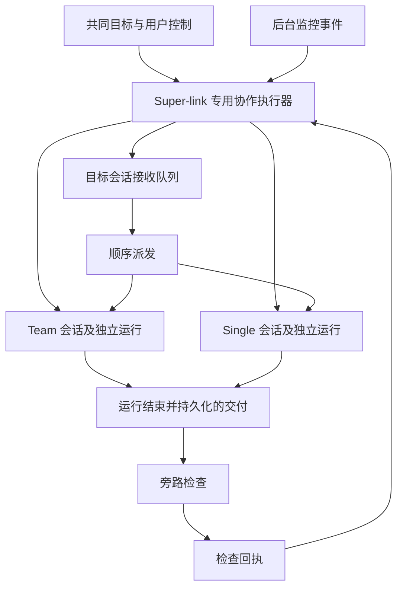

# Super-link 基础技术框架

| 项目 | 内容 |
|---|---|
| 版本 / 日期 | v0.7 · 2026-11-08（八项业务讨论形成基础共识；技术细节与业务调整空间保留） |
| 状态 | 架构建议；已确认约束见需求规格，存储/API/调度细节未冻结；未实现 |
| 需求依据 | [Super-link 需求规格](super-link-prd.md) |
| 实现依据 | 本文 §2 为 v0.1 编写时的仓库静态检查；本次只修订设计，未运行模型、服务、迁移或端到端测试 |
| 适用范围 | 新 Super-link 模式；不替代现有同研究切换模式的设计与历史验收记录 |

## 1. 架构约束

确认约束：共同研究对象与目标、各自独立业务状态；两个独立可延续会话；各轮结束并保存后通信；Agent 自主提出请求；旁路不编排；
接收方 FIFO；最大限度自主授权并保留删除等明确例外；原有能力及默认行为不被破坏。

采用独立的 Super-link 专用协作执行器作为编排方向，管理关系与交接，调用既有 Team/Single 执行入口。单个 Run 仍执行
一个工作流，Super-link 管理跨 Run、跨会话的协作，不将两个运行图拼成一个长期常驻 Run。
页面模式与底层 RunMode 分开表达，是否增加产品模式字段在实施设计时决定。

图中旁路只返回回执，队列与调度由协作模块负责。人工、协作、监控及本方后续执行请求
纳入同一接收会话的排序范围；具体入队与仲裁机制待设计，不得使用另一路入口绕过互斥。

### 1.1 专用协作执行器方向登记（2026-11-08）

用户确认以普通编排代码实现一套专门管理 Team 与 Single 通信和执行的协作执行器。
执行路径需要明确、可追踪：接收任务或交付、关联请求、调用旁路、管理队列、启动目标
会话运行、接收结果并根据后续意图继续或等待。该方向复用现有两种执行能力，不改造为
共享业务状态，也不新增替双方做研究决策的总控 Agent。

职责分工继续成立：Agent 判断业务下一步，旁路检查交付，执行器管理通信与执行路径。
研究问题和往返顺序可由 Agent 的实际请求推动，不固定为必须重复的 Team → Single 循环。

本方向不以引入 LangGraph、Redis 或扩展 MiniDAG 为前提，也不预先禁止后续采用这些技术。
现有 MiniDAG 继续承担原有工作流；新执行器暂不扩展成通用的任意 Agent 图编排平台。
消息中间件如后续引入，可承担通知或分发，不能使协作规则散落在多个消费者中。

事件驱动、分步推进、等待时保存记录并释放本次调度，是当前设计建议；普通编排代码不等于
只依赖易失内存。持久化方式、数据库/outbox 复用、状态与事件模型、接口、后续意图格式、
队列调度、恢复与去重均需另行讨论，不在本次登记中冻结。

本节只记录编排方向，不确认第二个问题中的精确交接时点、保存完成检查或旁路介入顺序。
各自长期记忆的业务原则已另行确认，见 PRD §2.4 和本文 §6.2；无代码实现或部署动作。

## 2. 现有能力与缺口

| 现有位置 | 静态检查事实 | 对 Super-link 的含义 |
|---|---|---|
| [run_modes.py](../../server/run_modes.py) | single/team 映射两个 pipeline | 可复用单轮执行选择；没有据此证明跨会话协作已存在 |
| [Team spec](../../workflows/agent_team/spec.py) | coordinator、成员研究与汇总，接收既有连续性输入 | 保留 Team 内部规划；跨会话交付不冒充其成员消息 |
| [profile.py](../../server/profile.py) | v0.1 静态检查时 Team 已接语料工具，提示仍说明 market_* 不开放 | 属于逐步接入的缺口，不是长期限制；按 PRD §2.7 延续非监控工具，实际可用性逐项验证 |
| [orchestrator.py](../../server/orchestrator.py) | 会话连续性、运行派发、来源提交；watch 使用只读连续性 | 可复用执行能力；自动研究成果长期记忆需要另行接线，不能仅靠 watch 原生上下文写回 |
| [monitor_longterm.py](../../server/monitor_longterm.py) | 监控事件派发 single，含在线检查和顺序消费 | 监控执行有基础；不是通用的跨会话交接队列 |
| [watch_agent.py](../../server/watch_agent.py) | 目标读写、归属/版本/证据检查与容量约束 | 复用有回执的监控操作，不能绕过既有数据有效性约束 |
| [当前监控设计](agent-driven-price-monitoring.md) | 价格监控、在线要求、三目标及轮询规则 | 非价格条件、离线监控、批量对象容量均不能假定已支持 |

v0.1 编写前未发现独立 Super-link 规格。现有模式切换与价格监控均不等于新模式已实现。
本文的结构建议没有冻结新增数据表、公共 API 或生产部署拓扑。

## 3. 模块职责与隔离

### 3.1 共同对象、关系与独立状态

依据 [PRD §2.1](super-link-prd.md#21-共同研究对象与独立业务状态2026-11-08-确认)，建议保存
独立协作关系，关联共同目标及其版本、共同研究对象、拥有者、Team 会话与 Single 会话。
关系的运行控制状态与通信状态属于 Super-link；Team 的研究进展与判断、Single 的跟进、
监控和采用状态分别由各自维护，不增设要求双方共同更新的统一业务状态。
两个会话继续各自拥有 Run、原生上下文、轨迹与产物，不共享可变的上下文 head。
逻辑会话如何映射现有 Research Session、账户绑定和新建入口，在建表前明确；不修改
现有 Run 只能归属一个研究的约束，也不在此新增与 CONTEXT.md 冲突的研究回合定义。

Agent 可细化工作、修正研究假设、提出目标调整建议。交付中的请求不能静默改写用户目标，
也不能把研究材料或模型内容升级为系统权限。目标版本用于检查和追溯，版本变化处置待细化。

对象关联只解决“双方谈论的是谁/什么范围”，不代表双方结论、采用版本或执行状态相同。
交付与处理回执应能按对象和问题串联。接收方保存所引用的固定版本及本方处理结果，
不通过共享可变记录直接改写发送方交付，也不因新交付发布就自动改变接收方业务状态。
页面如需并列展示双方状态，应分别注明归属和来源，不能合并成无归属的统一判断。

具体对象标识、别名/证券映射、集合变化及关联结构在业务开发中补充，物理表设计不在本版
冻结。策略采用/生效规则仍待讨论；此处仅明确状态所有权及交付关系。

### 3.2 执行适配

通过小接口提交一次目标会话运行，传入目标引用、当前任务、已核验的交付引用和本轮配置。
保留现有 Team 主 Agent 规划和委派、Single 分析及工具循环。Super-link 专属提示和工具
只对本模式启用，不全局修改默认 profile，不要求原模式每轮生成交接记录。

新协作状态与普通研究分离。建议独立开关和执行额度，避免新模式积压占满旧模式容量；
具体配额和独立进程/部署方案待定。逻辑隔离不自动等于资源隔离。

### 3.3 旁路检查

旁路作为独立监管参与方，职责依据见 PRD §2.6。检查目标、任务和职责由明确的任务来源
提供，不能只采用交付方对要求的转述。检查上下文和记录独立归属，关联目标版本、交付
版本、问题、补充材料、异议与复核结果；不能与 Team/Single 的研究记忆混写。
是否实现为独立长期会话、存储及复核接口仍待设计，不从角色独立推导出第三个执行会话。

输入为共同目标、当前任务与双方分工、固定版本交付、必要证据及接收方已知能力。
输出为检查回执；接口不提供创建 Run、修改队列、写入监控目标等能力。

核查交流应表达发送方及检查用途，不冒充用户指令或双方的研究结论。旁路可核验证据、
要求说明缺口及复核异议，不替交付方补做研究再自行审核；需补充运行时由执行器安排。
复核保留前后结论和变化原因，具体次数、失败与恢复机制未冻结。执行后监管尚未确定，
不在本版扩展为全程监督或总控 Agent，也不默认开放双方全部内部历史。

程序检查来源/身份/版本/结构及可读性；语义检查可由模型辅助判断是否偏题、证据缺失和
无法推进。复杂研究正确性不承诺自动证明，旁路不是第二支研究团队。
执行结果按 PRD 的通过、附带说明、阻断、检查未完成表达；模型或工具异常不能当作通过。

接收方可读性检查遵循 PRD §2.2 的正式交付范围，不要求读取任一方完整会话。
旁路介入时机及是否区分准备检查和内容检查，属于第二个问题的技术细节，本版不冻结。

## 4. 建议交接契约

下表是待实现的最小概念，不是已冻结的 JSON schema。

| 对象 | 需要表达 |
|---|---|
| 交付身份 | 协作关系、发送/接收会话、来源 Run、交付 ID、固定版本与提交时间 |
| 任务依据 | 共同研究对象引用与范围、总体目标版本、当前问题、用户约束、相关研究/策略/跟进引用及观测截止时点 |
| 结果 | 结论、新增事实、证据/产物引用、完成程度、不确定性和未解决问题 |
| 行动请求 | 仅供知悉或请求执行、接收方要回答的问题、预期产出及请求理由 |
| 检查回执 | 被检查交付版本、结果、问题位置、相关目标/要求、证据缺口及检查失败原因 |
| 处理回执 | 实际接收与处理状态、目标 Run、采用/未采用内容及原因、真实工具回执引用 |

大文件采用可授权读取的版本引用，不复制整个内部执行历史。每份交付一经提交固定内容；
修正形成新版本并引用被修正交付，不能更改接收方已经采用的原文。支持按需读原始材料，
也必须让关键目标、限制、任务和问题直接出现在目标运行输入中。

引用读取仅涵盖正式交付材料及其可复核来源，具体范围见 §6.1；不把对方历史归档或整个
运行目录作为交付附件默认开放。

运行达到终态并完成保存，是提交交付的必要条件。正常完成、部分完成、失败与停止分别记录；
只有包含可使用结果、满足本次任务交接要求的交付才可进入执行队列。失败 Run 不能因为
有正文就被当作完整成功；用户主动停止后的自动交付行为须待停止语义明确后设计。

以上保留完成后交接的原则，不等于已选定可靠交接点的实现。运行终态、文件/证据保存完成
与旁路检查的具体衔接仍待重新讨论；不预设新增“交付就绪”状态或两阶段检查已经获确认。

## 5. 顺序执行与派发

按 [PRD §2.5](super-link-prd.md#25-任务执行顺序2026-11-08-确认)，同一会话每次执行
一个 Run，Team 与 Single 可同时运行，Team 内部仍可并行委派成员。人工普通任务、
协作请求、监控触发任务与本方后续请求统一排序及检查会话占用；不要求两个会话全局互斥。
单纯资料保存、回执记录和后台采集不必创建 Run。以下展示其中的跨会话交付流程：

以下为逻辑顺序示意；第 1—2 步的精确执行时点与确认机制是第二个问题的待讨论内容。

1. 发送方运行终结并完成结果持久化，登记固定版本交付。
2. 旁路检查并保存对应版本回执。阻断项回给发送方，修正的任务安排由协作模块处理。
3. 对允许传递的内容记录投递。仅供知悉的内容保存为可读材料，不强制启动运行。
4. 需要执行的交付进入目标会话队列，分配持久递增序号。
5. 在目标会话空闲且符合运行控制时，领取最早待执行项，创建并关联目标 Run。
6. 目标 Run 结束并保存后登记处理结果，再处理下一项；需要反馈时生成新的交付。

默认不合并、不覆盖、不越过队列项，不往正在运行的模型输入中追加新交接。
建议以执行请求的入队序号为 FIFO 依据；全来源纳入同一排序范围已确认，不同旁路检查
完成顺序、监控/人工/修正事件的具体入队时点和并发仲裁仍待设计，不能声称已实现。
暂不可执行的队首不能静默跳过；其技术故障与 Agent 按序处理后判断无需行动应分别记录。

执行时由 Agent 核验请求当前是否适用，可以继续、结束、请求补充或提出后续任务，并
保存实际结果。后排交付不自动成为已经采纳的依据；未处理材料的可见范围及紧急纠正
机制另行设计，不用重排或隐式改写上下文替代。

跨会话等待应保存所等待的问题、请求关联和进展，结束并保存当前 Run 后释放执行位置。
问题保持待答复，本方可按序处理不依赖该答复的任务；答复经过正式交付流程重新入队，
关联原问题，而非直接恢复一个长期占位的运行。等待记录、依赖判定、唤起与恢复接口
未冻结；不能以此允许跳过尚未处理的队列项，或宣称超时/循环依赖处置已经解决。

用户明确停止或暂停走运行控制，不等待普通任务队列处理完毕；控制生效与当前 Run
终止/保存的协调、剩余队列及在途交付处置仍待设计。Agent 的业务判断应形成回执或
新请求，不直接静默改队。运行控制不等于普通任务优先级或自动抢占机制。

建议使用持久派发记录和唯一关联避免同一交付重复创建业务运行，沿用可复用的事务/outbox
能力；具体表和租约实现待定。重放/崩溃恢复的验证必须区分消息投递、Run 创建和工具副作用，
不能仅凭队列去重宣称所有外部操作 exactly-once。重试次数与失败后继续规则暂缓。

## 6. 上下文、监控与版本

### 6.1 正式交付的读取范围

接收方延续自身合法上下文，加入带来源和任务身份的交付材料；不导入对方 system 消息、
伪造工具调用或把委托请求记成用户原话，不从展示 turns 重建 prompt。

按 [PRD §2.2](super-link-prd.md#22-正式交付与证据读取范围2026-11-08-确认)，跨会话传递的
对象是正式交付及其证据，不是对方完整原生历史或内部执行轨迹。接收方读取自身历史和已接收
交付；现有同研究 `research_history` 不因 Super-link 而默认扩展成任意跨会话历史查询。

资料库或公开来源可凭有效定位由接收方自身工具复取；生成的报告、计算结果与底稿通过交付
附件或固定版本引用提供。具体复制、只读挂载或受控取件方式待实现选择，必须验证接收方可读，
不能仅检查发送方路径存在。引用不可用时显式返回缺口，不静默打开对方整个运行目录。

接收方无法理解或缺少材料时提交具体补充请求；发送方在自己的会话检索历史或补做研究，
完成后提交新交付。接收方可复用既往交付的固定版本，保留来源、版本和时点；材料失效或
不可读取时如实表达。引用的保存与复取不自动授予接收方本轮工具执行回执资格。

### 6.2 各自记忆（业务原则已确认，实现待细化）

按 [PRD §2.4](super-link-prd.md#24-各自研究与跟进记忆2026-11-08-确认)，双方各自维护
研究与跟进记忆，对方成果通过正式交付进入本方。人工发起与自动触发均可产生有效积累，
不能仅因自动触发就排除记忆写入；收到、采用、验证和执行应分别表达。

现有 watch 的 `continuity=read` 不覆盖人工连续性载体；当前 worker 将监控作为独立执行，
按需检索人工研究归档，不默认重放整段人工对话。该限制不等于所有执行记录均未保存，
也不应直接成为 Super-link 自动研究的记忆策略。普通 watch 的既有语义保持兼容。

需要实现的业务能力如下，具体载体和接口未冻结：

- 各自保存判断、依据与适用时点、实际处理结果、未完成事项及结论变化原因；原始运行
  记录供追溯，不能只靠最终回复承载全部必要积累。
- 已接收交付保留来源和固定版本，本方解释、采用情况及待验证事项分别记录；摘要和
  检索不得将对方观点转写为本方已验证事实或真实工具回执。
- 新任务能够使用相关历史，但旧待办不因被检索或载入就自动执行；运行启动仍归编排层。
- 新结论保留与旧结论的关联、变化原因和时点，区分被推翻、过去适用及未解决分歧；
  不通过共享记忆自动修改对方业务状态。
- 用户重新介入时能够找到自动工作期间的重要成果及待办，不要求全部原始轨迹常驻上下文。

存储、写入时机、摘要与检索、上下文窗口、保留期限及恢复机制另行设计。设计与验证须
分别证明记录已保存、后续能够读取、当前任务能正确使用，不能仅以数据库有记录声称
连续记忆已完成。哪些内容自动继承、哪些按需检索仍待技术讨论。

### 6.3 监控与版本（实现仍待细化）

后台采集不占用 Agent 运行；已有监控可在 Team 研究期间继续。Single 接收策略后应核验
最新状态，避免将排队前的快照当现价。策略采用和生效时点、旧事件如何处置明确留待后续；
当前仅要求记录来源版本和实际处理，不预设“最新报告立即覆盖所有旧规则”。

对象当前是持续观察还是等待交易信号，应能在交付与本方处理记录中说明，并保留调整
理由及相关依据；不将其设计成双方共享可变状态，不预先冻结二值枚举、阈值或单向阶段图。
建立监控、等待信号、条件满足及真实成交分别表达。具体字段及扩展方式按 PRD §2.8 后续细化。

### 6.4 工具能力延续（逐步接入）

按 PRD §2.7，除监控专属能力外，Single 工具能力原则上延续到 Team。行情、财务、宏观、
检索和计算等研究能力逐步接入，Team 可以独立取得和复核市场资料，不强制经 Single 转交。
历史行情和指标计算不能仅因与监控有关就一概排除；监控建立、维护和处理仍属 Single。

接入需逐项核对工具注册、配置暴露、数据权限、执行资源及证据回执，不把计划能力视为
当前可用，也不借新模式修改普通 Team 的全局默认行为。具体清单、接入顺序、监控专属
工具边界及 Team 内部角色可用范围另行设计；本轮未实施任何工具接线。
旁路结合实际能力与任务分工判断交付，但不能因缺工具就豁免推进下一步必需的证据。

## 7. 自动化权限

业务下一步由 Agent 推理提出，执行范围由已授予的能力和资源确定。普通研究、计算、
监控维护与跨会话请求默认自动进行，不将常规旁路问题一律升级成人工审批。

删除等明确例外通过可信工具执行层落实；具体名单待讨论。现有归属、授权、沙箱、暂停
及资源检查仍有效，不以“最大授权”解释为关闭这些基础保证。命令行能力不因工具形态
而整体受限，实际动作决定是否属于例外。

真实下单是否纳入及其权限尚未决定，本技术框架没有券商执行接口、资金划转或成交模拟。
策略条件满足、监控触发和真实成交必须分开记录。

## 8. 实施前检查与验证框架

本节为建议顺序，不是已启动实施或已完成验收。

1. 明确协作关系与现有研究的映射，冻结最低交付、检查回执及队列接口。
2. 用确定性执行替身验证：两会话往返、结束后交接、检查结果、FIFO、信息消息不自动唤起。
3. 接入现有执行入口，验证专属配置、历史读取、工具权限和原有模式回归。
4. 验证场景一、场景二的真实链路，分别记录代码层通过与真实模型内容质量。
5. 补齐适用于发布范围的暂停/恢复、故障恢复、预算、策略采用和资源隔离决策，再讨论发布。

| 检查 | 预期证据 |
|---|---|
| 原能力兼容 | 原 single/team 不启用新交接逻辑；提示与工具配置未受全局污染 |
| 两会话连续性 | 多轮后各自历史可读，自动研究结果不丢失、不覆盖人工历史 |
| 对象与状态所有权 | 同一对象的研究状态和跟进状态可独立变化；新交付不自动覆盖接收方状态，分歧保留依据，采用/处理关联具体来源版本 |
| 交付证据读取范围 | 无需开放对方完整会话即可复核交付；接收方确实可读附件和来源；缺料走补充请求，已接收历史交付可按固定版本复用 |
| 各自长期记忆 | 自动多轮后人工提问可追溯当前判断、实际结果及待办；对方结论摘要后仍有来源和采用情况；结论变化可解释，旧待办不自行启动；对应 SL-13—SL-15 |
| 旁路语义 | 偏题/关键证据缺失/无法执行被识别；合法反证和接收方应核验项不被误拦 |
| 监管独立与复核 | 目标来源及检查记录独立，核查交流有身份与版本；异议复核可追溯，旁路无研究代做和运行启动职责；对应 SL-20 |
| 工具与跟进意图 | 逐项验证 Team 的非监控工具接入与原模式兼容；可解释观察/等待信号及其调整，不强制固定阶段或共享状态；对应 SL-21—SL-22 |
| 顺序与重放 | 忙碌期间多条交付按序处理；重复投递不创建重复业务运行 |
| 全来源排序与业务适用性 | 同会话多来源串行、两会话独立并行；过期事件按序复核并留结果，后排交付不冒充已采纳依据；对应 SL-16—SL-17 |
| 等待与运行控制 | 保存等待关系后释放 Run，答复按序续接；明确停止/暂停不排在普通任务后面，模型不静默改队；对应 SL-18—SL-19，恢复细节仍待设计 |
| 状态真实性 | 检查失败、部分完成、引用不可用、工具保存失败均有可见原因 |
| 研究闭环 | 研报→候选→监控回执→环境研究→Single 最新核验，来源版本可串联 |

## 9. 后续决策

以 [PRD §9](super-link-prd.md#9-明确暂缓的决策) 为准。策略生效、修正/重试预算、删除例外
和真实交易范围暂不冻结。第二个问题的可靠交接时点、保存完成确认、旁路介入和等待/恢复
需要进一步设计，不能直接将上一轮的两阶段检查建议当作实现要求。§5 已确认全来源统一排序和等待释放原则；
实施层另外需要确定建表与 API、会话创建/导入、入队时点与并发仲裁、等待依赖及超时恢复、
未处理交付的可见范围、紧急纠正、优先级调整与停止后的剩余任务处置、
旁路故障恢复、暂停/取消、数据生命周期与资源配额，以及 §6.2 的记忆写入、检索、摘要和上下文继承机制。这些待办不应伪装为已有实现。

§1.1 登记的专用执行器只确定实现方向，具体技术细节继续待议；不将普通编排代码方案
自动解释为已选择数据库轮询、Redis 分发或某种图引擎。

八项业务共识的回溯入口为 [PRD §2.9](super-link-prd.md#29-八项业务讨论回溯索引)。
旁路独立上下文的具体载体、复核机制和执行后监管范围，工具接入清单与边界，以及对象
跟进意图的表达仍需后续设计；基础原则明确不表示以上实现细节或全部业务调整已冻结。
