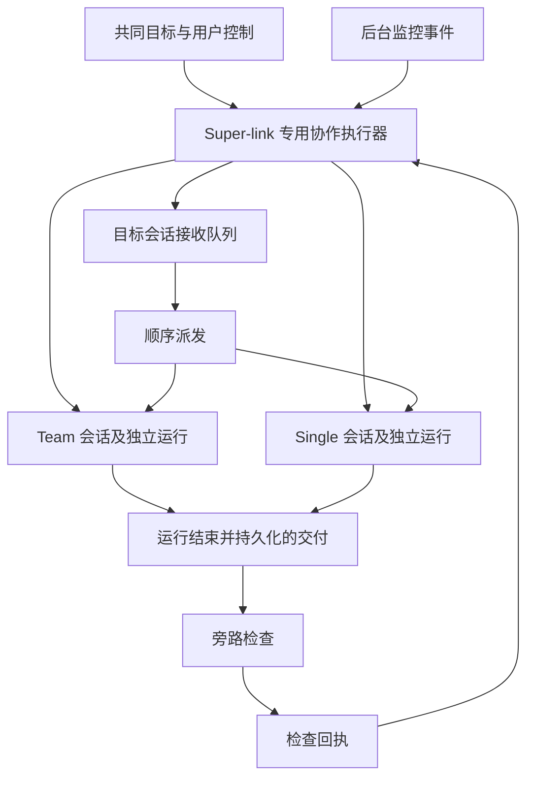

# Super-link 基础技术框架

| 项目 | 内容 |
|---|---|
| 版本 / 日期 | v0.18 · 2026-11-20（SSE-T01 契约与来源盘点完成，SSE 尚未实现） |
| 状态 | 独立入口、基础链路与控制面板已接通；本机 API 保持停止、Super-link 关闭，新迁移仅在隔离库验证（计划 §19） |
| 需求依据 | [Super-link 需求规格](super-link-prd.md) |
| 实施计划 | [基础通信建设计划](../plan/super-link-communication-foundation.md)，实际实现、验证及剩余范围见计划 §12—§16、§19；早期设计中的待办以这些实施记录更新为准 |
| 实现依据 | §2 保留最初静态检查；隔离 PG/Redis、真实 worker 配本地脚本模型验证双向往返；不代表研究质量或发布验收 |
| 适用范围 | 新 Super-link 模式；不替代现有同研究切换模式的设计与历史验收记录 |

## 1. 架构约束

确认约束：共同研究对象与目标、各自独立业务状态；两个独立可延续会话；各轮结束并保存后通信；Agent 自主提出请求；旁路不编排；
接收方 FIFO；最大限度自主授权并保留删除等明确例外；原有能力及默认行为不被破坏。

采用独立的 Super-link 专用协作执行器作为编排方向，管理关系与交接，调用既有 Team/Single 执行入口。单个 Run 仍执行
一个工作流，Super-link 管理跨 Run、跨会话的协作，不将两个运行图拼成一个长期常驻 Run。
页面模式与底层 RunMode 分开表达，是否增加产品模式字段在实施设计时决定。



图中旁路只返回回执，队列与调度由协作模块负责。人工、协作、监控及本方后续执行请求
纳入同一接收会话的排序范围；具体入队与仲裁机制待设计，不得使用另一路入口绕过互斥。

### 1.1 专用协作执行器方向登记（2026-11-08）

用户确认以普通编排代码实现一套专门管理 Team 与 Single 通信和执行的协作执行器。
执行路径需要明确、可追踪：接收任务或交付、关联请求、调用旁路、管理队列、启动目标
会话运行、接收结果并根据后续意图继续或等待。该方向复用现有两种执行能力，不改造为
共享业务状态，也不新增替双方做研究决策的总控 Agent。

职责分工继续成立：Agent 判断业务下一步，旁路检查交付，执行器管理通信与执行路径。
研究问题和往返顺序可由 Agent 的实际请求推动，不固定为必须重复的 Team → Single 循环。

本方向不以引入 LangGraph、Redis 或扩展 MiniDAG 为前提，也不预先禁止后续采用这些技术。
现有 MiniDAG 继续承担原有工作流；新执行器暂不扩展成通用的任意 Agent 图编排平台。
消息中间件如后续引入，可承担通知或分发，不能使协作规则散落在多个消费者中。

事件驱动、分步推进、等待时保存记录并释放本次调度，是当前设计建议；普通编排代码不等于
只依赖易失内存。持久化方式、数据库/outbox 复用、状态与事件模型、接口、后续意图格式、
队列调度、恢复与去重均需另行讨论，不在本次登记中冻结。

本节只记录编排方向，不确认第二个问题中的精确交接时点、保存完成检查或旁路介入顺序。
各自长期记忆的业务原则已另行确认，见 PRD §2.4 和本文 §6.2；无代码实现或部署动作。

### 1.2 基础通信计划更新（2026-11-19）

结合项目已使用 Redis 的事实，当前建议复用 PostgreSQL 权威记录＋Redis Streams 通知
的模式，在会话外构建专用通信模块。§1.1 的“不以引入中间件为前提”是早期方向登记，
不表示忽略既有 Redis；本次不另建通用编排引擎，也不把 Redis 当作运行或业务状态真源。

新增交付/接收/检查记录及独立 Stream/消费组，复用适合的现有派发能力。全来源 FIFO、
运行收尾可靠接点和协作来源身份尚需补齐，不能认为已有监控消费者直接具备这些能力。
只在输入、交付登记和收尾处适配；普通模式兼容默认行为、工具和上下文机制保留。

按空间、参与方和通信关系组织协议，首版一 Team、一 Single，允许独立空间并存；
一对多和新角色只预留契约扩展。前端独立协作 store/路由，复用完整研究视图。
具体接口、阶段任务、故障处理、兼容验收和待定项集中于
[基础通信建设计划](../plan/super-link-communication-foundation.md)，而非在两份文档重复冻结。

### 1.3 A2A 协作理念与协议适配边界（2026-11-19 补充）

依据 PRD §2.11，Team 和 Single 各作为独立协作参与方。Team 的对外接口封装整套研究
能力，不暴露子 Agent 寻址、内部计划或 AgentBus 消息；内部工作流继续独立演进。
Agent 使用通信工具表达交付意图，由宿主执行器负责可靠保存、校验、投递与运行启动。
提供通信工具不意味着把接收方降为无上下文的函数，也不意味着调用工具即已完成交付。

可借鉴的 [A2A 核心概念](https://a2a-protocol.org/latest/topics/key-concepts/)如下；本表为
语义对应建议，不是已实现的协议 schema，也不要求与现有数据库实体一一映射。

| A2A 概念 | Super-link 对应语义 | 保留的区分 |
|---|---|---|
| Agent Card | 参与方身份、公开能力及接口声明 | 能力声明不暴露私有工具配置或记忆；具体字段未冻结 |
| Message | 请求、补充问题、反馈及说明 | 消息不必触发 Run；协议 role 不等于人工授权身份 |
| Task | 一次协作请求及其处理生命周期 | 不等于整个研究会话、单个 Run 或双方共同业务状态 |
| Artifact | 正式报告、对象清单、监控成果与证据材料 | 引用仍需权限及可读性验证；固定版本交付不等于接收方已采用 |

建议分离三层职责：

- 协作语义：身份、能力、请求关联、交付与回执，由稳定接口表达。
- 内部可靠执行：PostgreSQL 权威记录、Redis 通知、旁路接点及 FIFO 派发，由项目实现。
- 外部协议适配：未来如接入 A2A，在适配位置处理标准接口、身份认证、生命周期和产物
  映射，不让 Team/Single 内核依赖具体传输或对方内部状态。

Redis 与 A2A 并非二选一；前者服务内部分发，后者规定跨 Agent 接口的交流方式。当前
Redis 消息结构不能仅因使用相似字段就称为 A2A。正式接入时需选定协议版本，验证标准
接口、能力声明、认证授权、任务/消息/产物语义及互操作，再声明实际支持的兼容范围。

旁路的目标/证据/可执行性检查、运行完成后正式发布、会话排队及故障恢复继续由
Super-link 保障。协议 Task 状态可以展示请求进展，不能替代任何一方的研究或监控判断。
本轮只记录定位及适配方向，不新增 A2A SDK、HTTP 服务、自动发现或通用编排框架。

### 1.4 第一批实现及隔离方式（2026-11-19）

[通信模块说明](../../server/super_link/README.md)记录本批内部接口与启动边界。代码包括
文本契约、独立空间/参与方、登记/发布、持久 outbox/收件和 Redis relay/consumer；
没有注册新路由、模型工具、后台循环或自动派发。现有工作流与监控入口未修改。

为避免新表成为旧服务就绪的前置条件，新模型使用独立 metadata 和可选 Alembic 入口，
不加入主迁移链或 `server.store.Base`。基础层显式调用后才使用其表和 Redis 命名空间。
部署前需另行安装和检查可选 schema；当前仅在隔离测试库完成迁移与恢复验证。

本批只发布固定文本，校验来源 Run 成功结束与原生连续性归档；没有附件快照、真实
收尾接点或业务语义审核。运输收件记录为 `awaiting_check`；真实旁路通过后的执行接受、
全来源 FIFO 与 Run 派发仍待接线。完整验收不能由这些基础层测试替代，详细证据见计划 §12。

## 2. 现有能力与缺口

| 现有位置 | 静态检查事实 | 对 Super-link 的含义 |
|---|---|---|
| [run_modes.py](../../server/run_modes.py) | single/team 映射两个 pipeline | 可复用单轮执行选择；没有据此证明跨会话协作已存在 |
| [Team spec](../../workflows/agent_team/spec.py) | coordinator、成员研究与汇总，接收既有连续性输入 | 保留 Team 内部规划；跨会话交付不冒充其成员消息 |
| [profile.py](../../server/profile.py) | v0.1 静态检查时 Team 已接语料工具，提示仍说明 market_* 不开放 | 属于逐步接入的缺口，不是长期限制；按 PRD §2.7 延续非监控工具，实际可用性逐项验证 |
| [orchestrator.py](../../server/orchestrator.py) | 会话连续性、运行派发、来源提交；watch 使用只读连续性 | 可复用执行能力；自动研究成果长期记忆需要另行接线，不能仅靠 watch 原生上下文写回 |
| [monitor_longterm.py](../../server/monitor_longterm.py) | 监控事件派发 single，含在线检查和顺序消费 | 监控执行有基础；不是通用的跨会话交接队列 |
| [monitor_pipeline.py](../../server/monitor_pipeline.py)（2026-11-19 补查） | PostgreSQL 权威记录，Redis Streams 传记录 ID，包含通知恢复机制 | 复用模式及适用代码，新通信记录和通道与监控业务隔离 |
| [dispatch_outbox.py](../../server/dispatch_outbox.py)（2026-11-19 补查） | Run 派发意图、租约、会话占用检查与恢复 | 通过执行适配复用，补齐 Super-link 接收记录及统一序号，不默认等同全来源严格 FIFO |
| [watch_agent.py](../../server/watch_agent.py) | 目标读写、归属/版本/证据检查与容量约束 | 复用有回执的监控操作，不能绕过既有数据有效性约束 |
| [当前监控设计](agent-driven-price-monitoring.md) | 价格监控、在线要求、三目标及轮询规则 | 非价格条件、离线监控、批量对象容量均不能假定已支持 |

v0.1 编写前未发现独立 Super-link 规格。现有模式切换与价格监控均不等于新模式已实现。
本文的结构建议没有冻结新增数据表、公共 API 或生产部署拓扑。

## 3. 模块职责与隔离

### 3.1 共同对象、关系与独立状态

依据 [PRD §2.1](super-link-prd.md#21-共同研究对象与独立业务状态2026-11-08-确认)，建议保存
独立协作关系，关联共同目标及其版本、共同研究对象、拥有者、Team 会话与 Single 会话。
关系的运行控制状态与通信状态属于 Super-link；Team 的研究进展与判断、Single 的跟进、
监控和采用状态分别由各自维护，不增设要求双方共同更新的统一业务状态。
两个会话继续各自拥有 Run、原生上下文、轨迹与产物，不共享可变的上下文 head。
逻辑会话如何映射现有 Research Session、账户绑定和新建入口，在建表前明确；不修改
现有 Run 只能归属一个研究的约束，也不在此新增与 CONTEXT.md 冲突的研究回合定义。

Agent 可细化工作、修正研究假设、提出目标调整建议。交付中的请求不能静默改写用户目标，
也不能把研究材料或模型内容升级为系统权限。目标版本用于检查和追溯，版本变化处置待细化。

对象关联只解决“双方谈论的是谁/什么范围”，不代表双方结论、采用版本或执行状态相同。
交付与处理回执应能按对象和问题串联。接收方保存所引用的固定版本及本方处理结果，
不通过共享可变记录直接改写发送方交付，也不因新交付发布就自动改变接收方业务状态。
页面如需并列展示双方状态，应分别注明归属和来源，不能合并成无归属的统一判断。

具体对象标识、别名/证券映射、集合变化及关联结构在业务开发中补充，物理表设计不在本版
冻结。策略采用/生效规则仍待讨论；此处仅明确状态所有权及交付关系。

### 3.2 执行适配

通过小接口提交一次目标会话运行，传入目标引用、当前任务、已核验的交付引用和本轮配置。
保留现有 Team 主 Agent 规划和委派、Single 分析及工具循环。Super-link 专属提示和工具
只对本模式启用，不全局修改默认 profile，不要求原模式每轮生成交接记录。

新协作状态与普通研究分离。建议独立开关和执行额度，避免新模式积压占满旧模式容量；
具体配额和独立进程/部署方案待定。逻辑隔离不自动等于资源隔离。

### 3.3 旁路检查

旁路作为独立监管参与方，职责依据见 PRD §2.6。检查目标、任务和职责由明确的任务来源
提供，不能只采用交付方对要求的转述。检查上下文和记录独立归属，关联目标版本、交付
版本、问题、补充材料、异议与复核结果；不能与 Team/Single 的研究记忆混写。
是否实现为独立长期会话、存储及复核接口仍待设计，不从角色独立推导出第三个执行会话。

输入为共同目标、当前任务与双方分工、固定版本交付、必要证据及接收方已知能力。
输出为检查回执；接口不提供创建 Run、修改队列、写入监控目标等能力。

核查交流应表达发送方及检查用途，不冒充用户指令或双方的研究结论。旁路可核验证据、
要求说明缺口及复核异议，不替交付方补做研究再自行审核；需补充运行时由执行器安排。
复核保留前后结论和变化原因，具体次数、失败与恢复机制未冻结。执行后监管尚未确定，
不在本版扩展为全程监督或总控 Agent，也不默认开放双方全部内部历史。

程序检查来源/身份/版本/结构及可读性；语义检查可由模型辅助判断是否偏题、证据缺失和
无法推进。复杂研究正确性不承诺自动证明，旁路不是第二支研究团队。
执行结果按 PRD 的通过、附带说明、阻断、检查未完成表达；模型或工具异常不能当作通过。

接收方可读性检查遵循 PRD §2.2 的正式交付范围，不要求读取任一方完整会话。
旁路介入时机及是否区分准备检查和内容检查，属于第二个问题的技术细节，本版不冻结。

## 4. 建议交接契约

下表是待实现的最小概念，不是已冻结的 JSON schema。

| 对象 | 需要表达 |
|---|---|
| 交付身份 | 协作关系、发送/接收会话、来源 Run、交付 ID、固定版本与提交时间 |
| 任务依据 | 共同研究对象引用与范围、总体目标版本、当前问题、用户约束、相关研究/策略/跟进引用及观测截止时点 |
| 结果 | 结论、新增事实、证据/产物引用、完成程度、不确定性和未解决问题 |
| 行动请求 | 仅供知悉或请求执行、接收方要回答的问题、预期产出及请求理由 |
| 检查回执 | 被检查交付版本、结果、问题位置、相关目标/要求、证据缺口及检查失败原因 |
| 处理回执 | 实际接收与处理状态、目标 Run、采用/未采用内容及原因、真实工具回执引用 |

大文件采用可授权读取的版本引用，不复制整个内部执行历史。每份交付一经提交固定内容；
修正形成新版本并引用被修正交付，不能更改接收方已经采用的原文。支持按需读原始材料，
也必须让关键目标、限制、任务和问题直接出现在目标运行输入中。

引用读取仅涵盖正式交付材料及其可复核来源，具体范围见 §6.1；不把对方历史归档或整个
运行目录作为交付附件默认开放。

运行达到终态并完成保存，是提交交付的必要条件。正常完成、部分完成、失败与停止分别记录；
只有包含可使用结果、满足本次任务交接要求的交付才可进入执行队列。失败 Run 不能因为
有正文就被当作完整成功；用户主动停止后的自动交付行为须待停止语义明确后设计。

以上保留完成后交接的原则，不等于已选定可靠交接点的实现。运行终态、文件/证据保存完成
与旁路检查的具体衔接仍待重新讨论；不预设新增“交付就绪”状态或两阶段检查已经获确认。

## 5. 顺序执行与派发

按 [PRD §2.5](super-link-prd.md#25-任务执行顺序2026-11-08-确认)，同一会话每次执行
一个 Run，Team 与 Single 可同时运行，Team 内部仍可并行委派成员。人工普通任务、
协作请求、监控触发任务与本方后续请求统一排序及检查会话占用；不要求两个会话全局互斥。
单纯资料保存、回执记录和后台采集不必创建 Run。以下展示其中的跨会话交付流程：

以下为逻辑顺序示意；第 1—2 步的精确执行时点与确认机制是第二个问题的待讨论内容。

1. 发送方运行终结并完成结果持久化，登记固定版本交付。
2. 旁路检查并保存对应版本回执。阻断项回给发送方，修正的任务安排由协作模块处理。
3. 对允许传递的内容记录投递。仅供知悉的内容保存为可读材料，不强制启动运行。
4. 需要执行的交付进入目标会话队列，分配持久递增序号。
5. 在目标会话空闲且符合运行控制时，领取最早待执行项，创建并关联目标 Run。
6. 目标 Run 结束并保存后登记处理结果，再处理下一项；需要反馈时生成新的交付。

默认不合并、不覆盖、不越过队列项，不往正在运行的模型输入中追加新交接。
建议以执行请求的入队序号为 FIFO 依据；全来源纳入同一排序范围已确认，不同旁路检查
完成顺序、监控/人工/修正事件的具体入队时点和并发仲裁仍待设计，不能声称已实现。
暂不可执行的队首不能静默跳过；其技术故障与 Agent 按序处理后判断无需行动应分别记录。

执行时由 Agent 核验请求当前是否适用，可以继续、结束、请求补充或提出后续任务，并
保存实际结果。后排交付不自动成为已经采纳的依据；未处理材料的可见范围及紧急纠正
机制另行设计，不用重排或隐式改写上下文替代。

跨会话等待应保存所等待的问题、请求关联和进展，结束并保存当前 Run 后释放执行位置。
问题保持待答复，本方可按序处理不依赖该答复的任务；答复经过正式交付流程重新入队，
关联原问题，而非直接恢复一个长期占位的运行。等待记录、依赖判定、唤起与恢复接口
未冻结；不能以此允许跳过尚未处理的队列项，或宣称超时/循环依赖处置已经解决。

用户明确停止或暂停走运行控制，不等待普通任务队列处理完毕；控制生效与当前 Run
终止/保存的协调、剩余队列及在途交付处置仍待设计。Agent 的业务判断应形成回执或
新请求，不直接静默改队。运行控制不等于普通任务优先级或自动抢占机制。

建议使用持久派发记录和唯一关联避免同一交付重复创建业务运行，沿用可复用的事务/outbox
能力；具体表和租约实现待定。重放/崩溃恢复的验证必须区分消息投递、Run 创建和工具副作用，
不能仅凭队列去重宣称所有外部操作 exactly-once。重试次数与失败后继续规则暂缓。

## 6. 上下文、监控与版本

### 6.1 正式交付的读取范围

接收方延续自身合法上下文，加入带来源和任务身份的交付材料；不导入对方 system 消息、
伪造工具调用或把委托请求记成用户原话，不从展示 turns 重建 prompt。

按 [PRD §2.2](super-link-prd.md#22-正式交付与证据读取范围2026-11-08-确认)，跨会话传递的
对象是正式交付及其证据，不是对方完整原生历史或内部执行轨迹。接收方读取自身历史和已接收
交付；现有同研究 `research_history` 不因 Super-link 而默认扩展成任意跨会话历史查询。

资料库或公开来源可凭有效定位由接收方自身工具复取；生成的报告、计算结果与底稿通过交付
附件或固定版本引用提供。具体复制、只读挂载或受控取件方式待实现选择，必须验证接收方可读，
不能仅检查发送方路径存在。引用不可用时显式返回缺口，不静默打开对方整个运行目录。

接收方无法理解或缺少材料时提交具体补充请求；发送方在自己的会话检索历史或补做研究，
完成后提交新交付。接收方可复用既往交付的固定版本，保留来源、版本和时点；材料失效或
不可读取时如实表达。引用的保存与复取不自动授予接收方本轮工具执行回执资格。

### 6.2 各自记忆（业务原则已确认，实现待细化）

按 [PRD §2.4](super-link-prd.md#24-各自研究与跟进记忆2026-11-08-确认)，双方各自维护
研究与跟进记忆，对方成果通过正式交付进入本方。人工发起与自动触发均可产生有效积累，
不能仅因自动触发就排除记忆写入；收到、采用、验证和执行应分别表达。

现有 watch 的 `continuity=read` 不覆盖人工连续性载体；当前 worker 将监控作为独立执行，
按需检索人工研究归档，不默认重放整段人工对话。该限制不等于所有执行记录均未保存，
也不应直接成为 Super-link 自动研究的记忆策略。普通 watch 的既有语义保持兼容。

需要实现的业务能力如下，具体载体和接口未冻结：

- 各自保存判断、依据与适用时点、实际处理结果、未完成事项及结论变化原因；原始运行
  记录供追溯，不能只靠最终回复承载全部必要积累。
- 已接收交付保留来源和固定版本，本方解释、采用情况及待验证事项分别记录；摘要和
  检索不得将对方观点转写为本方已验证事实或真实工具回执。
- 新任务能够使用相关历史，但旧待办不因被检索或载入就自动执行；运行启动仍归编排层。
- 新结论保留与旧结论的关联、变化原因和时点，区分被推翻、过去适用及未解决分歧；
  不通过共享记忆自动修改对方业务状态。
- 用户重新介入时能够找到自动工作期间的重要成果及待办，不要求全部原始轨迹常驻上下文。

存储、写入时机、摘要与检索、上下文窗口、保留期限及恢复机制另行设计。设计与验证须
分别证明记录已保存、后续能够读取、当前任务能正确使用，不能仅以数据库有记录声称
连续记忆已完成。哪些内容自动继承、哪些按需检索仍待技术讨论。

### 6.3 监控与版本（实现仍待细化）

后台采集不占用 Agent 运行；已有监控可在 Team 研究期间继续。Single 接收策略后应核验
最新状态，避免将排队前的快照当现价。策略采用和生效时点、旧事件如何处置明确留待后续；
当前仅要求记录来源版本和实际处理，不预设“最新报告立即覆盖所有旧规则”。

对象当前是持续观察还是等待交易信号，应能在交付与本方处理记录中说明，并保留调整
理由及相关依据；不将其设计成双方共享可变状态，不预先冻结二值枚举、阈值或单向阶段图。
建立监控、等待信号、条件满足及真实成交分别表达。具体字段及扩展方式按 PRD §2.8 后续细化。

### 6.4 工具能力延续（逐步接入）

按 PRD §2.7，除监控专属能力外，Single 工具能力原则上延续到 Team。行情、财务、宏观、
检索和计算等研究能力逐步接入，Team 可以独立取得和复核市场资料，不强制经 Single 转交。
历史行情和指标计算不能仅因与监控有关就一概排除；监控建立、维护和处理仍属 Single。

接入需逐项核对工具注册、配置暴露、数据权限、执行资源及证据回执，不把计划能力视为
当前可用，也不借新模式修改普通 Team 的全局默认行为。具体清单、接入顺序、监控专属
工具边界及 Team 内部角色可用范围另行设计；本轮未实施任何工具接线。
旁路结合实际能力与任务分工判断交付，但不能因缺工具就豁免推进下一步必需的证据。

## 7. 自动化权限

业务下一步由 Agent 推理提出，执行范围由已授予的能力和资源确定。普通研究、计算、
监控维护与跨会话请求默认自动进行，不将常规旁路问题一律升级成人工审批。

删除等明确例外通过可信工具执行层落实；具体名单待讨论。现有归属、授权、沙箱、暂停
及资源检查仍有效，不以“最大授权”解释为关闭这些基础保证。命令行能力不因工具形态
而整体受限，实际动作决定是否属于例外。

真实下单是否纳入及其权限尚未决定，本技术框架没有券商执行接口、资金划转或成交模拟。
策略条件满足、监控触发和真实成交必须分开记录。

## 8. 实施前检查与验证框架

本节为建议顺序，不是已启动实施或已完成验收。

1. 明确协作关系与现有研究的映射，冻结最低交付、检查回执及队列接口。
2. 用确定性执行替身验证：两会话往返、结束后交接、检查结果、FIFO、信息消息不自动唤起。
3. 接入现有执行入口，验证专属配置、历史读取、工具权限和原有模式回归。
4. 验证场景一、场景二的真实链路，分别记录代码层通过与真实模型内容质量。
5. 补齐适用于发布范围的暂停/恢复、故障恢复、预算、策略采用和资源隔离决策，再讨论发布。

| 检查 | 预期证据 |
|---|---|
| 原能力兼容 | 原 single/team 不启用新交接逻辑；提示与工具配置未受全局污染 |
| 两会话连续性 | 多轮后各自历史可读，自动研究结果不丢失、不覆盖人工历史 |
| 对象与状态所有权 | 同一对象的研究状态和跟进状态可独立变化；新交付不自动覆盖接收方状态，分歧保留依据，采用/处理关联具体来源版本 |
| 交付证据读取范围 | 无需开放对方完整会话即可复核交付；接收方确实可读附件和来源；缺料走补充请求，已接收历史交付可按固定版本复用 |
| 各自长期记忆 | 自动多轮后人工提问可追溯当前判断、实际结果及待办；对方结论摘要后仍有来源和采用情况；结论变化可解释，旧待办不自行启动；对应 SL-13—SL-15 |
| 旁路语义 | 偏题/关键证据缺失/无法执行被识别；合法反证和接收方应核验项不被误拦 |
| 监管独立与复核 | 目标来源及检查记录独立，核查交流有身份与版本；异议复核可追溯，旁路无研究代做和运行启动职责；对应 SL-20 |
| 工具与跟进意图 | 逐项验证 Team 的非监控工具接入与原模式兼容；可解释观察/等待信号及其调整，不强制固定阶段或共享状态；对应 SL-21—SL-22 |
| 顺序与重放 | 忙碌期间多条交付按序处理；重复投递不创建重复业务运行 |
| 全来源排序与业务适用性 | 同会话多来源串行、两会话独立并行；过期事件按序复核并留结果，后排交付不冒充已采纳依据；对应 SL-16—SL-17 |
| 等待与运行控制 | 保存等待关系后释放 Run，答复按序续接；明确停止/暂停不排在普通任务后面，模型不静默改队；对应 SL-18—SL-19，恢复细节仍待设计 |
| 状态真实性 | 检查失败、部分完成、引用不可用、工具保存失败均有可见原因 |
| 研究闭环 | 研报→候选→监控回执→环境研究→Single 最新核验，来源版本可串联 |

## 9. 后续决策

实施状态补充（v0.14）：计划 §15 已落地技术检查重试、业务反馈交回发送方、不可变
修订关联、诊断/恢复 API 与有证据的收尾放弃；相关首版参数为基础设施限制，不冻结
业务补正轮数或策略判断。普通运行不进入这些可选适配，完整生命周期控制仍待设计。

以 [PRD §9](super-link-prd.md#9-明确暂缓的决策) 为准。策略生效、修正/重试预算、删除例外
和真实交易范围暂不冻结。第二个问题的可靠交接时点、保存完成确认、旁路介入和等待/恢复
需要进一步设计，不能直接将上一轮的两阶段检查建议当作实现要求。§5 已确认全来源统一排序和等待释放原则；
实施层另外需要确定建表与 API、会话创建/导入、入队时点与并发仲裁、等待依赖及超时恢复、
未处理交付的可见范围、紧急纠正、优先级调整与停止后的剩余任务处置、
旁路故障恢复、暂停/取消、数据生命周期与资源配额，以及 §6.2 的记忆写入、检索、摘要和上下文继承机制。这些待办不应伪装为已有实现。

§1.1 保留早期执行器方向。当前文本基础层已采用 §1.2—§1.4 的 PostgreSQL 权威记录与
Redis 通知；这不代表完整业务编排、自动调度、检查与图引擎选型均已落定。

八项业务共识的回溯入口为 [PRD §2.9](super-link-prd.md#29-八项业务讨论回溯索引)。
旁路独立上下文的具体载体、复核机制和执行后监管范围，工具接入清单与边界，以及对象
跟进意图的表达仍需后续设计；基础原则明确不表示以上实现细节或全部业务调整已冻结。

## 10. 策略验证的扩展考虑（补充建议，未定案）

依据 [跨领域策略验证补充](super-link-strategy-validation-notes.md)，后续设计需评估以下
接口和记录需求；本节没有冻结数据表、框架、新 Agent 或首版功能清单。

| 扩展考虑 | 建议保留的能力与责任区分 |
|---|---|
| 试验与评估记录 | 关联假设、策略及模型/提示/工具版本、全部尝试、事前决定、结果与成本；不由最终报告覆盖旧记录 |
| 时间溯源 | 区分事件发生、公开、取得、决策和最早可行动时点，保留排队及核查耗时；检索截止不等于消除模型训练污染 |
| 独立验证 | 用可复核计算和对照评价策略，独立于旁路的交付检查；不要求新增验证 Agent |
| 影子运行 | 保存事前信号和预设模拟成交口径，与真实成交严格区分；具体引擎和方法另议 |
| 时效与队列 | 将信号适用时点与实际延迟关联，按序复核失效情况，不借验证扩展静默改队权限 |
| 组合与账户事实 | 若进入资金执行范围，关联权威持仓、资金和组合约束；不把双方研究记忆改为共享可变状态 |
| 归因与迭代 | 可比条件下对照简单基线、Single 与 Super-link，区分工程质量、研究质量、策略表现和运行费用 |

建议先围绕一个有明确范围的假设设计历史检查、前瞻影子记录和对照评估，再讨论扩大。
试验变更应可追溯，不能将同源多 Agent 认可当作独立证据。持久化和恢复的工程验收也
不能代替策略有效性验证。具体实施优先级、统计方法、证据门槛及资金执行另行确定。

## 11. SSE 接入边界（2026-11-20）

依据 PRD 的 SL-SSE-01—05，在既有执行器之外增加空间事件适配与展示通道。业务事实以
持久化记录为准，Redis 通知用于及时传播，HTTP 保留命令入口，SSE 提供变化订阅。
状态同步不能成为交付判定、旁路检查或 Agent 调度的替代入口。

关键业务事件和实时输出分别定义身份、恢复与保留规则；空间快照与游标需要一致性保证，
业务事件的可读顺序需覆盖并发事务晚提交。文本缺口通过补读或完整文本替换恢复，不能
简单复用单 Run 的轨迹行号作为空间游标，也不能沿用单 Run 结束即关闭连接的规则。

原有 SSE 传输解析和运行事件来源可复用，但 Super-link 使用独立状态管理及生命周期。
跨实例事件广播与 Worker 本地输出路由分别验收；现有工作消费组不能直接充当客户端广播。
展示通道故障不阻塞执行；必要权威记录保存失败仍进入事务回滚或既有恢复流程。

设计依据见[SSE 设计稿](super-link-sse-design-notes.md)。以下为 SSE-T01 的实施契约 v1，
后续实现按此验收；不是已实现的接口。任务状态与证据唯一维护在
[建设计划 §20](../plan/super-link-communication-foundation.md#20-sse-状态同步执行计划2026-11-20)。

### 11.1 设计决定与模块接口

1. **事实真源**：继续使用既有业务表；新增独立的持久事件账本，不重建研究业务状态。
   账本记录已经提交的事实及需要刷新的视图，不能发起研究、审批、交付或恢复。
2. **提交方案**：对已接入的空间，业务变化与事件在同一个 PostgreSQL 事务提交。
   事务收尾阶段锁定独立事件头，分配空间内序号；不使用全库自增 ID 推进客户端游标。
3. **快照方案**：在一个短生命周期、只读 REPEATABLE READ 事务中读取事件头和全部
   请求的业务视图；读取完成即释放事务，绝不为 SSE 长连接保留数据库事务。
4. **通知方案**：事件账本兼任待发布来源；Redis Pub/Sub 只广播空间和已提交游标提示，
   SSE 发送端从 PostgreSQL 补读。现有交付 Redis Streams/消费组保持原用途。
5. **前端方案**：事实事件以失效通知为主，前端合并通知后刷新相应一致快照；运行文本
   独立流式展示。事实回放不得将较旧载荷直接覆盖较新的业务快照。
6. **部署方案**：首版支持单 API 运行所有者与其 Worker 子进程、共享 PostgreSQL/Redis。
   多 API 实例的实时输出和控制路由不在本批承诺内，启用前须验证单所有者约束。

拟建事件模块提供三个业务接口，函数名作为 T02 的实现目标：

- `stage_change(session, change)`：在当前事务/保存点内登记脱敏后的事实草稿，不分配
  空间序号、不提交、不调用 Redis，也不等待浏览器。
- `seal_changes(session)`：业务 SQL 和相关锁操作全部完成并 flush 后，在最外层事务
  提交前统一分配事件序号、保存事件并更新事件头；返回提交后可用的通知提示。
- `read_snapshot/read_events(user, space, ...)`：鉴权、读取一致快照或已提交事件。

发布、连接队列、重试、脱敏和游标解析集中在事件模块内部。调用方不操作事件头，
不能单独提交事件。订阅模块使用自己的短事务，不反向取得业务写锁。

### 11.2 源码盘点与事件目录

盘点基于 2026-11-20 工作区源码，函数名是主要定位依据。下列 `sl.*` 为新契约名称，
与旧 Run SSE 的字符串名称分开；一个业务事务可以产生多条事件。

| 事件类型 | 权威来源与写入位置 | 事务、身份和载荷要点 |
|---|---|---|
| `sl.space.created` | [service.py](../../server/super_link/service.py) `create_pair`；[空间路由](../../server/routes/super_link.py) `create_space` | 与参与会话、首轮 Run、人工 turn 和派发意图同事务；重试创建不重复发事件 |
| `sl.space.control_changed` | [controls.py](../../server/super_link/controls.py) `control/reconcile_stops` | 状态、`control_version`、停止截止点；后台实际停止也必须产生事件 |
| `sl.action.recorded` | `controls.control`、[management.py](../../server/super_link/management.py) `recover` | 关联 RecoveryAction ID、请求动作、结果与目标；HTTP 接受不冒充 Worker 已执行 |
| `sl.space.budget_changed` | `management.recover` 的 `extend_budget` | 额度与被解除的 admission/feedback hold 同事务；批量 SQL 也需登记受影响对象或整个集合失效 |
| `sl.run.changed` | [store.py](../../server/store.py) `create_run/add_run/mark_run_started/update_run_result/mark_run_failed_if_active`；空间创建、`controls.control`、`coordination.enqueue_automatic/enqueue_direct` | 来源 Run ID、状态、启动/终止原因与有限摘要；所有创建来源均纳入，同一实体同事务只保留最终视图变化 |
| `sl.dispatch.changed` | [dispatch_outbox.py](../../server/dispatch_outbox.py) `enqueue/claim_due/mark_dispatched/mark_submit_failed/reclaim_expired/cancel_pending/stop_queued_run/abandon_for_run` 及 `dispatch_once` 内直接赋值 | 派发行 ID、Run、领取版本、状态、次数及下次尝试时间；领取不是实际启动 |
| `sl.finalization.changed` | [runtime.py](../../server/super_link/runtime.py) `prepare/witness_exit/launch_failed/finalize`；[process_witness.py](../../server/super_link/process_witness.py) `record_launch`；`management.recover`；[worker.py](../../server/super_link/worker.py) `recover_finalizations` | 退出见证、收尾状态、恢复次数/原因；只暴露进程身份是否可用，不发送主机、PID 等内部细节 |
| `sl.delivery.registered` / `sl.delivery.published` | `service.register/publish`，由 `runtime.register_from_worker/finalize` 驱动 | Message ID、请求关联、修订关联、来源 Run、目标版本及内容摘要；发布、证据快照和 Outbox 同事务 |
| `sl.delivery.received` / `sl.delivery.quarantined` | `service.receive`，由 [transport.py](../../server/super_link/transport.py) `Delivery.consume` 调用 | Receipt 与 Outbox 变化同事务，提交后才 ACK；received 不代表检查通过或已执行 |
| `sl.review.changed` | [coordination.py](../../server/super_link/coordination.py) `inspect_delivery` 的领取、租约过期和结果事务；`management.recover` | Message ID、attempt number、租约/重试、verdict 与 failure_kind；模型调用在事务外，迟到结果按已有条件拒绝 |
| `sl.admission.changed` | `coordination.accept_delivery`；`worker.admit_reviewed` 后续结果/退避事务；`management.recover` | 接收执行关联、持有/失败/重试字段；Execution、接收 Run 与派发意图原子提交 |
| `sl.feedback.changed` | `coordination.accept_feedback`；`worker.dispatch_feedback`；`management.recover` | 原交付、review number、补正 Run、尝试/持有状态；旁路本身不派发 |
| `sl.intervention.changed` | `store.create_control/resolve_control/close_open_controls`；上游 [orchestrator.py](../../server/orchestrator.py) `_persist_control_event/_record_steer_adopted/_close_control_records` 和 [Run 路由](../../server/routes/runs.py) `run_steer` | ControlRecord ID、kind、external ID、已保存状态及有限详情；审批超时、取消、指令未投递/未采纳均覆盖 |
| `sl.artifacts.changed` | `store.record_artifacts/sync_run_artifacts` | Run 与索引变化；索引登记不代表实际文件仍可读取，下载保持原校验 |
| `sl.continuity.changed` | `store.upsert_session_conversation`，上游 `_ingest_link_conversation/_ingest_conversation` 与恢复路径 | 仅说明来源 Run 归档、head 提交或拒绝；不发送私有 payload、摘要正文或其他会话历史 |
| `sl.participant.availability_changed` | `store.delete_session`、[business_archive.py](../../server/business_archive.py) `delete_research`，如现有访问路径允许作用于参与会话 | 已有删除/归档的状态适配，不新增删除能力；派发取消和前端不可用提示需同步 |

以下旁路写入来源也必须接到相应事件，不允许只修改上述常用函数：

- [watch_scheduler.py](../../server/watch_scheduler.py) `schedule_event` 和
  [monitor_longterm.py](../../server/monitor_longterm.py) `schedule/stop_cancelled_launch/defer_launch`：
  监控创建 Run、取消或延后派发；仅映射 Run/dispatch 的变化，不新增报价流和离线监控。
- [input_requests.py](../../server/input_requests.py) `materialize_worker_intent/create_request/answer_request`：
  补资料导致来源 Run 以 `input_required` 停止或创建续接 Run；推送已有 Run 变化和待输入
  原因，完整业务表单生命周期仍由原功能负责，不在本批复制一套表单事件系统。
- `routes/runs.py` 重算路径对旧 Run 直接写 `superseded_by_rerun`；`business_archive.delete_research`
  的批量派发取消；`orchestrator.reconcile_orphan_runs/_recover_finished_run` 的启动恢复。
- `worker.recover_finalizations/admit_reviewed/dispatch_feedback` 中在单独事务更新错误与退避；
  `management.recover` 的批量 hold 解除，不能漏掉仅有更新 SQL、没有 ORM 属性赋值的分支。

`Delivery.relay` 更新通知时间、连接心跳、模型 token、用量刷新及内部租约续期不自动
生成业务事实；会影响页面可操作状态或下一次执行时间的变化才进入上述目录。新增写入
入口时必须补本表和来源覆盖测试，不能宣称凭一次盘点永久覆盖后续代码。

### 11.3 持久化结构与提交协议

新增表归属独立 Super-link metadata/迁移，复用同一个数据库连接和事务；普通会话不
登记事件。已有 `SuperLinkOutbox` 专供交付收件，`RunDispatch` 专供工作派发，均不改作
客户端事件账本。现有 schema 版本之外的迁移编号在 T02 实施时核对，本文不占用编号。

| 拟建表 | 最小字段与约束 |
|---|---|
| `super_link_event_heads` | `space_id` 主键、`stream_epoch` UUID、`last_seq` bigint 初始 0、`min_after` bigint 初始 0；仅事件模块更新 |
| `super_link_events` | 主键 `(space_id, stream_epoch, seq)`，唯一 `event_id` UUID；`transaction_id`、`change_key`、type/schema_version、来源引用、白名单 payload、recorded_at、notified_at；唯一 `(space_id, stream_epoch, change_key)` |

事件序号是普通事务性整数，不使用 PostgreSQL sequence/serial。事件表仅向事件头建立
空间外键，不给 Run/Message/Session 再加外键锁依赖；来源绑定在取得事件头锁之前验证。
事件头在空间创建事务中初始化，既有空间在停写升级阶段补齐。无需修改原业务表结构。

提交顺序固定为：

1. 按原业务约束取得业务锁，完成所有业务变化；通过 `stage_change` 登记本事务事实。
2. 处理保存点结果，flush 所有业务写入并生成脱敏白名单载荷；无真实变化和幂等命中不发事件。
3. 在最外层事务末尾执行 `seal_changes`，按空间 UUID 排序取得涉及的事件头行锁。
4. 对各空间读取 `last_seq`，依次分配本批序号、插入事件并更新头；随后立即提交。
5. 提交后才允许发布通知。失败或回滚同时撤销业务变化、事件与序号更新。

**事件头锁必须最后取得**：取得后禁止再锁业务行、创建新的业务对象、调用另一数据库
事务、读文件、调用模型、等待 Redis 或启动 Worker。新事件行写入不能重新引入业务外键
锁。多个空间的一批事务必须先完成全部业务 SQL，再按固定顺序锁事件头。

这一选择避免给现有 Space、Session、RunDispatch、Finalization 的不同锁路径再插入
一个逆序公共锁。它不证明原有锁路径没有其他问题，T02 仍需用并发测试验证新增路径。
`dispatch_once` 既有提交 Worker 的副作用发生在其原有事务中，事件 seal 只能放在其后；
不能因事件写入失败自动再次调用 `orch.submit`，恢复仍依原领取版本和运行见证判断。

保存点尤其重要：`runtime.finalize` 在 `begin_nested` 中批量发布。保存点回滚时必须丢弃
该保存点的事件草稿；外层保存收尾失败原因可另发 `sl.finalization.changed`。不得在
保存点内分配空间序号，也不得将回滚的 `delivery.published` 留在内存草稿中。
T02 应实现事务/保存点作用域的缓冲与提交守卫：存在未 seal 的事件草稿时不得成功提交；
seal 后不得追加业务变更。不得只用一个不处理保存点的全局 `session.info` 列表。

`change_key` 表示逻辑来源变化，不是 payload 哈希。已存在的控制动作 ID、交付发布、
review attempt/阶段等使用稳定键；可重复的状态往返需要新的来源变化身份。同一个键
重试不增加事件，键相同而内容不同报冲突。没有既有幂等标识的事务使用一次变化 UUID，
只保证已提交事件重发可去重，不虚构原业务命令具有恰好一次执行保证。

原生 Run/Control/Artifact/continuity 保存函数通常自行创建事务。适配必须放在其实际
提交事务内，并受已接入空间身份限制；在外层 HTTP 响应之后另写事件不满足契约。
ORM、Core SQL 批量更新和调用方管理事务分别接线，禁止依赖 ORM dirty 扫描作为唯一来源。
`upsert_session_conversation` 还存在“提交不可变归档后抛 head 冲突”的分支，以及首次
补归档后直接返回的分支；必须在每个实际 commit 前 seal。冲突事件只说明归档成功但
head 未采用，不能按函数抛异常就丢掉已提交事实。实际提交后发生的 refresh/网络错误
也不能被误判为回滚；重试先读取已有来源和 change_key，不再次执行外部副作用。

PostgreSQL 的 sequence 变更不随事务回滚，而行锁通常保持到事务结束；本方案使用事务
整数和最后取得的行锁来约束发布顺序。[隔离语义](https://www.postgresql.org/docs/18/transaction-iso.html)
[锁语义](https://www.postgresql.org/docs/18/explicit-locking.html)

### 11.4 游标与事件信封

公开游标格式为 `sl1:<space_uuid>:<epoch_uuid>:<decimal_seq>`。空间与 epoch 必须匹配，
序号在 JSON 中使用十进制字符串，避免前端整数精度问题。游标不是访问凭据；每次读取
先校验用户和空间。`control_version`、Run 轨迹行号、Redis ID 都不参与空间游标推进。

事件信封固定字段如下，示例中的 UUID 为说明值：

```json
{
  "schema_version": 1,
  "event_id": "44444444-4444-4444-8444-444444444444",
  "cursor": "sl1:11111111-1111-4111-8111-111111111111:22222222-2222-4222-8222-222222222222:42",
  "space_id": "11111111-1111-4111-8111-111111111111",
  "stream_epoch": "22222222-2222-4222-8222-222222222222",
  "seq": "42",
  "transaction_id": "33333333-3333-4333-8333-333333333333",
  "type": "sl.space.control_changed",
  "recorded_at": "2026-11-20T04:00:00Z",
  "source": {"kind": "space", "id": "11111111-1111-4111-8111-111111111111"},
  "participant_id": null,
  "session_id": null,
  "run_id": null,
  "data": {"control_state": "stopping", "control_version": 3},
  "invalidate": ["space", "runs", "deliveries", "interventions", "actions"]
}
```

`recorded_at` 不是提交时钟，不用于排序。来源引用只包含服务端核验的归属；敏感参数、
令牌、私有连续性和完整模型配置不进入信封。内容用白名单裁切后再脱敏，禁止直接序列化
ORM 行。正文、完整报告和证据走已有鉴权读取接口。

Redis 或网络重试可以导致重复发送，前端按 event_id/cursor 去重。事件可使多个视图失效：
例如接收 Run 结束会同时影响 runs 和 deliveries。前端可以合并刷新，但不能把事件载荷
当作跨多个事务的完整空间状态，也不能把旧事件 payload 回写到新快照。

事务内一批事件均已提交后才可见，但客户端可能分批收到。事实时间线可以逐条显示；
跨对象的业务状态应从一致快照更新，不把收到半批事件视为完整事务快照。

### 11.5 快照与订阅接口

新增接口前缀沿用 `/api/super-link`，保留已有普通 Run 接口：

| 接口 | 契约 |
|---|---|
| `GET /spaces/{id}/snapshot` | 一个只读 REPEATABLE READ 事务，返回状态及其游标；可选 `min_cursor` 要求返回版本不早于已知事实 |
| `GET /spaces/{id}/events?after=<cursor>` | SSE；`after` 必填；从该游标之后按空间序号补读，然后持续观察；HTTP 头采用既有 bearer 鉴权 |

示例快照结构（集合内容省略，字段结构为契约）：

```json
{
  "schema_version": 1,
  "cursor": "sl1:11111111-1111-4111-8111-111111111111:22222222-2222-4222-8222-222222222222:42",
  "as_of": "2026-11-20T04:00:01Z",
  "durability_scope": "committed_records",
  "space": {"control_state": "stopping", "control_version": 3},
  "participants": [],
  "runs": {"items": [], "total": 0, "next_after": null},
  "deliveries": {"items": [], "total": 0, "next_after": null},
  "pending_interventions": {"items": [], "total": 0, "next_after": null},
  "actions": {"items": [], "total": 0, "next_after": null},
  "active_run_ids": [],
  "capabilities": {"replay": true, "live_output": "local_owner_only"}
}
```

快照必须使用同一 AsyncSession 及同一数据库快照，查询函数不得内部另开 session。
先设隔离级别再开始读取；以事件头读取建立快照，后续业务查询看到同一提交边界。
PostgreSQL REPEATABLE READ 的连续查询使用同一事务快照，适用于此处只读聚合；不需要
给整个项目修改默认隔离级别。[官方说明](https://www.postgresql.org/docs/18/transaction-iso.html#XACT-REPEATABLE-READ)

快照内容包括空间控制/额度、参与方、活动 Run ID 及有界的运行、交付、待审批和操作列表。
列表默认 50 项、最大 200 项，返回精确数量和继续位置；待审批独立分页，不受历史 Run
分页影响。后续分页是“读取当时的当前状态”，带自己的快照游标，不能声称属于旧快照。
前端不得将未加载的项视为删除，也不得用旧分页响应覆盖较新状态；历史阅读保留滚动位置。

`as_of` 描述快照时间；超时倒计时和连接健康属于展示信息，不伪造已落库的审批过期等事实。
用量、token 和实时文本不在此一致性快照保证内，单独标识为实时或归档数据。

订阅顺序为：鉴权与校验游标 → 注册通知监听 → 按数据库头补读 `(after, head]` →
再次核对头 → 等待提示或周期核对。通知可以先于监听到达，因为补读始终以数据库为准。
后台每 2 秒按活跃空间共享核对一次头，防止最后一条通知丢失后永远没有下一条来唤醒。
补读每批最多 200 条，逐批短事务；每批同时核对 epoch/min_after，避免清理或恢复后静默跳读。

事实帧用 `event: sl.fact`，`id:` 与 JSON cursor 相同。客户端显式保存的是成功处理或
安全登记失效后的游标，重连使用 `after`；不依赖旧 `openRunStream` 的数字 seq 逻辑。
首版不接受 `Last-Event-ID` 作为另一套隐式游标，避免两个位置冲突。

普通 EOF/代理切断属于需要重连的传输结束；Run 结束或空间停止不结束观察。客户端只有
主动退出、权限失效、功能关闭或明确协议错误时停止或重新同步。断线后原状态可保留，
但必须显示尚未同步；取得新快照后才恢复确定的当前状态显示。

| 条件 | HTTP 及流内处理 |
|---|---|
| 凭据无效/失效 | 建连 401；连接中以无业务载荷的 `sl.auth_required` 结束，重新认证 |
| 空间不存在或不属于用户 | 404，不返回事件头、游标范围或正文 |
| 游标格式错误、跨空间、seq 超过当前头 | 400 `invalid_cursor`；不要自动夹到当前值继续 |
| epoch 不符或 after 小于 min_after | 410 `resync_required`；连接中发现则发送同名控制帧并关闭，重新取快照 |
| 未完成迁移、事件链不可用或数据库失败 | 503；流内 `sl.unavailable` 并关闭，退避重连；不推进游标 |
| 超过连接配额 | 429，按 Retry-After 退避；不放大成无限重连 |

`min_cursor` 只接受同空间同 epoch 且不超过当前头的值，必须从主库读取，不使用存在
复制延迟的只读副本。页面接到 42 后发起刷新，新快照至少覆盖 42；若旧请求返回 40，
直接丢弃。完整刷新可跳过已被快照覆盖的状态更新；事件历史需要单独保留时仍按需补读，
不把快照当作包含所有历史事件。

### 11.6 运行输出与持久事实的区别

`sl.run.preview` 帧封装原有 Bridge/Relay 的文本、思考或工具进度，携带 Run、成员、
`output_epoch` 与 `output_seq`，不带 SSE `id:`，不推进空间事实游标。新连接或进程重启
建立新的 output_epoch；不能把旧轨迹行号与实时片段计数相加。

首版断线恢复不承诺逐 token 重播：先取得归档的完整已保存块，缺少的运行中块标记等待
同步，再以新 epoch 接收后续输出；最终以保存的文本替换对应块。文本必须具备 Run、
成员和块身份，不能跨块拼接；没有稳定身份的旧帧只能进入独立临时预览区，归档出现后
整体替换。缺片时发送 `sl.output_reset` 或关闭连接触发重新同步，不能静默拼接残文。

生命周期和审批事实只从已提交记录产生。旧 Bridge 的 `run_completed/approval_resolved`
即使先到，也只可作临时进度，不能推进正式状态、触发交付或开放审批操作。模型未提供
思考流时显示其实际提供的内容，不新增推断出来的思考。

### 11.7 来源持久化缺口与失败语义

此次检查发现两个现存事实，不能被新 SSE 的可靠性承诺掩盖：

- `orchestrator._persist_control_event/_persist_run_started` 捕获保存异常，原帧泵继续工作；
  `routes/runs.run_steer` 保存失败后也可能继续发送指令。因此不能承诺所有 Worker
  已发出的瞬时事实都已持久化。新契约保证的起点是 **权威来源记录成功提交**。
- `_record_steer_adopted` 的说明称一起写入，但实际调用 `append_turn` 和 `resolve_control`
  两个独立保存函数。事件不能把 turn 已写入推断成 ControlRecord 已采纳，也不能把
  控制记录与展示 turn 描述成同事务。修复原生源记录原子性需独立实施和回归。

此外，`server/worker.py` 的 `live_events` 当前是无界队列。本批只保证新增事件适配层和
客户端连接缓冲有界，不据此宣称原有运行全链路都有界。实时适配从原有父进程输出出口
旁挂，不能新增按客户端速度反压模型的路径；既有 Worker 队列的容量问题单独记录与评估。

已接入的来源事务若事件写入失败，必须与来源记录一起回滚，不能先提交来源再吞掉事件
异常。上游若仍按原规则继续运行，页面最多显示“运行通知尚未持久化/状态待核对”，不能
伪造持久成功。已落库记录和可验证归档可以经既有恢复路径重新提交；没有证据的审批
结果不能从模型文字推断。待审批未保存时，Super-link 不开放该项审批操作，保留原超时
拒绝行为；已结束 Run 的遗留 pending 只能按真实退出关闭，不能伪造成用户批准。

这是一项明确的来源边界，不是“故障后一定能找回所有瞬时消息”的保证。T02/T06 必须
覆盖保存失败不会产生假事实的测试，并保留原生持久化缺口的可观察说明；如需将保证
扩展到每个 Worker 控制帧，应另建可靠源记录/确认机制，不能偷偷加到 SSE 传输层。

数据库不可用时不能通过 Redis 继续声称有新的持久事实；Redis/SSE/浏览器失败则不
回滚已提交业务。业务事务不等待通知成功。通知缺失只增加同步延迟，由事件补读修复。

### 11.8 发布、保留与隔离

发布器扫描尚未通知的已提交事件，合并每个空间的 head 提示，发送成功后再记录通知水位；
崩溃可重复发布。通知消息仅含版本、space_id、epoch、head_seq，不含正文和用户令牌。
频道采用 `<environment>:<super_link_namespace>:ui-events:v1`，环境前缀必填；测试使用
独立前缀。Redis Pub/Sub 不按数据库编号隔离，且可能丢消息，因此不能靠换 Redis DB
编号隔离环境，也不能把发布成功视为所有客户端收到。[Redis 官方语义](https://redis.io/docs/latest/develop/pubsub/)

首版事件默认保留，不自动删除，不运行清理任务；大小/积压监测进入 T06，清理策略在
部署容量核对时另行确定。协议预留 min_after：以后清理只能删除已确认前缀，并与头的
min_after 同事务更新；未读完的客户端须显式重新同步，不得静默跳过。

旧空间升级建立基线头，seq 从 0 开始；快照包含已有业务状态，但不补造升级前的事件
时间线。停写完成迁移和头初始化后，所有适用来源接入同一版本再启用；混跑未接入
事件的旧写入进程不受支持。关闭展示订阅开关不停止已启用空间的事件捕获。若回退到
不写事件的代码，须关闭空间推送；再次启用前更换 epoch 并建立新基线，旧客户端强制
重新同步。数据库备份恢复后同样更换 epoch，避免复用旧客户端游标；保留旧事件，不删除业务数据。

首版运行所有者采用独立 PostgreSQL session advisory lock，在专用连接上持有并定期
检查；同一数据库的第二个启用实例不可进入 Super-link ready 状态。失去所有权时停止
本实例的新协作派发、控制转发与实时订阅，按原退出/收尾规则处置存量任务，不推断远程
Worker 已退出。此锁是单所有者保护，不是高可用接管协议；重启时仍须处理孤儿见证。
原有普通模式不受该锁影响，多实例部署需后续完成输出和控制路由后再解除限制。

连接最小运行参数采用可配置初值：心跳 15 秒、权限复核最长间隔 15 秒、单连接最长
5 分钟后主动重连、每用户最多 8 条空间连接。每批发送前检查过期/已知撤权，复核失败
不继续发送；账号停用和注销的传播上界为复核间隔。页面可以为多个 Run 共用一条空间
连接，服务端不得为每个标签页重复执行研究。

每条连接缓冲以 256 帧和 1 MiB 双重上限控制；预览内容合并或 reset，关键事实堵塞时
关闭慢连接并由客户端从已处理游标补读。持久事件载荷限 16 KiB，超长详情改为鉴权引用。
这些是实现默认值，不是性能验收结果；T06 测量资源与延迟后可调整，不改变有界及恢复语义。

### 11.9 契约推演与实施检查点

| 推演 | 必须成立的结果 | 后续验证 |
|---|---|---|
| A 先开始但尚未 seal，B 先取得头并提交 | B 先获得可见序号；A 随后获得更大序号，无晚提交低号 | PG 双连接 A01 |
| A 已取得头但未提交，B 尝试 seal；A 回滚 | B 等待头锁，回滚释放后取得下一有效序号；源记录和事件均无 A 残留 | PG 回滚/锁测试 A01 |
| 一次收尾发布多条交付，第二条证据校验失败 | 保存点回滚全部发布及其草稿，只保留真实收尾失败记录 | 保存点故障注入 T02 |
| 快照读取期间发生暂停或收尾提交 | 快照中的头和状态同时看见或同时看不见该事务；后续补读补齐 | REPEATABLE READ A02 |
| 提交成功后 Redis 失败或 API 退出 | 已提交事件可从主库重读；不重跑工具，不重派研究 | A03/A05 |
| Worker 审批通知到达但 ControlRecord 保存失败 | 不产生已持久化审批事实；不提供无记录批准入口；超时按原规则处理 | 来源失败 A07 扩展 |
| 阅读旧页时刷新快照与新事件交错 | 较旧快照丢弃，分页不覆盖新状态，不抢滚动和编辑输入 | A08 |
| 第二 API 启用或旧写入版本混跑 | 前者不 ready；后者不在支持范围，部署检查阻断启用，不能承诺可靠同步 | A10 |

以上是基于源码与事务语义的设计推演，不是已运行的 PG、浏览器或 Worker 测试。T01 完成
后进入 T02；原生源记录可靠性、多实例高可用、自动事件清理不因本次契约定案而宣称完成。
