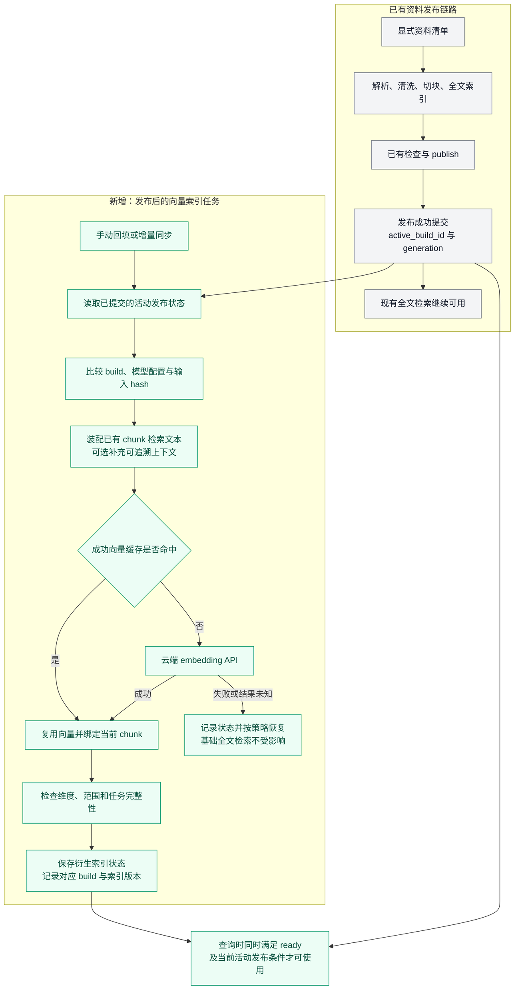
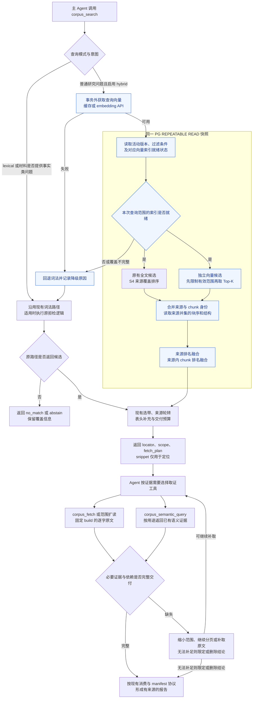
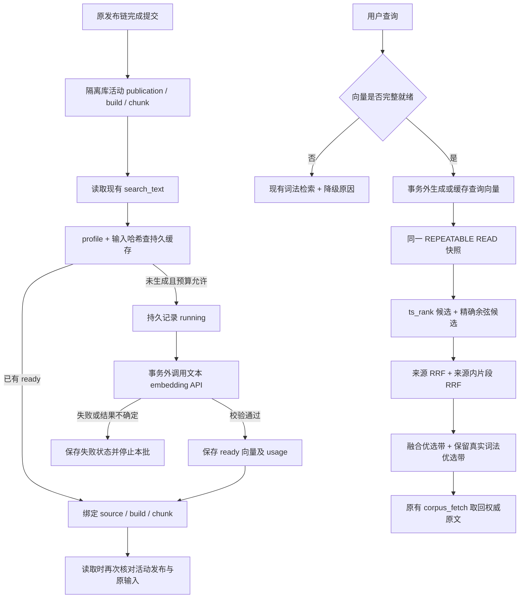
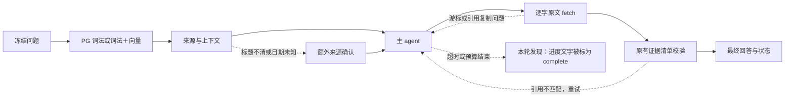

# 研报上下文向量检索小样本实施方案

状态：**有效方案；用户已选择隔离库并完成首批资料准备，向量部分待实施**。更新：2026-10-20。

关联需求：[PR-DATA-01、04、05、09、12、14，PR-OUT-06、07](../product-requirements.md)。本方案是本次检索试验的实施入口，不替代跨层总计划，不重新开启已关闭的 S5 评测。

在现有 PostgreSQL 资料库上增加稠密向量候选召回，与现有全文检索融合，再复用现有选带、原文取证和 Agent 交付链路。先分别验证“增加向量”和“增加片段上下文”的收益；通过小样本验收后，再决定是否推广。当前已完成用户授权的隔离资料准备，未修改检索业务代码、创建向量数据或调用模型；实际进度见 §12。

本次采用**发布后的向量增量索引**：直接读取已有发布结果，不重新执行原资料的准入、清洗、切块、审核或 `plan → build → check → publish`，也不以重新完成 claims／R2 抽取、S0–S5 治理评审作为建向量的前置条件。向量任务只维护自身的计算、缓存和可用状态；资料是否可用仍由现有发布链路决定。

## 1. 项目现状与设计依据

核对范围为 WSL `/home/administrator/FrontierAgent`，本次读取时 HEAD 为 `e71afc7f`，工作区存在其他未提交修改。下表描述已读文档与代码，数据库数量是 README 的历史快照，实施前需要重新核定。

| 已有能力 | 实际情况 | 本次设计 |
| --- | --- | --- |
| 资料入口 | `data/corpus/` 是原文件投放区，可能混有生产、开发、留出和未入库文件；通过显式 manifest 执行 `plan → build → check → publish` | 按选定来源和发布快照建立试验清单，不自动扫描整个目录入库 |
| 来源身份 | `source_id` 是原文件字节的 SHA256；同内容改名不变，内容改变产生新来源 | 直接沿用身份，不再创建另一套文档 ID |
| 原文与索引 | `corpus_units.raw_text` 是逐字证据；`corpus_chunks` 是带 `unit_refs/source_ranges` 的检索投影 | 向量关联已有 chunk，不重新解析或切块，不以 `search_text` 或生成背景替代原文 |
| 发布与版本 | `corpus_publications.active_build_id` 指定当前检索版本，build 固定解析、清洗、切块与索引版本 | 衍生向量索引服从现有准入、撤回和发布状态，不能自行发布资料 |
| 全文召回 | `zhcfg` 分词、查询规范化、词元处理、`ts_rank`、文件名加权；来源先按不同查询词元覆盖数排序，再比较来源与块得分 | 完整现有链路作为基线；不简化成裸 `ts_rank`，不替换成 BM25 |
| 证据范围选择 | 文档内结构信号、词法优选、有限连续 band、按来源轮转；随后补表头等上下文 | 向量接入候选阶段，继续使用有边界的选带和交付预算 |
| Agent 取证 | `corpus_search` 返回定位与 snippet；`corpus_fetch` 返回固定 build 的原文与分页状态 | 保持工具界面；snippet、背景和相似度均不是可引用证据 |
| 语义产物 | `corpus_semantic_query` 返回已发布、用途受限的 claims／items 及必要依赖 | 保留现有语义查询、消费台账与 manifest；向量不取代语义产物 |

主要依据：

- [资料库说明](../../data/corpus/README.md)：PG 九表、来源身份、入库与发布、快照、归档缺口。
- [清洗与检索专项说明](../data_clean_dos/README.md)：S0–S5、取证交付、验收与关闭边界。
- [全文检索](../../plugins/corpus/preparation/search_pg.py)、[快照读取](../../plugins/corpus/preparation/read_pg.py)、[选择策略](../../plugins/corpus/preparation/selection.py)、[CorpusService](../../plugins/corpus/service.py)。
- [搜索工具](../../plugins/tools/corpus_search.py)、[原文工具](../../plugins/tools/corpus_fetch.py)、[语义查询工具](../../plugins/tools/corpus_semantic_query.py)、[研究纪律](../../plugins/corpus/research_discipline.py)。

资料库 README 在 2026-10-20 记录了 8 个生产活动来源、14 个 build、7,128 个 unit、1,214 个 chunk；同目录另有 12 份隔离留出资料，不能直接计为生产内容。已有部分归档对象缺失的记录：本试验可读取现存 PG 原文，但不把归档完整性宣称为已通过，也不顺带执行修复、重解析或生产发布。

## 2. 范围与需要验证的问题

首轮直接选择**已有发布状态且有可用文本的研报**，尽量涵盖公司、行业、宏观。若当前符合条件的只有 8 份，就用这 8 份验证；10～20 份是后续样本目标，不为凑数重新启动入库治理。已有隔离数据仅在其发布状态和试验授权范围清楚时纳入；已经用于调试的留出资料只作开发和回归，不再称为新的盲测。

2026-10-20 用户进一步提出利用已下载研报并选择隔离库入库。本批已形成 18 份有效资料：8 份原发布快照＋10 份新增发布。后续直接使用这批固定来源开展 A/B 对照；新增未发布资料走一次正常入库，与“已发布资料建立向量不重复治理”是不同动作。

本轮使用本地 PG 和用户提供的云端 embedding API，只发送文本。不引入 OCR、图片／视频向量、GraphRAG、模型稀疏向量、独立 reranker、自动每日调度或云端部署改造。扫描页和不可解析图表列为文本覆盖缺口。

试验回答三个问题：

1. 在相同来源、过滤条件和返回预算下，向量能否补回全文检索遗漏的观点改写、同义表达及跨段语义证据？
2. 在相同 embedding 模型下，增加可追溯的片段背景是否进一步改善召回，而不是引入公司、年份、预测／实际值混淆？
3. 候选改善能否经过选带、工具分页和消息预算，真正变成主 Agent 收到并使用的完整证据？

`PR-DATA-14` 已要求正式启用向量前证明观点改写召回不足，且查询扩展、结构化过滤或排序校准无法充分修复。本轮按用户提出的小范围验证开展隔离实验；实验结果不自动等于生产启用。

## 3. 复用已有数据，新增可重建的向量索引

基础的 reader、clean、chunk、index 和 `plan/build/check/publish` 保持原有确定性、零模型流程。另建 PG 试验 schema，例如 `corpus_retrieval_pilot`，仅存放可重建的检索衍生数据。试验在独立数据库中使用经过核对的来源快照，不修改生产库或已关闭评测库。

具体入口为 `corpus_publications.active_build_id → 对应 corpus_chunks／必要的 corpus_units → embedding API → 向量记录 → 混合召回`。首次手动回填已发布范围，后续手动同步新发布或变化的 build；不要求在发布事务中加入模型调用，也不要求先建设事件总线或自动调度。试验数据库的快照复制属于环境准备，不是重新审批或发布原资料。

向量自身只检查必要的工程条件：关联来源和范围有效、模型与维度一致、输入去重、计算完成、查询时仍满足现有发布条件。这些检查自动执行，ready 表示索引可用，不新增人工审核、admission decision 或第二个 corpus publication。未完成或失败时沿用全文检索。

### 3.1 接入节点的综合评估

**本项目推荐两个接入点：离线建索引接在原资料发布提交之后；在线召回接在 `corpus_search` 内部，与全文召回并列，在 `_selected_context_hits` 选带之前融合。** 上下文补充位于片段检索输入装配阶段、embedding 之前。三个动作职责不同，不应合并成“在某一步调用一次向量模型”。

| 可选位置 | 影响 | 本轮结论 |
| --- | --- | --- |
| 原文件刚进入 `data/corpus/` | 尚未确定有效版本、可检索范围和稳定定位；扫描文件还会绕开显式入库清单 | 不接入 |
| 解析／清洗／切块过程中 | chunk 尚未最终固定；模型故障与原文处理耦合，重试可能重复计费 | 不接入 |
| chunk 和检查完成后、publish 之前 | 可以预计算以缩短发布后的等待，但需管理未发布向量；若设为发布前置，会改变现有发布可用性 | 本轮不做；未来有“发布即支持向量”要求时，可独立预计算，仍只对已发布版本开放查询 |
| **publish 成功提交后** | 原文范围和 chunk 已确定；可回填历史资料、增量更新，模型故障不阻塞原发布 | **本轮建索引入口** |
| **全文召回旁路、选带之前** | 可从同一有效语料范围独立找回词法漏召回的块，统一排序后再控制交付范围 | **本轮查询入口** |
| 已完成选带或 `corpus_fetch` 之后 | 只能处理已经找到的片段，无法补回未入选的来源；按查询重复生成文档向量会增加等待和费用 | 不作为候选召回接入点 |
| claims／R2 items 抽取或发布之后 | 把原文检索依赖于语义产物覆盖和抽取进度 | 不作为本轮前置；原文和语义查询保持现有各自职责 |

一般 RAG 系统在片段文本稳定后就能计算向量，是否在发布前计算取决于发布时效要求。本项目已经有完整发布协议，而且允许全文检索先服务，因此选择“发布后独立索引”，这是结合现状的取舍，不是所有系统都必须遵守的顺序。

### 3.2 建索引与增量执行链路

下图灰色是已有链路，绿色是拟新增的向量任务。左侧旧链路说明新资料从何而来；**对当前已发布资料，执行直接从发布状态开始，不重跑左侧节点。** 图中手动同步是本轮入口，后台定时同步或发布后通知属于后续自动化。



发布接口当前落在 `engine.publish_build → PgStore.publish → _set_publication`。向量同步只读取其**已提交结果**，不调用 `publish_build` 来重新认可已有资料，不向发布事务加入网络请求。以后若使用发布后通知，通知只负责唤醒任务；同步任务仍按发布表对账，使通知丢失不会永久漏建索引。

索引任务在短事务中取得来源、build 和输入清单，随后释放事务再调用模型。写回时复核记录身份，并将计算完成与当前查询可见性分开：如果期间发生新版本发布或撤回，旧向量可以保留为缓存，但不能重新激活旧 build。现有 PG 发布状态始终决定能否召回。

允许存在“全文可查、向量待就绪”的时间窗口。试验中记录这段耗时；如未来业务要求发布即双路可查，再评估发布前预计算，不在本轮引入额外发布门禁。

### 3.3 衍生数据与原文定位

建议的数据职责如下，物理表名在实施时按现有迁移方式落实：

| 衍生记录 | 必需字段／约束 |
| --- | --- |
| 试验清单与索引版本 | `run_id/index_version`、来源及 active build 清单、publication generation、过滤与模型配置、预期块数／成功／失败／排除数、状态、创建时间 |
| 片段检索输入 | `source_id/build_id/chunk_id`、输入变体、原文范围引用、原文投影 hash、独立 `context_text`、上下文依据与生成版本、最终 `input_hash` |
| 向量与任务 | provider、实际 model revision、维度、请求参数版本、输入 hash、embedding、任务状态／租约、请求标识、usage、重试与错误分类 |
| 查询观测 | 查询及参数版本、双路候选和原始分数、来源及块排名、融合名次、选带结果、降级原因、耗时和费用 |

原文仍从 `corpus_units` 按已有范围读取；衍生表中的文本是明确标识的检索副本。每个向量必须能定位到一个确定的 `(source_id, build_id, chunk_id)`。chunk 的多个不连续范围按列表保留，禁止用最小起点和最大终点拼成连续摘录。

先直接复用现有 chunk 边界。发现输入超过模型限制时，优先去掉非必要背景；仍超长的块可生成有独立范围映射的 embedding 子片段，召回时折回原 chunk 并去重。不得截掉正文后标为完整，也不得为满足向量长度重写基础 chunk。排除项单独披露，A/B/C 对比使用相同的已声明内容范围。

## 4. 检索输入与上下文

设置三个主要对照组，所有组固定来源快照、过滤条件、工具预算与选择策略：

| 组别 | 候选召回 | 目的 |
| --- | --- | --- |
| A：现有基线 | 完整当前全文检索链路 | 衡量现有能力和失败类型 |
| B：混合检索 | A 的词法候选＋现有 chunk 检索文本的稠密向量候选 | 单独衡量向量增益 |
| C：上下文混合检索 | 相同词法候选＋增加背景的 chunk 稠密向量候选 | 单独衡量上下文增益 |

B 的文本输入采用现有 `chunk.search_text`，其中已有的标题／结构信息照实保留，不能声称它是完全无上下文的裸正文。C 在此基础上补充背景，词法索引保持一致。

上下文先分两档验证：

- **C1：确定性背景。** 复用可追溯的报告标题、明确发布日期、章节路径、已有表头／单位／期间等。缺失字段保留未知；不能把文件名猜测、行业主体或被对比公司当作报告所属公司。
- **C2：可选生成背景。** 仅当 C1 仍有明确缺口时，为固定片段生成短背景；输入限定为同一 build 的可追溯文本与必要邻域。保存生成模型、提示版本、所用范围和输出，抽检主体、期间、事实／预测属性。与 C1 单独报告，不混为一种处理。

背景与原文分开保存，只帮助召回，不进入引用证据。否定、条件、风险和作者归属不得被改写成事实断言。上下文生成需要独立的文本生成模型与预算，embedding API 本身不承担背景写作；尚未提供生成模型时，B 和 C1 可以完整实施。

这属于“向量侧上下文增强”的局部试验，不是同时改写 BM25 和向量的完整 Contextual Retrieval 实现，也不套用其他资料集的提升比例。[Contextual Retrieval 原始说明](https://www.anthropic.com/engineering/contextual-retrieval)

## 5. 模型适配与 PG 检索

候选为用户提出的 Doubao Embedding Vision。实施前核对实际 endpoint、具体模型版本、文本输入格式、query/document 指令、维度、长度限制、限流和计费规则；`doubao-embedding-vision-251215` 作为待核对候选，不把名称自动当作用户已开通的服务。

适配器提供 `embed_documents` 与 `embed_query` 两个内部入口，统一记录模型空间和参数。查询向量与文档向量必须使用兼容的同一模型空间；返回数量、维度、有限数值和非零范数要校验。不能假定 multimodal API 的一个 `input` 数组会生成多个独立文档向量，批处理方式须按实际接口验证。[豆包向量化接口](https://docs.volcengine.com/docs/ark/vectorization?lang=en&redirect=1)

PG 驱动复用项目的 psycopg。先检查隔离环境是否安装兼容的 pgvector 扩展，不假设当前容器已经具备。小样本先使用精确余弦距离检索，不建 HNSW／IVFFlat；若当前实例缺扩展，单独准备兼容的试验实例，不为试验替换生产 PG 镜像。

模型维度在建表前冻结。pgvector 对普通 `vector` 的近似索引存在 2,000 维限制，不能把 2048 维模型输出直接套进该配置；精确存储／查询与近似索引能力分别验证。本轮不静默降维或改半精度。[pgvector 官方说明](https://github.com/pgvector/pgvector)

### 5.1 双路候选与融合

编排入口位于 `CorpusService.search_with_coverage`，具体做法是增加可返回双路候选的组合读取，在 `_selected_context_hits` 之前完成融合。当前 `read_pg.search_with_coverage_bands` 只按词法命中装配块序，不能在它返回后简单追加向量 hits；需要在同一快照中按**双路候选的来源并集**读取块序和必要结构字段，才能让向量独有来源正常进入选带。`lexical` 模式保留当前读取路径作为基线。

1. 查询 embedding 在数据库事务外获取，避免网络等待占住读取事务。使用保留主体、否定和时间条件的自然语言查询及模型规定的 query 指令，不把为 FTS 构造的 OR 词元串直接用作 embedding 输入；词法通道继续使用现有词元与查询构造规则。
2. 在 `REPEATABLE READ` 中读取活动发布状态、词法候选、符合相同状态与过滤条件的向量候选、原文块序和 coverage。向量记录必须与当前 active build 及已就绪索引版本匹配。
3. 词法候选保留当前完整排序。向量候选从满足条件的活动块独立召回，不能只给词法命中的块算向量，否则无法补回词法漏召回。
4. **候选方案为先融合来源排名，再融合来源内 chunk 排名。** 来源词法名次来自当前 S4 顺序；向量来源名次先用该来源最佳块名次归并。两层均采用 RRF，初始等权、常数 60，仅在开发集调参后冻结；同分按稳定 ID 排序。这是项目适配方案，不是已证明最优的算法；用相同候选池的小型离线对照，与单层 chunk RRF＋来源限额比较后再冻结。
5. 融合结果进入现有选带、来源轮转与表头补充。每个来源沿用候选限额，避免长报告占满结果。保留“最佳词法带”的真实词法依据；若选择器原本只接受一个 score，需显式补充词法与融合排名输入，不能将融合得分冒充 `ts_rank` 后继续按旧含义使用。

RRF 使用 `Σ 1/(60 + rank)`，缺席某一路贡献为 0；原始全文分数与余弦分数只用于观测，不直接相加。调试日志记录候选到最终交付每一步的丢失原因。

这里的并列召回表示两路独立产生候选，不要求并发执行两条 SQL。在一个 PG 事务中顺序查询即可保持实现简单，并使两路使用同一读取快照。PG Repeatable Read 的多条读取共享事务快照；pgvector 官方文档也提供了与全文检索结合、使用 RRF 融合的方式。采用来源／chunk 两层融合则是适配本项目选择策略的设计。[PG 隔离级别](https://www.postgresql.org/docs/current/transaction-iso.html)、[pgvector 混合检索](https://github.com/pgvector/pgvector#hybrid-search)

基线现有主候选、coverage、块序已有同快照读取；额外拒检和部分结构读取存在独立调用。新组合读取须保证双路核心候选及覆盖信息同快照，后续读取始终携带固定 build，并沿用撤回检查，不声称整个现有服务天然只有一个事务。

### 5.2 过滤、拒检和故障语义

下层已支持 research domain 和报告发布日期范围，公开 `corpus_search` 当前主要暴露 query／limit。公司、机构和时间过滤必须区分“底层已有”与“需要补充”：

- 来源／build 白名单、准入状态和日期过滤在向量 Top-K 之前生效，两路一致。
- 公司、机构先核对现有 admission 快照的字段和可信度；若没有权威映射，试验采用人工核对的独立元数据映射表，不借生成背景推断身份。
- 报告发布日期与正文讨论的业绩年份分别处理。元数据未知时，严格过滤不通过；不能由相似度覆盖硬条件。
- 首轮通过试验入口验证过滤；通用工具参数扩展另列小步实现和兼容测试，不先改整个 Web 查询界面。

现有 `_abstain_decision` 针对“这些报告是否提供某项事实”有严格词元检查。**本轮集成对此类问题继续走原有词法拒检策略**，不因向量总能返回近邻就判定存在证据；离线单独记录该策略可能挡住的同义候选，后续有独立正负样本再讨论改进。这是首版有意保留的能力限制。

向量 API 超时、索引缺失或部分覆盖时回退现有全文链路，并暴露 `retrieval_mode`、索引覆盖和降级原因。服务故障不等于资料不存在，不能伪装成有效 `no_match`。正常分析问题的语义候选也只是待取证材料，相似度不能证明问题可回答。

### 5.3 查询与 Agent 取证执行链路

下图展示普通研究问题的混合检索以及首版保留的词法路径。蓝色是拟新增行为；框内双路读取使用同一 PG 快照。模型调用在框外完成；文档向量已预先建立，在线只计算或复用**查询向量**。



图中“缺失 → 补取”只对可恢复的缺口继续执行，并受原有调用与预算限制；无法补足时缩小结论范围，不无限重试。语义查询返回的完整合法证据可直接进入消费流程，不强制再绕一次 `corpus_fetch`。

本轮固定试验范围内，只要向量覆盖未完整就回退该次查询的词法路径，并显式报告原因；不把混合了部分来源向量的结果算作完整 B/C 组。后续如支持部分覆盖混合检索，应另定义展示和评价口径。

### 5.4 代码落点与接口职责

| 位置 | 拟承担职责 | 与现有链路的关系 |
| --- | --- | --- |
| `preparation/engine.py`、`repository_pg.py` | 继续管理原资料发布和撤回 | 本轮不插入 embedding，也不修改发布状态机 |
| 新增 `plugins/corpus/retrieval/` 索引任务 | 读取活动发布清单、装配文本、缓存去重、调用模型和保存状态 | 首次回填与后续增量使用同一个同步入口；不另设人工审批 |
| 新增检索组合读取；复用 `read_pg.py`／`search_pg.py` 必要接口 | 同快照双路候选、过滤、覆盖和来源并集块序 | 词法查询实现复用；向量读取不能依赖词法先命中 |
| `CorpusService.search_with_coverage` | 选择检索模式，调用检索 Module 完成查询向量获取、组合读取、降级和融合 | 外部仍通过已有搜索工具调用，不让 Agent 自己合并两套结果 |
| `_selected_context_hits`／`selection.py` | 消费融合候选及真实词法优选依据，控制来源与证据带 | 对融合分数语义做必要适配，保留原文范围和预算规则 |
| `corpus_search`／`corpus_fetch`／`corpus_semantic_query` | 搜索定位与证据交付 | 搜索可增加检索模式和降级元信息；取证身份与用途约束保持现有协议 |

新增 Module 对服务层提供一个组合检索 Interface，返回候选、块序、coverage 和检索诊断；调用方不分别管理向量 SQL、模型重试和缓存。对索引入口与在线检索入口分别验证，避免把“索引已建成”当作“主 Agent 已收到有效证据”。

## 6. 增量、去重、发布和撤回

本轮用手动触发验证每日增量所需的机制，不建立自动调度：

| 事件 | 处理 |
| --- | --- |
| 相同文件再次提交或改名 | 复用已有 source/build 与已成功向量；没有输入变化不再次请求模型 |
| 原文件内容变化 | 由已有资料发布流程处理；向量任务仅在新 source/build 发布后消费，不发起入库治理，也不自动撤回旧来源 |
| 同来源重建 build | 新 build 发布后，对其 chunk 计算检索输入 hash；输入及模型参数完全相同的向量可复用，但必须重新关联并验证当前范围 |
| 背景、模型或参数变化 | 产生新的衍生索引版本；不混合不同向量空间 |
| 新 build 已发布、向量尚未就绪 | 该来源继续可走全文检索；向量侧不拿旧 build 补位，结果明确标示覆盖不足 |
| 撤回／准入失效 | 查询时以现有发布和准入状态排除，即使向量尚未物理删除也不得返回有效候选；旧 fetch 继续遵守现有撤回协议 |
| 恢复／重新发布 | 验证当前 build、范围与模型配置后复用或补算；未完成前不宣称向量可用 |

索引版本只有在其声明范围内的全部预期任务完成、定位检查通过后才标为 ready。部分完成保留诊断状态；主对照评测要求 B/C 对选定范围覆盖完整。发布基础资料与切换衍生索引是两个动作，不能让模型故障阻塞基础入库。

成功缓存按“最终输入＋provider/model revision＋维度＋请求参数版本”去重；任务唯一约束与租约防止并发重复计算。生成背景也独立缓存。

“重复入库不重复计费”可保证到已保存成功结果的重用。请求已被供应商处理但响应丢失时，若供应商没有幂等键或查询接口，无法保证外部计费严格一次；此时标记未知结果，按受限重试策略处理并记录可能重复费用，不无限重发。

## 7. Agent 接入与 claims／R2 边界

保留 `corpus_search → corpus_fetch／context inventory → 证据消费与 manifest` 的当前路径。搜索继续返回 `doc_id=cv2:<build_id>`、`locator=chunk:<chunk_id>`、scope、context locators 和 fetch plan；不增加另一套“按向量 ID 读报告”工具。

需要原文时按已有 locator 扩展，使用固定版本分页、body-first 预算和完整表格依赖；分页结束不等于证据完整，`budget_limited`、缺依赖等状态仍须处理。多个选带分别取读，不能把它们包成跨越大量无关页面的大区间。

claims 和 R2 items 保持各自的语义与用途约束，本轮不为它们另做向量索引，不重抽取、不迁移其独立结构化存储。基础 corpus 使用 PG，不意味着可以顺带替换语义产物仍使用的存储实现。

`corpus_semantic_query` 已完整交付并满足用途约束的证据，可按现有规则直接引用和提交 `semantic_references`，不例行再次 fetch。只有定位摘要、缺少期间／单位／条件、预算截断或证据冲突时才继续取原文。优化目标是减少重复查找与无效扩读，不以取消必要取证来降低调用数。

## 8. 验收方法与建议门槛

既有 S4 的 51/51 是特定冻结矩阵的结果，不是所有真实问题已解决；既有 S5 的 204 次模型运行存在评分、扩读和表格表达等归因，其关闭结果不作为“向量必需”的证据，也不修改或重评分旧结果。

### 8.1 数据与问题

先复现 A 的实际基线，再固定 30～50 条新题及原文证据范围。覆盖观点改写、简称／别名、跨段条件与风险、公司／年份近似混淆、表格单位／期间、明确无答案；按报告或主题分开开发与验收，避免同一问题的改写分别落入两组。记录每类数量与分母，小样本结果不外推全库。

已使用的 51 道题可复用为回归锚点，优先运行与本次选定资料及修改路径相关的用例；不要求重新跑完整 S0–S5 或旧 204 次模型评测才可建向量。结果写入本次试验记录，不改历史关闭记录。新增题先人工确认“原文是否足够回答”及必要范围，再冻结，不看候选输出修改金标。PR-DATA-14 所需的简单查询扩展、结构过滤或排序校准修复可能性，用少量有依据的失败分析记录；不在本轮扩成新的多模型查询改写工程。

### 8.2 三层观测

| 层次 | 主要指标 |
| --- | --- |
| 候选召回 | 来源 Recall@5、证据范围 Recall@10、必要依赖覆盖、词法／向量独有命中、公司／年份／来源错配 |
| 工具交付 | 选带后证据保留率、完整证据实际交付率、预算截断、重复 search、必要 fetch 与无效扩读分别计数 |
| Agent 报告 | 引用忠实度、条件／单位／期间完整性、无证据断言、claims／items 用途遵守、端到端时延和成本 |

Agent 验证从冻结题中选 6～10 个代表任务，各组使用相同主模型、提示、工具预算和固定语料快照，保存实际 tool 消息与报告；存在随机差异时按预先约定次数复跑，不只挑最好一次。候选命中不能替代实际交付和正确引用。

建议审核以下通过标准，执行前冻结：

- 身份、版本、撤回与范围检查全部通过；返回候选中硬过滤越界为 0；最终有效证据不新增公司／年份错配和无证据断言。
- 已有回归题不新增可归因于向量接入的失败；若当前 A 已与历史结果不同，先记录基线差异，不调整金标消除差异。
- 在预先定义的语义改写子集，B 相对 A 的证据 Recall@10 提升至少 10 个百分点，并列出逐题增益与损失；如果 A 已接近满分，不为达到阈值换题，结论可为暂不需要向量。
- C1／C2 分别与 B 比较；没有稳定质量增益或额外成本不值得时，仅保留 B，不把上下文生成设为必经步骤。
- 总体交付完整率不下降，无答案题不新增误报；额外回查次数作为次要指标，不要求必要 fetch 必须下降。
- 对照报告同时给出查询和端到端 p50/p95、冷／热缓存口径、首建／增量／单查询费用。具体延迟容忍度和金额上限在获知 API 价格、实际片段数后登记，不能预先承诺费用或倍数。

## 9. 实施步骤与交付物

| 步骤 | 工作 | 交付与继续条件 |
| --- | --- | --- |
| P0：冻结试验基线 | 读取已有来源发布清单，核定实际运行代码／配置、PG／zhcfg／pgvector、可用文本、现有基线和新题；建立隔离目标守卫 | 试验清单、基线报告、失败归因、任务量及费用估算；不产生新的入库 manifest 或资料审核；记录现有其他工作区修改，不带入本任务变更 |
| P1：建立衍生索引 | PG 迁移、embedding 适配、输入映射、缓存与任务状态；先少量契约调用再扩至清单 | B 索引及完整定位校验；通过重复执行、超时、并发、断点续跑测试 |
| P2：离线混合检索 | 双路同快照候选、两层融合、过滤、选带和诊断 | A/B 逐题对比；证明增益并满足安全及回归标准后进入接入 |
| P3：上下文对照 | 先 C1，必要时单独加入 C2 | B/C1/C2 质量、调用量与成本对照；选择最小有效方案 |
| P4：Agent 小范围接入 | 在试验配置启用已选方案，复用现有 search/fetch、语义查询与消费协议 | 实际交付与报告验证；确认增益没有被预算或选择器抵消 |
| P5：增量与回滚验收 | 在隔离数据模拟新增、相同内容、重建、发布并发、撤回、恢复和服务降级 | 重用／计费台账、状态与版本一致性结果、回滚说明、推广或停止建议 |

拟新增独立 `plugins/corpus/retrieval/` 模块承载模型适配、衍生索引任务和融合逻辑。现有准备引擎不依赖外部模型；确需共享的 PG 快照读取接口在 `preparation/read_pg.py` 附近扩展，服务层负责组合。文件划分可在实施时细化，但不将模型调用散落进 reader、fetch 或工具函数。

验证使用项目的 `uv` 工具链。重点测试真实 PG 的过滤／快照／撤回一致性、请求契约与异常、选带预算和 Agent 证据交付；文档阶段不运行模型或业务测试。试验配置默认 `lexical`，候选模式为 `hybrid_raw/hybrid_context`；回滚切回 `lexical`，保留已有 corpus 发布状态与取证工具。

## 10. 审核结论与执行前输入

本方案建议批准的范围是：**复用当前资料库和证据链，以 PG 衍生索引增加云端文本向量召回，先小样本证明收益，再按结果选择是否启用上下文。**

执行前需要落实的输入：

1. 用户提供 embedding endpoint、模型版本和 API 凭据配置位置；密钥通过环境或已有配置机制注入，不写入计划、日志或仓库。
2. 固定样本 manifest、开发／验收题及首次试验金额上限；实际可用资料不足 10 份时先完成工程验证。
3. 如选择 C2，再指定文本生成模型和独立预算；不影响 B/C1 先行。
4. 对上述验收门槛作一次确认，随后按 P0–P5 执行。生产启用、全库扩展、每日自动调度及 OCR 均不由本次试验自动触发。

## 11. 主流流程对照与遗漏复核

### 11.1 主流流程与本项目的对应关系

RAG 没有唯一固定模板。常见流程分为离线索引和在线回答两条链：离线完成内容准备、切块、可选背景补充、embedding 和持久化；在线完成查询准备、检索、结果选择、上下文装配和有依据的回答。Agent 可以按需多次调用检索，背景生成、查询改写和独立 reranker 都属于按效果选择的增强环节。[Microsoft RAG 架构与评估指南](https://learn.microsoft.com/en-us/azure/architecture/ai-ml/guide/rag/rag-solution-design-and-evaluation-guide)

| 阶段 | 常见处理 | 本项目对应 |
| --- | --- | --- |
| 离线内容准备 | 解析 → 清洗 → 切块 → 元数据／原文定位 | 已有确定性资料链路承担，不重做 |
| 离线向量化 | 可选背景 → 文档 embedding → 存储与更新 | 发布后消费已有 chunk，在 PG 保存衍生向量 |
| 在线查询 | 明确查询含义和过滤条件 → 查询 embedding | 复用 Agent 查询，保留主体、时间、否定和上下文；向量计算在读取事务外 |
| 在线候选 | 关键词与向量独立召回 → 融合 → 可选精排 | 现有全文链＋pgvector＋RRF；独立 reranker 暂不引入 |
| 上下文装配 | 去重、补必要上下文、控制预算、保留来源 | 现有选带、表头依赖、fetch 分页和原文范围 |
| 回答与维护 | 基于证据生成 → 引用与评测 → 增量／删除同步 | 现有 Agent 消费协议＋本次质量、费用和更新观测 |

混合检索保留关键词通道有实际理由：代码、名字和日期等精确表达与语义改写需要不同信号；RRF 可合并两路排序。`ts_rank` 不是 BM25，但并不妨碍“现有全文召回＋向量召回”构成混合检索，不需为对齐主流示例更换现有全文实现。[Azure 混合检索说明](https://learn.microsoft.com/en-us/azure/search/hybrid-search-overview)

**可行性结论：架构可行，适合在已有资料库上做小范围增量验证；实际收益和运行成本尚未验证。** 发布后生成向量会产生向量就绪延迟，但能保持基础发布独立。source／build／chunk 与原文取证是已有优势；两层融合、结构选带对向量候选的实际影响，需要通过实验确认。

### 11.2 实施前必须补齐的细节

以下属于本次实现与验证细节，不增加原资料审批或新的治理流程。

| 项目 | 当前缺口或风险 | 本轮落实方式 |
| --- | --- | --- |
| 候选深度 | 最终返回 10 条不等于每路只召回 10 个 chunk；提前截断会使融合无从补救 | 词法保持现有至少 200 个候选的逻辑；向量初始使用 200 个候选、每来源最多 40 个，均为开发起点。小样本精确查询中先执行来源限额再取全局候选，避免长文挤占来源。冻结返回条数不变，比较候选深度变化后的召回与时延 |
| 排序与选带 | 当前来源覆盖排序、结构优选和词法优选均会改变最终交付；两层 RRF 未必优于更简单的融合 | P2 以同一候选池比较单层／两层融合，记录“候选存在但在来源排序、选带或预算阶段丢失”的位置。不得对融合结果再次全局套用词元覆盖排序；测试向量独有来源及向量独有正文带能否最终交付 |
| 去重与来源多样性 | 一个 chunk 的多个向量子片段、同一证据重叠范围可能重复占位 | 子片段先折回 `(build_id, chunk_id)` 再融合，单路取最佳名次，不能重复投票；同一来源的重叠原文按范围去重。不同机构的类似论述保留各自出处，不擅自合并成独立佐证或市场共识 |
| 无答案与相近错配 | 向量近邻总能找到相似内容；RRF 得分只代表名次组合，不代表正确概率 | 不设置无依据的通用“相似度 0.8 即可信”阈值。除保留当前存在性查询拒检外，新增普通分析型无答案、错误公司、错误年份、否定反转、预测／实际混淆题；取证不足时不作肯定结论。候选被返回和答案受到支持分开评分 |
| 模型与输入契约 | 多模态模型能接收文本，不等于已验证中文研报检索效果；字符数也不等于 token 数 | P1 少量文本验证 query/document 输入与输出映射、实际长度限制、中文术语、数字和否定对。冻结 model revision、维度、距离度量和指令；超长、空白或输出异常显式处理，不自动截断原文。配置验证通过不等于检索质量通过 |
| 缓存失效与版本切换 | 仅以 chunk ID 缓存会漏掉背景变化；仅以查询字符串缓存会混用模型空间 | 文档缓存按最终输入及模型参数；上下文缓存同时包含其依赖范围／元数据和生成版本。查询向量缓存包含实际查询输入与 query 指令及模型版本。若未来缓存检索结果，还需绑定过滤条件和发布快照；本轮优先只缓存向量。模型升级新建空间，不原地混写 |
| API 故障与费用边界 | “有重试”不足以约束交互延迟；429、超长、鉴权失败不能同样处理 | P0/P1 冻结在线请求期限、离线并发／限流与本次费用上限；在线超时及时词法降级，离线可持久化重试。429 按服务约定退避，鉴权或请求格式错误停止盲重试。向量 SQL 失败若使事务回滚，则重新执行完整词法读取，不拼接不同快照的残余结果 |
| 索引有效性与更新观测 | 只有“完成条数”难以发现发布后漏同步或错误范围 | 以来源／build 记录预期、完成、失败和排除数，跟踪发布至向量 ready 的时间；整批实验 manifest 记录覆盖。覆盖与有效发布状态双重判断，进程重启后可继续，不靠一次性回调保持一致 |

现有参数依据是 `service.py` 的 `_SELECTION_POOL_MIN=200`、全文 SQL 每来源最多 40 块、`SelectionPolicy.top_k=5` 及 `corpus_search` 默认返回 10 条。向量的 200／40 是保持候选预算可比的起点，不是通用最优值，也不把 200 个 chunk 直接送给 Agent。融合只能重排已经召回的并集，候选阶段遗漏的证据无法靠后续融合恢复。[Qdrant 候选与融合说明](https://qdrant.tech/documentation/search-tuning/hybrid-search/)

### 11.3 小样本成立、长期使用需另行调整的地方

**整次查询回退仅作为本轮固定范围的严格实验策略。** 实际日更时，若一份新研报尚未建完向量就使全库停用混合检索，会降低已有索引的价值。扩展到日常使用时，建议按来源／build 管理 ready 状态：全文覆盖全部有效来源，向量覆盖已就绪来源，返回 `partial` 与明确覆盖信息；按覆盖完整和部分覆盖分别评价，不能混算增益。该模式不在本轮默认启用。

同样，当前保留的存在性查询词法拒检可能漏掉同义表述。首版将其作为已知限制，后续如需改善，应单独验证“存在／缺失”的判断，不能靠取消拒检或降低相似度阈值替代。

这轮刻意暂缓的能力包括独立 reranker、LLM 多查询改写、OCR、GraphRAG、ANN 索引和自动调度。是否增加它们应由失败归因决定：候选已有但排名差才考虑精排；原文没有被解析出来才讨论 OCR；精确查询性能确实不足才评估 ANN。暂不建设这些能力，不构成当前小样本架构缺失。

### 11.4 最小执行收口

P0 固定发布清单、文本覆盖、题集、费用和候选预算；P1 验证模型契约与可恢复索引；P2 验证候选、融合、选带和无答案；P4 验证 Agent 实际交付；P5 验证增量与故障。C1/C2 保持可选对照。重点是把已选路径测完整，不先扩展更多检索模块。

## 12. 首轮方案选择与资料准备实绩

**当前推荐先实施 B：现有全文检索＋现有 chunk 文本的稠密向量＋排名融合。** 在相同的已固定资料上与 A 对照；C1 作为下一步低成本对照，C2 暂缓。避免同时改模型、文本背景、切块和检索排序后无法判断收益来源。

用户已选择向量试验隔离库；本次完成以下工作：

| 项目 | 2026-10-20 实际结果 |
| --- | --- |
| 目标库 | `vector_pilot_corpus_20261020` |
| 基线资料 | 从生产 corpus 只读复制 8 份有效发布及关联数据 |
| 新资料 | 14 份执行入库，10 份检查通过并发布，4 份因图像／表格提取缺口暂未发布 |
| 可用试验范围 | 18 份：公司 3、行业 10、宏观 5；活动 chunk 703、unit 5,870 |
| 入库核验 | 18/18 标题检索与原文取回通过；14/14 新归档哈希通过；无 RUNNING 任务 |
| 环境 | 隔离库已具备 pgvector 0.8.6、zhparser 2.4、pg_trgm 1.6 |
| 生产与模型 | 生产发布指针及 generation 前后一致；模型调用 0 |

这些结果完成了 P0 的资料批次准备，不代表新题集、模型契约、向量索引或检索收益已经验收。下一步在获得 embedding API 配置后执行 P1，不要求先凑到 20 份或为四份缺口增加 OCR。

详细记录：[隔离入库报告](../../.scratch/corpus-vector-pilot-20261020/report.md)；[固定检索快照](../../.scratch/corpus-vector-pilot-20261020/retrieval-snapshot.json)。

## 13. B 方案工程实现与运行方式（2026-10-20）

已在 `plugins/corpus/retrieval/` 实现文本向量适配器、发布后侧索引、精确余弦召回、
两层 RRF 和隔离库 CLI。`CorpusService.search_with_coverage` 已接入可选混合模式，
`corpus_search → corpus_fetch` 继续使用既有版本句柄和原文证据协议。
目前完成工程链路，**尚未生成真实模型向量，也未完成检索质量验收**。

### 13.1 配置

项目根目录 `.env` 已追加以下字段，`.env.example` 同步提供模板：

| 字段 | 已填默认值／用途 |
| --- | --- |
| `CORPUS_RETRIEVAL_MODE` | `lexical`；保持日常服务现状，CLI 试验查询自行指定模式 |
| `CORPUS_VECTOR_TARGET_DB` | `vector_pilot_corpus_20261020` |
| `CORPUS_VECTOR_API_URL` | `https://ark.cn-beijing.volces.com/api/v3/embeddings/multimodal` |
| `CORPUS_VECTOR_API_KEY` | 留空，由用户填入专用 embedding Key |
| `CORPUS_VECTOR_MODEL` | `doubao-embedding-vision-251215`；若账号要求接入点 ID，改为实际 ID |
| `CORPUS_VECTOR_REVISION` | `doubao-embedding-vision-251215`；接入点背后模型升级时必须一起调整 |
| `CORPUS_VECTOR_DIMENSIONS` | `2048`；适配器支持该模型的 1024／2048 维配置 |
| `CORPUS_VECTOR_TIMEOUT_SECONDS` | `15`；HTTP 超时配置，在线失败回退，不自动重试 |
| `CORPUS_VECTOR_MAX_CHARS` | `16000`；保守字符保护，不等于模型 token 上限，不自动截断 |

文本请求使用 `instructions` 字段，query 与 document 使用不同指令。
每请求仅传一段文本，不把多模态 `input` 数组当成独立文本批处理。
输出按 `data.embedding` 读取并校验维度、有限值和非零向量。
接口依据：[豆包向量化文档](https://docs.volcengine.com/docs/ark/vectorization?lang=en&redirect=1)、
[多模态向量化 API](https://docs.volcengine.com/docs/ark/multimodal-vectorization-api?lang=zh)。
账号可用性与真实响应仍待用户配置后验证。

CLI 复用既有 PG 连接参数，仅在子进程里把 database 改为指定试验库；
`.env` 中原有 `CORPUS_DSN` 和 `CORPUS_TARGET_DB` 不因此改变。
CLI 要求目标库以 `vector_pilot_` 开头，并沿用项目的实际数据库身份检查。
线上模式误指向其他数据库时会词法降级，返回 `vector_target_mismatch`。

### 13.2 实际执行链路



侧表位于 `corpus_retrieval` schema：`spaces` 保存无密钥的模型／输入契约，
`embeddings` 保存输入缓存和请求状态，`chunk_vectors` 保存发布片段绑定。
不修改原文、原发布指针、claims 或 R2 items。查询阶段不创建表或扩展。

混合模式的选带先保留融合优胜带，再为真实词法优胜带预留位置；不把 RRF 分数
当成 `ts_rank` 再做结构重打分。词法模式原有结构排序保持不变。这是本轮需在
真实题集中特别观察的排序变化，不能仅凭模拟向量测试证明其质量优于基线。

### 13.3 配置完成后的命令

在 WSL 项目根目录运行：

```bash
cd /home/administrator/FrontierAgent

# 只读盘点；不会调用模型
uv run python -m plugins.corpus.retrieval.cli status

# 初次先限制为 3 个新文档输入请求，验证真实接口契约
uv run python -m plugins.corpus.retrieval.cli build --max-requests 3

# 接口验证通过后继续构建；已完成输入直接复用
uv run python -m plugins.corpus.retrieval.cli build --max-requests 700

# 同一问题输出 A/B 结果、来源定位、覆盖、耗时与查询 usage
uv run python -m plugins.corpus.retrieval.cli compare --query '制冷剂行业供需格局如何变化？'
```

`build` 默认最多发出 10 次新请求；上面的 700 是明确指定的本轮请求上限，
不是金额承诺。当前 703 个片段对应 **675 份不同输入**，长度最大 1,556 字符。
模型费用以供应商实际 usage 和账单为准；未知请求结果可能已计费，不能当作免费。

鉴权／格式／429 等确定失败会停止当批，修正后用 `--retry-failed` 继续。
超时、5xx、异常响应或进程中断留下的 `running` 不自动重试；
核实后如要重试，显式追加 `--retry-uncertain`，这可能产生重复费用。
当前没有自动退避重试、后台调度或每日定时任务；新增发布后再次执行 `build`
即可核对活动范围并补齐。未变化的文本跨 build 复用，撤回内容在读取时即时排除，
缓存暂留供复用／审计，不把缓存存在当作来源有效。

查询向量使用最多 128 条、5 分钟的进程内缓存，键包含 profile 和实际查询文本；
检索结果本身不缓存。完整性检查在查询向量生成前及最终读取快照内各执行一次。
缺索引、模型失败或向量 SQL 失败均显式词法降级；SQL 失败会重新读取完整词法
快照，不拼接失败事务的残余结果。

### 13.4 验证边界与下一步

已验证内容包括：请求／响应契约模拟、空间隔离、RRF 去重、向量独有证据带交付，
以及真实隔离 PG 上的预算中断后续建、重复执行零新请求、绑定丢失后缓存恢复、
活动内容变化失效、撤回过滤、日期过滤、API／SQL 故障降级与原文取回。
测试向量使用临时独立 profile，结束后清理，不进入正式模型空间。

本轮相关测试 **73 passed / 5 skipped**；5 项跳过来自既有 PG 测试的运行条件，
新增的 2 项隔离 PG 集成测试均实际执行。修改文件 Ruff／格式与 Pyright 检查通过，
项目 import smoke 两阶段、symbol closure 与既有 LLM preflight 通过。
正式 embedding 空间最终状态：18 个来源、703 个活动块、ready 0、请求 0；
缺索引时 CLI A/B 查询已验证为显式词法降级。
执行记录位于 `.scratch/corpus-vector-pilot-20261020/vector-tests.log`、
`vector-status.json` 和 `vector-fallback-comparison.json`。

仍待真实 API 配置后完成：小量契约实测、675 份输入的实际生成、冻结题集的
证据召回／公司年份错配／无答案评测、主 agent 回查次数与总延迟／实际费用对比。
`compare` 提供观测结果，不自动声称质量提升。公司和机构的规范化硬过滤仍需
核对元数据覆盖后补齐；本次保留原有领域与发布日期过滤能力。
C1/C2、OCR、GraphRAG、ANN 与自动调度继续不在当前工程增量内。

### 13.5 用户配置后的真实接口核验

用户采用 Agent Plan：Base URL 为 `https://ark.cn-beijing.volces.com/api/plan/v3`，
请求模型为 `doubao-embedding-vision`。官方说明该别名对应
`doubao-embedding-vision-251215`，与代码的标准方舟默认版本一致。
代码默认值只在环境变量缺失时使用；`revision` 是本地空间／缓存版本标记，
不作为 API 的 `model` 参数发送。
参考：[Agent Plan 向量模型配置](https://docs.volcengine.com/docs/ark/agent-plan-personal-vectorized-models?lang=en)。

真实发现的缺陷是：原适配器直接 POST `CORPUS_VECTOR_API_URL`，把 SDK 的 Base URL
当成完整资源地址，实测返回 HTTP 404。现已支持自动补全北京方舟的 `/api/v3`
和 `/api/plan/v3` Base URL，保留 `/plan` 前缀并追加 `/embeddings/multimodal`；
完整接口地址不重复追加。归一化后的地址进入 profile，等价写法不创建不同向量空间。

修复后使用两段合成短文本验证 document／query 两路：
均返回 HTTP 200、`data.embedding` 对象结构、2048 维向量，
服务端 `model` 均为 `doubao-embedding-vision-251215`，
两次成功请求分别报告 38、43 tokens。验证中另有一次 15 秒配置下的超时，
请求是否消耗额度无法确认；后续用独立 60 秒诊断配置验证，两次实际耗时约
0.58／0.25 秒，日常 `.env` 的 15 秒超时保持原值。

已将 `.env` 的 `CORPUS_VECTOR_REVISION` 固定为实测具体版本，
请求 `CORPUS_VECTOR_MODEL` 仍保留 Agent Plan 所需别名。新增返回版本校验：
当本地标记为具体豆包版本且 API 报告不同模型时，拒绝保存该向量，避免混入已有空间。
这不保证供应商未来永不变更别名路由；版本发生变化时仍须核验并建立新空间。

回归结果：78 passed / 5 skipped，新增配置覆盖／Base URL 补全／等价空间／
返回模型漂移测试通过，真实隔离 PG 集成、Ruff、Pyright、两阶段 import smoke、
symbol closure、项目 preflight 均通过。核验使用合成文本，没有开始批量研报向量化。
脱敏实测记录：`.scratch/corpus-vector-pilot-20261020/provider-audit-before.json`
和 `provider-audit-long.json`；后者记录的是修改本地 revision 标记前的真实响应。

## 14. 真实向量构建与首轮开发对比结果（2026-10-20）

**隔离库真实索引已完整就绪，混合检索与原文取回链路已跑通。**
本轮完成 P1 的真实批次和 P2／P4 的开发检查，不代表正式盲测、主 Agent 完整研究
任务或第一版全部质量指标已经验收。

### 14.1 建库实绩

| 项目 | 实测结果 |
| --- | --- |
| 目标库 | `vector_pilot_corpus_20261020` |
| 来源／活动片段 | 18 份／703 个，逐来源覆盖均完整 |
| 独立向量 | 675 个；重复输入复用，绑定全部 703 个片段 |
| 实际模型／维度 | `doubao-embedding-vision-251215`／2048 |
| 当前状态 | ready 675，失败／不确定／运行中均为 0 |
| 文档请求次数 | 680，未超过本轮 700 次上限 |
| 成功文档请求 usage | 198,261 tokens；不包含无有效响应请求的潜在消耗 |
| 重复构建 | 新 API 请求 0 |
| 向量内容存储量 | 5,532,300 字节，仅向量列，不是整个 PG 库占用 |
| 发布状态 | 固定试验快照未变化；生产发布指针与初始快照一致 |
| 日常服务模式 | `.env` 保持 `lexical`；隔离 CLI 可直接使用 hybrid |

首次 3 个输入成功后续建。过程中有 5 次请求未取得有效响应，其中后续观测明确为
读取超时；不能将这些请求当作免费。所有成功结果均持久化，后续只处理未完成内容。
离线等待上限由 15 秒放宽到 60 秒，并将请求起始间隔从 0.5 秒调整到 1 秒。
最后三份待处理输入在正常批次结束后独立诊断，使用相同原文、指令、模型与空间，
仅将等待上限设为 120 秒，实际分别约 0.32／0.27／0.28 秒返回成功。
其中一条 17 字符标题行在常规补跑后又进行了最后一次独立诊断，总计尝试 3 次；
其他两条总计各 2 次。没有删掉问题片段、修改输入或用模拟向量补齐。
日常在线查询的 15 秒超时未调整。请求成功不能倒推此前超时的确切服务端原因。

索引空间指纹：
`fbd9941b77ff17a534932b7bbec32358ae5088df9854d62a93b2e38801c3e107`。

### 14.2 检索与工具检查

在运行 A/B 前固定了 8 个已知原文锚点，各设计直接提问和改写提问，共 16 题；
另加 4 道错误年份、虚构公司、预测／实际混淆和存在性查询压力题。
题目由现有正文构造，是开发集，不是独立留出集；评分只检查指定 chunk 是否进入
返回上下文，不等同于完整答案准确率或全部等价证据的召回率。

| 指标 | 现有词法 A | 混合检索 B |
| --- | ---: | ---: |
| 指定证据锚点进入前 10 条返回上下文 | 15/16 | 15/16 |
| 指定来源被返回 | 16/16 | 16/16 |
| 指定锚点位于首条返回结果 | 11/16 | 14/16 |
| 检索中位耗时（单轮，含查询向量调用） | 288.95 ms | 672.0 ms |
| 检索最大耗时（16 道正例） | 450.1 ms | 1,016.6 ms |
| 正例中的混合降级次数 | 不适用 | 0 |
| 8 道直接提问，首条命中的原文取回页数合计 | 53 页 | 49 页 |

4 道题的指定锚点排名改善，1 道退后，其余保持不变；未根据这批结果调参后重新计分。
共同未命中的表格锚点是光力科技财务预测表，但核查发现返回正文第 16／17 页
`unit:0449`、`unit:0507` 已包含等价的 2026—2028 年归母净利润预测，因此不能将
15/16 直接解释为漏答一题。该复核保留原冻结锚点分数，不事后改金标抬高分数。

共抽查 134 个不同返回片段，逐字核对 1,691 次单元文本，与 PG 权威原文一致。
16 次工具层 `corpus_search → fetch_plan → corpus_fetch` 检查全部完整分页取回，
没有残留游标或 item error。53／49 是固定 6,000 字符分页预算下的工具调用页数，
**不是主 Agent 自行额外回查／重搜次数**；本轮没有执行完整研究 Agent 来评分该指标。
查询向量缓存复用已验证，19 次首次查询向量的已报告 usage 合计 940 tokens。

三个普通压力问题在 A/B 下均返回 10 条相近候选；仅明确询问“这些报告是否披露
贵州茅台 2032 年实际营业收入”的问题，在两组中都触发既有 abstain 并返回空结果。
这不是已经观测到 Agent 生成错误答案，但说明**检索候选的存在不能证明所问公司、
年份与实际／预测条件成立**。公司、时期与事实状态约束仍须纳入后续验收。

### 14.3 当前结论与复核入口

工程上可以继续使用隔离混合检索试验；本轮观察到部分排名改善，也有排名退化和
额外查询时延。由于固定锚点命中数没有增加且样本小，不据此宣布整体检索质量提升，
不自动切换日常服务默认模式。下一步重点是独立题集、公司／年份／预测实际约束、
排序退化归因及主 Agent 完整任务的额外回查和总成本。

以下命令现在会实际运行混合检索，CLI 自行选择隔离库，不要求改动日常数据库配置：

```bash
cd /home/administrator/FrontierAgent
uv run python -m plugins.corpus.retrieval.cli query --mode hybrid --query '纯碱的外需为什么不止直接出口？'
uv run python -m plugins.corpus.retrieval.cli compare --query '纯碱的外需为什么不止直接出口？'
```

可复核记录均在 `.scratch/corpus-vector-pilot-20261020/`：

- `vector-build-final.json`、`vector-inventory-final.json`：最终覆盖、维度与发布状态。
- `vector-build-first3.json`、`vector-build-rest.json`、`vector-build-controlled.json`、
  `vector-build-continue-*.json`、`vector-isolated-diagnostics.json`：构建与故障过程。
- `vector-eval-cases.json`、`eval-seeds.json`：运行前固定的开发题和锚点。
- `vector-eval-results.json`、`vector-eval.log`：逐题 A/B、原文检查、缓存与工具分页检查。
- `alternative-evidence-review.json`：共同漏锚点的等价原文证据复核。

## 15. 第二轮场景验收（2026-10-20）

本轮沿用同一隔离库与 18 份活动资料、703 个片段，不重建向量，不改变默认检索、
发布状态或排序参数。执行记录目录为
`.scratch/corpus-vector-acceptance-20261020/`。

### 15.1 冻结协议

- 32 道新编场景题：24 道正例覆盖 13 份资料，8 道压力题覆盖不存在公司、未来实际值、
  预测／实际、错误年份、未披露客户、错误业务归属、错误机构、过时行情。
  正例不再按同一事实生成两种问法；部分题仍共享报告或上下文，不视作完全独立样本。
- 题目与答案依据在执行前写入 `manifest.json`，SHA-256 为
  `50305e59759c13d662dce9ae84001474ae7dec596c55aed1449c9aabf1250a68`。
  **这些是阅读语料后编写的场景题，不是用户真实问题集，也不是盲测留出集。**
- 固定查询对比运行 32 × 2 次；正例以预先收集的等价候选片段集合统计上下文命中、
  第一位命中与 MRR。片段集合通过文本定位建立，只是证据召回代理指标；
  最终能否回答由原文及答案逐题审核，不能将代理指标直接称为答案正确率。
- 主 agent 使用真实 `BenchmarkSession → stateful-react-agent → corpus_search /
  corpus_fetch` 链路与现有 `tui` 模型配置。只开放这两个读取工具，两个检索组
  使用相同提示词和运行限制；工作流自动加入的 `corpus_submit_manifest` 及原有证据校验
  保持启用。不向 agent 暴露答案、证据锚点或本地评测文件。
  因而本轮是完整的资料库问答任务，不代表允许外部搜索的完整投研工作流。
  `corpus_inventory`／`data_coverage` 未开放，来源确认次数不能直接外推到完整工具配置。
- 每题每种模式使用新进程，隔离会话、注册表和查询向量缓存；题内顺序交替为
  lexical→hybrid / hybrid→lexical。先以单任务检查，再以至多 4 个独立题目并发。
- 每次正式任务最多 12 轮，研究时间 300 秒、收尾预留 30 秒，单次输出上限 8192 tokens；
  推理时间保护沿用项目的 120 秒，355 秒任务硬超时、380 秒进程保护。
  达到预算或基础设施失败均记录，不能当作正常完成。
  已有结果不自动重跑，也不挑选较好结果替换原记录。
- 为分离主流程与额外故障补答，本轮显式设置 `salvage_infra_errors=false`，
  不启动额外 LLM 救援，`reporter=false`。这不同于默认允许故障补答的日常配置；
  300 秒研究上限也远短于日常 profile 默认值。因此这里只能比较**同一受限配置**
  下的运行结果，不能推断默认长时／救援模式的完成率或完整费用。
- 保存每次真实工具参数／返回、模型 usage、最终答案、停止原因及耗时。
  `additional_search_calls = max(search_calls - 1, 0)` 仅为额外搜索计数；
  另统计首次 fetch 前后的搜索，区分初始多查询与读取证据后的再搜索。
  `corpus_fetch` 游标分页单独计数，不能冒充额外搜索或返工。
- 成本先报告供应商返回的 tokens 和嵌入 usage。缺少账单和适用费率时不估造金额；
  未返回 usage 的失败请求、缓存折扣和模型重试须另作说明。
- 预检 `p01/lexical` 曾使用较紧的 50 秒推理保护，第 5 轮触发
  `LLMReasoningRunaway`／`accepted_degraded`，最终结果仅为上一轮进度文字。
  该记录保存在 `smoke-50s-p01-lexical/`，不混入正式 A/B，费用不能忽略。
  在扩大运行前恢复 120 秒保护并扩大任务时限；所有正式任务统一使用调整后的限制。
  这同时暴露了运行时可能将中间进度当作最终答案的问题，不能只看 `stopped_by=no_tool`
  就认定回答成功。
- 模型采样保持配置值，单次运行不代表稳定正确率；并发任务的总耗时还包含共享
  模型服务负载，不能将差异全部归因于检索。
- 正式试跑 `p02/hybrid` 在取回证据后仍以 `llm_error` 结束，数值题 `p19/lexical`
  则完成回答。因此先执行 8 题 × 2 模式的稳定性阶段：
  `p02,p08,p12,p19,p24,n03,n05,n06`；该选择发生于上述试跑后，
  **不是随机质量样本**。批次若再累计出现两次基础设施失败，停止启动后续任务，
  保留在途任务与所有失败记录，先处理阻塞再扩到全量 32 题。

### 15.2 固定问题检索结果

| 指标（24 道正例） | 词法检索 | 混合检索 |
|---|---:|---:|
| 冻结候选片段在前 10 个返回上下文内命中 | 24/24 | 24/24 |
| 首个结果的上下文包含候选证据 | 19/24 | 24/24 |
| MRR | 0.8611 | 1.0000 |
| 单轮延迟中位数 | 219 ms | 575 ms |

32 道查询的混合检索无降级，查询嵌入返回用量共 1633 tokens。
两组返回的上下文范围可能不同；该指标同时受到排序和上下文组装的影响，
不等于裸片段排序。正例排序改善的题号为 `p11,p12,p13,p18,p24`。
这仍只证明本题集的排序改善，未证明召回覆盖扩大，也未证明主 agent 的答案、
搜索次数或总成本改善。主 agent 结果见 §15.4。

### 15.3 已确认的数据与返回信息缺口

- `audit.json`／`authority-evidence.json` 核验了 24 道正例的 30 个不同候选片段，
  文本逐单元对应 `corpus_units.raw_text`，未用检索摘要代替原文。
- 18 份活动资料的 `admission.metadata_snapshot.report_publication.value` 全部为空，
  状态为 `unknown`。日期过滤 SQL 虽已存在，当前样本缺少可过滤的有效日期；
  不得从文件名默默补值，也不得宣布日期约束已经验收。
- `service.py` 当前将片段 `title_text` 或章节名作为搜索结果 `title`；
  例如电子报告命中标题显示为 `”`，不等于资料来源的完整报告标题。
  预检轨迹出现了读取文档开头、声明及再次搜索机构的行为。需区分来源确认成本与
  排序／召回成本；两组共用该返回协议，此处不是向量新增的缺陷。

### 15.4 主 agent 稳定性阶段最终结果

8 道题、两组共 **16 次**真实主 agent 运行全部结束并落盘；不是 32 题全量主 agent
验收。模型 usage 中报告的实际模型为 `glm-5-3-flash-260828`，配置别名为
`glm-5.3-flash`。人工逐题复核依据为冻结答案、最终答复及已取得原文，
只评所问核心结论，不宣称审计了答案中所有附加表述；评审非盲法，未额外调用 LLM judge。

| 场景 | 词法组 | 混合组 |
|---|---|---|
| p02：立体堆叠如何拉动后道测试 | 未完成：时间预算 | 未完成：LLM 超时 |
| p08：1998 年特别国债金额 | 完成，2700 亿元，有原文支持 | 完成，同左 |
| p12：3.2T 批量供应及 2028 年数量，区分预测 | 完成，明确属于预测 | 未完成：时间预算 |
| p19：光力科技 2026H1 收入和归母净利润 | 完成，4.53／0.74 亿元，有原文支持 | 完成，同左 |
| p24：工业富联利润与现金质量 | 完成，原文支持 229.84／73.91 亿元及 0.32 倍 | 完成，同左 |
| n03：500 万只是否已实际出货 | 未完成：时间预算 | 完成，明确不能据预测证明实际出货 |
| n05：保密 MLCC 客户全名 | 完成，明确未披露，拒绝猜测 | 完成，同左 |
| n06：将半导体收入误归安全监控业务 | 完成，纠正为安全监控 1.01 亿元 | 未完成：LLM 超时 |

| 观测项（每组 8 次，含未完成任务） | 词法组 | 混合组 |
|---|---:|---:|
| 完成且所问核心结论有原文支持 | 6/8 | 5/8 |
| 只返回进度文字，未完成回答 | 2/8 | 3/8 |
| 搜索调用总数 | 19 | 17 |
| 超出每题第一次搜索的调用 | 11 | 9 |
| 首次 fetch 之后的后续轮次搜索 | 0 | 1 |
| 原文 fetch 总数 | 19 | 31 |
| 其中游标分页请求 | 5 | 9 |
| 证据清单提交次数 | 13 | 13 |
| 任务总耗时中位数 | 181.9 秒 | 274.8 秒 |
| 已报告的 LLM 尝试 tokens | 923,256 | 1,196,257 |
| 其中已报告缓存读取 tokens | 659,456 | 880,640 |
| 未返回 usage 的 LLM 尝试 | 1 | 3 |
| agent 查询嵌入 tokens | 0 | 685 |

计数与解读边界：

- 同一 assistant 轮次里规划的 search 和 fetch 不可能互相响应，因此不算“读完原文
  后的回查”；只把首次 fetch **后续轮次**的 search 单列。17 对 19 的差异主要是
  初始查询策略，不能称为减少了 2 次读后回查。必要的 `corpus_fetch` 本身也不是返工。
- 已完成的 11 次任务，其所问核心结论均能由原文支持；其余 5 次是未完成，不标成
  公司错配、年份错配或幻觉。压力题中仅 n03/n05/n06 跑了 agent；其余压力场景
  只有固定查询检索结果，**尚无完整 agent 约束验收结论**。
- 耗时是单次、混合并发条件下的观测，前置试跑与后续最多 4 并发负载不同。
  不能将 274.8 对 181.9 秒的差异全部归因于向量，亦不能用本小样本判断总体胜负。
  但没有证据支持“增加向量已经降低了主 agent 总操作量或成本”。
- tokens 按已结束的实际 LLM 尝试统计，包括有 usage 的内部重试，
  不只是最终被采用的响应；包括缓存输入，不等于全额计费 tokens。
  两组已知合计 **2,119,513 tokens**，另有 4 次未返回 usage 的尝试，金额未知。
  被排除的 50 秒预检另有 **63,258 个已知 tokens** 和 1 次缺少 usage 的尝试；
  `tools/preflight.py` 的单次廉价调用另计。不能隐去预检费用，也不能据此估造账单。
- 固定查询与 agent 合计报告查询嵌入 **2,318 tokens**（1633 + 685）。
  本轮没有生成新文档向量，原 675 条唯一向量、703 个活动片段绑定保持可用。

### 15.5 本轮暴露的阻塞与下一步顺序

**停止扩量，暂不执行剩余 24 题 × 2 的主 agent 调用。** 原因是稳定性阶段已经暴露
5 次未完成任务，且有明确的数据／状态缺口；继续扩量不能替代先修复这些问题。
这是本轮评测依据结果作出的范围调整，完整主 agent 验收尚未完成。

1. **先修复异常退出的最终状态。** 5 次未完成任务都仍返回
   `answer_status=complete`，正文却是“再取来补全”“提交清单后给出结论”等进度话术。
   `_response.extract_final_content` 会回取最后一条非空 assistant 文本，
   `main_agent.py` 再按 `final_answer_source=agent` 推导为 complete。
   此次在禁用额外故障补答的受限配置下复现；不能据此断言默认救援路径同样失败，
   但该配置下的状态契约确有缺陷。应保留有用的部分证据并标注未完成，
   不将带工具调用的进度文字冒充最终回答；恢复后再单独评测默认补答的成本与效果。
2. **补齐来源元数据的读取与有证据的维护。** 搜索结果应分别提供报告标题、
   章节标题、机构与经过确认的发布日期。缺失日期须维持 unknown，
   通过已有审核／发布机制补齐后验证时间过滤；不能根据文件名静默猜测。
   公司、年份、预测／实际的完整约束验收仍待完成。
3. **减少取证协议自身的重复成本。** 轨迹出现游标校验失败、空工具参数重试、
   `quote_not_found` 后反复取回／提交，以及为确认标题而扩读的情况。
   保留逐字原文与证据校验，先分析上下文范围、游标传递和引用选择的可用性；
   不通过放松验证、丢弃失败任务或只重跑坏结果来美化指标。
4. 修复后另开新的实验版本，使用统一有效配置、完整真实问题集与重复运行，
   再比较公司／年份错配、答案支持、读后回查、包含补答的总时延与总费用。
   本轮的固定题集及失败轨迹保留为回归材料，不再称作新盲测。



**结论：保留向量侧索引继续试验，日常默认仍为 lexical。**
本轮证明了已发布资料的混合检索链路及此题集的上下文排序收益；没有证明整体召回
覆盖扩大，也没有证明主 agent 的最终效果、回查或总成本改善。生产发布指针与
最初快照一致，`.env` 日常模式仍为 lexical。

复核材料位于 `.scratch/corpus-vector-acceptance-20261020/`：

- `manifest.json`／`manifest.sha256`：冻结的 32 题与候选证据。
- `retrieval/*.json`：64 次固定查询结果；`summary.json`：描述性计数及费用口径。
- `agents/<case>/<mode>/`：16 次运行的结果、工具与模型尝试记录、原有轨迹。
- `manual-review.json`／`answer-audit.json`：逐题主结论复核、进度误终结与引用句柄检查；
  句柄检查未发现未读取的完整引用句柄，但不等价于逐字审计了每一段附加文字。
- `authority-evidence.json`／`audit.json`：30 个不同候选片段的原文、日期缺口、
  向量状态、代码哈希、生产发布快照检查。
- `smoke-50s-p01-lexical/`：单列保留的初始失败预检，未混入两组成绩。
- `import1.log`／`import2.log`／`symbols.log`／`preflight.log`：两阶段导入、
  符号闭包与真实 LLM 预检均通过；评测脚本语法检查通过。

本轮新增的是离线评测脚本与执行记录，没有调整产品检索排序或索引数据。
`summarize.py`／`audit_answers.py` 只重算记录，不会新增模型调用：

```bash
cd /home/administrator/FrontierAgent
uv run --no-sync python .scratch/corpus-vector-acceptance-20261020/summarize.py
uv run --no-sync python .scratch/corpus-vector-acceptance-20261020/audit_answers.py
```

## 16. 确定性上下文前缀试验（2026-10-20）

在 §15 的元数据缺口之后，本轮只在既有隔离库继续，不改变生产发布链和默认
CORPUS_RETRIEVAL_MODE=lexical。

### 16.1 元数据与索引落点

- corpus_retrieval.source_metadata 是向量试验侧表，按 source_id 绑定人工复核结果；
  每个非空字段必须有 evidence ref，并保存 reviewed_by、reviewed_at 和 metadata_hash。
- 18/18 个活动来源有复核报告标题，16/18 有机构，9/18 有正文位置支持的发布日期。
  其余日期保持 unknown；没有使用文件名日期补齐。
- admission.metadata_snapshot.report_publication 仍是业务日期过滤的唯一落点。本轮侧表中的
  confirmed_publication_date 只进入向量试验前缀，不改写过滤语义。
- chunk_vectors 分别保存 input_text、context_prefix、section_path 和 metadata_hash；
  embedding provider 的实际输入在调用边界临时拼接。原文 fetch 和引用仍只读 corpus_units。
- 新 profile 的 input_variant 为 reviewed-context-prefix-v1。元数据哈希、章节路径或原
  search_text 任一变化都会使绑定不完整，hybrid 在 703/703 ready 前自动回退 lexical。

执行链路：

    已发布活动来源
      → 逐来源人工复核标题／机构／日期证据
      → source_metadata 侧表（来源哈希绑定）
      → chunk.search_text + chunk.section_path
      → 固定模板生成 context_prefix
      → 调用边界拼接前缀与原文
      → Doubao embedding
      → 新 profile 缓存与 chunk 绑定
      → 完整性硬闸
      → 词法候选 + 上下文向量候选 + 两级 RRF
      → 主 agent 仍按 locator fetch 逐字原文

### 16.2 构建结果

- profile：daf684fc7ee191d1c452a400b330b19c0cd4e3c2bf8859667e5ea09d6e36f18c。
- 700 个唯一输入全部 ready，703/703 个活动片段绑定；原基线 profile 仍为 703/703。
- 最长模型输入 1688 字符，0 个无效输入。
- 成功响应报告 264,141 document embedding tokens。
- 总 attempts 725；25 次传输结果不确定需要显式恢复。这些请求没有 usage，可能发生
  重复供应商处理，不能把 264,141 当作完整计费上界。

### 16.3 固定查询结果

沿用 §15 冻结的 32 题与基线结果，只新增上下文 profile 的 32 次查询。

| 指标（24 道正例） | 原混合向量 | 上下文前缀向量 |
|---|---:|---:|
| 前 10 命中 | 24/24 | 24/24 |
| Top-1 | 24/24 | 23/24 |
| MRR | 1.0000 | 0.9653 |
| 正例延迟中位数 | 575 ms | 685 ms |

上下文组 3/32 次查询向量等待 120 秒后降级词法（p01、p05、n07）；正常响应共报告
1,483 query tokens。唯一排序回归是 p18：正确的天风来源仍排第一，但报告级标题、
机构和日期重复进入每个片段后，同来源内的“海外央行动态”章节压过目标非农／CPI
证据，目标上下文从第 1 降至第 6。

### 16.4 当前裁决

保留元数据侧表与上下文 profile，不切换日常 hybrid。当前题集的基线已经 24/24、
Top-1 24/24，无法证明上下文前缀带来增益，反而观察到一个来源内排序回归和明显的
查询 API 长尾。

若继续下一版，报告级元数据应只参与来源排序；来源内片段排序使用章节路径 + 原文，
或复用原始片段向量。验收集需新增跨文件同主题、相同公司不同机构／日期、机构点名和
同报告相邻章节消歧题，先验证来源收益，再验证来源内不回归。

复核材料位于 .scratch/corpus-contextual-prefix-20261020/：

- source-metadata.json：18 个来源的逐字段复核清单。
- retrieval/*.json 与 summary.json：32 次检索结果和基线对比。
- audit.json：原文／前缀分存、元数据哈希、章节、双 profile readiness 与发布指针审计。
- report.md：本轮简版结论。
