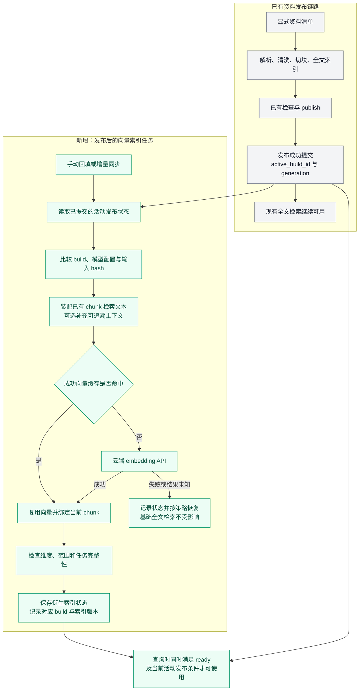
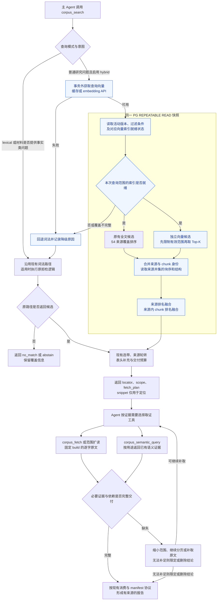
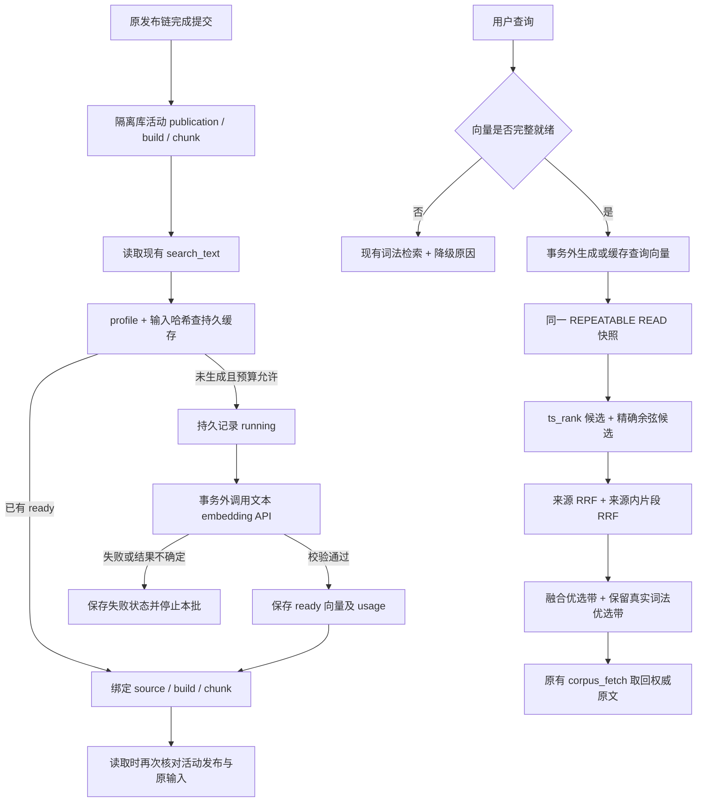
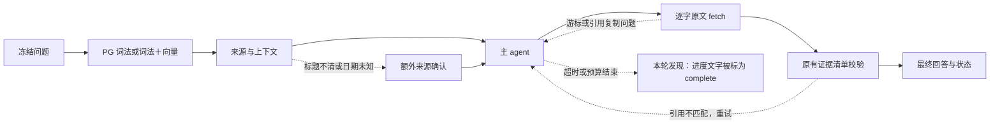
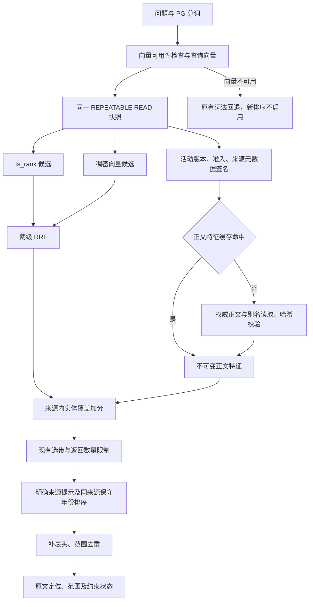
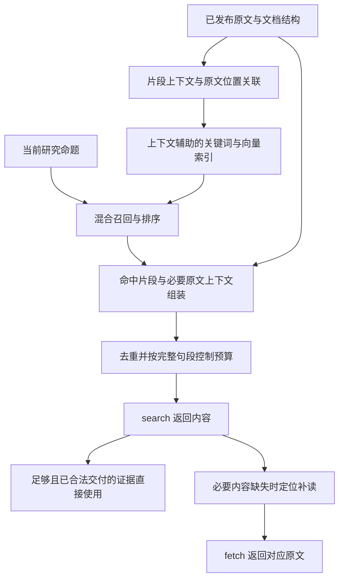
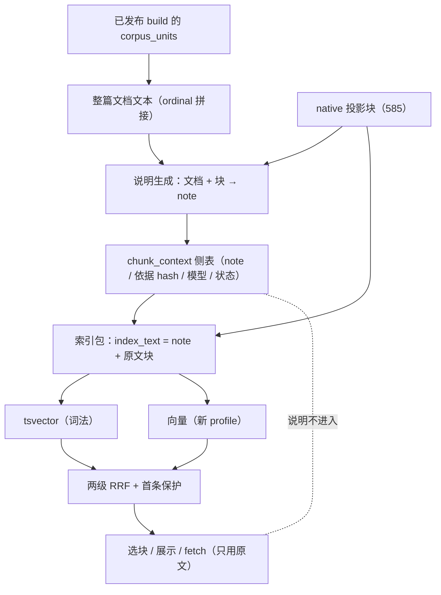

# 研报上下文向量检索小样本实施方案

状态：**历史隔离检索接入已验收；原生混合检索已于 2026-10-22 正式发布；§30 展示选择已局部实现；§33 Contextual Retrieval 已跑通首轮（585 条说明 + 上下文索引包 + 57 题结构 A/B），默认检索未切换**。2026-10-21 验收结论与范围见 §29，真实入口和版本缓存验证见 §28；§25–29 的开关及数据范围属于当时的实验记录，当前正式配置以发布说明为准。

后续进展（2026-10-22）：原生正文有界交付已接入现有搜索／取证工具，新增默认关闭的试用开关；23来源、585块的旧32＋新25题工具回归与更新／降级／关闭恢复验证完成。使用方式见 [原生正文工具试用](../corpus-native-trial.md)，执行证据见 [本轮报告](../../.scratch/corpus-native-tools-20261022/report.md)。这不改写§29的历史验收范围，也不表示已默认启用。

正式发布进展（2026-10-22）：用户随后明确授权“可以直接发到正式库中”。已将已验证的23个原生来源及检索策略发布至 `postgres`，在本机8000服务启用 `release` 开关，正式库57题工具回归和真实HTTP搜索／取证通过；保留关闭、降级及历史版本回读。详见 [正式发布说明](../corpus-native-release.md)。上下文增强尚未完成完整对照，按用户决定延后，不作为此次混合检索发布条件。此前§29及试用记录保留为历史阶段结论。

后续执行入口：§30 记录 2026-10-22 讨论确认的上下文感知策略、执行顺序和效果判断，与 [search/fetch 内容保留讨论稿](corpus-search-evidence-delivery-redesign.md) 配套；§31 定第一步（片段上下文组织方式）的字段、存储、消费边界与验收口径。§33（2026-10-23）把 Anthropic Contextual Retrieval 的「文档+块→说明→说明+块→双索引→融合」落到现有 native 链，代码与只读盘点已实跑，说明生成与向量构建需显式付费执行。

关联需求：[PR-DATA-01、04、05、09、12、14，PR-OUT-06、07](../product-requirements.md)。本方案是本次检索试验的实施入口，不替代跨层总计划，不重新开启已关闭的 S5 评测。

在现有 PostgreSQL 资料库上增加稠密向量候选召回，与现有全文检索融合，再复用现有选带、原文取证和 Agent 交付链路。先分别验证“增加向量”和“增加片段上下文”的收益；通过小样本验收后，再决定是否推广。§12 起记录隔离资料准备、真实向量及检索实验；§25 为最新重建对照，不包含主 agent 回答评测。

本次采用**发布后的向量增量索引**：直接读取已有发布结果，不重新执行原资料的准入、清洗、切块、审核或 `plan → build → check → publish`，也不以重新完成 claims／R2 抽取、S0–S5 治理评审作为建向量的前置条件。向量任务只维护自身的计算、缓存和可用状态；资料是否可用仍由现有发布链路决定。

上述边界适用于单独建向量；§22–25 的清洗版本变更则须先经过正式构建检查和发布，再更新向量。向量任务本身不绕过或承担资料发布。

## 1. 项目现状与设计依据

核对范围为 WSL `/home/administrator/FrontierAgent`，本次读取时 HEAD 为 `e71afc7f`，工作区存在其他未提交修改。下表描述已读文档与代码，数据库数量是 README 的历史快照，实施前需要重新核定。

| 已有能力 | 实际情况 | 本次设计 |
| --- | --- | --- |
| 资料入口 | `data/corpus/` 是原文件投放区，可能混有生产、开发、留出和未入库文件；通过显式 manifest 执行 `plan → build → check → publish` | 按选定来源和发布快照建立试验清单，不自动扫描整个目录入库 |
| 来源身份 | `source_id` 是原文件字节的 SHA256；同内容改名不变，内容改变产生新来源 | 直接沿用身份，不再创建另一套文档 ID |
| 原文与索引 | `corpus_units.raw_text` 是逐字证据；`corpus_chunks` 是带 `unit_refs/source_ranges` 的检索投影 | 向量关联已有 chunk，不重新解析或切块，不以 `search_text` 或生成背景替代原文 |
| 发布与版本 | `corpus_publications.active_build_id` 指定当前检索版本，build 固定解析、清洗、切块与索引版本 | 衍生向量索引服从现有准入、撤回和发布状态，不能自行发布资料 |
| 全文召回 | `zhcfg` 分词、查询规范化、词元处理、`ts_rank`、文件名加权；来源先按不同查询词元覆盖数排序，再比较来源与块得分 | 完整现有链路作为基线；不简化成裸 `ts_rank`，不替换成 BM25 |
| 证据范围选择 | 文档内结构信号、词法优选、有限连续 band、按来源轮转；随后补表头等上下文 | 向量接入候选阶段，继续使用有边界的选带和交付预算 |
| Agent 取证 | `corpus_search` 返回定位与 snippet；`corpus_fetch` 返回固定 build 的原文与分页状态 | 保持工具界面；snippet、背景和相似度均不是可引用证据 |
| 语义产物 | `corpus_semantic_query` 返回已发布、用途受限的 claims／items 及必要依赖 | 保留现有语义查询、消费台账与 manifest；向量不取代语义产物 |

主要依据：

- [资料库说明](../../data/corpus/README.md)：PG 九表、来源身份、入库与发布、快照、归档缺口。
- [清洗与检索专项说明](../data_clean_dos/README.md)：S0–S5、取证交付、验收与关闭边界。
- [全文检索](../../plugins/corpus/preparation/search_pg.py)、[快照读取](../../plugins/corpus/preparation/read_pg.py)、[选择策略](../../plugins/corpus/preparation/selection.py)、[CorpusService](../../plugins/corpus/service.py)。
- [搜索工具](../../plugins/tools/corpus_search.py)、[原文工具](../../plugins/tools/corpus_fetch.py)、[语义查询工具](../../plugins/tools/corpus_semantic_query.py)、[研究纪律](../../plugins/corpus/research_discipline.py)。

资料库 README 在 2026-10-20 记录了 8 个生产活动来源、14 个 build、7,128 个 unit、1,214 个 chunk；同目录另有 12 份隔离留出资料，不能直接计为生产内容。已有部分归档对象缺失的记录：本试验可读取现存 PG 原文，但不把归档完整性宣称为已通过，也不顺带执行修复、重解析或生产发布。

## 2. 范围与需要验证的问题

首轮直接选择**已有发布状态且有可用文本的研报**，尽量涵盖公司、行业、宏观。若当前符合条件的只有 8 份，就用这 8 份验证；10～20 份是后续样本目标，不为凑数重新启动入库治理。已有隔离数据仅在其发布状态和试验授权范围清楚时纳入；已经用于调试的留出资料只作开发和回归，不再称为新的盲测。

2026-10-20 用户进一步提出利用已下载研报并选择隔离库入库。本批已形成 18 份有效资料：8 份原发布快照＋10 份新增发布。后续直接使用这批固定来源开展 A/B 对照；新增未发布资料走一次正常入库，与“已发布资料建立向量不重复治理”是不同动作。

本轮使用本地 PG 和用户提供的云端 embedding API，只发送文本。不引入 OCR、图片／视频向量、GraphRAG、模型稀疏向量、独立 reranker、自动每日调度或云端部署改造。扫描页和不可解析图表列为文本覆盖缺口。

试验回答三个问题：

1. 在相同来源、过滤条件和返回预算下，向量能否补回全文检索遗漏的观点改写、同义表达及跨段语义证据？
2. 在相同 embedding 模型下，增加可追溯的片段背景是否进一步改善召回，而不是引入公司、年份、预测／实际值混淆？
3. 候选改善能否经过选带、工具分页和消息预算，真正变成主 Agent 收到并使用的完整证据？

`PR-DATA-14` 已要求正式启用向量前证明观点改写召回不足，且查询扩展、结构化过滤或排序校准无法充分修复。本轮按用户提出的小范围验证开展隔离实验；实验结果不自动等于生产启用。

## 3. 复用已有数据，新增可重建的向量索引

基础的 reader、clean、chunk、index 和 `plan/build/check/publish` 保持原有确定性、零模型流程。另建 PG 试验 schema，例如 `corpus_retrieval_pilot`，仅存放可重建的检索衍生数据。试验在独立数据库中使用经过核对的来源快照，不修改生产库或已关闭评测库。

具体入口为 `corpus_publications.active_build_id → 对应 corpus_chunks／必要的 corpus_units → embedding API → 向量记录 → 混合召回`。首次手动回填已发布范围，后续手动同步新发布或变化的 build；不要求在发布事务中加入模型调用，也不要求先建设事件总线或自动调度。试验数据库的快照复制属于环境准备，不是重新审批或发布原资料。

向量自身只检查必要的工程条件：关联来源和范围有效、模型与维度一致、输入去重、计算完成、查询时仍满足现有发布条件。这些检查自动执行，ready 表示索引可用，不新增人工审核、admission decision 或第二个 corpus publication。未完成或失败时沿用全文检索。

### 3.1 接入节点的综合评估

**本项目推荐两个接入点：离线建索引接在原资料发布提交之后；在线召回接在 `corpus_search` 内部，与全文召回并列，在 `_selected_context_hits` 选带之前融合。** 上下文补充位于片段检索输入装配阶段、embedding 之前。三个动作职责不同，不应合并成“在某一步调用一次向量模型”。

| 可选位置 | 影响 | 本轮结论 |
| --- | --- | --- |
| 原文件刚进入 `data/corpus/` | 尚未确定有效版本、可检索范围和稳定定位；扫描文件还会绕开显式入库清单 | 不接入 |
| 解析／清洗／切块过程中 | chunk 尚未最终固定；模型故障与原文处理耦合，重试可能重复计费 | 不接入 |
| chunk 和检查完成后、publish 之前 | 可以预计算以缩短发布后的等待，但需管理未发布向量；若设为发布前置，会改变现有发布可用性 | 本轮不做；未来有“发布即支持向量”要求时，可独立预计算，仍只对已发布版本开放查询 |
| **publish 成功提交后** | 原文范围和 chunk 已确定；可回填历史资料、增量更新，模型故障不阻塞原发布 | **本轮建索引入口** |
| **全文召回旁路、选带之前** | 可从同一有效语料范围独立找回词法漏召回的块，统一排序后再控制交付范围 | **本轮查询入口** |
| 已完成选带或 `corpus_fetch` 之后 | 只能处理已经找到的片段，无法补回未入选的来源；按查询重复生成文档向量会增加等待和费用 | 不作为候选召回接入点 |
| claims／R2 items 抽取或发布之后 | 把原文检索依赖于语义产物覆盖和抽取进度 | 不作为本轮前置；原文和语义查询保持现有各自职责 |

一般 RAG 系统在片段文本稳定后就能计算向量，是否在发布前计算取决于发布时效要求。本项目已经有完整发布协议，而且允许全文检索先服务，因此选择“发布后独立索引”，这是结合现状的取舍，不是所有系统都必须遵守的顺序。

### 3.2 建索引与增量执行链路

下图灰色是已有链路，绿色是拟新增的向量任务。左侧旧链路说明新资料从何而来；**对当前已发布资料，执行直接从发布状态开始，不重跑左侧节点。** 图中手动同步是本轮入口，后台定时同步或发布后通知属于后续自动化。



发布接口当前落在 `engine.publish_build → PgStore.publish → _set_publication`。向量同步只读取其**已提交结果**，不调用 `publish_build` 来重新认可已有资料，不向发布事务加入网络请求。以后若使用发布后通知，通知只负责唤醒任务；同步任务仍按发布表对账，使通知丢失不会永久漏建索引。

索引任务在短事务中取得来源、build 和输入清单，随后释放事务再调用模型。写回时复核记录身份，并将计算完成与当前查询可见性分开：如果期间发生新版本发布或撤回，旧向量可以保留为缓存，但不能重新激活旧 build。现有 PG 发布状态始终决定能否召回。

允许存在“全文可查、向量待就绪”的时间窗口。试验中记录这段耗时；如未来业务要求发布即双路可查，再评估发布前预计算，不在本轮引入额外发布门禁。

### 3.3 衍生数据与原文定位

建议的数据职责如下，物理表名在实施时按现有迁移方式落实：

| 衍生记录 | 必需字段／约束 |
| --- | --- |
| 试验清单与索引版本 | `run_id/index_version`、来源及 active build 清单、publication generation、过滤与模型配置、预期块数／成功／失败／排除数、状态、创建时间 |
| 片段检索输入 | `source_id/build_id/chunk_id`、输入变体、原文范围引用、原文投影 hash、独立 `context_text`、上下文依据与生成版本、最终 `input_hash` |
| 向量与任务 | provider、实际 model revision、维度、请求参数版本、输入 hash、embedding、任务状态／租约、请求标识、usage、重试与错误分类 |
| 查询观测 | 查询及参数版本、双路候选和原始分数、来源及块排名、融合名次、选带结果、降级原因、耗时和费用 |

原文仍从 `corpus_units` 按已有范围读取；衍生表中的文本是明确标识的检索副本。每个向量必须能定位到一个确定的 `(source_id, build_id, chunk_id)`。chunk 的多个不连续范围按列表保留，禁止用最小起点和最大终点拼成连续摘录。

先直接复用现有 chunk 边界。发现输入超过模型限制时，优先去掉非必要背景；仍超长的块可生成有独立范围映射的 embedding 子片段，召回时折回原 chunk 并去重。不得截掉正文后标为完整，也不得为满足向量长度重写基础 chunk。排除项单独披露，A/B/C 对比使用相同的已声明内容范围。

## 4. 检索输入与上下文

设置三个主要对照组，所有组固定来源快照、过滤条件、工具预算与选择策略：

| 组别 | 候选召回 | 目的 |
| --- | --- | --- |
| A：现有基线 | 完整当前全文检索链路 | 衡量现有能力和失败类型 |
| B：混合检索 | A 的词法候选＋现有 chunk 检索文本的稠密向量候选 | 单独衡量向量增益 |
| C：上下文混合检索 | 相同词法候选＋增加背景的 chunk 稠密向量候选 | 单独衡量上下文增益 |

B 的文本输入采用现有 `chunk.search_text`，其中已有的标题／结构信息照实保留，不能声称它是完全无上下文的裸正文。C 在此基础上补充背景，词法索引保持一致。

上下文先分两档验证：

- **C1：确定性背景。** 复用可追溯的报告标题、明确发布日期、章节路径、已有表头／单位／期间等。缺失字段保留未知；不能把文件名猜测、行业主体或被对比公司当作报告所属公司。
- **C2：可选生成背景。** 仅当 C1 仍有明确缺口时，为固定片段生成短背景；输入限定为同一 build 的可追溯文本与必要邻域。保存生成模型、提示版本、所用范围和输出，抽检主体、期间、事实／预测属性。与 C1 单独报告，不混为一种处理。

背景与原文分开保存，只帮助召回，不进入引用证据。否定、条件、风险和作者归属不得被改写成事实断言。上下文生成需要独立的文本生成模型与预算，embedding API 本身不承担背景写作；尚未提供生成模型时，B 和 C1 可以完整实施。

这属于“向量侧上下文增强”的局部试验，不是同时改写 BM25 和向量的完整 Contextual Retrieval 实现，也不套用其他资料集的提升比例。[Contextual Retrieval 原始说明](https://www.anthropic.com/engineering/contextual-retrieval)

## 5. 模型适配与 PG 检索

候选为用户提出的 Doubao Embedding Vision。实施前核对实际 endpoint、具体模型版本、文本输入格式、query/document 指令、维度、长度限制、限流和计费规则；`doubao-embedding-vision-251215` 作为待核对候选，不把名称自动当作用户已开通的服务。

适配器提供 `embed_documents` 与 `embed_query` 两个内部入口，统一记录模型空间和参数。查询向量与文档向量必须使用兼容的同一模型空间；返回数量、维度、有限数值和非零范数要校验。不能假定 multimodal API 的一个 `input` 数组会生成多个独立文档向量，批处理方式须按实际接口验证。[豆包向量化接口](https://docs.volcengine.com/docs/ark/vectorization?lang=en&redirect=1)

PG 驱动复用项目的 psycopg。先检查隔离环境是否安装兼容的 pgvector 扩展，不假设当前容器已经具备。小样本先使用精确余弦距离检索，不建 HNSW／IVFFlat；若当前实例缺扩展，单独准备兼容的试验实例，不为试验替换生产 PG 镜像。

模型维度在建表前冻结。pgvector 对普通 `vector` 的近似索引存在 2,000 维限制，不能把 2048 维模型输出直接套进该配置；精确存储／查询与近似索引能力分别验证。本轮不静默降维或改半精度。[pgvector 官方说明](https://github.com/pgvector/pgvector)

### 5.1 双路候选与融合

编排入口位于 `CorpusService.search_with_coverage`，具体做法是增加可返回双路候选的组合读取，在 `_selected_context_hits` 之前完成融合。当前 `read_pg.search_with_coverage_bands` 只按词法命中装配块序，不能在它返回后简单追加向量 hits；需要在同一快照中按**双路候选的来源并集**读取块序和必要结构字段，才能让向量独有来源正常进入选带。`lexical` 模式保留当前读取路径作为基线。

1. 查询 embedding 在数据库事务外获取，避免网络等待占住读取事务。使用保留主体、否定和时间条件的自然语言查询及模型规定的 query 指令，不把为 FTS 构造的 OR 词元串直接用作 embedding 输入；词法通道继续使用现有词元与查询构造规则。
2. 在 `REPEATABLE READ` 中读取活动发布状态、词法候选、符合相同状态与过滤条件的向量候选、原文块序和 coverage。向量记录必须与当前 active build 及已就绪索引版本匹配。
3. 词法候选保留当前完整排序。向量候选从满足条件的活动块独立召回，不能只给词法命中的块算向量，否则无法补回词法漏召回。
4. **候选方案为先融合来源排名，再融合来源内 chunk 排名。** 来源词法名次来自当前 S4 顺序；向量来源名次先用该来源最佳块名次归并。两层均采用 RRF，初始等权、常数 60，仅在开发集调参后冻结；同分按稳定 ID 排序。这是项目适配方案，不是已证明最优的算法；用相同候选池的小型离线对照，与单层 chunk RRF＋来源限额比较后再冻结。
5. 融合结果进入现有选带、来源轮转与表头补充。每个来源沿用候选限额，避免长报告占满结果。保留“最佳词法带”的真实词法依据；若选择器原本只接受一个 score，需显式补充词法与融合排名输入，不能将融合得分冒充 `ts_rank` 后继续按旧含义使用。

RRF 使用 `Σ 1/(60 + rank)`，缺席某一路贡献为 0；原始全文分数与余弦分数只用于观测，不直接相加。调试日志记录候选到最终交付每一步的丢失原因。

这里的并列召回表示两路独立产生候选，不要求并发执行两条 SQL。在一个 PG 事务中顺序查询即可保持实现简单，并使两路使用同一读取快照。PG Repeatable Read 的多条读取共享事务快照；pgvector 官方文档也提供了与全文检索结合、使用 RRF 融合的方式。采用来源／chunk 两层融合则是适配本项目选择策略的设计。[PG 隔离级别](https://www.postgresql.org/docs/current/transaction-iso.html)、[pgvector 混合检索](https://github.com/pgvector/pgvector#hybrid-search)

基线现有主候选、coverage、块序已有同快照读取；额外拒检和部分结构读取存在独立调用。新组合读取须保证双路核心候选及覆盖信息同快照，后续读取始终携带固定 build，并沿用撤回检查，不声称整个现有服务天然只有一个事务。

### 5.2 过滤、拒检和故障语义

下层已支持 research domain 和报告发布日期范围，公开 `corpus_search` 当前主要暴露 query／limit。公司、机构和时间过滤必须区分“底层已有”与“需要补充”：

- 来源／build 白名单、准入状态和日期过滤在向量 Top-K 之前生效，两路一致。
- 公司、机构先核对现有 admission 快照的字段和可信度；若没有权威映射，试验采用人工核对的独立元数据映射表，不借生成背景推断身份。
- 报告发布日期与正文讨论的业绩年份分别处理。元数据未知时，严格过滤不通过；不能由相似度覆盖硬条件。
- 首轮通过试验入口验证过滤；通用工具参数扩展另列小步实现和兼容测试，不先改整个 Web 查询界面。

现有 `_abstain_decision` 针对“这些报告是否提供某项事实”有严格词元检查。**本轮集成对此类问题继续走原有词法拒检策略**，不因向量总能返回近邻就判定存在证据；离线单独记录该策略可能挡住的同义候选，后续有独立正负样本再讨论改进。这是首版有意保留的能力限制。

向量 API 超时、索引缺失或部分覆盖时回退现有全文链路，并暴露 `retrieval_mode`、索引覆盖和降级原因。服务故障不等于资料不存在，不能伪装成有效 `no_match`。正常分析问题的语义候选也只是待取证材料，相似度不能证明问题可回答。

### 5.3 查询与 Agent 取证执行链路

下图展示普通研究问题的混合检索以及首版保留的词法路径。蓝色是拟新增行为；框内双路读取使用同一 PG 快照。模型调用在框外完成；文档向量已预先建立，在线只计算或复用**查询向量**。



图中“缺失 → 补取”只对可恢复的缺口继续执行，并受原有调用与预算限制；无法补足时缩小结论范围，不无限重试。语义查询返回的完整合法证据可直接进入消费流程，不强制再绕一次 `corpus_fetch`。

本轮固定试验范围内，只要向量覆盖未完整就回退该次查询的词法路径，并显式报告原因；不把混合了部分来源向量的结果算作完整 B/C 组。后续如支持部分覆盖混合检索，应另定义展示和评价口径。

### 5.4 代码落点与接口职责

| 位置 | 拟承担职责 | 与现有链路的关系 |
| --- | --- | --- |
| `preparation/engine.py`、`repository_pg.py` | 继续管理原资料发布和撤回 | 本轮不插入 embedding，也不修改发布状态机 |
| 新增 `plugins/corpus/retrieval/` 索引任务 | 读取活动发布清单、装配文本、缓存去重、调用模型和保存状态 | 首次回填与后续增量使用同一个同步入口；不另设人工审批 |
| 新增检索组合读取；复用 `read_pg.py`／`search_pg.py` 必要接口 | 同快照双路候选、过滤、覆盖和来源并集块序 | 词法查询实现复用；向量读取不能依赖词法先命中 |
| `CorpusService.search_with_coverage` | 选择检索模式，调用检索 Module 完成查询向量获取、组合读取、降级和融合 | 外部仍通过已有搜索工具调用，不让 Agent 自己合并两套结果 |
| `_selected_context_hits`／`selection.py` | 消费融合候选及真实词法优选依据，控制来源与证据带 | 对融合分数语义做必要适配，保留原文范围和预算规则 |
| `corpus_search`／`corpus_fetch`／`corpus_semantic_query` | 搜索定位与证据交付 | 搜索可增加检索模式和降级元信息；取证身份与用途约束保持现有协议 |

新增 Module 对服务层提供一个组合检索 Interface，返回候选、块序、coverage 和检索诊断；调用方不分别管理向量 SQL、模型重试和缓存。对索引入口与在线检索入口分别验证，避免把“索引已建成”当作“主 Agent 已收到有效证据”。

## 6. 增量、去重、发布和撤回

本轮用手动触发验证每日增量所需的机制，不建立自动调度：

| 事件 | 处理 |
| --- | --- |
| 相同文件再次提交或改名 | 复用已有 source/build 与已成功向量；没有输入变化不再次请求模型 |
| 原文件内容变化 | 由已有资料发布流程处理；向量任务仅在新 source/build 发布后消费，不发起入库治理，也不自动撤回旧来源 |
| 同来源重建 build | 新 build 发布后，对其 chunk 计算检索输入 hash；输入及模型参数完全相同的向量可复用，但必须重新关联并验证当前范围 |
| 背景、模型或参数变化 | 产生新的衍生索引版本；不混合不同向量空间 |
| 新 build 已发布、向量尚未就绪 | 该来源继续可走全文检索；向量侧不拿旧 build 补位，结果明确标示覆盖不足 |
| 撤回／准入失效 | 查询时以现有发布和准入状态排除，即使向量尚未物理删除也不得返回有效候选；旧 fetch 继续遵守现有撤回协议 |
| 恢复／重新发布 | 验证当前 build、范围与模型配置后复用或补算；未完成前不宣称向量可用 |

索引版本只有在其声明范围内的全部预期任务完成、定位检查通过后才标为 ready。部分完成保留诊断状态；主对照评测要求 B/C 对选定范围覆盖完整。发布基础资料与切换衍生索引是两个动作，不能让模型故障阻塞基础入库。

成功缓存按“最终输入＋provider/model revision＋维度＋请求参数版本”去重；任务唯一约束与租约防止并发重复计算。生成背景也独立缓存。

“重复入库不重复计费”可保证到已保存成功结果的重用。请求已被供应商处理但响应丢失时，若供应商没有幂等键或查询接口，无法保证外部计费严格一次；此时标记未知结果，按受限重试策略处理并记录可能重复费用，不无限重发。

## 7. Agent 接入与 claims／R2 边界

保留 `corpus_search → corpus_fetch／context inventory → 证据消费与 manifest` 的当前路径。搜索继续返回 `doc_id=cv2:<build_id>`、`locator=chunk:<chunk_id>`、scope、context locators 和 fetch plan；不增加另一套“按向量 ID 读报告”工具。

需要原文时按已有 locator 扩展，使用固定版本分页、body-first 预算和完整表格依赖；分页结束不等于证据完整，`budget_limited`、缺依赖等状态仍须处理。多个选带分别取读，不能把它们包成跨越大量无关页面的大区间。

claims 和 R2 items 保持各自的语义与用途约束，本轮不为它们另做向量索引，不重抽取、不迁移其独立结构化存储。基础 corpus 使用 PG，不意味着可以顺带替换语义产物仍使用的存储实现。

`corpus_semantic_query` 已完整交付并满足用途约束的证据，可按现有规则直接引用和提交 `semantic_references`，不例行再次 fetch。只有定位摘要、缺少期间／单位／条件、预算截断或证据冲突时才继续取原文。优化目标是减少重复查找与无效扩读，不以取消必要取证来降低调用数。

## 8. 验收方法与建议门槛

既有 S4 的 51/51 是特定冻结矩阵的结果，不是所有真实问题已解决；既有 S5 的 204 次模型运行存在评分、扩读和表格表达等归因，其关闭结果不作为“向量必需”的证据，也不修改或重评分旧结果。

### 8.1 数据与问题

先复现 A 的实际基线，再固定 30～50 条新题及原文证据范围。覆盖观点改写、简称／别名、跨段条件与风险、公司／年份近似混淆、表格单位／期间、明确无答案；按报告或主题分开开发与验收，避免同一问题的改写分别落入两组。记录每类数量与分母，小样本结果不外推全库。

已使用的 51 道题可复用为回归锚点，优先运行与本次选定资料及修改路径相关的用例；不要求重新跑完整 S0–S5 或旧 204 次模型评测才可建向量。结果写入本次试验记录，不改历史关闭记录。新增题先人工确认“原文是否足够回答”及必要范围，再冻结，不看候选输出修改金标。PR-DATA-14 所需的简单查询扩展、结构过滤或排序校准修复可能性，用少量有依据的失败分析记录；不在本轮扩成新的多模型查询改写工程。

### 8.2 三层观测

| 层次 | 主要指标 |
| --- | --- |
| 候选召回 | 来源 Recall@5、证据范围 Recall@10、必要依赖覆盖、词法／向量独有命中、公司／年份／来源错配 |
| 工具交付 | 选带后证据保留率、完整证据实际交付率、预算截断、重复 search、必要 fetch 与无效扩读分别计数 |
| Agent 报告 | 引用忠实度、条件／单位／期间完整性、无证据断言、claims／items 用途遵守、端到端时延和成本 |

Agent 验证从冻结题中选 6～10 个代表任务，各组使用相同主模型、提示、工具预算和固定语料快照，保存实际 tool 消息与报告；存在随机差异时按预先约定次数复跑，不只挑最好一次。候选命中不能替代实际交付和正确引用。

建议审核以下通过标准，执行前冻结：

- 身份、版本、撤回与范围检查全部通过；返回候选中硬过滤越界为 0；最终有效证据不新增公司／年份错配和无证据断言。
- 已有回归题不新增可归因于向量接入的失败；若当前 A 已与历史结果不同，先记录基线差异，不调整金标消除差异。
- 在预先定义的语义改写子集，B 相对 A 的证据 Recall@10 提升至少 10 个百分点，并列出逐题增益与损失；如果 A 已接近满分，不为达到阈值换题，结论可为暂不需要向量。
- C1／C2 分别与 B 比较；没有稳定质量增益或额外成本不值得时，仅保留 B，不把上下文生成设为必经步骤。
- 总体交付完整率不下降，无答案题不新增误报；额外回查次数作为次要指标，不要求必要 fetch 必须下降。
- 对照报告同时给出查询和端到端 p50/p95、冷／热缓存口径、首建／增量／单查询费用。具体延迟容忍度和金额上限在获知 API 价格、实际片段数后登记，不能预先承诺费用或倍数。

## 9. 实施步骤与交付物

| 步骤 | 工作 | 交付与继续条件 |
| --- | --- | --- |
| P0：冻结试验基线 | 读取已有来源发布清单，核定实际运行代码／配置、PG／zhcfg／pgvector、可用文本、现有基线和新题；建立隔离目标守卫 | 试验清单、基线报告、失败归因、任务量及费用估算；不产生新的入库 manifest 或资料审核；记录现有其他工作区修改，不带入本任务变更 |
| P1：建立衍生索引 | PG 迁移、embedding 适配、输入映射、缓存与任务状态；先少量契约调用再扩至清单 | B 索引及完整定位校验；通过重复执行、超时、并发、断点续跑测试 |
| P2：离线混合检索 | 双路同快照候选、两层融合、过滤、选带和诊断 | A/B 逐题对比；证明增益并满足安全及回归标准后进入接入 |
| P3：上下文对照 | 先 C1，必要时单独加入 C2 | B/C1/C2 质量、调用量与成本对照；选择最小有效方案 |
| P4：Agent 小范围接入 | 在试验配置启用已选方案，复用现有 search/fetch、语义查询与消费协议 | 实际交付与报告验证；确认增益没有被预算或选择器抵消 |
| P5：增量与回滚验收 | 在隔离数据模拟新增、相同内容、重建、发布并发、撤回、恢复和服务降级 | 重用／计费台账、状态与版本一致性结果、回滚说明、推广或停止建议 |

拟新增独立 `plugins/corpus/retrieval/` 模块承载模型适配、衍生索引任务和融合逻辑。现有准备引擎不依赖外部模型；确需共享的 PG 快照读取接口在 `preparation/read_pg.py` 附近扩展，服务层负责组合。文件划分可在实施时细化，但不将模型调用散落进 reader、fetch 或工具函数。

验证使用项目的 `uv` 工具链。重点测试真实 PG 的过滤／快照／撤回一致性、请求契约与异常、选带预算和 Agent 证据交付；文档阶段不运行模型或业务测试。试验配置默认 `lexical`，候选模式为 `hybrid_raw/hybrid_context`；回滚切回 `lexical`，保留已有 corpus 发布状态与取证工具。

## 10. 审核结论与执行前输入

本方案建议批准的范围是：**复用当前资料库和证据链，以 PG 衍生索引增加云端文本向量召回，先小样本证明收益，再按结果选择是否启用上下文。**

执行前需要落实的输入：

1. 用户提供 embedding endpoint、模型版本和 API 凭据配置位置；密钥通过环境或已有配置机制注入，不写入计划、日志或仓库。
2. 固定样本 manifest、开发／验收题及首次试验金额上限；实际可用资料不足 10 份时先完成工程验证。
3. 如选择 C2，再指定文本生成模型和独立预算；不影响 B/C1 先行。
4. 对上述验收门槛作一次确认，随后按 P0–P5 执行。生产启用、全库扩展、每日自动调度及 OCR 均不由本次试验自动触发。

## 11. 主流流程对照与遗漏复核

### 11.1 主流流程与本项目的对应关系

RAG 没有唯一固定模板。常见流程分为离线索引和在线回答两条链：离线完成内容准备、切块、可选背景补充、embedding 和持久化；在线完成查询准备、检索、结果选择、上下文装配和有依据的回答。Agent 可以按需多次调用检索，背景生成、查询改写和独立 reranker 都属于按效果选择的增强环节。[Microsoft RAG 架构与评估指南](https://learn.microsoft.com/en-us/azure/architecture/ai-ml/guide/rag/rag-solution-design-and-evaluation-guide)

| 阶段 | 常见处理 | 本项目对应 |
| --- | --- | --- |
| 离线内容准备 | 解析 → 清洗 → 切块 → 元数据／原文定位 | 已有确定性资料链路承担，不重做 |
| 离线向量化 | 可选背景 → 文档 embedding → 存储与更新 | 发布后消费已有 chunk，在 PG 保存衍生向量 |
| 在线查询 | 明确查询含义和过滤条件 → 查询 embedding | 复用 Agent 查询，保留主体、时间、否定和上下文；向量计算在读取事务外 |
| 在线候选 | 关键词与向量独立召回 → 融合 → 可选精排 | 现有全文链＋pgvector＋RRF；独立 reranker 暂不引入 |
| 上下文装配 | 去重、补必要上下文、控制预算、保留来源 | 现有选带、表头依赖、fetch 分页和原文范围 |
| 回答与维护 | 基于证据生成 → 引用与评测 → 增量／删除同步 | 现有 Agent 消费协议＋本次质量、费用和更新观测 |

混合检索保留关键词通道有实际理由：代码、名字和日期等精确表达与语义改写需要不同信号；RRF 可合并两路排序。`ts_rank` 不是 BM25，但并不妨碍“现有全文召回＋向量召回”构成混合检索，不需为对齐主流示例更换现有全文实现。[Azure 混合检索说明](https://learn.microsoft.com/en-us/azure/search/hybrid-search-overview)

**可行性结论：架构可行，适合在已有资料库上做小范围增量验证；实际收益和运行成本尚未验证。** 发布后生成向量会产生向量就绪延迟，但能保持基础发布独立。source／build／chunk 与原文取证是已有优势；两层融合、结构选带对向量候选的实际影响，需要通过实验确认。

### 11.2 实施前必须补齐的细节

以下属于本次实现与验证细节，不增加原资料审批或新的治理流程。

| 项目 | 当前缺口或风险 | 本轮落实方式 |
| --- | --- | --- |
| 候选深度 | 最终返回 10 条不等于每路只召回 10 个 chunk；提前截断会使融合无从补救 | 词法保持现有至少 200 个候选的逻辑；向量初始使用 200 个候选、每来源最多 40 个，均为开发起点。小样本精确查询中先执行来源限额再取全局候选，避免长文挤占来源。冻结返回条数不变，比较候选深度变化后的召回与时延 |
| 排序与选带 | 当前来源覆盖排序、结构优选和词法优选均会改变最终交付；两层 RRF 未必优于更简单的融合 | P2 以同一候选池比较单层／两层融合，记录“候选存在但在来源排序、选带或预算阶段丢失”的位置。不得对融合结果再次全局套用词元覆盖排序；测试向量独有来源及向量独有正文带能否最终交付 |
| 去重与来源多样性 | 一个 chunk 的多个向量子片段、同一证据重叠范围可能重复占位 | 子片段先折回 `(build_id, chunk_id)` 再融合，单路取最佳名次，不能重复投票；同一来源的重叠原文按范围去重。不同机构的类似论述保留各自出处，不擅自合并成独立佐证或市场共识 |
| 无答案与相近错配 | 向量近邻总能找到相似内容；RRF 得分只代表名次组合，不代表正确概率 | 不设置无依据的通用“相似度 0.8 即可信”阈值。除保留当前存在性查询拒检外，新增普通分析型无答案、错误公司、错误年份、否定反转、预测／实际混淆题；取证不足时不作肯定结论。候选被返回和答案受到支持分开评分 |
| 模型与输入契约 | 多模态模型能接收文本，不等于已验证中文研报检索效果；字符数也不等于 token 数 | P1 少量文本验证 query/document 输入与输出映射、实际长度限制、中文术语、数字和否定对。冻结 model revision、维度、距离度量和指令；超长、空白或输出异常显式处理，不自动截断原文。配置验证通过不等于检索质量通过 |
| 缓存失效与版本切换 | 仅以 chunk ID 缓存会漏掉背景变化；仅以查询字符串缓存会混用模型空间 | 文档缓存按最终输入及模型参数；上下文缓存同时包含其依赖范围／元数据和生成版本。查询向量缓存包含实际查询输入与 query 指令及模型版本。若未来缓存检索结果，还需绑定过滤条件和发布快照；本轮优先只缓存向量。模型升级新建空间，不原地混写 |
| API 故障与费用边界 | “有重试”不足以约束交互延迟；429、超长、鉴权失败不能同样处理 | P0/P1 冻结在线请求期限、离线并发／限流与本次费用上限；在线超时及时词法降级，离线可持久化重试。429 按服务约定退避，鉴权或请求格式错误停止盲重试。向量 SQL 失败若使事务回滚，则重新执行完整词法读取，不拼接不同快照的残余结果 |
| 索引有效性与更新观测 | 只有“完成条数”难以发现发布后漏同步或错误范围 | 以来源／build 记录预期、完成、失败和排除数，跟踪发布至向量 ready 的时间；整批实验 manifest 记录覆盖。覆盖与有效发布状态双重判断，进程重启后可继续，不靠一次性回调保持一致 |

现有参数依据是 `service.py` 的 `_SELECTION_POOL_MIN=200`、全文 SQL 每来源最多 40 块、`SelectionPolicy.top_k=5` 及 `corpus_search` 默认返回 10 条。向量的 200／40 是保持候选预算可比的起点，不是通用最优值，也不把 200 个 chunk 直接送给 Agent。融合只能重排已经召回的并集，候选阶段遗漏的证据无法靠后续融合恢复。[Qdrant 候选与融合说明](https://qdrant.tech/documentation/search-tuning/hybrid-search/)

### 11.3 小样本成立、长期使用需另行调整的地方

**整次查询回退仅作为本轮固定范围的严格实验策略。** 实际日更时，若一份新研报尚未建完向量就使全库停用混合检索，会降低已有索引的价值。扩展到日常使用时，建议按来源／build 管理 ready 状态：全文覆盖全部有效来源，向量覆盖已就绪来源，返回 `partial` 与明确覆盖信息；按覆盖完整和部分覆盖分别评价，不能混算增益。该模式不在本轮默认启用。

同样，当前保留的存在性查询词法拒检可能漏掉同义表述。首版将其作为已知限制，后续如需改善，应单独验证“存在／缺失”的判断，不能靠取消拒检或降低相似度阈值替代。

这轮刻意暂缓的能力包括独立 reranker、LLM 多查询改写、OCR、GraphRAG、ANN 索引和自动调度。是否增加它们应由失败归因决定：候选已有但排名差才考虑精排；原文没有被解析出来才讨论 OCR；精确查询性能确实不足才评估 ANN。暂不建设这些能力，不构成当前小样本架构缺失。

### 11.4 最小执行收口

P0 固定发布清单、文本覆盖、题集、费用和候选预算；P1 验证模型契约与可恢复索引；P2 验证候选、融合、选带和无答案；P4 验证 Agent 实际交付；P5 验证增量与故障。C1/C2 保持可选对照。重点是把已选路径测完整，不先扩展更多检索模块。

## 12. 首轮方案选择与资料准备实绩

**当前推荐先实施 B：现有全文检索＋现有 chunk 文本的稠密向量＋排名融合。** 在相同的已固定资料上与 A 对照；C1 作为下一步低成本对照，C2 暂缓。避免同时改模型、文本背景、切块和检索排序后无法判断收益来源。

用户已选择向量试验隔离库；本次完成以下工作：

| 项目 | 2026-10-20 实际结果 |
| --- | --- |
| 目标库 | `vector_pilot_corpus_20261020` |
| 基线资料 | 从生产 corpus 只读复制 8 份有效发布及关联数据 |
| 新资料 | 14 份执行入库，10 份检查通过并发布，4 份因图像／表格提取缺口暂未发布 |
| 可用试验范围 | 18 份：公司 3、行业 10、宏观 5；活动 chunk 703、unit 5,870 |
| 入库核验 | 18/18 标题检索与原文取回通过；14/14 新归档哈希通过；无 RUNNING 任务 |
| 环境 | 隔离库已具备 pgvector 0.8.6、zhparser 2.4、pg_trgm 1.6 |
| 生产与模型 | 生产发布指针及 generation 前后一致；模型调用 0 |

这些结果完成了 P0 的资料批次准备，不代表新题集、模型契约、向量索引或检索收益已经验收。下一步在获得 embedding API 配置后执行 P1，不要求先凑到 20 份或为四份缺口增加 OCR。

详细记录：[隔离入库报告](../../.scratch/corpus-vector-pilot-20261020/report.md)；[固定检索快照](../../.scratch/corpus-vector-pilot-20261020/retrieval-snapshot.json)。

## 13. B 方案工程实现与运行方式（2026-10-20）

已在 `plugins/corpus/retrieval/` 实现文本向量适配器、发布后侧索引、精确余弦召回、
两层 RRF 和隔离库 CLI。`CorpusService.search_with_coverage` 已接入可选混合模式，
`corpus_search → corpus_fetch` 继续使用既有版本句柄和原文证据协议。
目前完成工程链路，**尚未生成真实模型向量，也未完成检索质量验收**。

### 13.1 配置

项目根目录 `.env` 已追加以下字段，`.env.example` 同步提供模板：

| 字段 | 已填默认值／用途 |
| --- | --- |
| `CORPUS_RETRIEVAL_MODE` | `lexical`；保持日常服务现状，CLI 试验查询自行指定模式 |
| `CORPUS_VECTOR_TARGET_DB` | `vector_pilot_corpus_20261020` |
| `CORPUS_VECTOR_API_URL` | `https://ark.cn-beijing.volces.com/api/v3/embeddings/multimodal` |
| `CORPUS_VECTOR_API_KEY` | 留空，由用户填入专用 embedding Key |
| `CORPUS_VECTOR_MODEL` | `doubao-embedding-vision-251215`；若账号要求接入点 ID，改为实际 ID |
| `CORPUS_VECTOR_REVISION` | `doubao-embedding-vision-251215`；接入点背后模型升级时必须一起调整 |
| `CORPUS_VECTOR_DIMENSIONS` | `2048`；适配器支持该模型的 1024／2048 维配置 |
| `CORPUS_VECTOR_TIMEOUT_SECONDS` | `15`；HTTP 超时配置，在线失败回退，不自动重试 |
| `CORPUS_VECTOR_MAX_CHARS` | `16000`；保守字符保护，不等于模型 token 上限，不自动截断 |

文本请求使用 `instructions` 字段，query 与 document 使用不同指令。
每请求仅传一段文本，不把多模态 `input` 数组当成独立文本批处理。
输出按 `data.embedding` 读取并校验维度、有限值和非零向量。
接口依据：[豆包向量化文档](https://docs.volcengine.com/docs/ark/vectorization?lang=en&redirect=1)、
[多模态向量化 API](https://docs.volcengine.com/docs/ark/multimodal-vectorization-api?lang=zh)。
账号可用性与真实响应仍待用户配置后验证。

CLI 复用既有 PG 连接参数，仅在子进程里把 database 改为指定试验库；
`.env` 中原有 `CORPUS_DSN` 和 `CORPUS_TARGET_DB` 不因此改变。
CLI 要求目标库以 `vector_pilot_` 开头，并沿用项目的实际数据库身份检查。
线上模式误指向其他数据库时会词法降级，返回 `vector_target_mismatch`。

### 13.2 实际执行链路



侧表位于 `corpus_retrieval` schema：`spaces` 保存无密钥的模型／输入契约，
`embeddings` 保存输入缓存和请求状态，`chunk_vectors` 保存发布片段绑定。
不修改原文、原发布指针、claims 或 R2 items。查询阶段不创建表或扩展。

混合模式的选带先保留融合优胜带，再为真实词法优胜带预留位置；不把 RRF 分数
当成 `ts_rank` 再做结构重打分。词法模式原有结构排序保持不变。这是本轮需在
真实题集中特别观察的排序变化，不能仅凭模拟向量测试证明其质量优于基线。

### 13.3 配置完成后的命令

在 WSL 项目根目录运行：

```bash
cd /home/administrator/FrontierAgent

# 只读盘点；不会调用模型
uv run python -m plugins.corpus.retrieval.cli status

# 初次先限制为 3 个新文档输入请求，验证真实接口契约
uv run python -m plugins.corpus.retrieval.cli build --max-requests 3

# 接口验证通过后继续构建；已完成输入直接复用
uv run python -m plugins.corpus.retrieval.cli build --max-requests 700

# 同一问题输出 A/B 结果、来源定位、覆盖、耗时与查询 usage
uv run python -m plugins.corpus.retrieval.cli compare --query '制冷剂行业供需格局如何变化？'
```

`build` 默认最多发出 10 次新请求；上面的 700 是明确指定的本轮请求上限，
不是金额承诺。当前 703 个片段对应 **675 份不同输入**，长度最大 1,556 字符。
模型费用以供应商实际 usage 和账单为准；未知请求结果可能已计费，不能当作免费。

鉴权／格式／429 等确定失败会停止当批，修正后用 `--retry-failed` 继续。
超时、5xx、异常响应或进程中断留下的 `running` 不自动重试；
核实后如要重试，显式追加 `--retry-uncertain`，这可能产生重复费用。
当前没有自动退避重试、后台调度或每日定时任务；新增发布后再次执行 `build`
即可核对活动范围并补齐。未变化的文本跨 build 复用，撤回内容在读取时即时排除，
缓存暂留供复用／审计，不把缓存存在当作来源有效。

查询向量使用最多 128 条、5 分钟的进程内缓存，键包含 profile 和实际查询文本；
检索结果本身不缓存。完整性检查在查询向量生成前及最终读取快照内各执行一次。
缺索引、模型失败或向量 SQL 失败均显式词法降级；SQL 失败会重新读取完整词法
快照，不拼接失败事务的残余结果。

### 13.4 验证边界与下一步

已验证内容包括：请求／响应契约模拟、空间隔离、RRF 去重、向量独有证据带交付，
以及真实隔离 PG 上的预算中断后续建、重复执行零新请求、绑定丢失后缓存恢复、
活动内容变化失效、撤回过滤、日期过滤、API／SQL 故障降级与原文取回。
测试向量使用临时独立 profile，结束后清理，不进入正式模型空间。

本轮相关测试 **73 passed / 5 skipped**；5 项跳过来自既有 PG 测试的运行条件，
新增的 2 项隔离 PG 集成测试均实际执行。修改文件 Ruff／格式与 Pyright 检查通过，
项目 import smoke 两阶段、symbol closure 与既有 LLM preflight 通过。
正式 embedding 空间最终状态：18 个来源、703 个活动块、ready 0、请求 0；
缺索引时 CLI A/B 查询已验证为显式词法降级。
执行记录位于 `.scratch/corpus-vector-pilot-20261020/vector-tests.log`、
`vector-status.json` 和 `vector-fallback-comparison.json`。

仍待真实 API 配置后完成：小量契约实测、675 份输入的实际生成、冻结题集的
证据召回／公司年份错配／无答案评测、主 agent 回查次数与总延迟／实际费用对比。
`compare` 提供观测结果，不自动声称质量提升。公司和机构的规范化硬过滤仍需
核对元数据覆盖后补齐；本次保留原有领域与发布日期过滤能力。
C1/C2、OCR、GraphRAG、ANN 与自动调度继续不在当前工程增量内。

### 13.5 用户配置后的真实接口核验

用户采用 Agent Plan：Base URL 为 `https://ark.cn-beijing.volces.com/api/plan/v3`，
请求模型为 `doubao-embedding-vision`。官方说明该别名对应
`doubao-embedding-vision-251215`，与代码的标准方舟默认版本一致。
代码默认值只在环境变量缺失时使用；`revision` 是本地空间／缓存版本标记，
不作为 API 的 `model` 参数发送。
参考：[Agent Plan 向量模型配置](https://docs.volcengine.com/docs/ark/agent-plan-personal-vectorized-models?lang=en)。

真实发现的缺陷是：原适配器直接 POST `CORPUS_VECTOR_API_URL`，把 SDK 的 Base URL
当成完整资源地址，实测返回 HTTP 404。现已支持自动补全北京方舟的 `/api/v3`
和 `/api/plan/v3` Base URL，保留 `/plan` 前缀并追加 `/embeddings/multimodal`；
完整接口地址不重复追加。归一化后的地址进入 profile，等价写法不创建不同向量空间。

修复后使用两段合成短文本验证 document／query 两路：
均返回 HTTP 200、`data.embedding` 对象结构、2048 维向量，
服务端 `model` 均为 `doubao-embedding-vision-251215`，
两次成功请求分别报告 38、43 tokens。验证中另有一次 15 秒配置下的超时，
请求是否消耗额度无法确认；后续用独立 60 秒诊断配置验证，两次实际耗时约
0.58／0.25 秒，日常 `.env` 的 15 秒超时保持原值。

已将 `.env` 的 `CORPUS_VECTOR_REVISION` 固定为实测具体版本，
请求 `CORPUS_VECTOR_MODEL` 仍保留 Agent Plan 所需别名。新增返回版本校验：
当本地标记为具体豆包版本且 API 报告不同模型时，拒绝保存该向量，避免混入已有空间。
这不保证供应商未来永不变更别名路由；版本发生变化时仍须核验并建立新空间。

回归结果：78 passed / 5 skipped，新增配置覆盖／Base URL 补全／等价空间／
返回模型漂移测试通过，真实隔离 PG 集成、Ruff、Pyright、两阶段 import smoke、
symbol closure、项目 preflight 均通过。核验使用合成文本，没有开始批量研报向量化。
脱敏实测记录：`.scratch/corpus-vector-pilot-20261020/provider-audit-before.json`
和 `provider-audit-long.json`；后者记录的是修改本地 revision 标记前的真实响应。

## 14. 真实向量构建与首轮开发对比结果（2026-10-20）

**隔离库真实索引已完整就绪，混合检索与原文取回链路已跑通。**
本轮完成 P1 的真实批次和 P2／P4 的开发检查，不代表正式盲测、主 Agent 完整研究
任务或第一版全部质量指标已经验收。

### 14.1 建库实绩

| 项目 | 实测结果 |
| --- | --- |
| 目标库 | `vector_pilot_corpus_20261020` |
| 来源／活动片段 | 18 份／703 个，逐来源覆盖均完整 |
| 独立向量 | 675 个；重复输入复用，绑定全部 703 个片段 |
| 实际模型／维度 | `doubao-embedding-vision-251215`／2048 |
| 当前状态 | ready 675，失败／不确定／运行中均为 0 |
| 文档请求次数 | 680，未超过本轮 700 次上限 |
| 成功文档请求 usage | 198,261 tokens；不包含无有效响应请求的潜在消耗 |
| 重复构建 | 新 API 请求 0 |
| 向量内容存储量 | 5,532,300 字节，仅向量列，不是整个 PG 库占用 |
| 发布状态 | 固定试验快照未变化；生产发布指针与初始快照一致 |
| 日常服务模式 | `.env` 保持 `lexical`；隔离 CLI 可直接使用 hybrid |

首次 3 个输入成功后续建。过程中有 5 次请求未取得有效响应，其中后续观测明确为
读取超时；不能将这些请求当作免费。所有成功结果均持久化，后续只处理未完成内容。
离线等待上限由 15 秒放宽到 60 秒，并将请求起始间隔从 0.5 秒调整到 1 秒。
最后三份待处理输入在正常批次结束后独立诊断，使用相同原文、指令、模型与空间，
仅将等待上限设为 120 秒，实际分别约 0.32／0.27／0.28 秒返回成功。
其中一条 17 字符标题行在常规补跑后又进行了最后一次独立诊断，总计尝试 3 次；
其他两条总计各 2 次。没有删掉问题片段、修改输入或用模拟向量补齐。
日常在线查询的 15 秒超时未调整。请求成功不能倒推此前超时的确切服务端原因。

索引空间指纹：
`fbd9941b77ff17a534932b7bbec32358ae5088df9854d62a93b2e38801c3e107`。

### 14.2 检索与工具检查

在运行 A/B 前固定了 8 个已知原文锚点，各设计直接提问和改写提问，共 16 题；
另加 4 道错误年份、虚构公司、预测／实际混淆和存在性查询压力题。
题目由现有正文构造，是开发集，不是独立留出集；评分只检查指定 chunk 是否进入
返回上下文，不等同于完整答案准确率或全部等价证据的召回率。

| 指标 | 现有词法 A | 混合检索 B |
| --- | ---: | ---: |
| 指定证据锚点进入前 10 条返回上下文 | 15/16 | 15/16 |
| 指定来源被返回 | 16/16 | 16/16 |
| 指定锚点位于首条返回结果 | 11/16 | 14/16 |
| 检索中位耗时（单轮，含查询向量调用） | 288.95 ms | 672.0 ms |
| 检索最大耗时（16 道正例） | 450.1 ms | 1,016.6 ms |
| 正例中的混合降级次数 | 不适用 | 0 |
| 8 道直接提问，首条命中的原文取回页数合计 | 53 页 | 49 页 |

4 道题的指定锚点排名改善，1 道退后，其余保持不变；未根据这批结果调参后重新计分。
共同未命中的表格锚点是光力科技财务预测表，但核查发现返回正文第 16／17 页
`unit:0449`、`unit:0507` 已包含等价的 2026—2028 年归母净利润预测，因此不能将
15/16 直接解释为漏答一题。该复核保留原冻结锚点分数，不事后改金标抬高分数。

共抽查 134 个不同返回片段，逐字核对 1,691 次单元文本，与 PG 权威原文一致。
16 次工具层 `corpus_search → fetch_plan → corpus_fetch` 检查全部完整分页取回，
没有残留游标或 item error。53／49 是固定 6,000 字符分页预算下的工具调用页数，
**不是主 Agent 自行额外回查／重搜次数**；本轮没有执行完整研究 Agent 来评分该指标。
查询向量缓存复用已验证，19 次首次查询向量的已报告 usage 合计 940 tokens。

三个普通压力问题在 A/B 下均返回 10 条相近候选；仅明确询问“这些报告是否披露
贵州茅台 2032 年实际营业收入”的问题，在两组中都触发既有 abstain 并返回空结果。
这不是已经观测到 Agent 生成错误答案，但说明**检索候选的存在不能证明所问公司、
年份与实际／预测条件成立**。公司、时期与事实状态约束仍须纳入后续验收。

### 14.3 当前结论与复核入口

工程上可以继续使用隔离混合检索试验；本轮观察到部分排名改善，也有排名退化和
额外查询时延。由于固定锚点命中数没有增加且样本小，不据此宣布整体检索质量提升，
不自动切换日常服务默认模式。下一步重点是独立题集、公司／年份／预测实际约束、
排序退化归因及主 Agent 完整任务的额外回查和总成本。

以下命令现在会实际运行混合检索，CLI 自行选择隔离库，不要求改动日常数据库配置：

```bash
cd /home/administrator/FrontierAgent
uv run python -m plugins.corpus.retrieval.cli query --mode hybrid --query '纯碱的外需为什么不止直接出口？'
uv run python -m plugins.corpus.retrieval.cli compare --query '纯碱的外需为什么不止直接出口？'
```

可复核记录均在 `.scratch/corpus-vector-pilot-20261020/`：

- `vector-build-final.json`、`vector-inventory-final.json`：最终覆盖、维度与发布状态。
- `vector-build-first3.json`、`vector-build-rest.json`、`vector-build-controlled.json`、
  `vector-build-continue-*.json`、`vector-isolated-diagnostics.json`：构建与故障过程。
- `vector-eval-cases.json`、`eval-seeds.json`：运行前固定的开发题和锚点。
- `vector-eval-results.json`、`vector-eval.log`：逐题 A/B、原文检查、缓存与工具分页检查。
- `alternative-evidence-review.json`：共同漏锚点的等价原文证据复核。

## 15. 第二轮场景验收（2026-10-20）

本轮沿用同一隔离库与 18 份活动资料、703 个片段，不重建向量，不改变默认检索、
发布状态或排序参数。执行记录目录为
`.scratch/corpus-vector-acceptance-20261020/`。

### 15.1 冻结协议

- 32 道新编场景题：24 道正例覆盖 13 份资料，8 道压力题覆盖不存在公司、未来实际值、
  预测／实际、错误年份、未披露客户、错误业务归属、错误机构、过时行情。
  正例不再按同一事实生成两种问法；部分题仍共享报告或上下文，不视作完全独立样本。
- 题目与答案依据在执行前写入 `manifest.json`，SHA-256 为
  `50305e59759c13d662dce9ae84001474ae7dec596c55aed1449c9aabf1250a68`。
  **这些是阅读语料后编写的场景题，不是用户真实问题集，也不是盲测留出集。**
- 固定查询对比运行 32 × 2 次；正例以预先收集的等价候选片段集合统计上下文命中、
  第一位命中与 MRR。片段集合通过文本定位建立，只是证据召回代理指标；
  最终能否回答由原文及答案逐题审核，不能将代理指标直接称为答案正确率。
- 主 agent 使用真实 `BenchmarkSession → stateful-react-agent → corpus_search /
  corpus_fetch` 链路与现有 `tui` 模型配置。只开放这两个读取工具，两个检索组
  使用相同提示词和运行限制；工作流自动加入的 `corpus_submit_manifest` 及原有证据校验
  保持启用。不向 agent 暴露答案、证据锚点或本地评测文件。
  因而本轮是完整的资料库问答任务，不代表允许外部搜索的完整投研工作流。
  `corpus_inventory`／`data_coverage` 未开放，来源确认次数不能直接外推到完整工具配置。
- 每题每种模式使用新进程，隔离会话、注册表和查询向量缓存；题内顺序交替为
  lexical→hybrid / hybrid→lexical。先以单任务检查，再以至多 4 个独立题目并发。
- 每次正式任务最多 12 轮，研究时间 300 秒、收尾预留 30 秒，单次输出上限 8192 tokens；
  推理时间保护沿用项目的 120 秒，355 秒任务硬超时、380 秒进程保护。
  达到预算或基础设施失败均记录，不能当作正常完成。
  已有结果不自动重跑，也不挑选较好结果替换原记录。
- 为分离主流程与额外故障补答，本轮显式设置 `salvage_infra_errors=false`，
  不启动额外 LLM 救援，`reporter=false`。这不同于默认允许故障补答的日常配置；
  300 秒研究上限也远短于日常 profile 默认值。因此这里只能比较**同一受限配置**
  下的运行结果，不能推断默认长时／救援模式的完成率或完整费用。
- 保存每次真实工具参数／返回、模型 usage、最终答案、停止原因及耗时。
  `additional_search_calls = max(search_calls - 1, 0)` 仅为额外搜索计数；
  另统计首次 fetch 前后的搜索，区分初始多查询与读取证据后的再搜索。
  `corpus_fetch` 游标分页单独计数，不能冒充额外搜索或返工。
- 成本先报告供应商返回的 tokens 和嵌入 usage。缺少账单和适用费率时不估造金额；
  未返回 usage 的失败请求、缓存折扣和模型重试须另作说明。
- 预检 `p01/lexical` 曾使用较紧的 50 秒推理保护，第 5 轮触发
  `LLMReasoningRunaway`／`accepted_degraded`，最终结果仅为上一轮进度文字。
  该记录保存在 `smoke-50s-p01-lexical/`，不混入正式 A/B，费用不能忽略。
  在扩大运行前恢复 120 秒保护并扩大任务时限；所有正式任务统一使用调整后的限制。
  这同时暴露了运行时可能将中间进度当作最终答案的问题，不能只看 `stopped_by=no_tool`
  就认定回答成功。
- 模型采样保持配置值，单次运行不代表稳定正确率；并发任务的总耗时还包含共享
  模型服务负载，不能将差异全部归因于检索。
- 正式试跑 `p02/hybrid` 在取回证据后仍以 `llm_error` 结束，数值题 `p19/lexical`
  则完成回答。因此先执行 8 题 × 2 模式的稳定性阶段：
  `p02,p08,p12,p19,p24,n03,n05,n06`；该选择发生于上述试跑后，
  **不是随机质量样本**。批次若再累计出现两次基础设施失败，停止启动后续任务，
  保留在途任务与所有失败记录，先处理阻塞再扩到全量 32 题。

### 15.2 固定问题检索结果

| 指标（24 道正例） | 词法检索 | 混合检索 |
|---|---:|---:|
| 冻结候选片段在前 10 个返回上下文内命中 | 24/24 | 24/24 |
| 首个结果的上下文包含候选证据 | 19/24 | 24/24 |
| MRR | 0.8611 | 1.0000 |
| 单轮延迟中位数 | 219 ms | 575 ms |

32 道查询的混合检索无降级，查询嵌入返回用量共 1633 tokens。
两组返回的上下文范围可能不同；该指标同时受到排序和上下文组装的影响，
不等于裸片段排序。正例排序改善的题号为 `p11,p12,p13,p18,p24`。
这仍只证明本题集的排序改善，未证明召回覆盖扩大，也未证明主 agent 的答案、
搜索次数或总成本改善。主 agent 结果见 §15.4。

### 15.3 已确认的数据与返回信息缺口

- `audit.json`／`authority-evidence.json` 核验了 24 道正例的 30 个不同候选片段，
  文本逐单元对应 `corpus_units.raw_text`，未用检索摘要代替原文。
- 18 份活动资料的 `admission.metadata_snapshot.report_publication.value` 全部为空，
  状态为 `unknown`。日期过滤 SQL 虽已存在，当前样本缺少可过滤的有效日期；
  不得从文件名默默补值，也不得宣布日期约束已经验收。
- `service.py` 当前将片段 `title_text` 或章节名作为搜索结果 `title`；
  例如电子报告命中标题显示为 `”`，不等于资料来源的完整报告标题。
  预检轨迹出现了读取文档开头、声明及再次搜索机构的行为。需区分来源确认成本与
  排序／召回成本；两组共用该返回协议，此处不是向量新增的缺陷。

### 15.4 主 agent 稳定性阶段最终结果

8 道题、两组共 **16 次**真实主 agent 运行全部结束并落盘；不是 32 题全量主 agent
验收。模型 usage 中报告的实际模型为 `glm-5-3-flash-260828`，配置别名为
`glm-5.3-flash`。人工逐题复核依据为冻结答案、最终答复及已取得原文，
只评所问核心结论，不宣称审计了答案中所有附加表述；评审非盲法，未额外调用 LLM judge。

| 场景 | 词法组 | 混合组 |
|---|---|---|
| p02：立体堆叠如何拉动后道测试 | 未完成：时间预算 | 未完成：LLM 超时 |
| p08：1998 年特别国债金额 | 完成，2700 亿元，有原文支持 | 完成，同左 |
| p12：3.2T 批量供应及 2028 年数量，区分预测 | 完成，明确属于预测 | 未完成：时间预算 |
| p19：光力科技 2026H1 收入和归母净利润 | 完成，4.53／0.74 亿元，有原文支持 | 完成，同左 |
| p24：工业富联利润与现金质量 | 完成，原文支持 229.84／73.91 亿元及 0.32 倍 | 完成，同左 |
| n03：500 万只是否已实际出货 | 未完成：时间预算 | 完成，明确不能据预测证明实际出货 |
| n05：保密 MLCC 客户全名 | 完成，明确未披露，拒绝猜测 | 完成，同左 |
| n06：将半导体收入误归安全监控业务 | 完成，纠正为安全监控 1.01 亿元 | 未完成：LLM 超时 |

| 观测项（每组 8 次，含未完成任务） | 词法组 | 混合组 |
|---|---:|---:|
| 完成且所问核心结论有原文支持 | 6/8 | 5/8 |
| 只返回进度文字，未完成回答 | 2/8 | 3/8 |
| 搜索调用总数 | 19 | 17 |
| 超出每题第一次搜索的调用 | 11 | 9 |
| 首次 fetch 之后的后续轮次搜索 | 0 | 1 |
| 原文 fetch 总数 | 19 | 31 |
| 其中游标分页请求 | 5 | 9 |
| 证据清单提交次数 | 13 | 13 |
| 任务总耗时中位数 | 181.9 秒 | 274.8 秒 |
| 已报告的 LLM 尝试 tokens | 923,256 | 1,196,257 |
| 其中已报告缓存读取 tokens | 659,456 | 880,640 |
| 未返回 usage 的 LLM 尝试 | 1 | 3 |
| agent 查询嵌入 tokens | 0 | 685 |

计数与解读边界：

- 同一 assistant 轮次里规划的 search 和 fetch 不可能互相响应，因此不算“读完原文
  后的回查”；只把首次 fetch **后续轮次**的 search 单列。17 对 19 的差异主要是
  初始查询策略，不能称为减少了 2 次读后回查。必要的 `corpus_fetch` 本身也不是返工。
- 已完成的 11 次任务，其所问核心结论均能由原文支持；其余 5 次是未完成，不标成
  公司错配、年份错配或幻觉。压力题中仅 n03/n05/n06 跑了 agent；其余压力场景
  只有固定查询检索结果，**尚无完整 agent 约束验收结论**。
- 耗时是单次、混合并发条件下的观测，前置试跑与后续最多 4 并发负载不同。
  不能将 274.8 对 181.9 秒的差异全部归因于向量，亦不能用本小样本判断总体胜负。
  但没有证据支持“增加向量已经降低了主 agent 总操作量或成本”。
- tokens 按已结束的实际 LLM 尝试统计，包括有 usage 的内部重试，
  不只是最终被采用的响应；包括缓存输入，不等于全额计费 tokens。
  两组已知合计 **2,119,513 tokens**，另有 4 次未返回 usage 的尝试，金额未知。
  被排除的 50 秒预检另有 **63,258 个已知 tokens** 和 1 次缺少 usage 的尝试；
  `tools/preflight.py` 的单次廉价调用另计。不能隐去预检费用，也不能据此估造账单。
- 固定查询与 agent 合计报告查询嵌入 **2,318 tokens**（1633 + 685）。
  本轮没有生成新文档向量，原 675 条唯一向量、703 个活动片段绑定保持可用。

### 15.5 本轮暴露的阻塞与下一步顺序

**停止扩量，暂不执行剩余 24 题 × 2 的主 agent 调用。** 原因是稳定性阶段已经暴露
5 次未完成任务，且有明确的数据／状态缺口；继续扩量不能替代先修复这些问题。
这是本轮评测依据结果作出的范围调整，完整主 agent 验收尚未完成。

1. **先修复异常退出的最终状态。** 5 次未完成任务都仍返回
   `answer_status=complete`，正文却是“再取来补全”“提交清单后给出结论”等进度话术。
   `_response.extract_final_content` 会回取最后一条非空 assistant 文本，
   `main_agent.py` 再按 `final_answer_source=agent` 推导为 complete。
   此次在禁用额外故障补答的受限配置下复现；不能据此断言默认救援路径同样失败，
   但该配置下的状态契约确有缺陷。应保留有用的部分证据并标注未完成，
   不将带工具调用的进度文字冒充最终回答；恢复后再单独评测默认补答的成本与效果。
2. **补齐来源元数据的读取与有证据的维护。** 搜索结果应分别提供报告标题、
   章节标题、机构与经过确认的发布日期。缺失日期须维持 unknown，
   通过已有审核／发布机制补齐后验证时间过滤；不能根据文件名静默猜测。
   公司、年份、预测／实际的完整约束验收仍待完成。
3. **减少取证协议自身的重复成本。** 轨迹出现游标校验失败、空工具参数重试、
   `quote_not_found` 后反复取回／提交，以及为确认标题而扩读的情况。
   保留逐字原文与证据校验，先分析上下文范围、游标传递和引用选择的可用性；
   不通过放松验证、丢弃失败任务或只重跑坏结果来美化指标。
4. 修复后另开新的实验版本，使用统一有效配置、完整真实问题集与重复运行，
   再比较公司／年份错配、答案支持、读后回查、包含补答的总时延与总费用。
   本轮的固定题集及失败轨迹保留为回归材料，不再称作新盲测。



**结论：保留向量侧索引继续试验，日常默认仍为 lexical。**
本轮证明了已发布资料的混合检索链路及此题集的上下文排序收益；没有证明整体召回
覆盖扩大，也没有证明主 agent 的最终效果、回查或总成本改善。生产发布指针与
最初快照一致，`.env` 日常模式仍为 lexical。

复核材料位于 `.scratch/corpus-vector-acceptance-20261020/`：

- `manifest.json`／`manifest.sha256`：冻结的 32 题与候选证据。
- `retrieval/*.json`：64 次固定查询结果；`summary.json`：描述性计数及费用口径。
- `agents/<case>/<mode>/`：16 次运行的结果、工具与模型尝试记录、原有轨迹。
- `manual-review.json`／`answer-audit.json`：逐题主结论复核、进度误终结与引用句柄检查；
  句柄检查未发现未读取的完整引用句柄，但不等价于逐字审计了每一段附加文字。
- `authority-evidence.json`／`audit.json`：30 个不同候选片段的原文、日期缺口、
  向量状态、代码哈希、生产发布快照检查。
- `smoke-50s-p01-lexical/`：单列保留的初始失败预检，未混入两组成绩。
- `import1.log`／`import2.log`／`symbols.log`／`preflight.log`：两阶段导入、
  符号闭包与真实 LLM 预检均通过；评测脚本语法检查通过。

本轮新增的是离线评测脚本与执行记录，没有调整产品检索排序或索引数据。
`summarize.py`／`audit_answers.py` 只重算记录，不会新增模型调用：

```bash
cd /home/administrator/FrontierAgent
uv run --no-sync python .scratch/corpus-vector-acceptance-20261020/summarize.py
uv run --no-sync python .scratch/corpus-vector-acceptance-20261020/audit_answers.py
```

## 16. 确定性上下文前缀试验（2026-10-20）

在 §15 的元数据缺口之后，本轮只在既有隔离库继续，不改变生产发布链和默认
CORPUS_RETRIEVAL_MODE=lexical。

### 16.1 元数据与索引落点

- corpus_retrieval.source_metadata 是向量试验侧表，按 source_id 绑定来源元数据。
  本轮实际由 agent 辅助检查并录入，尚未经用户逐字段人工确认；
  每个非空字段必须有 evidence ref，并保存 reviewed_by、reviewed_at 和 metadata_hash。
- 18/18 个活动来源有复核报告标题，16/18 有机构，9/18 有正文位置支持的发布日期。
  其余日期保持 unknown；没有使用文件名日期补齐。
- admission.metadata_snapshot.report_publication 仍是业务日期过滤的唯一落点。本轮侧表中的
  confirmed_publication_date 只进入向量试验前缀，不改写过滤语义。
- chunk_vectors 分别保存 input_text、context_prefix、section_path 和 metadata_hash；
  embedding provider 的实际输入在调用边界临时拼接。原文 fetch 和引用仍只读 corpus_units。
- 新 profile 的 input_variant 为 reviewed-context-prefix-v1。元数据哈希、章节路径或原
  search_text 任一变化都会使绑定不完整，hybrid 在 703/703 ready 前自动回退 lexical。

执行链路：

    已发布活动来源
      → 逐来源检查标题／机构／日期证据（本轮为 agent 辅助检查）
      → source_metadata 侧表（来源哈希绑定）
      → chunk.search_text + chunk.section_path
      → 固定模板生成 context_prefix
      → 调用边界拼接前缀与原文
      → Doubao embedding
      → 新 profile 缓存与 chunk 绑定
      → 完整性硬闸
      → 词法候选 + 上下文向量候选 + 两级 RRF
      → 主 agent 仍按 locator fetch 逐字原文

### 16.2 构建结果

- profile：daf684fc7ee191d1c452a400b330b19c0cd4e3c2bf8859667e5ea09d6e36f18c。
- 700 个唯一输入全部 ready，703/703 个活动片段绑定；原基线 profile 仍为 703/703。
- 最长模型输入 1688 字符，0 个无效输入。
- 成功响应报告 264,141 document embedding tokens。
- 总 attempts 725；25 次传输结果不确定需要显式恢复。这些请求没有 usage，可能发生
  重复供应商处理，不能把 264,141 当作完整计费上界。

### 16.3 固定查询结果

沿用 §15 冻结的 32 题与基线结果，只新增上下文 profile 的 32 次查询。

| 指标（24 道正例） | 原混合向量 | 上下文前缀向量 |
|---|---:|---:|
| 前 10 命中 | 24/24 | 24/24 |
| Top-1 | 24/24 | 23/24 |
| MRR | 1.0000 | 0.9653 |
| 正例延迟中位数 | 575 ms | 685 ms |

上下文组 3/32 次查询向量等待 120 秒后降级词法（p01、p05、n07）；正常响应共报告
1,483 query tokens。唯一排序回归是 p18：正确的天风来源仍排第一，但报告级标题、
机构、日期及章节组合前缀加入后，同来源内的“海外央行动态”章节压过目标非农／CPI
证据，目标上下文从第 1 降至第 6。此结果只证明组合前缀的排序发生回归，尚不能
把原因单独归于重复元数据；需要字段消融才能作因果判断。

### 16.4 当前裁决

保留元数据侧表与上下文 profile，不切换日常 hybrid。当前题集的基线已经 24/24、
Top-1 24/24，无法证明上下文前缀带来增益，反而观察到一个来源内排序回归和明显的
查询 API 长尾。

后续范围按用户 2026-10-21 指示调整：保持现有验收题，关注召回和交付了什么证据，
不判定研报观点是否成立。先复用原始片段向量检查候选到最终结果的选择损失；
来源元数据用于展示和明确的查询约束，是否另行辅助排序待验证，不设标题硬筛门槛。

复核材料位于 .scratch/corpus-contextual-prefix-20261020/：

- source-metadata.json：18 个来源的逐字段复核清单。
- retrieval/*.json 与 summary.json：32 次检索结果和基线对比。
- audit.json：原文／前缀分存、元数据哈希、章节、双 profile readiness 与发布指针审计。
- report.md：本轮简版结论。

## 17. 选择层诊断与离线对照（2026-10-21）

### 17.1 已实施的查询观测链路

    主 agent / 调用方查询
      → PG 词法候选 ─┐
      → 原片段向量候选 ─┤（每个通道保留原排名、片段 ID 与定位摘要）
                       → 两级 RRF（记录融合顺序）
                       → 来源限制与连续区间选择（记录可供返回的区间）
                       → 跨来源轮流返回 / limit（记录交付与遗漏）
                       → 表头上下文补充
                       → 原有搜索结果返回

新增可选 RetrievalTrace，由调用方显式传入；默认不采集，不加入 agent 的工具结果。
记录词法候选、向量候选、融合候选、区间池、最终命中和原文顺序。
候选去向分为锚点交付、上下文交付、来源门槛、区间选择、返回数量截断。
记录仅涵盖 SQL 有界候选池，无法据此判断池外证据为何未被召回。

生产 RRF、来源配额、轮流返回和默认 lexical 配置保持原状。本轮没有重建文档向量。

### 17.2 对照设计

固定使用原 32 题、原向量 profile，每题只采集一次；三个方案复用同一候选快照：

- baseline：原两级 RRF、前 5 个来源、原区间选择、轮流返回。
- source_first：区间与分数不变，只改为先返回同一来源的全部可选区间。
- global_rrf_cap3：按通道全局片段名次计算等权 RRF，再选择连续区间；
  取消前 5 来源门槛，每个来源最多 3 个区间，总量最多 10。
  该方案同时改变融合和选择，不是单因素消融，也未排除词法文件名加分的影响。

三个方案统一在表头补充之前比较，基线回放锚点与真实服务输出逐题校验一致。
均最多返回 10 个区间，但不等价于相同上下文长度，故同时报告块数。
原题锚点只是定位代理，不代表全部相关证据，更不代表研报结论正确。

### 17.3 本轮结果

32 题中 30 题获得完整混合候选，p17、p18 在约 15 秒后出现
provider_transport_uncertain 并降级；不自动重试，不纳入混合对照。
剩余 22 个正例的原有定位锚点全部存在于词法和向量候选池中。

| 指标 | baseline | source_first | global_rrf_cap3 |
|---|---:|---:|---:|
| 正例定位锚点前 10 命中 | 22/22 | 22/22 | 22/22 |
| 正例定位锚点 Top-1 | 21/22 | 21/22 | 21/22 |
| 正例 MRR | 0.9773 | 0.9596 | 0.9773 |
| 每题平均来源数（30 题） | 5.00 | 2.63 | 6.40 |
| 每题平均不同上下文块 | 102.50 | 84.97 | 127.63 |
| 每题跨区间重复块次数 | 15.53 | 16.43 | 1.00 |

source_first 使 p13 从第 2 位降至第 9 位。global_rrf_cap3 使 p12 从第 1 位降到
第 2 位、p13 从第 2 位升到第 1 位；新增来源与片段尚未逐条标注相关性。
更广的来源覆盖不能直接解释为更多有效证据；新策略上下文块数增加约 24.5%。

基线的未交付候选累计为：来源门槛 4,198、返回数量截断 1,106、区间选择 108。
这些是跨查询的候选出现次数，含无关候选，并非漏掉的有效证据数。

32 次查询中位耗时约 621 ms，最大约 15.4 秒。成功响应报告 1,536 query tokens；
两次传输结果不确定无 usage，计费可能不为零。文档 embedding 新增请求为 0，
后续离线回放不调用模型或数据库。仓库要求的廉价 LLM preflight 另计。
前后基线索引状态相同：18 个来源、703/703 绑定、675 个唯一向量；
全部采集记录的发布快照标识相同。

### 17.4 裁决与产物

本轮完成可观测性和离线对照，暂不切换排序。取消轮流返回未显示收益；全局片段
方案的重复更少，但上下文更长且存在排序交换，尚无足够证据替换基线。
后续若继续，应优先验证重叠区间去重和上下文长度约束，再评估新增片段的实际价值。

产物在 .scratch/corpus-selection-audit-20261021/：

- run.py：--capture 采集并回放；无参数只读本地记录回放，已有请求（含降级）不重试。
- captures/：32 题的各阶段候选与真实服务输出；manifest SHA256 固定原题。
- comparisons/：30 题各策略的新增／移出片段、结果区间和基线候选去向。
- evidence-report.md：逐题对照和片段定位摘要；摘要不是逐字引用的权威原文。
- summary.json、index-status.json、report.md：统计、索引状态与结论。

验证：25 个向量／诊断单元测试、72 个选择／查询回归测试、2 个隔离 PG 集成测试通过；Ruff、相关模块
Pyright、两阶段 import smoke、check_symbols、真实廉价 LLM preflight 均通过。

### 17.5 证据报告展示缺陷修正

用户指出 evidence-report.md 所示材料不能回答问题。核验确认原报告仅展开
新增／移出／向量独有的差异候选，没有展示各策略共同命中的实际返回核心证据；
差异示例还按片段 ID 取前两条，且只有截断定位摘要。因此其展示不能用于判断
系统实际交付的内容是否可回答问题，属于报告生成缺陷。

p01 的真实第 1 位原文明确包含逻辑折叠、互连电容与降低电压的解释，但未展示。
差异中风电、电解液等内容本身也没有回答 p01，说明候选噪声确实存在，不能只
归为展示问题。定位锚点 22/22 只表示标注块落在返回范围，不能替代可回答性、
相关性或新增有效证据判断；不核实研报观点真伪，不等于不检查是否回答问题。

修复仅作用于报告：按原捕获句柄 fetch_verbatim 取回 134 个不同锚点／已交付
标注块原文，覆盖全部 32 题，不重新搜索、不重新生成向量。每题先显示实际第 1 位
完整原文，再链接全部返回锚点；差异放到独立折叠区，按原融合顺序选例。
两道降级题也展示实际输出。原 captures、题集与统计不改。
新增 33 个报告回归检查：第一题的原文必须出现、全部实际锚点的身份和完整原文
必须对应原捕获结果；检查已通过。原文快照和页面位于 returned-text/。

## 18. 证据可用性、句段预览与核心取证（2026-10-21）

### 18.1 范围与边界

原 32 题不改；复用既有捕获与权威原文，不重新搜索或生成 embedding。
agent 在实现前逐题阅读首位锚点，判断其能否回答问题，不评判来源事实真伪。
review.json 固定标签及支持要点，标签不传入预览算法；其余 288 个锚点未逐条标注。

首位原文判断为直接可回答 24、部分可回答 1、背景关联 5、无关 2。
24 个正例中分别为 21、1、2、0。压力题中，能纠正错误前提或说明未披露也算
可回答。p13 首位机构不匹配，p16 首位只回答两家公司之一，p18 原运行降级词法。

### 18.2 实施链路

    原召回 → 原两级 RRF → 原区间选择（不改顺序与范围）
      → 可选批量权威锚点读取
      → 按查询词元定位完整句段，保留相邻解释（最多 600 字符）
      → preview + core_fetch_plan + 完整扩展范围
      → 工具字符预算压缩（先去重复计划表示，再整条省略尾部）
      → 主 agent 选读 → 正常 corpus_fetch → 原有证据账本

plugins/corpus/retrieval/delivery.py 承载纯预览与计划投影，CorpusService 暴露
evidence_previews，corpus_search 仅在 CORPUS_EVIDENCE_PREVIEW=pilot 时调用，
且强制 vector_pilot_* 数据库；默认 off，.env.example 已补说明，.env 不改。
所有召回、排序和完整 context_locators 保持原样。

预览为权威文本的连续切片，保留偏移及原换行，不硬切超长句，不拼接离散句子。
表格／标题不生成假正文，首读计划也不缩小其原范围。正文先读锚点，原有结构
依赖由权威读取接口保留。多对象、因果链与指代未完整时仍需扩展。
预览不登记为 fetched/delivered，不能绕过引用取证。批量读取失败则整批不给预览，
维持原搜索结果与正常撤回校验，附失败类型而不输出敏感异常详情。

### 18.3 结果与限制

320 个命中中生成完整预览 270，表格／标题 26，无合适完整匹配句 24。
旧摘要平均 15.1 字符，新预览平均 420.7 字符（含空预览）。
24 个首位原文直接可回答案例的全部支持标记覆盖由 0/24 变为 24/24。
这是样本内文本标记代理，且实现已据本题集迭代，不是盲测、全命中精确率或
主 agent 答题正确率。相关性不足和公司／机构错配没有因预览而被修复。

核心首读集合平均 18.31 块，原完整集合 101.66 块，原区间出现总数 116.44。
较小集合不等价于已证明减少回查、延迟或成本；p16 明确需要相邻片段。

| 同工具结果字符预算 | 原平均保留命中 | 试验平均保留命中 | 原／试验正例定位块覆盖 |
|---|---:|---:|---:|
| 6,000 | 2.125 | 2.000 | 23/24 → 23/24 |
| 12,000 | 5.781 | 5.375 | 24/24 → 24/24 |

两档预算实际保留非空预览 59、151 个，直接可回答的 24 个首位预览均保留支持标记。
取证计划压缩保留完整 doc_id/context_locators；扩展时可据此构造请求。
正文预览更可读，但仍挤占部分尾部命中，暂不切换默认。
初始实现的预览全部被预算丢弃等问题保存在 initial-summary.json，不隐去迭代过程。

32 题真实 PG 批量读取的结果与离线原文快照生成视图一致。新增读取及生成耗时
中位约 225 ms、最大约 492 ms（本地单次测量，不含搜索与 agent 推理）。
本轮无 embedding 请求，廉价 LLM preflight 按仓库要求另计。

### 18.4 复核与后续

产物位于 .scratch/corpus-evidence-delivery-20261021/：
report.md 为结论，evidence-review.md 为逐题判断和预览，review.json 为冻结标注，
cases/、payloads/ 为诊断与工具格式输出，summary.json 为统计。
evaluate.py 无参数可纯离线回放；--prepare-terms 和 --verify-live-reads
仅做 PG 分词与原文一致性读取，不触发搜索或模型调用。

测试覆盖默认输出、范围／版本身份、完整句段与限定、表格、工具预算、
账本不将预览视为取证，以及真实 PG 读取。Ruff、相关 Pyright、两阶段导入、
符号检查与廉价 LLM preflight 通过。
下一阶段若继续，验证主 agent 的实际选读与扩展行为，以及预览长度和尾部证据
保留的取舍；当前不改 RRF、不新增上下文向量或相关性模型。

## 19. 小范围真实主 agent 对照（2026-10-21）

已对原题 p01、p16、n01 各运行一次关闭／开启预览，共 6 次。使用相同模型
glm-5.3-flash、原始混合检索 profile、发布快照、问题提示和运行预算；独立进程
串行运行，p16 反转开关顺序。保留工作流自动接入的证据清单校验。
本轮不改业务代码、.env、索引或题目，预览仍默认关闭。

| 题目 | 总秒数（关→开） | 搜索（关→开） | 原文回查（关→开） | 返回正文字符（关→开） |
|---|---:|---:|---:|---:|
| p01 正文解释 | 183.9 → 115.8 | 2 → 2 | 4 → 2 | 4,812 → 2,125 |
| p16 两家公司 | 49.6 → 277.2 | 2 → 2 | 1 → 2 | 2,068 → 5,111 |
| n01 缺少目标公司 | 66.9 → 173.3 | 5 → 7 | 2 → 1 | 1,634 → 216 |

p01 两侧均给出核心解释，但开启侧一次向量请求约 15 秒后降级，不能纯粹归因于
预览。p16 开启侧已通过分页取回两家公司的证据，随后引文校验不匹配，模型请求
约 180 秒无流式内容并最终 llm_error；没有完成有效回答，不能作为成功速度样本。
n01 两侧都未套用其他公司数据，但开启侧搜索和生成更多，少读正文没有转化为更快。
两侧将“未检索到”说成“库中不存在任何资料”，仍有超出检索证据的缺失断言。

正文字符来自对完整工具输出回放实际工作流预算处理器，只统计 fetch 正文；
轨迹落盘本身会裁剪诊断消息，不能直接作模型输入计数。该口径不等于模型理解
每一字符。输入／输出 usage、缓存、异常、逐次搜索与取证详见实验报告。

6 次运行共 20 次搜索、12 次 fetch；1 次向量降级、1 次模型请求失败。未重建
文档向量，已报告查询 embedding 为 701 tokens，降级请求用量未知。题目已用于
既有开发且每侧仅一次，agent 改写查询也不同，不给总体提速或降费结论。

本阶段曾观察到消费侧与模型接口的耗时问题，但用户随后明确本轮范围只包含
检索准确率和召回率。因此这些消费侧建议不进入当前实施计划，由 §20 的检索
评价与优化顺序替代；不据这次主 agent 小样本切换默认或改 RRF。

产物：[实验报告](../../.scratch/corpus-preview-agent-ab-20261021/report.md)、
[逐题答案与取证](../../.scratch/corpus-preview-agent-ab-20261021/answers.md)、
[一致性核验](../../.scratch/corpus-preview-agent-ab-20261021/audit.json)。
run.py 为真实调用入口（会产生费用）；summarize.py 可离线复算。

## 20. 回归检索相关性与证据覆盖（2026-10-21）

### 20.1 当前范围与验收口径

仅评价 PG ts_rank、稠密向量、融合和区间输出，不再以主 agent 的阅读、回答或
停止策略作为本轮优化目标。不判断研报观点真伪，只判断原文是否提供问题所需
证据。题目保持不变，复用同次检索的两路捕获；本轮无 embedding 请求。

重点复核 p01、p13、p16 及未命中公司压力题 n01。批量读取 18 个已发布来源的
703 块权威原文，检查指定 3 份报告的全部 120 块，结合前 10 名候选并集记录
180 条题目—片段判断。由 agent 标注、非盲测、未独立人工复核；其他来源的
排除仅遵守这些题目明确的报告范围，不形成产品侧来源过滤。

必须区分：前 K 条锚点实质相关率、指定报告内相关块覆盖、最终上下文覆盖、
问题要点覆盖。只有部分答案要点的片段可计相关，但不能计完整覆盖。不存在
已确认相关证据的题目不定义召回率；旧少量 gold 命中不等价于总体真实召回率。

    同一问题
      ├─ PG ts_rank 候选 ─┐
      └─ 稠密向量候选 ────┤
                          ↓
                    两级 RRF 融合
                          ↓
                 来源与区间选择、锚点输出
                          ↓
                 原文定位与完整上下文范围

在每层分别检查相关证据是否仍在、排第几、是否重复；范围止于检索输出。

### 20.2 核验结果

| 题目 | 指定报告内相关块 | 最终锚点覆盖 | 最终上下文覆盖 | 要点覆盖 |
|---|---:|---:|---:|---:|
| p01 芯片功耗解释 | 1 | 1/1 | 1/1 | 2/2 |
| p13 宏观景气分化 | 1 | 1/1 | 1/1 | 2/2 |
| p16 两家公司 NPO 产品 | 4 | 1/4 | 4/4 | 2/2 |

这三题两路候选都已包含全部标注证据，最终上下文也完整保留，证据覆盖成立。
p16 的 body:0001/0003 同时覆盖两家，0004 只覆盖华工，0005 只覆盖立讯。
不能将只返回一个锚点误判为丢失另外三个块，也不能把旧清单里的 partial 块
都当成完整答案的等价证据。n01 前十条均不支持目标公司，不得据近似公司作答，
也不据检索未命中断言全库不存在资料。

PG／向量／融合候选／最终锚点的 P@10：p01 为 1/10、1/10、1/10、1/10；
p13 为 1/10、1/10、0/10、1/10；p16 为 4/10、4/10、4/10、1/10。
候选与最终区间是不同阶段，不直接把比例差当证据丢失；只有一个相关块的题目，
固定返回十条时 P@10 上限本来就是 10%。可减少无关尾部，不应为凑满数量而
增加无关证据，也不能只靠分母变化声称召回能力提高。

原 32 题中有 2 次向量降级。22 道成功混合检索正例的上下文均命中至少一个旧标注块，
最终覆盖 34/35 个旧标注块。p20 未返回的 body:0017 是半导体收入的重复支持，
已返回的 body:0003 同时提供两个业务收入，未因此丢失问题要点。旧标注不完整，
该统计只是扩大检查代理；本轮未给出总体年份错配率。

### 20.3 优化决策

第一优先：检索输出中的包含范围去重。只合并同 build、同锚点、上下文存在
包含关系的结果，保留完整较大范围与最早位置；不回填新结果。离线回放 32 题
由 320 条变为 273 条，减少 47 条重复表示，逐题版本化上下文集合完全不变。
固定 P@10 不提升，不声称增加了新证据；该变体尚未接入业务代码。

第二优先：单独实验版权声明、页眉等模板信息的排序降权。p01 的声明块进入
关键词与融合前排，并成为最终第 10 条。保留权威原文和结构依赖，不一刀切
删除“风险提示”或含机构名的正文，不妨碍明确查询声明规则。

第三优先：提升正文实体、所问指标/事件和多对象覆盖在片段排序中的作用。
不是默认强化机构和日期。离线全局 RRF 能改善 p13 首位，却不能改善 p16 的
首位要点覆盖；既有全局 RRF + 每来源三带变体还扩大了无关上下文，暂不切换。

继续使用现有股票、年份与预测/实际题补充标注，保持候选覆盖后比较前排质量。
不扩大候选池、不重建向量、不改主 agent；业务默认与 .env 保持原样。

产物：[检索核验报告](../../.scratch/corpus-relevance-audit-20261021/report.md)、
[相关性标注](../../.scratch/corpus-relevance-audit-20261021/labels.json)、
[逐层指标与证据流转](../../.scratch/corpus-relevance-audit-20261021/metrics.json)。
evaluate.py 可离线复算；原文快照、候选与标注均保存哈希，一致性断言及仓库
两阶段导入、符号、脚本语法与 preflight 检查通过。

## 21. 去重接入与来源词、模板、正文信号对照（2026-10-21）

本节更新 §20 的“尚未接入”：包含范围去重已接入新读链公开检索服务，位于
表头补齐之后、scope_id 和范围统计之前。仅合并同来源、版本、锚点的包含范围，
保留较大已有范围和最早位置，不回填。关键词与混合检索均适用。

32 题实际服务回放从 320 条降至 273 条，逐题版本化证据集合不变；84 项测试、
403/403 与 452/452 导入、501 文件符号检查及廉价 preflight 通过。

完成文件名加分归零、机构词退出评分、模板降权、实体覆盖、要点覆盖的独立对照。
前两项只读重算 PG 关键词排序，向量池冻结；后三项保持来源顺序，只改来源内排序。
模板/实体/要点分别保留第一轮与文本角色修正后的 v2。v2 为开发样本上的后续修订，
不能作为独立留出评估；实体与要点依赖手工题意词组，尚非自动提取能力。

关键结论：

- 机构词退出评分、实体 v2、要点 v2 均将 p16 首条由一家公司的部分证据换为
  两家公司的完整证据，四个相关块仍在上下文；实体 v2 的全部 32 题范围不变。
- 模板 v1 把含免责声明提醒页脚的财务正文误降权，实体 v1 误伤使用“公司”代称的正文。
  v2 修正这些问题，但模板续段仍漏判；规则命中数下降不等于真实无关结果已清除。
- p13 跨来源排序和 n01 错公司近似结果仍未解决，三道重点题前 10 条相关锚点数仍各为 1。
- 旧定位清单的首位基线是 20/22、前 10 锚点为 21/22、上下文为 34/35。
  p16 body:0005 是后来补标的有效部分证据，不能把旧清单与扩展相关性口径混用。

本轮业务只启用去重；其余排序变体留在实验，默认检索模式及 .env 不变。
后续优先验证机构名称歧义、公司代称、资料来源行与法律声明续段，保持既有证据覆盖。
未运行主 agent、未重新嵌入文档或新增检索模型请求。

详细结果：[单信号排序对照报告](../../.scratch/corpus-ranking-ablation-20261021/report.md)、
[原文对照包](../../.scratch/corpus-ranking-ablation-20261021/evidence-report.md)、
[逐题指标](../../.scratch/corpus-ranking-ablation-20261021/metrics.json)。

## 22. 原项目清洗规则修正 clean-6（2026-10-21）

用户确认当前尚无实际业务，可直接修改原项目。默认清洗规则已由 clean-5 升至
clean-6，沿用现有 clean 台账及构建版本身份；没有另设实验专属清洗默认值。

补齐“特别声明”等独立标题及普通段落形式的精确标题，持续识别免责续段；
页码与已知装饰标题不打断已识别的免责节。完整独立提醒行记为 noise，夹带提醒的
财务正文继续保留，clean_view 仍满足非空白字符全覆盖和定位映射。

18 份开发资料对照影响 13 份、增加 301 个 noise 单元；原 24 题关键文本与三道
细标题的 6 个相关块支持文本均保留。此前 p01 两个免责声明块的全部引用单元已
退出新切块输入。174 项清洗/切块/准入/发布相关测试通过，导入、符号与 preflight 通过。

这是原项目代码及构建前验证，不是已发布检索效果验收：未重建存量 build、修改
活动发布指针或更新向量；混合正文内页脚及部分标题正文合并单元仍有残留。
后续按正常版本化构建和发布更新存量资料，再复验混合检索准确率与覆盖。

详情：[clean-6 修正报告](../../.scratch/corpus-clean-disclaimer-20261021/report.md)、
[新增排除原文清单](../../.scratch/corpus-clean-disclaimer-20261021/removed-review.md)。

## 23. clean-6 全量差异复核（2026-10-21）

已逐项阅读 301 个新增排除单元及相邻上下文，未发现研究正文或实际评级被误排除；
同输入离线切块从 703 降至 678，保留单元无 clean_view 改写或切块引用缺失。
24 道正例的 30 个不同旧证据块及 6 个细标块已逐单元核对，本次仅排除一个
被 p09/p10 共用的独立提醒单元，未新增正文证据缺失。

发现一处应先修正的问题：国盛评级表表头及标准说明退出切块，但 7 行模板评级仍保留。
后续联系方式中的“邮编：330038”触发证券代码事实保护，将评级行与联系方式一起保留；
12 条单元格 header_for 依赖跨越新增 noise 与 kept 边界。标题与正文合并的法律段仍有残留。

因此更新 §22 后续顺序：先修正邮编语境、游程边界及表格一致性，再复核清洗差异；通过后
才在隔离库做版本化重建与原 32 题混合检索对照。本轮仅复核，未改业务规则或更新索引。
这是 agent 对开发样本的审查，不是独立人工验收或真实检索召回率提升结论。

详情：[实际变化复核](../../.scratch/corpus-clean-review-20261021/report.md)。

## 24. clean-7 邮编与表格边界修正（2026-10-21）

§23 发现的边界问题已修正。明确邮编不再触发证券代码保护，免责节内连续同表的
表头与行一起判定，表格/联系方式分界处结算前段；跨段真实事实与混合正文仍保留。
清洗版本升至 clean-7，DOCX 表身份剥离行号但保留父路径。

同一 18 份解析输入对照中，仅国盛报告新增排除 25 个单元（7 行评级模板、18 个
联系方式），块数 678 → 676；上轮 12 条表头依赖交叉消除，其他 17 份状态不变。
24 道正例与 6 个细标块无新增正文缺失，184 项相关回归、Ruff、导入、符号及
廉价 preflight 通过。25 个变化单元已逐项审查，均为研究范围外模板内容。

本轮未重建/发布或更新向量，.env 不变。清洗差异门槛通过，下一阶段可沿已有链路
在隔离库做版本化重建，再用原 32 题评估真实混合检索；尚不能声称召回率已提升。
旧 checkpoint 恢复与准入仍应走正式引擎，离线兼容恢复不替代正式重建。

详情：[边界修正与复核](../../.scratch/corpus-clean-boundary-20261021/report.md)。

## 25. clean-7 隔离库版本化重建与实际召回（2026-10-21）

从原试验库完整恢复独立库 `vector_pilot_clean7_20261021`，沿正式构建/检查/发布链路
完成 16 个来源的新版本发布。贵州茅台第 2 页、光力科技第 7 页因图像区域不可读被
检查阻断，保留旧活动版本，没有新增 OCR 或放宽门槛。现有 18 个活动来源、684 个块，
向量全部就绪；原试验库、生产 publication 与 `.env` 均未切换。

后续核验确认：这两处图像缺口在旧构建中已存在，旧版有绑定具体 build/指纹/证据范围的
人工复核。茅台为第 2 页分季度拆分表，原所需证据在第 1、3 页；光力为第 7 页组织架构图，
原所需同页文字位于图像之外。新构建没有对应凭证，故不能沿用旧复核放行，并非清洗新增
缺失或向量调用失败。旧范围复核不等于整篇覆盖；正文与整篇覆盖分层、缺口复核跨版本
再验证仅为后续建议，尚未实施。主记录见[清洗与发布当前状态](../data_clean_dos/README.md#当前清洗与发布状态2026-10-21)。

原 32 题完成旧/新 × 词法/混合 128 份真实记录，同题复用同一真实查询向量。
混合检索已审模板主导锚点出现次数 37 → 2，返回范围的完整旧标注块覆盖保持 38/39，
正文首条覆盖保持 22/24。只看新版本来源的 21 道正例，覆盖保持 34/34。
含旧标题的严格首条指标 22 → 21，核验为 p24 标题引用变化，正文和排名未变。
以上是已见开发样本的证据覆盖与模板指标，不是全库召回率或整体准确率。

8 份旧检查点走正式重解析，2 份未发布，所以实际 684 块与离线固定解析预测 676 块
不能直接等同；这次不是只有清洗变量的纯对照。新增文档向量成功 63 次、尝试 65 次，
查询向量 32 次；成功响应报告总计 30,939 tokens，两个传输不确定尝试的计费未知。
重复增量请求为 0。缓存查询向量后的中位检索耗时 310.5 → 324.0 ms，未观察到提速。

下一步固定此快照，分别验证正文实体匹配、多要点覆盖及融合到选带的证据损失，
保持原题与证据覆盖门槛；主 agent 消费仍不在本轮范围。导入两阶段、符号与 preflight
通过。详情：[重建对照报告](../../.scratch/corpus-clean7-rebuild-20261021/report.md)、
[逐题实际证据](../../.scratch/corpus-clean7-rebuild-20261021/evidence-report.md)。

## 26. 正文实体、多要点与最终选带排序验证（2026-10-21）

固定 §25 的 18 来源/684 块及原 32 题，复用同一批真实查询向量。先逐题真实检索确认
候选与最终结果无漂移，再对照实体加分、查询词覆盖、重选锚点、最终顺序及组合。
本轮信号从问题、正文和来源信息自动提取，排序代码不读取题号、答案或金标；实体规则
仍属有限的名称/语法匹配，不是完整 NER，查询词覆盖也不等于语义要点覆盖。

第一轮实体加分使 p16 首条从只含立讯技术的部分证据变为同时包含华工正源、立讯技术
产品的完整证据；普通查询词加分则使 p08 的 1998 年历史证据落后于当前注资内容。
纯数字未纳入该评分导致年份约束丢失，不能以总块覆盖提升掩盖首条回退。

第二轮采用“来源内实体加分＋最终明确机构提示稳定排序”，不使用普遍查询词加分。
32 题实际 PG/公开服务验证与离线结果一致：首条变化仅 p13、p16，前者指定平安报告
由第 2 升第 1，后者首条要点覆盖 1/2→2/2。24 道正例首条覆盖至少一个旧标注块正文
由 22→24，最终范围仍为 38/39 个旧标注块，新版本来源保持 34/34；32/32 题的全部
原返回范围完全保留。该指标不等于完整回答率或全库准确率；开发样本非盲测。

p20 缺少的旧标注块在词法第 5、向量第 13、融合第 8，最终所属带轮转至第 11，
超出 limit=10；已有其他块覆盖同题数值。n01 可标记候选无所问公司名称支持，但仍返回
其他公司近似结果，尚不能可靠过滤。机构名/公司名角色、别名以及年份/实际预测约束
仍待验证；来源提示也不能被扩展为所有问题都优先按机构排序。

未改业务排序、数据库、发布或 `.env`，新增检索 embedding 调用为 0。导入两阶段、
符号及廉价 preflight 通过。保守组合仅作为后续接入候选；先解决实体/来源角色和时间
边界，再决定是否默认启用。第一轮失败与第二轮修订均保留。

详情：[正文排序验证报告](../../.scratch/corpus-body-ranking-20261021/report.md)、
[原文核验包](../../.scratch/corpus-body-ranking-20261021/evidence-report.md)。

## 27. 实体别名、来源角色与年份约束（2026-10-21）

新增纯规则模块 `plugins/corpus/retrieval/constraints.py`，不依赖模型或数据库。
别名必须提供来源引用，歧义别名不自动选主体；本批资料验证了光力/茅台股票代码、
立讯技术英文名等关系，未建立全量公司字典。机构名须在来源语境中出现，“平安银行”
和“中国平安”不会自动变成平安研报限制，来源与研究公司分别判定。

年份从问题和正文独立提取，报告日期不能代替证据年份。四位年份、有界区间和金融
期间缩写分别处理；“28年”只标为缩写可能匹配，不猜运行年份。预测、观察和混合
线索单独记录，“预计实现”不能等同于已经实现，也不删除用于澄清的预测证据。

固定 §26 快照和原 32 题，未改题目、发布、索引或 `.env`。直接按年份排序出现两类
回退：p12 缩写年份让无关来源提前，p13 省略年份的正文被日历表超过。失败轮次保留；
最终约束年份只辅助同来源正文排序，要求主题、实体和来源支持不弱于原片段。

最终真实 PG/公开服务实验 32/32 与离线一致，首条相对上一轮候选不变，正文首条
覆盖保持 24/24，返回旧标注块保持 38/39、新版本来源保持 34/34，全部原范围不变。
这些不是全库准确率。n01 可标出无实体支持，n02/n04 首条缺所问年份，n03 是预测
线索，n07 公司匹配但来源不符；近似结果仍保留，尚未实现自动错配过滤。

25 项新增边界测试连同相关回归共 79 项通过，导入、符号、Ruff、preflight 通过，
新增检索 embedding 调用 0。该轮结束时，公开输出接线、在线正文/别名缓存及高置信
过滤尚未实施；后续 §28 已补齐前两项，高置信过滤仍未实施，主 agent 仍不在范围。

详情：[约束验证报告](../../.scratch/corpus-constraints-20261021/report.md)、
[逐题约束审计](../../.scratch/corpus-constraints-20261021/constraint-audit.json)。


## 28. 真实检索入口接入与版本缓存验证（2026-10-21）

`CorpusService.search_with_coverage` 已接入 `body-constraints-v1`。业务代码直接读取
PG 当前发布内容，不依赖 `.scratch` 中的语料、预计算信号、题号或金标。固定 18 来源、
684 块和原 32 题，正式路径逐题复现 §27 最佳实验结果，全部返回范围保持；关闭开关
另跑 32 题，逐题恢复原始混合结果。验证只替换查询 embedding 网络调用，复用此前
付费所得的真实向量，不替换召回、排序、选带或数据库读取。



- 候选实体评分同时作用于 RRF 与词法备选；来源候选顺序仍由既有融合决定。
- 来源提示仅在问题明确点名机构、正文主题有匹配且实体没有明显失配时生效。
- 年份只可提升同来源正文，且主题、实体和来源支持不能变差；实际值问题不能因年份
  相同而提升带预测/混合线索的片段。查询词覆盖仅作此保护，不作为独立排序加分。
- 约束诊断位于 `coverage.ranking`，以 `build_id + chunk_id` 对应最终锚点；缺公司、
  缺年份、来源不同及预测线索均不触发硬删除，也不构成事实正确性或无答案判定。
- 缓存只存正文特征，不存检索结果。每次检索在候选事务内重新读取发布签名，签名
  含数据库身份、active build、generation、当前准入、来源文件名、机构及元数据哈希。
  最多保留两个快照；查询约束/评分为请求局部数据。构建内容遵循项目不可变契约。
- 抽出 `read_pg.fetch_bands_on` 复用权威读取与跨边界上下文逻辑；未另造原文拼接规则。
  新特征与候选共享快照。既有后续表头/种类读取没有整体重构为单一事务；不能据此
  宣称整个服务响应及之后 fetch 的所有操作都处于同一个事务。

启用仍限 `vector_pilot_*`，且排序目标必须与服务目标一致。实际 `.env` 未改；
`.env.example` 已加入默认关闭的字段。可在 WSL 项目目录单次调用：

```bash
CORPUS_VECTOR_TARGET_DB=vector_pilot_clean7_20261021 \
CORPUS_RETRIEVAL_RANKING=body-constraints-v1 \
CORPUS_RETRIEVAL_RANKING_TARGET_DB=vector_pilot_clean7_20261021 \
uv run python -m plugins.corpus.retrieval.cli query --mode hybrid --query '你的研究问题'
```

CLI 现有 `pilot_dsn` 会在该进程内设置检索库和新读链；普通服务进程另需设置匹配的
`CORPUS_DSN`、`CORPUS_TARGET_DB`、`CORPUS_READ_CHAIN=new` 和
`CORPUS_RETRIEVAL_MODE=hybrid`。回退设置 `CORPUS_RETRIEVAL_RANKING=off`。

验收结果：正文首条覆盖 24/24、旧标注块覆盖 38/39、新版本来源子集 34/34，均与
上一轮最佳结果一致，不是本轮新增召回收益。32 题中原有范围逐题保持，不能推广为
任意新问题的范围不变保证。133 项针对性回归、1 项真实 PG 生命周期测试，以及导入、
符号、Ruff、类型检查和 preflight 通过。生命周期测试在回滚事务内模拟活动版本
切换、撤回、来源元数据/文件名变更，并核验并发连接仍看到自己的快照；未正式发布
新报告或改动两份被图像缺口阻断的构建。

18 来源小样本的缓存查询耗时记录见报告；新增特征会增加开销，未观察到提速，尚未
验证 500 份规模。新增 embedding 调用为 0；preflight 按仓库要求有一次普通模型调用。
默认检索、原试验库和生产配置均未切换，不涉及主 agent 消费。

详情：[接入验收报告](../../.scratch/corpus-ranking-integration-20261021/report.md)、
[32 题正式路径记录](../../.scratch/corpus-ranking-integration-20261021/live-verification.json)。


## 29. 本轮验收结论与收尾（2026-10-21）

**验收结论：检索优化接入验收通过，保留已知问题。** 用户在本轮评估后明确确认：
“验收，并回填相应主文档”。据此关闭当前隔离语料上的检索优化接入任务。
本节记录用户验收决定，§28 及其链接保留技术验证依据；本次回填没有重新执行实验。

### 验收范围与依据

验收限定于 `vector_pilot_clean7_20261021` 的 18 个活动来源、684 个块：现有 PG
`ts_rank` 与外部 embedding 向量的混合检索、正文实体/来源角色/保守年份排序，
以及当前发布版本有效性、缓存失效和回退机制。正文证据仍按既有版本和定位读取。

| 验收项 | 已核验结果 |
|---|---|
| 真实入口接入 | 正式业务路径读取 PG 当前发布内容，不依赖实验导出的排序信号 |
| 原题复现 | 原 32 题复现上一轮最佳结果；265 个最终锚点约束诊断一致 |
| 证据覆盖 | 正例首条正文覆盖 24/24，旧标注块覆盖 38/39，已更新来源子集 34/34；32 题原返回范围保持 |
| 关闭与回退 | 关闭开关的另 32 题恢复原始混合结果；向量不可用时原有词法回退正常 |
| 发布有效性 | 回滚事务内的版本切换、撤回、来源变更及并发快照检查通过 |
| 工程验证 | 133 项相关回归、1 项真实 PG 生命周期测试及 §28 记录的仓库门禁通过 |

### 保留问题与验收边界

- 错公司、错来源等近似结果尚未完全消除；约束状态仅作诊断和保守排序，没有自动硬过滤。
- 旧标注块仍为 38/39；p20 的一处标注块受最终返回预算限制，其他已返回片段包含相关数值。
  这一缺口保留，不将当前结果表述为全部证据召回。
- 原 32 题已参与优化，属于开发/回归样本，不能代表新研报、新问题或全库的泛化准确率。
- 本轮接入保持已有最佳效果，没有新增召回收益或提速结论；500 份规模尚未验证。
- 两份因既有图像缺口而未发布新构建的报告继续使用旧活动版本，本轮不放行其新构建。

默认 `CORPUS_RETRIEVAL_RANKING=off` 是已验收的受控启用状态，不构成本轮阻塞；
按 §28 可显式在隔离库使用。用户验收不自动切换 `.env`、生产检索或发布指针，也不
构成云端上线、主 agent 消费、Claims/R2、OCR 或全库推广验收。

### 收尾与后续阶段

本轮停止围绕原 32 题继续调参。扩大已发布研报样本，并以未参与优化的新问题验证
检索准确率、召回率、来源混淆、多实体覆盖和最终输出截断损失，作为独立后续阶段；
本次验收不自动启动扩库、追加 embedding 计费或新一轮实验。

验收记录已同步到计划索引、跨层总计划、清洗专项说明、资料库说明及
[接入验收报告](../../.scratch/corpus-ranking-integration-20261021/report.md)。

## 30. 面向研究命题的上下文感知与执行安排

实施进展（2026-10-23）：本节的返回层展示选择已完成局部代码优化及固定句柄验证，见 [实施记录](../../.scratch/corpus-query-display-20261023/report.md)。未重启服务；索引前上下文增强、search 直接证据登记及真实 Agent 行为效果仍待后续工作。本节其余安排保留为待实施。

日期：2026-10-22；进展更新：2026-10-23。状态：**方向已讨论确认，展示选择局部实现，其余待实施**。目标是让 search 找到相关片段，并返回足以理解和使用的原文上下文；必要内容未返回时由 fetch 补读。字段、窗口大小、权重、模型使用方式和阈值保留调整空间。

本轮覆盖上下文辅助检索、search 原文组装及 fetch 补读衔接。Claims/items 的重新提取、发布与迁移，material_relations、团队研究及全库重构继续暂缓；不以完成这些工作作为启动条件。

### 30.1 上下文来源与研究含义

上下文来自原文的讨论背景、对象、行为和关系，以及可核对的文档结构。以下维度可以重叠，不作为互斥分类，也不要求每个片段填写全部维度。

| 维度 | 从原文识别什么 | 检索和理解的用途 |
|---|---|---|
| 行业 | 行业、产业链环节、供需和竞争背景 | 将公司或产品变化放回相关行业背景 |
| 产品 | 产品、技术方案、用途、应用场景及替代关系 | 区分相近概念，定位具体技术问题 |
| 公司 | 公司及供应商、客户、竞争者、观点提出者等角色 | 避免出现公司名就被视为该公司的经营事实 |
| 宏观 | 原文明示的政策、利率、贸易、经济周期等背景 | 找到外部变化与研究对象之间有依据的联系 |
| 实物 | 设备、产线、工厂、项目、原材料等具体对象 | 将讨论落实到实际资产、生产或交付环节 |
| 执行内容 | 谁在研发、采购、扩产、交付、投产，处于计划、进行中还是已完成 | 区分意向、行动与实际结果 |
| 时间 | 报告发布时间、事件发生期、数据所属期、预测期 | 避免混用时间，报告日期不替代数据或事件时间 |
| 讨论对象 | 当前片段主要解释谁、什么问题或什么关系 | 确定片段核心，理解“该方案”“上述”“其”等指代 |

还要保留主体与对象之间的关系、因果或比较、条件、否定、转折、预测措辞和观点归属。仅添加标签不能代替理解这些关系。

原文上下文回答“作者在讨论什么”；当前研究命题决定“从中检索和展示什么”。不得为匹配命题补出原文没有表达的行业归属、宏观因果或公司关系。依据不足的对象、关系或时间保持未确定；相对时间只有在原文基准清楚时才解析，原始表述仍保留。

假设原文写“公司 A 计划在明年扩建产品 B 的产线，以满足客户 C 的需求，但投产时间取决于设备到货”。应保留 A 的执行主体角色、B 与产线的关系、C 的需求、计划状态、相对时间及设备到货条件。研究供给、资本开支或需求传导都可能用到它，但不能把计划产能写成已投产产能。该例仅用于说明策略，不是语料事实。

### 30.2 检索与返回的接入位置

索引前补足片段含义，命中后组装理解所需的原文。无需等全库上下文完备，才开始改善 search。



**索引前：让片段能被找对。** 优先利用标题、章节路径、相邻原文、明确主体和时间信息。片段仍难以独立理解时，可试验由模型依据原文生成简短说明；不预设全库模型生成，也不在每次查询时重复生成文档上下文。辅助说明与权威原文分别保存，保留说明所依据的原文位置和版本。

片段说明可以参与向量输入及现有 PG 关键词检索，两路可分别试验，不要求同时切换，不替换现有关键词方案为 BM25。报告级标题、机构、日期优先作为来源筛选或辅助排序信息；片段级说明侧重章节主题、讨论对象、行为和必要指代，避免共同报告前缀淹没片段差异。辅助说明命中不能单独证明正文支持问题。

[此前前缀试验](../../.scratch/corpus-contextual-prefix-20261020/report.md) 的 24 道正例首位命中由 24/24 变为 23/24，出现找对报告但排错章节的案例。这提示需要区分来源与片段信号，不能直接打开旧前缀开关作为本轮实现；小样本结果也不代表上下文增强必然无效。

**命中后：让片段能被读懂。** 根据问题和文档结构返回必要的标题、前文主语、后文解释、条件或比较内容。合并重叠范围，不强制固定前后各几段；不同位置的原文分别展示，不拼成貌似连续的引文。新增范围通过合法原文映射生成定位，不改写旧句柄扩大读取。

辅助说明帮助检索；可引用内容来自实际返回、核验并登记的原文。生成说明不能混入原文证据。

### 30.3 当前实现与后续接点

以下是实施时的核对位置，不是锁定的文件改动清单。

| 环节 | 当前依据 | 后续关注点 |
|---|---|---|
| 上下文辅助信息 | [既有上下文处理](../../plugins/corpus/retrieval/context.py)与前缀试验 | 复用结构信息，补充片段对象和关系，保留原文依据 |
| 向量输入绑定 | [native_sync](../../plugins/corpus/retrieval/native_sync.py)、[native 索引](../../plugins/corpus/retrieval/native.py) | 当前绑定 search_text；增加说明后区分检索输入身份与原文身份 |
| 混合召回与排序 | [native_pg](../../plugins/corpus/retrieval/native_pg.py) | 保留 PG 关键词与稠密向量融合，验证同报告不同章节的区分 |
| search 内容组织 | [native_live](../../plugins/corpus/retrieval/native_live.py)、[corpus_search](../../plugins/tools/corpus_search.py) | 改善首块前 240 字符及预算再截短，展示多块关键上下文，减少重复元数据 |
| 原文补读 | [corpus_fetch](../../plugins/tools/corpus_fetch.py) | 复用版本、范围及分页能力，避免重复读取已有足够内容 |
| 可引用证据交付 | [消费登记](../../plugins/corpus/ledger.py) | search 直接交付证据时适配实际送达登记和引用校验，生成说明不登记为原文 |

修改 embedding 输入后，受影响片段需要新的输入哈希及相应向量，不能直接复用旧向量冒充上下文增强。先在小范围保留原始基线和可区分的上下文版本，遵循现有发布、准入及版本有效性要求；不因此重做全部资料清洗或 Claims/items。

### 30.4 执行顺序与阶段产物

| 顺序 | 执行内容 | 可检查的结果 |
|---|---|---|
| 1. 建立片段上下文组织方式（本轮第一步） | 依据原文及文档结构，关联行业、产品、公司、宏观、实物、执行内容、时间和讨论对象，保留必要的关系与条件，并能追溯到对应原文；对象为最新发布清洗内容 | 字段契约 + 上下文可得性盘点（§31.6）+ 可复算的上下文产物；每个非空字段可回到 unit 与字符区间，未知显式保留，无误推（判据见 §31.5） |
| 2. 接入检索 | 小范围验证该上下文对召回与排序的影响；结构层与说明层分别试验，说明层参与向量须新建 profile | 能区分“找得更准”和“返回得更完整”，两项可迭代推进 |
| 3. 组装返回 | 以命中所在原文为中心补前文主语、后文解释、条件与比较对象；重叠合并、多处分别标识、预算不足显式说明 | 仅看 search 输出能否理解该片段并判断相关性 |
| 4. 衔接 fetch 与引用 | 根据 search 已交付内容定位必要补读；直接证据模式配套实际送达登记 | 足够时不例行重读，不足时有有效补读路径，引用仍可追溯 |
| 5. 比较并决定启用 | 对照当前发布版本，检查内容充分性和新问题表现，记录开销与异常 | 明确改善、回退和剩余缺口，再决定后续启用范围 |

第 1 步的字段、存储、消费边界与验收口径见 §31。执行前核对实际配置和索引；历史隔离实验（前缀试验、32 题调参、旧评分口径）只作为失败记录，不作为本轮依据，不照搬其命令。阶段可按反馈调整，不设置固定五项补读门槛、强制模型审批或全库完成前置条件。当前没有用于一键开启本节完整能力的命令；此次文档补充不执行索引生成、付费调用或正式配置切换。

### 30.5 效果界定与补读判断

首要标准是：**仅看 search 实际返回内容，能否准确理解并支持当前研究问题；对照必要原文后，是否遗漏会改变理解的信息。** 完整句子或更多字符不自动等于完整上下文。

检查对象及角色、数值口径和时间、计划与实际状态、条件与否定、因果与比较、观点归属是否清楚；只检查与问题相关的维度。

| 样例结果 | 后续处理 |
|---|---|
| 返回内容足以理解并支持当前问题 | 达到内容目标；已完成合法证据交付时直接使用 |
| 已命中，但遗漏关键解释或前提 | 优先改善 search 组装；预算或范围仍不足时定向 fetch |
| 未命中关键证据，或找错对象/章节 | 检查上下文输入、召回与排序，继续搜索，不重复 fetch 掩盖问题 |
| 原文本身未说明或含糊 | 保留不确定性或寻找其他材料，不通过生成说明补成确定事实 |

验证以模型最终可见的工具输出为准，不能把选中块总字符数、内部候选或预算压缩前的内容当作已交付。保持对照问题和来源版本可比；调参题用于回归，新问题用于检查泛化。

耗时、token 用量、重复读取和 fetch 次数作为辅助观察，不预设降幅，也不为少一次 fetch 牺牲内容。相关段落更长但理解更准确，可以有价值；盲目扩读大量无关内容不算上下文完整性改善。

内容已足够但引用登记未接通，属于交付适配问题，现行契约仍需正常取证。内容确实缺失且位置已知时补读合法范围，位置未知则继续检索。next_cursor 表示仍有内容未交付，不自动说明当前问题需要读完全部页面；已有一页也不能证明整个请求范围完整。调整分页消费方式时需同步核对现有范围校验和工具提示，不能只要求 Agent 忽略它们。

本节具备小范围实施与验证的讨论基础，尚无本轮新方案的效果结果。正式能力以 [发布说明](../corpus-native-release.md) 为准，search/fetch 具体范围与取舍见 [内容保留讨论稿](corpus-search-evidence-delivery-redesign.md)。

## 31. 片段上下文组织方式（第一步口径）

日期：2026-10-22。状态：**第一步范围已定，实施待开始**。本节确定 §30.4 第 1 步的组织方式；§30 的其余内容（目标、效果界定、补读判断）继续有效。历史隔离实验——前缀试验、旧 32 题调参与排名实验、旧评分口径——只作为失败记录保留，不作为本轮执行参考，也不沿用其隔离库、profile 或命令。

### 31.1 第一步要解决什么

让资料片段在检索和返回时，都保有研究所需的上下文——清楚表达讨论对象、背景、行为、关系、时间与条件。

因此第一步 = **明确并建立片段的上下文组织方式**：依据原文及文档结构，关联行业、产品、公司、宏观、实物、执行内容、时间和讨论对象，保留必要的关系与条件，并能追溯到对应原文。

对象是**最新发布清洗内容**，即 `corpus.corpus_publications.active_build_id` 指向的 build；新建上下文只能基于该范围内的 `corpus_units.raw_text` 与 `corpus_chunks` 结构，不引用旧试验库或旧索引包。此步不改变发布、准入、引用协议。

### 31.2 组织方式：三层，均与原文分存

| 层 | 依据 | 内容 | 可否作为证据 |
|---|---|---|---|
| 结构层 `structural` | 已有文档结构，确定性生成 | 报告级：标题、机构、已确认发布日期；片段级：章节路径、在文档中的前后位置、所在页 | 否，只用于定位与展示 |
| 追溯层 `anchor` | 原文逐字 | 八个维度中每个非空值指向 `unit_id` + 字符区间（或 page/bbox），保留原文表述 | 否，它指向原文，本身不是引文 |
| 说明层 `note`（可选） | 由原文派生 | 片段主题、指代对象、行为状态、条件依赖的短说明，标注生成方式、版本与依据范围 | 否，且不得混入原文证据 |

规则：

- 八个维度可重叠，不要求逐项填满；只记录与该片段讨论对象有关的维度。
- **未知就留空并显式标注**。报告级标题、机构、日期不下沉为片段事实；行业归属、公司关系、宏观因果必须有原文依据。
- 关系、条件、否定、转折、预测措辞、观点归属单独记录；仅加标签不能替代这些内容。
- 相对时间只在原文基准清楚时解析，原始表述同时保留。
- 有说明的片段，其检索输入身份 = 说明与原文的确定性拼接哈希；**原文身份不变**，取证仍按单元读取。

#### 31.2.1 八个维度的记录形式

统一结构 `context_schema_version = chunk-context-1`；每个非空值都是 `{值, refs}`，`refs` 至少一条 `{unit_id, start, end}`（或 `{unit_id, page, bbox}`），指向原文可回读的位置。

| 维度 | 从原文／结构识别 | 记录形式 | 未知与边界 |
|---|---|---|---|
| 行业 | 行业名、产业链环节、供需与竞争表述 | `industry[]`：`{label, refs}` | 机构归类或文件名不算；原文只说“行业”无名 ⇒ 留空 |
| 产品 | 产品、技术方案、用途、应用场景、替代关系 | `product[]`：`{label, relation}`，relation ∈ 替代/配套/用于/构成 | 简称不自动并入全称，保留原文词形并另记 `alias_of` |
| 公司 | 公司，及供应商、客户、竞争者、观点提出者 | `entity[]`：`{name, role}`，role ∈ 主体/供应/客户/竞争/提及 | 仅出现公司名 ⇒ role=提及，不得记为该公司的经营事实 |
| 宏观 | 政策、利率、贸易、经济周期 | `macro[]`：`{label, link}` | `link` 只写原文给出的联系；原文未给因果则不补 |
| 实物 | 设备、产线、工厂、项目、原材料 | `asset[]`：`{label, kind}` | “产能”“订单”等泛称不算具体实物 |
| 执行内容 | 谁在研发、采购、扩产、交付、投产，及进展 | `action[]`：`{actor, verb, object, status}`，status ∈ 计划/进行/完成/未提及 | 不推断完成度；计划不得写成已实现 |
| 时间 | 发布日、事件发生期、数据所属期、预测期 | `time[]`：`{kind, text, normalized?}` | 报告日期不替代数据期；相对时间无清楚基准只留原文 |
| 讨论对象 | 片段主要在解释谁、什么问题或什么关系 | `subject`：`{text, refs}`，另记 `others[]` | 多主体并列时不强行单选，`others` 保留 |

关系与条件单独成表，不塞进维度标签：

- `relations[]`：`{type, from, to, refs}`，type ∈ 因果/比较/条件/否定/转折/归属；`from`/`to` 引用上面各维度的值下标。
- `conditions[]`：`{text, applies_to, refs}`，例如“投产取决于设备到货”挂到对应 `action`。
- 观点归属：`attribution[]`：`{claim, speaker, refs}`，用于“我们认为”“管理层表示”等表述。

结构层不从原文重新抽取，直接取已有列：报告标题/机构/日期来自来源元数据，片段级章节与位置来自 `chunk.section_path`、块内单元 `ordinal` 与 `location.page`。因此结构层的追溯只需记列名与块身份，不伪造原文区间。

### 31.3 存储与版本

- 侧表承载（建议 `corpus_retrieval.chunk_context`），主键 `(build_id, chunk_id, context_version)`；字段含三层内容、`context_hash`、参与检索时的 `input_hash`、生成方式（deterministic / model + 版本）、`reviewed_by` / `reviewed_at`。
- 不改 `corpus_units`、`corpus_chunks` 与发布指针；上下文是衍生视图，可整体丢弃重建。
- 任一字段变化即产生新 `context_version` 与新 `input_hash`，旧向量不得当作“已含上下文”复用；不混用不同向量空间。
- 检索时按当前活动构建读取；来源撤销、排除沿用现有检查，不因侧表存在而放行。

### 31.4 两个消费面

- **检索**：结构层可先用于词法侧与来源提示（例如以章节主题、讨论对象作辅助词元或来源内排序）；说明层参与向量必须新建 profile，单独报告，不与原 profile 合并计算收益。
- **返回**：以命中句所在单元为中心，按文档结构补前文主语、后文解释、条件与比较对象；重叠范围合并，不同位置分别标识；预算不足时显式标“未展示 + 合法 locator”，不静默跳过关键块。
- 说明层只帮助找和读，不登记为取证；可引用内容仍只能来自 `corpus_units.raw_text` 的实际送达。

### 31.5 第一步的验收（不依赖模型也能判）

1. **追溯完整**：每个非空字段可回到 `unit_id` 与字符区间，回读原文逐字命中；空值有明确 unknown 标记。
2. **无误推**：抽样核对未出现原文没有的行业归属、公司关系、时间解析或事实断言。由 Agent 阅读的记「抽样阅读核验」，不得记作人工核验；有人工复核时另行署名并写明范围。
3. **覆盖可解释**：按 `kind`、有无 `section_path` 分别报告覆盖率与 unknown 比例；缺结构的原因可归因（原文没有 vs 未抽取）。
4. **选读有效**：给定真实问题，仅凭该片段的上下文与首块，能判断“该片段是否相关”并说明依据；这不等于答题正确率。
5. **可复算**：同一输入重复生成字节一致（不写墙钟时间戳），可幂等重跑。

### 31.6 上下文可得性盘点（第一步 P0）

对当前有效语料做一次上下文可得性盘点，结合结构统计和分层抽样，明确哪些上下文可以直接使用、哪些可以通过原文关联补齐、哪些值得进一步试验说明层。盘点服务于实施，不作为额外审批门槛，也不替代后续效果验证。

**范围先确认。** 盘点前重读 `corpus_publications` 的 active build 清单，核对来源数与块数；不一致以实读为准并记录差异，不沿用旧数字，也不把旧索引包当作当前范围。2026-10-22 实读：23 个活动来源，范围内语料块 **888**（body 537 / table 196 / heading 153 / list 2），其中进入 native 投影的是 **585** 块——两者不是同一口径，报告须写明用的是哪一层。196 个 table 块当前既不参与 native 检索、也不能用 native 句柄取证，盘点时单列，不混入覆盖率分母。

**两类证据分开，结论强度不同。**

- *结构统计（全量，只作线索）*：`kind`、有无 `section_path`、邻块章节是否一致、`ordinal` 连续度、是否跨页或跨块、heading 占比。这些只是结构线索，不能推出研究含义：
  - 同章节不保证讨论同一对象；
  - `ordinal` 连续不保证论述连续；
  - 没有章节路径不代表正文缺少上下文；
  - `refs` 能逐字回读只证明可追溯，不证明内容足够理解。

  2026-10-22 全量结构统计（585 个投影块，仅作线索）：有 `section_path` 557、含指代词 193、含时间表述 141、含角色词（客户/供应商/下游等）96、跨页 113、`ordinal` 不连续 172。这些数字只说明结构形态，不构成上下文充分性的结论。
- *分层抽样阅读（发现问题用）*：约 20 个锚点，只用于暴露问题，**不作为全库结论**，也不用于估计全库准确率。采用有目的的覆盖抽样，而不是简单随机抽块。

**第一层：按研究视角选取约 20 个样例。**

| 研究视角 | 起始数量 | 重点覆盖 |
|---|---|---|
| 个股／公司 | 7 | 公司角色、产品业务、执行动作、经营数据、计划与实际状态 |
| 行业 | 7 | 产业链、供需、产品与技术比较、实物与产能、上下游关系 |
| 宏观 | 6 | 政策及执行、经济指标、数据期间、预测条件、影响对象 |

起始分配不是固定比例。按**原文实际讨论内容**归类，不只看报告类型；混合内容可指定一个主要视角并保留其他标签。某类语料不足时如实记录，不为凑数勉强归类。当前 23 个来源中，公司口径报告只有 4 份（光力科技、贵州茅台×2、工业富联），7 个个股锚点必然有来源贡献 2 个以上，须在报告中注明这一集中度。

**第二层：在 20 个样例内交叉覆盖上下文难点**（可叠加，不互斥）：

- **自身完整**：无需前后文即可理解，作为对照；保留容易理解的样例，避免只选困难块后误判整体都需要额外说明。
- **依赖结构**：对象或主题需要标题、章节信息才能确定。
- **依赖邻文**：“该公司”“上述方案”、原因或条件在前后段。
- **跨页跨块**：一句话、一个论证或比较关系被切开。
- **多对象多角色**：供应商、客户、竞争者或观点提出者容易混淆。
- **时间与状态复杂**：报告日期、数据期间、预测时间，以及计划、实施、完成容易混用。
- **原文本身不明确**：合理保留 unknown，检查是否被错误补全。

有／无 `section_path`、`kind`、`ordinal` 连续度作为这些锚点的**结构属性记录**，不当作互斥配额——一个片段可能同时无章节、跨页又多对象。

**抽样单位与记录方式。** 抽样单位是「锚点块及其必要原文上下文」，不是孤立块。选 20 个锚点，核对时允许查看对应标题与必要邻文，逐项记录：

> 块内已经有什么 → 原文附近还能补什么 → 补完后是否能理解 → 仍缺什么、为什么缺

记录字段（不要求每块填满）：

| 组 | 记录项 |
|---|---|
| 结构属性 | `build_id` / `chunk_id` / `kind` / `section_path` / 相邻块是否同章节 / `ordinal` 是否连续 / 是否跨页 |
| 研究含义 | 讨论对象、执行主体与动作、时间、指代对象、条件、观点归属，各自标「片段内已有 / 相邻原文可补齐 / 原文未说明」 |
| 追溯与结构 | `refs` 回读是否逐字命中、是否存在结构错位（如 kind 与所在章节不符） |

来源上尽量分散，避免同一报告的相似段落占满样本。20 个锚点无法覆盖全部 23 个来源，因此**全量统计负责覆盖所有来源，抽样阅读负责检查典型结构和研究语义**。

**盘点结果决定后续方向，不是一次性决定做不做说明层。**

| 盘点结果 | 后续方向 |
|---|---|
| 片段自身上下文清楚 | 直接利用现有内容 |
| 必要信息在标题或相邻原文中 | 优先通过结构关联补齐 |
| 原文有依据，但跨段关系较难表达 | 列为说明层候选，后续验证价值 |
| 原文未说明或结构错位 | 分别保留未知或修复定位，不能靠生成说明填补 |

盘点输出为分类计数、每类样例和对应下一步动作；不产出“是否启用说明层”的单次结论。

**2026-10-22 首次盘点结果**（抽样阅读核验，20 锚点 / 覆盖 14 个来源，明细见[报告](../../.scratch/corpus-context-inventory-20261022/report.md)）：自身足够 7、标题或相关原文可补齐 8、跨段关系复杂 1、原文未说明 1、结构／定位问题 3。规则线索误报 4 例（自足块被标为依赖邻文或时间复杂），说明结构线索只能作候选；3 个对照位中 1 例未通过（正文未点名公司），已保留该发现并改由另一锚点承担对照。同批发现与结构线索无关的交付问题：数值百分号丢失、页码与水印混入、小节切块边界不一致、相邻块整段重复、结论段前置。以上只描述这 20 个锚点，不推算全库。随后 4 例离线组装对照（同一报告 §9）显示：基线 240 字符对单块内指代常已足够，扩读须按内容判断触发、不能对每个命中默认补邻块；跨页论证 600 字符不足；原文不明确时组装只能补语境。8 题真实查询（同一报告 §10）进一步显示：命中单位是来源，每题固定选 20 块，但模型只看到每来源首块前 240 字符，本次 8 题展示的正文字符约占已选正文的 **5.8%**（4,800/83,459）；该比例只表示展示覆盖，不等于证据完整率，未展示部分含相关内容、重复与噪声，也可能经 fetch 读取。同命中集合、同候选块集合下的组装对照（§11）把正文压到 1,402 字符（29%）后，8/8 题可判断、7 题内容足够；本轮未出现“必要内容完全未召回”，因此组装应做成“同源多块按句段选摘”，不是“补邻块”，缺口也不按“首条是否正确”归到检索层。但选摘目前依赖阅读者语义指定，确定性规则复现尚未验证。上述组装结果只在返回体未触及预算上限时成立：8 题 payload 6.2–10.6k，正文仅占 3.7%–9.2%，其余为句柄与元数据；构造 10 命中×20 locator（44.1k）时，15,000 预算下只剩 6 条命中且每条正文统一截到 120 字符，240/250/600 三种正文长度经预算函数后输出完全相同。因此接入前须先压句柄表示，再在同一 payload 预算下重跑对照（报告 §12）。

### 31.7 明确不做

改 `corpus_units` / `corpus_chunks` 或重切块；重做 clean、准入与发布；Claims/items 重抽或迁移；全库语义依赖图；把说明层当引用证据；以旧前缀开关或旧 32 题调参结论作为本轮依据。

## 32. 冻结 search 选段规则，回到切块与索引之间（2026-10-23）

### 32.1 为什么调整

2026-10-23 的真实 agent 复跑（3 题 × 2 次）显示：句段级展示让搜索次数略降（2.33→2.00），但 fetch 上升 58%（2.00→3.17）、取块 +142%、用时 +91%、tokens +49%，并出现 1 次 `partial`。原因是展示在同一命中里给出**跨块**多段节选、每段带独立句柄，模型按成员逐个取证。

即：**下游在替上游打补丁**。块本身没保住上下文（句子在词中切断、表头与表体分离、表格不参与索引），展示层只能靠"多给几段"补偿，代价转嫁到取证次数与 token。因此停止继续增加 search 选段规则，先修上游。

### 32.2 调整后的顺序

| 顺序 | 动作 | 产物 | 判据 |
|---|---|---|---|
| 1. 检查原文结构是否保留 | 块能否关联文档、章节、页码、前后单元；对象、条件、表头是否被切断 | 结构核对报告（[已出](../../.scratch/chunk-structure-check-20261023/report.md)） | 可定位 + 切断可枚举，不要求先重切 |
| 2. 为块补充专属上下文 | 结合原文说明讨论的公司／行业／产品／宏观对象、时间、业务口径与必要条件；按需补充，未知保留 | `chunk_context` 侧表（§31.2） | 每个非空值可回读 `unit_id`+字符区间 |
| 3. 上下文用于混合索引 | 「上下文说明＋原文块」建词法与向量索引；原文独立保存，说明不作证据 | 新 profile + 新向量，与旧索引并存对照 | 可区分"找得更准"与"返回更完整" |
| 4. 验证检索，再调 search/fetch | 先看是否更容易找准目标块；再判断展示多少、fetch 补什么 | 两段分别的实验记录 | 两段分开报告，不用总体结果掩盖 |

### 32.3 冻结与保留

- **冻结**：`plugins/corpus/retrieval/display.py` 的选段规则不再扩展，保留现状作为对照版本；不因下游指标回退而整体回滚。
- **保留判断**：「答案块已在句柄里、模型却没看到」仍是下游交付问题，重建索引不会自动修复，必须独立验证。
- **不做**：全库重切、重做 clean/准入/发布、整体回退。结构检查显示丢弃单元主要是目录与免责声明，块粒度本身可用，缺的是边界与表头绑定。

### 32.4 第一步检查结果（2026-10-23，只读）

23 来源 / 888 块：可关联章节 860（96.8%）、可关联页码 861（96.9%）、相邻块间跳号 88 处（跳过 273 单元）；同章节相邻块**约 45% 在句子中间切开**（光力 38/83、天风 37/68、长江 67/147、中泰 31/55），实证「…应收 | 账款回收…」；表格块 196 个（长江 35、光力 29、天风 23），表头常落在相邻块（天风：数据行在前块、`季调，万人`在后块），且 `project()` 排除 table ⇒ 不可检索、不能用 native 句柄取证。单元未进块 1,058 个，绝大多数为零长度、目录行、免责声明与页眉水印，丢弃策略本身合理。

由此定第 2 步的最小范围：**句界补全 + 表头绑定 + 块级上下文说明**，不改块正文、不重切。

## 33. Contextual Retrieval 落地（2026-10-23）

日期：2026-10-23。状态：**流程已跑通首轮：585 条说明入库、上下文索引包已生成、57 题结构 A/B 已跑**；默认检索配置与线上索引包未切换。本节把 Anthropic 的 Contextual Retrieval 流程按本项目现状改写为可执行步骤，并给出已实跑的盘点与首轮执行结果。

### 33.1 流程映射

| Anthropic 步骤 | 本项目落点 | 现状 |
|---|---|---|
| 1. 文档切块 | 已发布 `corpus_chunks` → native 投影（排除 table） | 已有，585 块 |
| 2. 整篇文档 + 单块 → 模型生成 50–100 token 上下文 | 整篇 build 文本（`corpus_units.raw_text` 按 `ordinal` 确定性拼接）+ 该块投影文本 → 说明 ≤120 字 | 新增，未执行 |
| 3. 说明 + 原文块 | `index_text = note + "\n" + chunk_text` | 已实现 |
| 4. 建向量索引 | 新 profile（`CORPUS_VECTOR_INPUT_VARIANT=contextual-note-v1`），`input_hash = sha256(index_text)` | 已实现（未生成向量） |
| 5. 建 BM25 索引 | 仍用 PG `ts_rank`，但 `search_tsv` 建在 `index_text` 上 | 已实现 |
| 6. 混合检索 + 融合 | `native_pg.search_native`：词法 `_SEARCH_SQL` + 稠密 `<=>`，两级 RRF + `global_rrf` 首条保护 | 复用，未改 |
| 7. 可选重排序 | 预留接缝，本轮不接 | 未实现（触发条件见 §33.6） |
| 8. 交付相关内容 | `select_native` + `display.compose` + `corpus_fetch` | 复用，未改 |

与 Anthropic 原文的三处有意差异，不是遗漏：

1. **词法不换 BM25。** 项目已有 `zhcfg` 分词、词元规范化、来源覆盖排序，方案 §4 已明确不替换；「BM25 索引」在这里的等价物是「同一份 `index_text` 生成的 `tsvector`」，检索仍按 `ts_rank`。二者都是词法通道，信号不同但角色相同。
2. **没有持久词法索引。** 检索在 `pg_temp.native_chunks` 里按 `index_text` 现算 `tsvector`（585 块可接受）；量大后若时延不可接受，再评估物化 GIN，不在本轮。
3. **说明不进返回体。** Anthropic 的上下文用于提高命中率，本项目额外把「说明不得成为证据」写成硬约束（§33.3）。



### 33.2 三个硬边界

1. **说明不是证据。** 说明只存 `corpus_retrieval.chunk_context` 与包的 `notes.json`；`NativeBlock.text`、切片映射、`corpus_fetch` 全部只读 `chunk["search_text"]`（原文投影）。包加载时校验 `index_text` 必须以 `search_text` 结尾，说明一旦挤掉原文就整包拒绝。
2. **原文身份不变。** `index_text` 只影响 `input_hash` 与 `tsvector`；`search_text`、`unit_refs`、切片坐标、`locator` 摘要口径都不变，旧句柄继续可回读。
3. **新向量空间。** 改 embedding 输入即产生新 `input_hash`，旧「原始 search_text」向量不得当作「已含上下文」复用；两套 profile 并存对照，不原地混写。

### 33.3 生成与校验

- 提示词版本 `PROMPT_VERSION=contextual-note-v1`，单条说明上限 `NOTE_MAX_CHARS=120`。要求写清讨论对象（公司／行业／产品／宏观）、章节主题、时间或数据期、计划／进行／完成状态；原文没写就不写。
- **一批一次请求**：同一文档的多个块放在同一请求里，文档只出现一次（`build_messages`），减少重复发送整篇文档。
- **四条离线校验**（不需要模型即可判）：
  1. 非空、单行、≤120 字；
  2. 不出现 `[原文片段]`／`[来源元数据]` 等内部标记（防串入模板）；
  3. 说明里的每个阿拉伯数字都必须在文档原文出现过（防编造年份／金额）；
  4. 说明里的归属／预测／完成措辞（预计、预测、认为、表示、承诺、宣布、已经、尚未…）必须在原文出现过（防把「计划」写成「已投产」）。
- 不合格说明记 `status='rejected'` + `reject_code`，并保留模型原文供复核（不参与索引）；缺说明的块让索引包构建直接失败（`contextual_pack_notes_incomplete`）。
- **碎片不叠说明**（首轮实测后补）：正文短于 `FRAGMENT_MIN_CHARS=12` 的片段（页码 `3/ 8`、图表轴数字残片、图表注记）本身不表意，补说明会让它们带上整篇语义而被排到前面。这类片段只索引原文，`notes.json` 只记录实际生效的说明，包加载时双向校验（叠了必须有记录、没叠不能有记录）。
- `temperature=0`，不可重试的不确定结果不自动重发（同一纪律见 §13.3）：超时／5xx 落 `running`，鉴权／格式错误落 `rejected`，都要人工确认后再跑。

### 33.4 双索引与检索

`native_pg._prepare` 把 `index_text` 灌进 `pg_temp.native_chunks.search_text` 的 `tsvector`，`search_text` 列仍存原文投影（`ts_headline` 片段只用于诊断）。稠密侧读包的 `vectors.json`（按 `input_hash`），其余流程一行未改：

- 词法：`_SEARCH_SQL`（`ts_rank` + 来源原名加权 + 每来源 ≤40 + 全局 200）
- 稠密：`_DENSE_SQL`（`<=>`，每来源 ≤40 + 全局 200）
- 融合：`hybrid.fuse` 两级 RRF → `diagnostics.global_rrf` → 首条保护
- 交付：`select_native`（≤20 块 / ≤16,000 字符）→ `display.compose` → `corpus_fetch`

上下文包在 `refresh_on` 里按活动发布重建：有说明的块用 `note + 当前原文` 重算 `input_hash`，新发布的 build 没有说明就退回纯原文（向量查询不到 → `native_vectors_pending` 词法降级并报原因），不会拿旧 build 补位。

### 33.5 盘点实跑（零模型调用）

```bash
uv run python -m plugins.corpus.retrieval.cli context-plan --deployment release
```

2026-10-23 实跑结果：23 来源、**585 投影块**、575 个不同块文本、23 篇文档、文档合计 299,524 字符、说明就绪 0、缺失 585。`--chunks-per-request` 的取舍（估算 token 含整篇文档重复发送）：

| 每请求块数 | 请求次数 | 估算输入 token |
|---:|---:|---:|
| 4 | 156 | 1,969,148 |
| 6 | 109 | 1,388,735 |
| 12 | 60 | 808,897 |
| 20 | 41 | 590,357 |

批越大越省，但单个响应越长、缺项风险越高。首轮建议 12（约 81 万输入 token，输出约 2–3 万）。**金额以供应商账单为准，本节不承诺价格**；未返回 usage 的失败请求可能已计费。

### 33.5.1 首轮执行结果（2026-10-23）

- **说明：585/585 ready，0 rejected**，`context_version=chunk-note-1`，16 块/请求，模型 `doubao-seed-2.1-lite`，报告 token 975,772（批次记账；最早 43 条因重复记账已清零，另有探针约 1.6 万）。
- 首轮有 5 条被校验拒绝（1 条归属措辞、4 条数字不在原文，集中在同一份文档），只重跑这 5 条后通过；拒绝时现在保留模型原文，便于复核。
- **索引包已生成**：`data/corpus-native-context/20261023`（`native-evidence-contextual-1`，`index_id=1f8a0e04…`），585 块、577 个不同索引输入、492 条说明生效、93 个碎片不叠说明。
- **57 题结构 A/B**（两包均 0 错误）：原包 top1 **57/57** 仍在上下文包候选池；同一文档内 top1 变化 8 题；平均 top-20 重合 0.809。金标只覆盖 2 题（p19/p20，且 p19 目标块名次 1→2），因此**不报准确率**，只报结构信号。
- **首版发现并已修的问题**：给所有块叠说明时，`3/ 8` 这类页码／图表残片被“抬”到首位（p13 首位变 `heading:0002`）。140 个 ≤20 字块的索引/正文长度比达 **8.5 倍**（全库中位 1.5 倍）。已加 `FRAGMENT_MIN_CHARS=12`：短于 12 字的片段只索引原文、不叠说明，`notes.json` 只记实际生效的说明，包加载双向校验；重建后 p13 恢复原位。
- **未解问题（下一轮）**：说明会强调“年份＋主题”，但不区分实际／预测。p19 新首位是“我们测算 2026-2028 年营收…”的预测段，压过了上半年实际业绩段；而 N5-04（问 2026-2028 预期）新首位命中预测段、方向正确。⇒ 说明需带状态词并与片段核对，而不是只查数字。
- 逐条记录与复跑命令见 [首轮实施记录](../../.scratch/corpus-contextual-20261023/report.md)。

### 33.6 融合之外：重排序的接缝与触发条件

本轮不接 reranker，也不加 LLM 多查询改写。判据是先看失败归因：

- 目标块**不在**候选池 → 上下文没解决召回，继续改说明或词法，不上 rerank；
- 目标块**在**候选池但排名靠后 → 才考虑 rerank，接缝放在 `native_pg.search_native` 的 `fuse` 之后、`select_native` 之前，输入是候选并集，输出是重排后的顺序，不得改变块身份与预算；
- 目标块**已交付**但模型没读懂 → 属交付问题（§32.3 保留判断），rerank 无效。

### 33.7 执行步骤（尚未执行的部分）

```bash
# 0) 只读盘点（已完成，见 §33.5）
uv run python -m plugins.corpus.retrieval.cli context-plan --deployment release

# 1) 生成说明（付费；--max-requests 是硬上限，默认 10 次）
#    需先在 .env 配置 CORPUS_CONTEXT_API_URL / API_KEY / MODEL / REVISION
uv run python -m plugins.corpus.retrieval.cli context-generate \
  --deployment release --chunks-per-request 12 --max-requests 60

# 2) 构建上下文索引包（向量缺失会显式报 contextual_pack_vectors_pending）
uv run python -m plugins.corpus.retrieval.cli native-pack \
  --deployment release --out data/corpus-native-context/20261023 \
  --max-requests 600 --release-id native-contextual-20261023

# 3) 切换与回退（只改进程环境，不改库）
#    CORPUS_NATIVE_INDEX=data/corpus-native-context/20261023/manifest.json
#    CORPUS_VECTOR_INPUT_VARIANT=contextual-note-v1
#    回退：改回原 manifest + published-search-text-v1
```

顺序约束：`context-generate` 只依赖活动发布和 `corpus_units`；`native-pack` 依赖说明齐备；检索侧只认「包 + 同 profile 的 ready 向量」。三步都可重跑，已 ready 的说明与向量不重复付费。

### 33.8 验收口径（两段分开，不许合并成一句「效果更好」）

1. **找得更准**：同一批冻结问题，对比原包与上下文包的候选池与首位命中；记录「目标块是否在候选池」「在池内的名次」「是否被来源门槛／选块／预算丢掉」。样本必须包含同报告不同章节（§16 的 p18 型回归）与跨段条件（§30.1 的例子型）。
2. **返回得更完整**：在同一 payload 预算下比较 `search` 实际交付的正文字符、可判断率、需要 fetch 补读的次数。展示层已冻结（§32.3），本轮不改选段规则。
3. **不许越界**：说明不得出现在 `snippet`／证据文本里；`corpus_fetch` 的原文与哈希与旧包逐字一致；撤回／排除语义不变。
4. **成本与降级**：报告说明生成的实际 token 与请求数、索引包大小、检索 p50/p95、降级次数与原因。

### 33.9 明确不做

重切块；改 `corpus_units`／`corpus_chunks`／发布指针；表格块入索引（196 块仍排除，属 §32.4 的表头绑定议题）；全库清洗与 Claims/items 重抽；rerank 与查询改写；持久词法索引；把说明写进返回体或引用清单。
