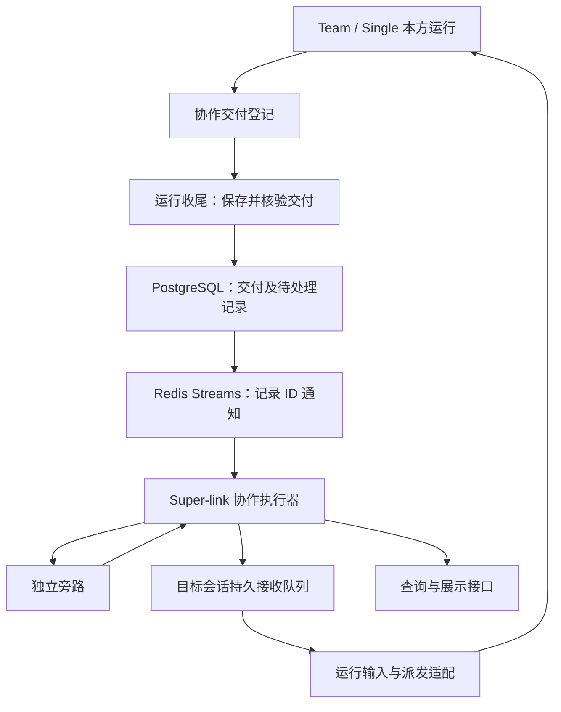

# Super-link 基础通信建设计划

| 项目 | 内容 |
|---|---|
| 版本 / 日期 | v0.9 · 2026-11-20（SSE-T04 前端关键状态闭环完成） |
| 状态 | 有效；基础通信、独立入口与控制面板的实施证据见 §12—§19；SSE-T01/T02/T03/T04 完成、T05—T07 待开始；完整发布及真实研究业务验收未完成 |
| 需求依据 | [产品需求 PR-SL-01](../product-requirements.md#24-super-link-独立协作模式2026-11-07)；[专项需求](../design/super-link-prd.md) SL-01—SL-22、SL-SSE-01—05 |
| 技术依据 | [基础技术框架](../design/super-link-technical-design.md) |
| 本轮目标 | 在保护既有模式的前提下，建立空间级可靠状态同步，再接通运行输出展示 |
| 实施边界 | §12—§19 保存历史实现与启停证据；§20 是当前 SSE 执行清单，T01 仅完成设计，不代表 SSE 已实现；最近启停记录为 §18，本次未重新探测或变更服务 |

## 1. 首版范围与完成定义

首版先完成一个 Team 会话与一个 Single 会话的正式交付和补充请求往返：

> Team 研究并保存交付 → 独立旁路检查 → Single 收件及按序执行 → 保存处理结果 →
> 按需请求 Team 补充 → Team 答复 → Single 关联原问题继续处理。

发送方自主决定是否交付、向谁交付及希望对方做什么。信息回执不强制启动运行；运行
结束不代表任务解决。关闭页面不应造成通信记录丢失或取消已接受的研究派发，但现有
监控在线要求保持原语义，不能据此宣称离线监控已经实现。

首版包含独立页面入口、协作列表、往返时间线、交付/检查详情和完整会话访问。通信不能
以删减 Team 规划/委派能力、Single 工具、原有记忆、产物或运行控制为代价。

暂不包含：真实交易、策略收益验证、Agent 大脑、通用图编辑器、完整 A2A 服务、任意
Agent 拓扑、一对多广播与汇总、既有会话迁入，以及跨空间共享同一会话。非监控工具
向 Team 延续的长期方向保留，但本批不以一次接齐所有工具为前提，也不缩减现有工具。

## 2. 隔离与扩展原则

1. Super-link 是独立协作空间，保存目标、研究对象关联与参与方；允许多个空间独立存在。
   建议首版每个空间新建一个 Team 和一个 Single 会话，每个参与会话只归属一个空间。
   具体数据库映射在 P0 确定，保持一个 Run 只归属一个研究会话的既有约束。
2. 协议按参与方身份寻址，不写死“对面 Agent”。数据关系预留多个参与方；首版明确限制
   为一 Team、一 Single，暂不暴露不可用的一对多操作。未来同份交付的多个接收者分别
   拥有投递与处理记录，不靠修改 Team/Single 内部逻辑实现扩展。
3. 两工作流内部独立演进。通信不解析内部计划、成员报告格式、私有 checkpoint 或思考
   文本；Team 内部 AgentBus 继续用于成员协作，不改造成跨 Web 会话通信总线。
4. 通信通过输入、交付登记和运行收尾三个适配位置接入。普通 single/team、既有同研究
   模式切换及普通 watch 默认不启用新通信工具、检查调用和队列依赖。
5. 复用现有 profile/工具解析，再叠加最小协作能力，不维护长期分叉的 Agent 提示和工具
   清单。协议版本、执行适配契约与兼容性测试共同保证后续升级。
6. 新记录、Redis 命名空间/消费组、配置开关与运行额度独立。逻辑隔离不等于物理资源
   隔离；需要限并发、背压、故障恢复及旧模式负载验证。

### 2.1 多智能体协作与协议预留

Super-link 是独立 Agent 系统之间的协作层：Team 对外作为一个参与方，内部继续自主
规划和委派；Single 保持自己的执行、监控与记忆。借鉴 A2A 的能力声明、Message、Task
及 Artifact 语义，具体对应见 [技术框架 §1.3](../design/super-link-technical-design.md)。

协作请求进度属于通信和执行记录，不要求双方共享研究/监控业务状态。首版使用现有
PostgreSQL＋Redis 实现内部可靠链路，预留外部协议适配位置；尚未实现或验证 A2A 兼容。
不得把完整 A2A 接入加为 P1—P5 前置，也不得以协议替代旁路、完成后交付和顺序执行规则。

## 3. 当前项目可复用位置与缺口

以下为 2026-11-19 静态核对，不代表功能测试通过。

| 位置 | 当前事实 | 本批处理方式 |
|---|---|---|
| [run_modes.py](../../server/run_modes.py) | single/team 对应既有两个 pipeline | 保持映射；Super-link 作为协作层，不新建替代二者的工作流 |
| [monitor_pipeline.py](../../server/monitor_pipeline.py) | PostgreSQL 保存权威记录，Redis Streams 传 ID，包含领取/确认与恢复路径 | 复用模式及确有共性的代码；独立通信记录与 Stream，不直接套入监控业务分支 |
| [dispatch_outbox.py](../../server/dispatch_outbox.py) | Run 持久派发、租约、会话占用检查及恢复 | 经适配复用派发；不能据现有 created_at 排序声称全来源严格 FIFO 已具备 |
| [orchestrator.py](../../server/orchestrator.py) | submit 默认补用户回合；终态、产物登记与上下文保存分别发生 | 保留普通行为；增加协作来源与可恢复收尾接点，不以完成 SSE 直接发送交付 |
| [worker.py](../../server/worker.py) | 既有上下文传递与 watch 的只读连续性 | 协作运行使用本方连续性，不能把自动协作归类为 watch；不重建历史文本 |
| [AgentBus](../../frontier_agent/components/agent_bus/bus.py) | Team 内部子 Agent 协作 | 保持原职责，不暴露成员通信给外部 Single |
| [ChatView.vue](../../web/src/views/ChatView.vue) 与 [stores](../../web/src/stores) | 活动会话、当前运行流存在共享前端状态 | 独立协作 store，完整会话视图复用；不直接渲染两个共享 store 的 ChatView |
| [ResearchRail.vue](../../web/src/components/ResearchRail.vue)、[router](../../web/src/router/index.ts) | 现有工作台导航和路由 | 新增独立入口与路由，保留原研究和模式选择操作 |

## 4. 建议模块与稳定接口

建议新增服务器侧 Super-link 模块，内部包含协议、持久记录、传输、执行适配、旁路适配
和查询接口。可放在一个专属包中，不要求拆成多个部署单元；具体目录和类名在 P0 确定。
Agent kernel 和工作流不直接导入服务器数据库或 Redis 实现。

| 接口 | 输入/输出约定 | 不承担 |
|---|---|---|
| 运行输入适配 | 目标参与会话、任务、交付/证据引用 → 关联 Run 与接受结果 | 改写原工作流、把协作请求记成人工授权 |
| 交付登记 | 接收方、正文、成果引用、请求关系及执行意图 → 稳定登记 ID | 在运行中直接唤起对方、猜测最终回答中的隐含交付 |
| 运行收尾适配 | 来源 Run 的真实结果和已保存材料 → 固定版本正式交付或可见缺口 | 将部分完成冒充成功、让 Redis 失败改写研究结果 |
| 旁路适配 | 目标/任务版本、交付、证据与接收方能力 → 版本化检查回执 | 创建 Run、改队、补做研究 |
| 状态查询 | 协作/参与方/请求/消息标识 → 持久记录及进展 | 以浏览器内存或连接状态判定业务完成 |

登记工具只在绑定 Super-link 的运行配置中开放，Team 由对外负责的主 Agent 提交；
内部成员草稿不会自动交付。模型可指定接收意图，但发送身份、来源 Run、拥有者及
合法接收关系由服务端绑定和核验。注册方式遵循现有工具 allowlist 与执行资源机制。

协议外层结构化、正文保持自然语言与结构化资料兼容。至少表达协议版本、协作 ID、
消息 ID、发送/接收参与方、来源 Run、目标/问题引用、原请求/回复关系、正文、成果
固定版本及是否请求执行。具体 schema、大小限制和兼容规则在 P0 落实。

交付物、协作请求、投递记录和 Run 分开建模。请求可跨多轮，修订生成新版本，不覆盖
原交付。未知协议版本应显式拒绝或保留待处理，不能静默按旧格式执行。

## 5. 单次往返与持久化顺序

以下为拟实施顺序；结果可交接的具体判定在 P0 固化为契约测试。

1. Agent 在本轮登记拟交付，收到“已登记”回执；不是“对方已收到”。重复登记使用稳定
   身份去重。普通最终答案仍可正常输出，不能强迫每次运行都生成协作消息。
2. 运行终结后，收尾适配确认交付正文与附件已保存、内容固定、归属正确且接收方可读。
   核验本方下一轮所需连续性提交情况；缺口记录为待修复，不能静默从空历史续接。
   建议首版失败/停止运行不自动发布拟交付，保留材料和原因；部分成功需显式标注。
3. 文件发布与数据库事务分开处理：先完成文件保存及摘要校验，再在同一事务中登记
   正式交付及待处理意图。收尾过程需可重复核对；进程在中间退出后可扫描未完成记录恢复。
4. relay 将持久记录 ID 发往独立 Redis Stream。消费方读取数据库权威内容并可靠登记
   下一步处理后确认通知，不占住一条 Redis 消息等待长时间 LLM 运行结束。
5. 独立旁路返回通过、附带说明、阻断或检查未完成。检查结果与交付版本绑定；异常不
   当作通过。阻断只记录问题及后续补充关系，旁路不直接调度；自动修正须经执行器并受
   明确的有界重试/往返策略约束。配置值及耗尽后处置在 P0 明确。
6. 检查允许后保存接收记录。供参考的信息不自动创建 Run；执行请求加入目标会话统一
   队列。待处理内容不能自动成为接收方已采纳的研究依据。
7. 目标会话空闲且控制条件满足时，按持久序号取得队首；领取、关联唯一目标 Run 和
   写入 Run 派发意图在同一事务内完成，再通过现有执行入口启动。
8. 目标运行使用自己的上下文，加上有明确来源的交付。处理后保存回执、采用情况及
   未解决问题；如果需要回复，登记带原请求关联的新消息，再走同样链路。
9. 等待对方答复时保存问题与进展，结束并保存本轮，释放执行位置。答复重新入队，
   不维持一个同步等待对方的长期 Run，也不因等待而丢失本方工作积累。

### 5.1 顺序与多来源请求

首版建议以“具备执行条件、被目标会话队列接受”的事务顺序分配序号。跨会话交付
先通过检查再入队；创建交付时间不等于入队时间。用户任务、监控任务和本方后续请求
在 Super-link 参与会话中共用排序入口。来源差异不允许绕过运行互斥。

以上入队定义为计划建议，须在 P0 明确并测试并发检查完成、重试和人工请求同时到达。
普通旧会话保留现有路径；共享函数的改动采用兼容默认值，不全局更换旧调度规则。
Redis 到达顺序不作为业务 FIFO 的唯一依据；队首技术故障不能静默跳过，其他会话仍可执行。

### 5.2 中断与恢复

| 中断位置 | 恢复要求 |
|---|---|
| 登记后来源运行失败/停止 | 保留拟交付和原因，默认不误投递为成功成果 |
| 产物保存或连续性提交不完整 | 显示缺口并重试收尾，不依赖一次性内存回调 |
| 事务已提交但 Redis 通知失败 | 从未完成待处理记录重投，研究结果不回滚 |
| 消费已落库但 ACK 丢失 | 重复消费命中原记录，不重复检查提交或创建 Run |
| 旁路服务不可用 | 检查未完成，不启动目标；普通模式继续可用 |
| 目标 Run 已创建但启动结果不明 | 查询既有关联及运行事实，按现有恢复契约处理，不直接创建第二个 Run |
| 目标 Run 执行失败 | 区分通信成功与执行失败；不把传输重试变成业务动作重跑 |
| Redis 数据丢失或消费者重启 | 依据数据库非终态记录恢复；已完成项不重新派发 |
| 页面断线或刷新 | 查询持久状态并补取事件，不重复提交或启动任务 |

消息去重、Run 唯一关联与工具副作用幂等分别验证；不能宣称消息队列保证所有外部动作
exactly-once。超时、租约、重试与背压采用可配置的有界策略，故障记录必须可查询。

## 6. 保留既有能力与双向兼容

- 普通会话未开启 Super-link 时，不增加通信提示、工具、旁路调用或新 Redis 依赖。
- Super-link 参与会话继续运行当前实际 pipeline；Team 的规划、委派、恢复和汇总，
  Single 的工具循环、附件、正常压缩、历史读取和产物能力均通过正常入口保留。
- 不从展示 turns 重建模型历史，不导入对方原始 system/工具消息；本方连续性载体继续
  由本方工作流解释。新自动协作不得套用普通 watch 只读语义；普通 watch 保持兼容。
- 定义单独的协作来源与展示身份。复用 submit 时处理默认 user 回合写入，不能只靠
  正文前缀冒充身份隔离；底层协议 role 的使用也不应提升业务授权。
- 主 Agent 的对外交付只依赖公开成果及登记接口，不绑定内部节点名称、成员数或状态结构。
- 协议做向后兼容的可选字段演进；破坏性变化显式升级并有适配，不能静默解释旧交付。
- 新通信失败不改写已完成的旧模式运行结果；新消费者关闭不妨碍原研究运行与既有监控。
- 涉及参与会话的人工停止仍走既有运行控制。建议“暂停协作”只阻止新派发，当前运行
  继续并保存；“停止当前运行”明确指向某个 Run。暂停并发领取、停止后拟交付及恢复
  规则在 P0 定案，页面不能以一个模糊按钮混用这些动作。

## 7. 前端最小交付

新增独立导航和协作路由，建议包含列表页及按协作 ID 打开的详情页；复用登录与工作台
视觉。普通研究输入框中的 single/team 选择不承担 Super-link 的空间管理。

1. 协作列表：名称/目标、双方运行摘要、最近交付和需关注问题。
2. 新建协作：共同目标、可选对象/约束/资料；显示职责并创建两独立会话。
3. 总览：参与方摘要、正式交付时间线、队列等待及待答复问题；不混入所有内部工具轨迹。
4. 交付详情：正文、证据附件、来源运行、旁路意见与复核、实际处理结果和回复关系。
5. 完整会话入口：进入对应 Team/Single 的原有研究体验，保留输入、过程、报告和控制，
   并提供返回协作入口。首版不强制并排两个完整聊天窗口。
6. 明确发送对象与控制范围，分别显示检查、投递、执行和任务解决状态；不把收到当采用。

Super-link 使用独立前端状态管理；会话及运行内容按 ID 隔离，不以两个共享活动 store
的 ChatView 直接拼装双窗口，也不复制另一套 Agent 聊天实现。参与方导航使用列表，
首版两项即可，预留增加 Single 的展示位置；不显示未实现的广播或拓扑编辑按钮。

后台是事实来源。实时事件用于刷新展示，重连后查询补齐；前端挂载不派发任务，页面
关闭不决定协作完成。旧监控在线存在机制的兼容问题须验证，不能隐式改变其产品约束。

## 8. 分阶段实施与退出条件

当前 P0 已落实文本契约、身份归属、登记/发布/收件区分及独立迁移；P1 文本骨架实现见
§12。完整收尾、附件、执行队列及控制等契约继续在接入前明确。下表仍是阶段完成定义，
P2/P3 的首批接线见 §13；P2—P5 的完整验收尚未完成，不因基础层测试通过而宣称真实协作模式可用。

| 阶段 | 主要工作 | 阶段完成证据 |
|---|---|---|
| P0 契约与基线 | 固化三处适配、消息结构、身份、完成后提交时点、入队顺序、控制及恢复规则；记录旧模式能力基线 | 可评审时序/接口/记录归属；复用与新增点清楚；关键待决项有可测试定义 |
| P1 持久通信骨架 | 新记录与增量迁移、独立 Redis 通道、事务待处理意图、接收去重、请求关联及恢复 | 测试执行替身完成双向消息；重复、断线、消费者重启可恢复；不开放给实际用户 |
| P2 Agent 适配 | 登记入口、正式收尾、附件读取、本方连续性、运行来源和统一入队；调用真实旧 pipeline | Team 委派与 Single 工具能力保持；自动多轮及后续人工回合均可续接；测试旁路替身仅用于测试 |
| P3 独立旁路 | 接通真实检查、补充/异议记录和有界失败策略，支持四类结果 | 无条件放行替身不能进入正式链路；偏题、缺关键证据、附件不可读能阻断；合法不确定性可继续 |
| P4 前端接通 | 独立入口、列表、新建、总览、交付/旁路详情和完整会话访问 | 用户能完成并追踪一轮往返；忙时排队、断线恢复、来源与控制范围清楚 |
| P5 恢复与兼容验收 | 真实数据库/Redis 故障测试、原模式回归、升级契约和资源隔离验证；执行真实模型往返 | 下表验收有证据；旧模式基线不退化；可关闭新入口和派发并保留记录；据结果决定是否发布 |

P1/P2 的替身只验证工程契约，不等于旁路质量或真实 Agent 任务完成。实施过程按阶段
更新本计划，分别记录自动化通过、真实模型通过及尚未验证项。

## 9. 基础链路验收清单

以下为完整链路验收，仍未整体签收；本批部分工程证据见 §12。编号用于本计划追踪，
不替代产品 SL 验收范围，文本通信测试不能覆盖附件、旁路质量及真实 Agent 执行。

| ID | 必须验证的结果 | 关联 |
|---|---|---|
| C01 | 关闭 Super-link 时，原 single/team、同会话切换、普通监控与既有控制不依赖新消费者 | SL-01 |
| C02 | Team 完整研究交付，Single 使用自身工具复核并回复，Team 补充后 Single 正确关联原问题 | SL-02—04 |
| C03 | 活跃运行的草稿不启动对方；产物/连续性缺口不冒充可靠交付；停止和失败不冒充成功 | SL-03、10 |
| C04 | 旁路四种结果和复核有版本与依据；异常不放行，旁路不创建业务 Run | SL-05、20 |
| C05 | 人工、协作和监控请求在参与会话内统一串行，双方可并行，Team 成员仍可并行 | SL-06、16 |
| C06 | 重复消息/ACK 丢失/消费者并发不重复创建目标 Run；启动结果不明先核对 | SL-10 |
| C07 | Redis 暂不可用、通知丢失或重启后从数据库恢复；单空间失败不阻塞其他空间或旧模式 | SL-01、06 |
| C08 | 接收方确实读取固定版本附件；外部路径、越权接收或失效引用不能静默成功 | SL-12 |
| C09 | 双方不共享原始上下文；协作来源不伪装人工；自动多轮后仍可读取本方积累并承接人工提问 | SL-02、13—15 |
| C10 | 等待答复保存问题后释放运行；信息回执不触发空转循环；请求处理与任务解决分别记录 | SL-18 |
| C11 | 暂停派发与停止指定 Run 的作用范围明确，恢复不重复执行；无静默跳队 | SL-17、19 |
| C12 | 前端刷新、离开后返回和会话切换不串流、不重复发送；过程与原有产物/工具界面可用 | SL-01、02 |
| C13 | 两个独立 Super-link 的目标、消息、队列和文件权限互相隔离；首版不能误建一对多关系 | SL-11、12 |
| C14 | 替换符合契约的执行适配或增加可选输出字段时，通信无需解析新内部实现；未知版本明确处理 | SL-01、21 |
| C15 | 并发与积压受限，新旁路/传输故障不影响旧研究能力；未实际接入的工具不宣称可用 | SL-01、21 |

测试应验证外部可观察结果与故障恢复，不仅断言内部函数调用。现有回归重点包括
`tests/test_context_inheritance.py`、`tests/test_run_modes.py`、
`tests/test_web_dispatch_recovery.py`、`tests/test_monitor_longterm.py`，以及
`tests/pg/test_run_dispatch.py`、`tests/pg/test_monitor_pipeline.py`。
PostgreSQL/Redis 实测使用隔离数据库或命名空间，不能向现有业务队列注入故障。

实施时按变更范围运行 uv 管理的 Python 测试、Ruff、Pyright 及仓库要求的 preflight、
import_smoke、check_symbols；前端运行现有 typecheck/test/build，并验证实际页面交互。
真实模型验收记录 Run、交付和检查 ID，内容质量与工程通过分开记录；已知旧缺陷需如实
列为基线缺口，不能将原有未通过项宣称已通过。最初计划只做文档检查；本批代码验证
及全仓检查的限制另见 §12。

## 10. 启用、停用与待落实项

建议增量建表、默认关闭入口与派发，先在隔离验证环境完成 P1—P5。是否抽取共享 Redis
传输代码，应以保持现有监控行为和测试通过为前提，避免为通信首版大范围重构旧链路。

停用新入口与派发应可独立操作，保留数据库和交付文件供恢复；不通过删除资料回滚。
当前已启动 Run 的处理遵循明确控制语义。启用前明确服务重启恢复、连接池/并发额度、
队列积压告警及保留期限；共享 Redis 故障也不能导致普通研究新增依赖。

P0 优先落实：

- 协作空间/参与方与现有 Session 的映射，首版创建与归属限制。
- 协议 schema、版本、来源身份、稳定登记键和附件发布契约。
- 明确登记成功、正式交付、目标接受与可启动运行各自的承诺；参照 A2A 概念区分请求、
  消息和成果，但不将请求状态等同双方业务状态，也不将外部协议适配预留当成已兼容。
- 运行终结、产物保存、本方连续性提交与正式发布之间的可靠接点。
- 全来源队列接受时点、序号、会话互斥与 Run 派发的事务关系。
- 旁路重试/复核、业务往返预算和耗尽后的可见状态；保持 Agent 常规自主性。
- 暂停、停止、恢复与部分成果处理；前端动作与后台事实一致。

## 11. 借鉴来源及适用范围

- [A2A 定义与设计原则](https://a2a-protocol.org/latest/topics/what-is-a2a/)：独立 Agent
  系统通过公开能力交流、保持内部实现不透明；用于协作定位，不替代本项目执行规则。
- [A2A 核心概念](https://a2a-protocol.org/latest/topics/key-concepts/)：借鉴任务、消息、
  产物与内部实现独立的概念；本计划不承诺完整协议兼容，也不直接映射其消息 role 为人工身份。
- [Claude Code 子 Agent](https://code.claude.com/docs/en/sub-agents)、
  [Agent Teams](https://code.claude.com/docs/en/agent-teams) 与
  [跨会话通信](https://code.claude.com/docs/en/cross-session-messaging)：区分内部委派、
  团队信箱和独立会话通信。官方团队文档描述本地 JSON 信箱，跨会话文档描述同机 Unix
  socket / Windows named pipe；不能混为一种实现，也不能据此推断采用了 Redis 或 A2A。
  本项目借鉴“Agent 表达意图、宿主管理投递、接收方使用自身上下文”的分工，不照搬
  本地传输；保留运行完成后的正式交付约束，不采用运行中插入对方消息的执行方式。
- [Transactional Outbox](https://microservices.io/patterns/data/transactional-outbox.html)：
  将业务记录与待投递意图原子保存，通知后续发送；文件发布仍需单独校验。
- [Correlation Identifier](https://www.enterpriseintegrationpatterns.com/patterns/messaging/CorrelationIdentifier.html)：
  回复明确关联请求，支持多轮补充。
- [Idempotent Receiver](https://www.enterpriseintegrationpatterns.com/patterns/messaging/IdempotentReceiver.html)：
  识别重复接收，不将重投转为重复业务动作。

以上来源为本轮讨论已核对的设计参考；具体实现以本项目现有 PostgreSQL、Redis、Run
及会话机制为基础，不因借鉴这些模式引入新的通用编排框架。

## 12. 第一批基础层实施记录（2026-11-19）

用户要求开始搭建基础层。本批代码位于 [server/super_link](../../server/super_link/README.md)，
实现文本消息范围；未修改既有 Agent 工作流、工具清单、server lifespan、监控消费者或前端。

### 12.1 已实现的接口与可靠性

- 独立协作空间，原子创建一 Team、一 Single 两个专属研究会话；创建键重放返回原关系。
- 可信宿主绑定发送身份，校验拥有者、空间、参与方、来源 Run 与 pipeline；跨空间收件
  和伪造回复被拒绝。注册键与来源 Run 联合去重，内容改变不能复用同一键覆盖原交付。
- 固定文本契约 V1：正文及是否请求执行；未知字段/版本拒绝，附件目前不接受。
- `registered` 只表示登记；宿主调用发布接口时，要求来源 Run 成功结束、完成时间存在，
  且本方 RunContextSource 原生归档及摘要有效。文本与 outbox 同事务发布；不输出私有历史。
- PostgreSQL 保存事实，Redis 仅传消息 ID；持久收件后 ACK，丢失通知可重放，并发及重投
  不重复收件。非法持久内容隔离，Redis 不可用不改变来源研究结果。
- 收件状态固定为 `awaiting_check`，不是旁路通过、接收执行、采用或完成。`inbox` 是宿主
  核查查询，不是将未检查内容注入 Agent 的入口。回复保留原请求和上一条消息关联。

实际基础层顺序为：登记 → 成功 Run 与归档校验 → 文本发布/outbox → Redis 通知 →
持久收件等待检查。未来旁路通过后的执行接受、FIFO 序号与 Run 派发尚未实现；此处的
运输收件不替代 §5 第 6 步的执行接受，也不表示收到后必须运行。

### 12.2 隔离与迁移

五张新表使用独立 SQLAlchemy metadata，迁移入口为
[server/super_link/alembic.ini](../../server/super_link/alembic.ini)，版本表为
`super_link_alembic_version`。既有 `server/store.py`、主迁移目录及 readiness 不变；
未安装新表时旧服务仍按原规则就绪。模块不会自动注册后台进程或接口。

迁移仅在本批独立临时 PostgreSQL 上执行，Redis 也使用独立临时实例和随机测试命名空间。
未连接业务库执行迁移，未重启或部署现有服务。测试框架只增加保留独立版本表的规则，
避免清理测试业务数据时误清迁移历史。停用功能不得使用删表降级。

### 12.3 验证证据与范围

| 验证 | 结果及限制 |
|---|---|
| 新增基础契约测试 | `tests/test_super_link.py`：18 passed；含身份/空间隔离、冲突重放、失败运行不发布、连续性缺口、事务回滚及旧模式无需新表 |
| 新增真实 PG/Redis 测试 | `tests/pg/test_super_link.py`：9 passed；含并发去重、重启、Redis 丢失/中断、ACK 丢失、DB 回滚、非法消息隔离、复合外键及独立迁移往返 |
| 既有定向回归 | 连续性、run_modes、Web 派发恢复、monitor_longterm 共 144 passed；既有 PG Run 派发 19 passed；与新增项合计 190 passed |
| 静态检查 | 新增模块 Ruff 与定向 Pyright 通过；全仓 Pyright 报告 14 个错误，均位于本批未改动文件，不宣称全仓类型门禁通过 |
| 仓库门禁 | import_smoke 两阶段、check_symbols 和 preflight 通过；preflight 只有一次真实模型探测，不等于真实 Super-link 往返 |

测试往返使用显式创建的执行替身，没有真实 Agent 自动续跑、旁路模型调用或自动监控建立。
全仓类型错误位于 `deploy/huggingface/app.py`、`frontier_agent/components/agent_bus/bus.py`、
`scripts/run_retention.py`、`server/watch_scheduler.py` 和 `server/worker.py`；本批未改这些文件。

### 12.4 下一批接线前必须补齐

1. P2：真实运行输入、交付工具和可靠收尾；附件固定版本发布与授权读取；失败收尾的
   持久缺口及恢复；自动协作记忆写回。当前宿主发布接口不能代替完整收尾适配。
2. P3：独立检查记录、四类结论、异议复核及有界往返。当前没有无条件放行的生产旁路。
3. 执行接受与全来源 FIFO、队列到唯一 Run/outbox 的原子关联、控制及资源上限；运输
   收件顺序不是已实现的业务执行顺序。暂停/目标版本字段的存在不代表控制接口已实现。
4. P4/P5：前端、消费者生命周期与可观测性、保留/清理策略、真实模型闭环和发布验收。

这些工作不阻碍当前基础层作为后续接线的起点，但阻止把本批成果直接作为可用协作模式开放。

## 13. 第二批：运行收尾、交付适配与旁路/队列接线（2026-11-19）

本节更新 §12.4 的实施进度，§12 保留为第一批历史记录。当前默认关闭；只对专属参与方
会话接线，既有工作流和 AgentBus 未改写，没有迁移业务库、启动生产消费者或部署服务。

### 13.1 已接通的实际链路

`主 Agent 显式登记 → 父进程确认 worker 退出 → 产物和本方记忆归档 → 正式发布/outbox
→ Redis 通知/持久收件 → 独立旁路记录 → 执行受理 → 现有 RunDispatch 顺序派发
→ 接收方原 pipeline → 本方记忆保存与可选回复`。

- `run_finished` 不是交接点；新增退出见证和可重试收尾记录，归档缺口不放行。
  归档恢复复用原会话 CAS 和原始 dump，不把聊天展示文本重新拼成上下文。
- 工具仅登记，宿主绑定来源 Run/拥有者/参与方；Team 子成员不能直接使用对外交付工具。
  原模式不加载新通道，删除等确认规则不变。
- V1 正文契约保持兼容；V2 接受最多四份、各 64KB 的 UTF-8 outputs 文件引用。
  收尾时校验路径、产物登记和摘要，保存不可变交付快照；不共享私有历史、原目录访问权。
- 旁路独立调用模型，无工具、无私有研究历史，只返回 pass/caveat/block/incomplete。
  检查结果与目标版本、交付摘要绑定；异常/无效返回保持 incomplete，不兜底放行。
- 编排层独立受理，通过或带说明通过且请求执行，才原子生成唯一接收 Run/outbox。
  不写伪造人工 Turn；保留旁路说明；不强迫每轮继续交接。
- 会话 FIFO 使用 Run 创建时间及 UUID 同时点排序，覆盖人工、监控、协作已有来源；
  重试等待不能被后来任务超越，前轮收尾未完成不能启动下一轮。不同会话不相互串行。
  停用 Super-link 后，旧 outbox 中带协作标记的排队项保持等待，不回落为普通任务派发；
  普通安装无需查询可选表即可执行这一停用判断。
- 专属会话的自动运行写回本方原生连续性；普通监控会话仍沿用旧的只读人工连续性行为。
  自动协作身份不能冒用“本轮人工要求”取消暂停监控。
- 可选 schema 增加退出见证、证据快照、旁路记录、执行映射四表；独立迁移
  `sl_0002_runtime`。开启条件、配置及错误边界详见 [模块说明](../../server/super_link/README.md)。

### 13.2 验证范围

- 基础契约 18 项、运行适配 18 项；后者包含真实 Web 子进程、原 Team/Single 工作流、
  真实交付工具通道、归档、旁路调用、RunDispatch 接收方续跑及关联回复。
- 真实工作进程使用本地脚本模型端点，覆盖双向往返和首次归档失败后的补偿；不是实盘
  研究、真实模型自主策略能力或旁路质量验收。真实 preflight 仍只是单次配置探测。
- 独立 PG/Redis 测试增至 11 项，新增并发旁路只评一次、并发执行受理只建一个 Run、
  并发领取不超越队首。既有 PG 派发 19 项通过，迁移往返保留旧业务数据与 readiness。
- 既有连续性、模式、派发、监控和审批定向回归 187 项通过，另验证 1 项原 Team
  委派/读取/独立核查的真实 worker 回归；连同上述新增项共 254 项。
- 新模块定向 Pyright、Ruff、两阶段 import_smoke、check_symbols、preflight 通过。
  全仓 Pyright 仍为既有 14 个错误，包含 worker.py 原有可空 snapshot 行；未把它宣称为通过。

### 13.3 尚未覆盖的上线条件

旁路崩溃或模型失败记录为 incomplete，当前不自动重评；异议、检查版本、可审计重评及
重试预算尚需补齐。缺失父进程退出见证的孤儿运行保持阻断，不能仅凭 completed 推断安全
发布；需要可观测的处置入口。独立旁路首版支持 OpenAI-compatible 配置，其他提供方需要
适配。默认每空间最多自动受理 20 个 Run，是临时基础设施预算，可配置，不固化业务策略。

前端/HTTP 管理入口、完整暂停/恢复与目标变更操作、统一诊断与保留策略、二进制证据、
真实资料库研究到监控的模型质量验收仍待完成。此次完成运行链路基础接线，不将完整产品
或可持续盈利能力标为已验收。

## 14. 第三批：复核遗漏修复（2026-11-19）

本批按执行复核的五项发现补齐基础链路，继续默认关闭，未迁移业务库或部署消费者。

### 14.1 已修复的边界

1. **跨空间推进**：检查前的目标/正文/证据校验失败也保存阻断记录，退出待检查候选集。
   执行受理失败保存原因和 30 秒重试时间；受理与收尾恢复优先处理未尝试、最久未尝试的
   到期项，避免固定前 5/50 项长期占满扫描批次。传输、收尾恢复、旁路和受理独立运行，
   慢旁路调用不阻塞其他通道。调整的是后台处理机会，不改变同一会话已有 Run 的 FIFO。
2. **收尾校验**：归档存在不等于连续性更新成功。正式发布还要求本方当前连续性头指向
   本 Run，且正文摘要与归档一致；CAS 冲突保持 pending 和队列屏障，不能仅凭归档放行。
   宿主低层发布入口对已接入运行适配的 Run 执行相同校验，显式修复后可幂等恢复。
3. **信息交付读取**：新增主 Agent 只读工具 `read_super_link_inbox`。每轮启动时固定本方
   已收件、通过/附带说明、当前目标版本的信息交付可见集合；支持分页摘要和单条正文、
   固定证据及来源读取。未检查/阻断内容、对方历史、后排执行请求和本轮新到消息不可提前
   读取。信息回执不启动新 Run；后续真实运行按需读取，并通过本方原生连续性保存，读取
   不冒充采纳、验证或执行。新增可见集合记录也须纳入后续保留策略。
4. **旁路任务依据**：宿主直接提供来源 Run 的任务、双方身份/职责及适用约束，独立于
   交付方对自己任务的转述。角色和 pipeline 不能证明具体工具、数据能力已接通；旁路须
   保留这种不确定性。未实现完整能力目录或后续复核版本管理。
5. **模型审计**：自动创建 Run 复用既有非密钥模型快照流程，保存配置引用和快照。
   不改变原系统关于排队期间模型配置变化的既有语义。

可选迁移新增 `sl_0003_reliability`，包括重试字段及 `super_link_inbox_access` 表。
已有专属库应先升级到新 head 再启用；迁移只在本批临时注册测试库验证。

### 14.2 验证与剩余范围

- Super-link 基础、运行适配、可靠性测试共 48 项；新增可靠性案例 12 项。
  原有 3 项真实 worker 测试扩展至信息回复的后续读取及本方记忆保存。
- 独立 PostgreSQL/Redis 16 项，包括新增 5 项跨空间、CAS、收件箱和迁移验证；
  原有 PostgreSQL 派发 19 项通过。
- 连续性/归档、模式、派发恢复、监控和审批回归 192 项通过。以上共 275 个不同案例。
- 定向 Ruff、Pyright、两阶段 import smoke、符号检查与 preflight 通过；
  worker 测试仍使用本地脚本模型，preflight 仅验证配置，不代表真实研究或旁路质量验收。
  全仓 Pyright 仍为原有 14 个错误，本批定向模块无新增类型错误。

旁路异议/重评、缺失退出见证的孤儿处置、完整控制及管理入口、保留策略和真实研究质量
验收仍按 §13.3 推进，本批未将这些延期事项标为完成。

## 15. 第四批：反馈修订、有界恢复与诊断接口（2026-11-19）

本批继续保持功能默认关闭，未部署业务服务、未迁移业务库。扩展集中在宿主适配与
Super-link 专属模块；Team/Single 的研究循环、委派机制和原生记忆格式保持既有实现。

### 15.1 旁路反馈与版本闭环

- 每次检查独立记录序号、实际输入、非密钥模型配置快照、结果和起止时间。检查调用
  最长 60 秒，领取租约 90 秒；租约过期可接续，迟到结果不能覆盖后续版本。
- 技术故障与业务判断区分：超时、网络/解析异常最多自动尝试 3 次，退避从 30 秒开始
  指数增长、上限 300 秒；提供方不支持/未配置等待显式恢复。旁路判断缺证据或不可执行
  所产生的 `block/incomplete` 不通过反复调用模型来“刷通过”。
- 编排层读取业务阻断结果，为同一交付最多创建一个原发送方的反馈 Run，进入其原有
  FIFO 会话队列。旁路只产出判断。Agent 自行决定补充、解释异议或结束，不强制重发。
- 修订通过 `register_super_link_delivery.revises_message_id` 显式指向旧交付；必须来自
  同一发送方的新 Run，接收方保持一致，并保留原始 request 关联。正文、旧核查和原始
  交付不可改写；新交付重新经历真实退出、记忆保存、证据快照与独立检查。新版本不自动
  取消其他交付、撤回执行或改队；这类业务语义继续留待完整控制设计。
- 执行 Run 与反馈 Run 共享空间自动运行预算，默认 20。反馈不能伪装人工指令，仍不可
  使用人工取消已暂停监控的例外；信息交付回执依旧不会自动启动接收方。

### 15.2 状态与恢复 API

仅空间所有者可访问 `/api/super-link`；关闭功能时返回 404 且不查询可选表。
恢复模式允许诊断读取，拒绝恢复写操作。接口清单与字段见
[模块 README](../../server/super_link/README.md#feedback-and-owner-recovery)。

| 接口 | 已提供的用途 |
|---|---|
| `GET /spaces`、`GET /spaces/{id}` | 空间、目标、参与者及已用/剩余预算 |
| `GET /spaces/{id}/deliveries`、`GET /spaces/{id}/deliveries/{message_id}` | 正式交付、检查各版本、修订关联、阻断原因与双方运行状态 |
| `GET /spaces/{id}/runs` | 按会话运行 FIFO 的时间/ID 顺序查询派发与收尾状态 |
| `GET /spaces/{id}/recovery-actions` | 操作人、原因、请求、幂等键与结果 |
| `POST /spaces/{id}/recovery` | 有界技术恢复、预算扩展与可验证的收尾放弃 |

恢复命令必须带幂等键与原因；相同请求重放返回原结果，同键不同内容拒绝。
支持检查/受理/反馈/收尾重试，目标分别是交付 ID 或 Run ID。每次显式重试最多授予
后续 3 次机会，目标累计技术尝试上限 20；不清零历史次数。原有 RunDispatch 自身的
重试限制保持不变。队列满/暂停等待不消耗技术异常次数。空间预算可每次增加 1—100，
总上限 1000；只解除相应预算等待，不越过核查与 FIFO。

收尾默认自动恢复最多 3 次；耗尽后保留屏障与原因。放弃收尾必须有退出见证，或记录了
同一次 Linux 启动、同一 PID 命名空间中的进程身份，并能确认原进程组已消失。放弃仅
标记失败并释放收尾屏障，不发布交付，也不伪造成功退出。连续性写入与放弃共用空间锁，
已放弃后到达的写入回调被拒绝，防止释放队列后旧记忆被迟到恢复覆盖。

旧运行没有可验证进程身份、跨主机/命名空间或证据读取不确定时，继续保持阻断；不是
“查不到本进程句柄就视为退出”。本批未实现跨主机自动追踪、杀进程或强制放行接口。

### 15.3 迁移、验证与范围

新增可选迁移 `sl_0004_recovery`：检查尝试、反馈映射、恢复审计表，以及修订关系、
重试和空间预算字段。旧检查保留为第 1 次历史记录；原本没有保存的输入/模型快照明确
留空，不补造证据。需升级到此 head 后再启用功能；迁移不会在服务启动时自动执行。

- Super-link 基础、运行、可靠性与恢复共 61 项，包含 5 个真实 Web worker 案例，新增
  Team/Single 两方向的旁路反馈→本方修订→重新核查→对方执行→信息回复→后续记忆读取。
- 独立 PostgreSQL/Redis 20 项，包含并发反馈去重、预算操作幂等、租约迟到隔离、
  旧检查迁移保留，以及原生记忆写入与收尾放弃的互斥；既有 PG 派发 19 项通过。
- 原有连续性/归档、模式、派发、监控与审批回归 192 项；合计 292 个不同测试案例。
- 定向 Ruff/Pyright、两阶段 import smoke、符号闭合检查与真实配置 preflight 通过。
  全仓 Pyright 仍为原有 14 个错误；没有将全仓类型检查标为通过。

真实 worker 的模型回复仍是本地脚本，验证运行与通信边界，不代表真实研究、旁路判断
或交易质量。完整前端/创建入口、暂停/停止/目标变更、跨主机孤儿恢复、数据保留与二进制
证据、真实研报到监控的业务验收仍待后续实施；此次未宣称完整产品上线。

## 16. 第五批：独立前端入口（2026-11-19）

按本轮确认，Super-link 是独立产品模式，页面入口与普通 Single/Team 模式切换分开。
研究导航新增链接，进入 `/super-link`；协作详情使用 `/super-link/{space_id}`，支持刷新
与直接访问。继续复用现有 Vue、鉴权、API 客户端、成果附件与轨迹组件，不新增前端框架。

### 16.1 已接通的最小路径

1. **独立列表与创建**：展示本人的协作空间；输入共同研究目标，创建两份独立会话并
   启动 Team 首轮研究。页面不提供原有 Single/Team 切换器，双方职责保持固定。
2. **原子启动**：新增 `GET /api/super-link/capabilities` 与 `POST /api/super-link/spaces`。
   创建参数为 `goal`、`creation_key`，所有者来自服务端鉴权。建空间/两会话、首轮 Run、
   人工目标记录与 RunDispatch 同事务提交；并发与丢响应重试返回同一结果。
   首轮是人工发起任务，不计入自动跟进额度；模型凭据、Team 可用性、恢复模式、派发与
   存储就绪检查沿用当前服务约束。浏览器按用户保存当前标签页中的待确认创建请求，刷新
   后重试不更换幂等键；修改目标才视为新的创建意图。
3. **协作详情**：共同目标、预算用量、双方分别的运行列表，查看本轮成果、附件及轨迹。
   正式交付另成一列，展示方向、检查状态、旁路说明、反馈运行和不可变修订关联。信息
   交付不显示为“已执行”。运行/交付新增可选最新优先分页，原默认分页语义保留。
4. **会话隔离**：普通工作台列表在分页和计数前排除协作专属会话，关闭 Super-link 后
   也不混回普通列表。只检查可选表是否安装；未迁移的旧环境仍正常列出普通会话。
   不改变 Session 的原生连续性结构，也不要求新增主业务表迁移。
5. **页面状态**：详情每 5 秒刷新；查看更早记录时暂停刷新并提供说明，手动刷新返回
   最新记录。路由切换丢弃旧请求结果；未启用、无权限/不存在、网络失败和空数据分别
   显示。桌面与 390px 手机布局已检查，交付正文沿用既有 Markdown 清洗流程。

### 16.2 验证与边界

- 后端定向测试 105 项通过，含新增创建事务回滚、幂等、服务门禁、会话列表隔离和分页
  等 8 项；同时覆盖既有通信、真实 worker、恢复、会话与模式/派发回归。
- 隔离 PostgreSQL/Redis 21 项与原有 PG 派发 19 项通过，新增并发页面创建只建一个
  首轮运行的验证；本批后端合计 145 项。
- 前端 107 项单元测试、TypeScript 检查与生产构建通过。Super-link 浏览器验收覆盖
  独立导航、失败/刷新后重试、成果与交付查看、正文清洗、详情重载、手机布局、关闭及
  非本人空间；原模式切换浏览器回归也通过。浏览器 API 为隔离夹具，不访问业务服务。
- 定向 Ruff/Pyright、两阶段导入、符号检查和真实配置 preflight 通过。

本批提供独立入口、创建与运行/交付查看，完整的人机审批/补充输入、暂停/停止/目标变更
及恢复操作面板仍待后续接入；后台原有权限和核查门禁不会因页面缺少操作而自动放行。
未部署前端或启用业务消费者，功能默认关闭；真实资料库到监控仍需单独业务验收。

## 17. 本机服务启用记录（2026-11-19）

用户明确要求服务端启用 Super-link 后，本机现有 Web 服务已完成启用。此记录更新
§16 的运行部署状态，不改变代码中默认关闭的设置，也不代表真实研究业务已验收。

- 操作前核对当前 API 无 running/queued 任务，Team 与派发已启用、沙箱为 bwrap，
  Redis 可连通。先生成 PostgreSQL 备份，并通过 `pg_restore --list` 校验。
- 对本机 `apodex` 库执行 Super-link 独立迁移至 `sl_0004_recovery`；原主迁移版本
  保持 `0025_session_cash_link`，没有升级或回退原业务迁移。
- 在本机 `.env` 持久化 `SERVER_SUPER_LINK_ENABLED=true`，继承原服务环境平滑重启
  API。运行文件根保持原目录；没有启动第二个并行 API 实例。
- `/readyz` 返回 200；Redis 独立消费组 `super-link-receivers-v1` 已建立，消费者 1、
  待确认消息 0，启动后未发现 Super-link 后台错误。创建条件校验通过。
- 本机前端 `/super-link` 在 4174（预览）和 5173（开发）端口均返回页面；API 及前端
  代理对未登录的能力查询均返回 401，鉴权保持有效。未替用户创建协作、发起模型研究
  或交易；登录后可自行创建首个协作空间。

备份、迁移和启动日志保存在宿主数据目录
`/home/administrator/.local/share/frontier-agent/web/operations/super-link-enable-20261119T115318Z/`。
其中环境备份与数据库备份仅允许所有者读取，不提交版本库。备份校验采用标准输入传入
容器，避免宿主 0600 文件复制后因容器 UID 不同而无法读取。

## 18. 暂停服务与下一步范围（2026-11-19）

用户要求先停止服务，完整审批、暂停/停止及恢复操作面板留待下一步接入。本轮只进行
服务停止和范围登记，不实施这些面板，也不把服务进程停止冒充已实现空间级暂停。

- 已停止本机 8000 端口的 API 进程与其研究工作进程，停止前有 1 个运行中任务，
  停止后 running/queued 记录为 0。保留既有数据库、成果及交付记录，不将中断运行
  改写为成功。
- 本机 `.env` 中 `SERVER_SUPER_LINK_ENABLED=false` 已持久化；今后单独重启 API
  不会自动重新启用 Super-link。数据库与 Redis 基础服务没有停止或删除。
- 下一步接入完整人工审批/补充输入、空间暂停/停止与队列处置、恢复原因与版本展示及
  有界恢复操作面板。需衔接既有权限、运行收尾、FIFO 与审计机制，明确每个操作对
  正在执行任务和剩余队列的影响，再实施并做回归。

宿主操作记录：
`/home/administrator/.local/share/frontier-agent/web/operations/super-link-stop-20261119T133822Z/`。

## 19. 第六批：人工介入与空间控制（2026-11-19）

用户确认开始实施 §18 登记的下一步。本批在独立 Super-link 页面接通审批、补充指令、
补充任务、暂停/停止、恢复及故障处理。没有启动本机 API，也没有对业务数据库执行迁移。

### 19.1 控制语义与执行边界

| 操作 | 当前运行 | 队列与交付 | 恢复方式 |
|---|---|---|---|
| 暂停 | 已交给运行器的任务继续收尾，可处理审批、读取本轮固定收件箱并登记成果 | 新核查、受理及派发暂停，队列保留 | 恢复协作后按原 FIFO 继续 |
| 停止 | 持久化停止请求，由后台反复尝试原生协作停止；显示“正在停止” | 取消排队项；停止前未执行交付和补正不再自动进入执行 | 真实退出与未完成收尾解除后才显示“已停止” |
| 恢复 | 不复活已停止或失败的 Run | 暂停队列可继续；停止取消的任务不会重跑 | 需要继续某项研究时，明确补充新任务 |
| 补充任务 | 不改写原 Run | 在指定参与方的原会话中，新建人工任务、user turn 和顺序派发项 | 原子事务与幂等键保证重试只产生一轮 |

暂停和停止属于控制层状态，不合并 Team/Single 的业务状态或私有研究记忆。停止保留
成果、交付正文、旁路判断及审计；已经通过检查的信息证据仍可被后续研究按既有收件箱
规则读取，但未执行的旧请求不再自动推进。监控配置与市场采集不删除；停止空间中新产生
的监控运行在派发适配器处取消，不产生新的模型执行。

空间新增 `control_state`、`control_version`、`delivery_cutoff`，原 `paused` 继续作为
核查/受理/派发门禁。独立迁移 `sl_0005_controls` 将旧暂停记录迁为 `paused`，保留所有
历史数据。正式部署需先升级该可选迁移，再单独启用服务；本机仍停在先前业务库版本。

### 19.2 服务端实现

- `POST /spaces/{id}/control` 接收 `pause/stop/resume/continue`，要求所有者身份、非空
  原因、UUID 幂等键和预期控制版本。空间行锁串行化人工操作；旧版本拒绝，丢响应重试
  返回原结果，更换参数复用原键冲突。控制记录复用原恢复审计表，保留操作者和结果。
- 原派发器在真正提交运行器之前再次持有空间锁检查暂停，覆盖“已经领取、尚未派发”的
  竞态；不改变普通会话执行路径。已经提交给运行器的工作属于暂停时需正常收尾的范围。
- 独立后台停止通道处理排队取消、向当前运行发送停止，以及终态确认。运行状态或收尾
  仍未确认时保持 `stopping`；跨进程无本地句柄不代表进程已退出。单次停止失败不会
  阻断其他空间，重启后继续读取持久化意图。恢复后的新任务不受旧停止扫描影响。
- `GET /interventions` 读取当前运行的全部待审批记录和最近 100 条审批/指令记录，
  不依赖运行列表的分页范围。空间级 approve/steer 路由核对所有者、参与方与 Run，
  审批还核对待处理 external ID，再使用既有原生审批和指令链路。HTTP 接收不等于采纳。
- 人工补充任务绑定原参与方模式和会话，保留当前用户模型快照、额度与队列容量检查，
  不计入自动跟进轮数，不把自动反馈伪装为人工授权。恢复模式禁止这些写操作。
- 真实停止回归发现 worker 异常分支会遗漏 `stopped_by`：首轮未产生答案时，调度器的
  无输出异常会把已确认停止写成失败。本批补传真实停止原因及已有部分文本，保持
  `ok=False` 与错误证据；没有答案时不虚构 assistant 成果。

### 19.3 页面行为

- 空间控制区显示暂停、停止中、已停止与恢复入口，操作前明确影响并记录原因。停止中
  不显示恢复入口；不能把请求已接收显示成停止已完成。
- 待审批按各自 Run 展示工具、目标、原因、命令及成员信息；高风险批准保留 `yes`
  确认，支持单次、本轮相同命令/工具授权，拒绝可附替代指令。未增加跨运行永久授权。
  成功提交后等待 worker 回执，刷新可从持久化审批记录重建；超时仍按原规则拒绝。
- 运行中可发送补充指令，终止后可明确创建新的补充任务。两者各自显示发送/采纳记录，
  不接入原普通工作台的全局当前 Run 状态，避免 Team/Single 相互覆盖。
- 故障恢复面板接入技术核查重试、受理重试、补正派发重试、收尾重试、放弃收尾和额度
  增加。依然受原有技术重试上限、退出证据、预算和旁路约束；不提供强制通过检查。
- 生命周期和恢复请求按用户/空间在标签页存储中保留幂等键与原请求。页面刷新后可重试
  原请求；版本冲突需先核对状态再发起新操作。操作历史支持最新优先分页。
- 交付详情显示目标版本、内容摘要、各次核查依据和模型快照；运行详情显示模型和收尾
  状态。较早恢复目标可通过页面原有运行/交付分页载入。

### 19.4 验证与剩余边界

- 后端合并回归 256 项通过，覆盖通信、运行收尾、恢复、空间控制，以及原有审批、
  停止、连续性、模式与派发路径；加上独立 PG/Redis 共 299 个不同测试案例。
- 新增 12 项空间控制回归，覆盖保留 FIFO、停止取消、晚到交付、真实退出屏障、
  停止后的监控派发、人工任务事务回滚和幂等、跨用户隔离、审批真实回执、恢复模式、
  派发领取后的暂停竞态及跨空间停止故障隔离。
- 隔离 PostgreSQL/Redis 24 项与原 PG 派发 19 项通过，包括新增并发控制、人工任务
  去重、暂停迁移保留与领取后暂停。没有使用业务库运行测试或自动迁移。
- 浏览器验证审批恢复、高风险确认、HTTP 接收不冒充采纳、暂停/停止/恢复、刷新后原键
  重试、补充任务、额度恢复、独立入口、成果读取、正文清洗、手机布局和权限错误。
  原模式切换浏览器回归通过；浏览器业务 API 使用隔离夹具。
- 前端类型检查、生产构建及最终 109 项单测通过。首次检查时并行新增的主题测试
  导入失败，随后其导入已由并行修改修正；本批未改动主题文件。共享依赖目录也发生
  变化，因此最终用 `/tmp/frontier-sl-controls-web-20261119` 源码快照与独立安装依赖
  重新验证，未覆盖共享 `node_modules`。新后端模块定向类型检查通过；`server/worker.py:748`
  仍存在此前已登记的 Optional `snapshot` 类型错误，与本次异常收尾修改无关。
- 定向 Ruff、两阶段 import smoke、符号检查及一次真实配置 preflight 通过。

本批的停止使用原生协作停止，不新增强制杀死远程进程或跨主机退出推断。无退出证据、
未解决的收尾仍需核查并按已有恢复规则处理。目标变更、监控配置的独立生命周期、二进制
证据、数据保留及真实资料库到监控的业务验收继续留在后续范围。上述页面不是研究质量
或交易盈利保证，也不改变原有 Agent 的删除等审批边界。

## 20. SSE 状态同步执行计划（2026-11-20）

### 20.1 范围与开工条件

本批依据 PR-SL-01 和 SL-SSE-01—05，实施服务端状态推送、断线恢复、独立页面同步及
Team/Single 的可见运行输出。设计与遗漏分析见[SSE 设计稿](../design/super-link-sse-design-notes.md)。
不新增编排引擎，不改变旁路、FIFO、记忆、实际收尾和监控在线规则，不修改普通模式的
默认 SSE 行为。本节是唯一的 SSE 任务状态与证据台账。

SSE-T01 已完成，实施契约见[技术框架 §11](../design/super-link-technical-design.md#11-sse-接入边界2026-11-20)。
T02 持久事件与 T03 快照/SSE 接口已通过 SQLite 与隔离 PG 验收；T04 前端订阅与状态
同步已通过单测、类型检查与生产构建。现可进入 T05，接通真实运行输出；默认参数及首版
单所有者范围已登记。改变产品行为或扩大部署范围时另行讨论。文档登记不启动服务、
不迁移业务库。

### 20.2 执行任务及依赖

任务状态如下；完成后在本节记录变更、测试证据、限制与下一步。设计推演不替代功能测试。

| 任务 | 依赖 | 工作与主要位置 | 完成交付与退出条件 | 状态 |
|---|---|---|---|---|
| SSE-T01 契约与来源盘点 | 无 | 核对 `server/super_link/`、审批、派发和运行收尾的状态写入点；确定事件目录、身份、版本、快照、游标及错误响应 | 保存来源到事件的完整映射；确定并发提交安全方案、快照一致性、权威写入失败语义和首版部署拓扑；给出请求/响应样例与异常路径 | 设计完成，见 §20.7 |
| SSE-T02 持久事件与可靠发布 | T01 | 独立事件存储/可选迁移、业务写入适配、发布与补偿读取；核对现有 outbox 复用边界 | 覆盖 HTTP 和后台来源；状态与事件同事务或有明确可恢复转换；晚提交、回滚、重复、Redis 故障与重启不漏关键事实 | 实现完成，SQLite 与隔离 PG 验收通过，见 §20.8 |
| SSE-T03 空间快照与 SSE 接口 | T02 | 独立空间快照/订阅接口、补读、鉴权、心跳、连接释放和有界缓冲 | 快照切流无空隙；重复去重、游标过期重新同步；Run 终态不关闭空间观察；满足约定拓扑下的路由与权限隔离 | 实现完成，SQLite 与隔离 PG 验收通过，见 §20.9 |
| SSE-T04 前端关键状态闭环 | T03 | Super-link 独立订阅与状态管理，审批/控制/交付同步；检查 `SuperLinkView.vue` 及现有 `sse.ts` 的复用边界 | 页面离线期间完成交接后可准确恢复；保留历史分页、未提交输入、幂等和版本冲突；旧空间迟到事件不污染新空间；普通模式不变 | 实现完成，前端单测/类型/构建通过，未做真实浏览器验收，见 §20.10 |
| SSE-T05 真实运行输出适配 | T04 | Worker/Bridge/Orchestrator/Relay 输出适配，Team 成员归属，实时与归档内容衔接 | Team 与 Single 实际运行内容可实时展示；缺片修复、最终文本对齐；无思考流也正常；按 T01 拓扑验证跨进程/实例来源，不重复执行工具 | 待开始 |
| SSE-T06 故障、兼容与观测验收 | T05；定向测试随 T02—T05 同步完成 | 后端/前端针对性测试、隔离 PG/Redis、真实 Worker、浏览器与代理链路；连接和发布指标 | §20.4 场景有证据；运行展示和业务执行故障可区分；队列/连接有界；普通 single/team、审批、停止和连续性无回归 | 待开始 |
| SSE-T07 发布准备与启用核对 | T06 | 核对业务库版本、控制迁移与 SSE 迁移顺序、配置、备份、兼容回退与发布说明 | 隔离环境验证升级及保留数据的回退；形成具体部署清单。准备完成与实际启用分别记录，启用按用户届时指令执行 | 待开始 |

T01 不要求新增一个独立契约文档：正式决定集中补入技术框架 §11，本设计稿保留依据。
T02—T05 每完成一项先跑相关回归再推进；T06 汇总端到端和故障场景，不把所有验证留到最后。

### 20.3 事件目录的最低覆盖

| 来源 | 必须追踪的变化 | 核对重点 |
|---|---|---|
| 人工与空间控制 | 请求接受、暂停/恢复、停止中、实际停止、补充任务 | 命令与实际效果区分；幂等重试和版本冲突不产生伪状态 |
| 审批与指令 | 审批提出、答复、过期/取消，指令排队与实际采纳 | HTTP 应答不冒充 Worker 回执；重连后待处理事项可恢复 |
| 运行与收尾 | 入队、派发、运行终态、产物及连续性提交、收尾失败/恢复 | 真实退出、模型结束和正式交付条件不混为一项 |
| 交付、旁路与队列 | 交付登记、检查/补正、受理、队列取消与技术重试 | 后台写入与人工路由均覆盖；正文可按需读取，不塞入所有通知 |
| 启动与故障恢复 | 持久意图恢复、状态核对与事件补偿 | 源记录唯一标识支持去重，不靠扫描私有思考判断状态 |
| 运行展示 | 可见思考/文本、工具进度、成员信息、最终内容 | 与关键业务事件分开定义游标和保留；输出结束不触发交接 |

目录必须列出真实写入位置与事务边界。若来源记录与空间事件不能同事务写入，T01 明确
可重试转换、来源去重键与核对入口，T02 用故障测试证明可以补齐，不能只加内存回调。

### 20.4 验收矩阵

以下均为计划场景，尚未执行，不使用历史通信测试数量替代本批证据。

| 编号 | 场景与预期结果 | 负责任务 |
|---|---|---|
| SSE-A01 | A 先分配编号却晚于 B 提交，含 A 回滚：客户端不越过仍可能提交的事实，不因编号空洞永久等待 | T02 |
| SSE-A02 | 读取快照时持续发生变化，历史与实时重叠、游标过期：无漏读，去重可靠，过期可重新同步 | T03/T04 |
| SSE-A03 | 页面断线期间完成研究收尾、旁路和交接：回来后状态准确，无额外模型执行或重复派发 | T04/T06 |
| SSE-A04 | 停止响应丢失、重复提交、两个标签页同时操作：原键复用结果，旧版本拒绝，只有真实收尾完成才显示停止 | T04/T06 |
| SSE-A05 | 高速多成员输出、慢客户端、SSE 断开、Redis 故障和 API 重启：执行不被展示阻塞，缓冲有界，关键事实可恢复 | T02/T03/T05/T06 |
| SSE-A06 | Run A 结束后 Run B 启动，成员输出交错、无思考流、文本片段缺失：归属正确，空间观察继续，最终内容可核对 | T05 |
| SSE-A07 | 跨用户/空间订阅与补读、令牌失效：访问受限且一致脱敏；源审批记录保存失败不产生假事实或无记录批准入口 | T02/T03/T06 |
| SSE-A08 | 切换空间、阅读旧页、编辑未提交内容：释放旧连接且不污染新空间；更新不抢页、不覆盖输入 | T04 |
| SSE-A09 | 普通 single/team、审批、停止、上下文连续性与 Super-link 同时使用：原模式行为保持，资源竞争可观察 | T06 |
| SSE-A10 | 按 T01 的拓扑经过实际代理连接，覆盖心跳、缓冲、服务退出和实例路由；升级及回退保留记录 | T06/T07 |

每项证据注明测试环境、故障注入点、预期/实际、结果与限制。真实 Worker 配脚本模型
可验证流协议和运行生命周期；真实模型端点流式兼容需另记结果，不据此声称研究质量已验收。
多实例若不在首版支持范围，记录约束及保护行为，不能将该项标为多实例通过。

### 20.5 阶段门槛与发布边界

1. **契约可实施**：T01 完成，事件来源、事务/提交顺序、快照/游标、权限及拓扑均有确定方案。
2. **关键状态闭环**：T02—T04 完成，优先通过 A01—A04 和相关隔离测试；不依赖逐 token 流才能成立。
3. **实时展示与故障验收**：T05—T06 完成，A01—A10 适用部分及既有模式回归有证据；保留未支持边界。
4. **可部署**：T07 的准备完成，迁移、配置、备份、代理与回退方案明确；实际启用单独记录。

最近操作记录显示业务库此前仅应用到 `sl_0004_recovery`，`sl_0005_controls` 只在隔离库
验证。本次未连接业务库复核，部署前以现场实际版本为准，不根据旧记录直接执行迁移。
停止服务和功能关闭的既有安排不由本计划解除；真实资料库到监控的业务验收仍需独立开展。

### 20.6 文档完备性结论

需求、设计依据、模块接口、任务依赖及验收场景已经建立。T01 已将事件目录、事务提交、
游标、快照和部署范围定为实施契约，T02 完成持久事件账本与来源接线，T03 完成快照与
SSE 接口，T04 完成前端订阅、状态合并与页面接入；具备启动 T05 的条件，T05—T07 尚未
实施或验证，不具备直接正式启用的条件。后续进度只更新本节及对应实现证据。

### 20.7 SSE-T01 完成记录（2026-11-20）

用户要求从契约与来源盘点开始，本批仅修改文档。契约集中落在技术框架 §11.1—§11.9，
不新建第二份实施任务台账，不修改应用代码、运行配置或数据库。

| 交付 | 已确定内容 | 后续实现检查 |
|---|---|---|
| 来源与事件目录 | 空间、动作、额度、Run、dispatch、收尾、交付、收件、旁路、受理、补正、人工介入、产物、连续性及参与方可用性 | T02 对每个源事务接线；覆盖监控、补资料、重算、批量 SQL 和孤儿恢复旁路 |
| 事务提交 | 独立事件头与账本；业务事务内登记，完成业务 SQL 后最后锁事件头、分配序号并提交；保存点草稿随回滚撤销 | PG 并发、回滚、保存点、commit 后抛错与外部副作用恢复测试 |
| 游标 | `sl1:space:epoch:seq`；序号字符串；独立于 control_version、轨迹行号和 Redis ID | 同空间顺序、重发去重、跨空间拒绝、epoch 重置与 410 重新同步 |
| 快照与订阅 | 新 snapshot/events 接口；短只读 REPEATABLE READ 事务，SSE 不持有长事务；失效通知触发一致快照刷新 | 快照竞态、游标最小版本、分页与旧响应覆盖测试 |
| 传播与拓扑 | PostgreSQL 可补读账本＋Redis Pub/Sub 提示＋服务端周期核对；首版单 API 运行所有者 | 独立命名空间、单所有者保护、代理链路和输出来源验证 |
| 失败与保留 | 保证起点为已提交来源记录；实时输出单独 epoch，不承诺逐 token 回放；首版不自动清理事件 | 源记录保存失败不伪造事实；限流、缓冲、权限和恢复验证 |

盘点发现并登记的既有缺口：审批/启动通知保存为 best-effort，指令采纳的 turn 与控制
记录实际分两次保存，Worker 原有 live_events 为无界队列。这些不能通过增加 SSE 连接
自动修复。契约明确可靠性保证起点，并把相关失败场景列为后续验收；没有将缺口写成已修复。

核查范围包括 `server/super_link/`、`server/store.py`、Orchestrator、dispatch_outbox、
空间/Run 路由、监控调度、业务补资料、归档删除、Bridge/Worker 与前端 SSE 协议。
核对 PostgreSQL 18 的事务隔离/行锁和 Redis Pub/Sub 官方语义；来源链接在技术框架。
完成静态来源对应和并发时序推演，检查文档链接、JSON 样例及格式；未运行 PG 并发或
Worker 测试，未调用模型、启动服务或执行迁移。此记录是设计完成证据，不是运行验收。

下一项为 **SSE-T02 持久事件与可靠发布**，优先实现事务缓冲/保存点、事件头分配、
可靠提交与源覆盖回归，再接通知发布；不要先接前端而跳过这些条件。

### 20.8 SSE-T02 完成记录（2026-11-20）

按已批准的 [spec.md](../spec/super-link-sse-t02/spec.md) 与
[tasks.md](../spec/super-link-sse-t02/tasks.md) 实施持久事件账本。未启动本机服务、
未连接或迁移业务库；SQLite 使用临时库，PG 使用已登记的隔离库 `apodex_biz_test`。

收尾审查后补齐：反馈成功事件只由 `accept_feedback` 产生，`dispatch_feedback` 只发
失败事件，重试成功不再与首次事件键冲突；事件外键改指 `super_link_event_heads.space_id`，
不再通过 Space 行引入锁循环；`read_events` 以本次读到的 head 为上界；自动受理与补正
成功事件的 `invalidate` 增加 `space`。PG 用例修正了 `await sessions()`、事务进入、
双空间创建事件计数，并补 A01 提交路径与 Space/头交叉锁序。

| 交付 | 已实现内容 | 证据与限制 |
|---|---|---|
| 事件存储 | `super_link_event_heads`、`super_link_events`（空间/epoch/seq 主键、`change_key` 唯一、`notified_at` 水位、`space_id` 外键指向事件头）；`sl_0006_events` 接 `sl_0005_controls`，为既有空间补基线头 | SQLite 与隔离 PG 通过；PG 会话按升级→降级→升级重建表，确认外键与基线头 |
| 事务与保存点 | 显式 `events.savepoint()` 管理草稿栈，不依赖 `after_transaction_end`/`after_soft_rollback` 先后；监听器只对根事务清理；flush 内部事务不结束作用域 | 保存点回滚/嵌套/合并、未托管 `begin_nested` 拒绝、seal 内开保存点拒绝均有测试 |
| 提交守卫 | `before_flush`/`before_commit` 检查未 seal 草稿与 seal 后 ORM 新增/修改/删除；监听器幂等注册，普通会话无状态、零副作用 | 未 seal 提交回滚业务与事件、seal 后写入被拒、重复安装与关闭 Super-link 场景通过 |
| 跨事务幂等 | seal 锁空间头后按 `change_key` 查已提交事件；同键同内容复用且不增序号，同键不同内容报 `change_key_conflict`；内存草稿同规则 | 重试复用、冲突、事务内重复键测试通过 |
| 事件键 | Run 相位、dispatch `claim_version`、finalization 版本、交付/审批/补正/干预状态、连续性 outcome、参与方可用性；产物用变更 UUID，内容哈希放在 data；反馈成功仅一个生产者 | A→B→A 产物四个不同键；失败→重试成功只保留一条 `started` 事件且键为 `feedback:{id}:{attempts}:started` |
| 读取与发布 | `read_events` 鉴权、1—200 分页、`sl1` 游标、`invalid_cursor`/`resync_required`，只返回 `(after, 本次 head]`；通知器扫描未通知水位、按空间/epoch 取最大 seq、成功后新事务标记 | 游标分页、越权/坏游标、读头后并发提交不越过本页、发布重试与 Redis 失败保留水位测试通过；未对真实 Redis 发布 |
| 来源接线 | 提交型函数在最后业务 SQL 后 seal 并提交；`add_run`、`enqueue`、`mark_dispatched` 等只暂存，由调用方 `business_transaction`/`dispatch_once`/监控事务 seal；`stop_queued_run` 自带提交并 seal；归档删除逐行锁并暂存 | `tests/test_super_link_event_sources.py` 7 项覆盖运行、产物、控制、派发、连续性、统一事务与普通会话零事件 |
| 启动条件 | `readiness.ok && super_link_enabled && !restore_mode` 时与协调循环同批启动发布器；退出取消并等待；Redis 故障只延迟通知，不回滚业务 | 谓词与 Redis 故障测试通过；未启动实际进程验证 |

测试结果：T02 核心三文件 34 passed；全部 Super-link 非 PG 测试 116 passed；隔离 PG
6 passed。收尾后全量非 PG 套件 5651 passed、30 failed、84 errors（9 分 25 秒）。
30 个失败节点在 HEAD 基线 worktree 重跑，失败集合完全一致；84 errors 全部来自
`test_corpus_*` 的隔离库守卫（`CORPUS_I2_DSN` 的 `current_database='postgres'` 不等于
`i2_sandbox_corpus`），属环境配置而非 T02 回归。

限制：PG 验收在隔离库 `apodex_biz_test` 执行并重建 `sl_0006_events`，未连接或迁移业务
库；真实 Redis Pub/Sub、真实 Worker 与浏览器链路留待 T05/T06。不据此宣称 SSE 已可
正式启用。

下一项为 **SSE-T03 空间快照与 SSE 接口**：在已提交账本上实现快照切流、补读、鉴权、
心跳与连接释放；不改变本批确定的事务边界。

### 20.9 SSE-T03 完成记录（2026-11-20）

按 [spec.md](../spec/super-link-sse-t03/spec.md) 与
[tasks.md](../spec/super-link-sse-t03/tasks.md) 实施空间快照与 SSE 接口。未启动本机
服务、未连接或迁移业务库；SQLite 使用临时库，PG 使用已登记的隔离库 `apodex_biz_test`。
本批无新表、无新迁移，不改 T02 的事务边界与事件写入。

| 交付 | 已实现内容 | 证据与限制 |
|---|---|---|
| 一致快照 | `stream.snapshot_session()` 在 PostgreSQL 首条语句设置 `REPEATABLE READ`，同一 `AsyncSession` 内先读事件头再读空间、参与方、Run、交付、待审批、操作与活动 Run；读取结束立即释放，SSE 不持有事务。四个列表接受 `runs_after`/`deliveries_after`/`pending_after`/`actions_after` 续页，`total` 为完整列表数，响应带自己的 `cursor` | SQLite 字段/总数/排序断言；4 条 Run 与 4 条待审批以 `limit=1` 全量续读无重复/遗漏；隔离 PG 在事务内先读头，另一连接提交控制状态与事件后旧事务仍见旧状态/旧游标，事务结束后新快照见新值 |
| `min_cursor` | 只接受同空间同 epoch 且不超前当前头；跨空间/超前 400，epoch 不符或低于 `min_after` 410；不自动夹取 | SQLite 与隔离 PG 均覆盖成功、超前、过期 epoch、坏格式 |
| 快照切流 | 快照游标即事件头位置；提交新事件后 `read_events(after=快照游标)` 只返回新事件 | 无空隙测试；PG 边界测试在事务结束后读到同一控制事件 |
| SSE 建连 | `after` 必填；先校验用户 active 与空间归属，再复用 `read_events` 游标语义；错误矩阵 400/401/404/410/429/503；429 带 `Retry-After: 5`；不改 `Last-Event-ID` | HTTP 矩阵与缺失事件头 503、配额 429 测试；错误在 `StreamingResponse` 之前产生 |
| 补读与观察 | 每批 200 条、逐批短只读事务；不满批后再次核对事件头；通知为“粘性待确认”提示，补读期间到达的通知不会被丢失；共享头核对每 2 秒按活跃空间查询一次，只在 `(stream_epoch,last_seq)` 变化时唤醒 | 补读收口测试在补读中途提交事件并由再次核对读出；Hub 测试覆盖头变化唤醒、头未变不唤醒、轮询失败只触发复核 |
| 生命周期 | Run 终态与空间停止只作为事实发送，不关闭连接；空闲 15 秒心跳；15 秒权限复核；单连接最长 5 分钟直接关闭；每用户 8 条连接；每连接 256 帧/1 MiB 有界缓冲，满载时生产者等待消费者，超时才清空关闭；响应层对每次 ASGI send 施加 15 秒上限，并用总寿命 deadline 包住整个响应迭代，发送或数据库读取阻塞都会中止并 `aclose()` 生成器 | 终态/停止后继续收帧；流中停用用户收到 `sl.auth_required`；epoch 变化收到 `sl.resync_required`；账本读取异常收到 `sl.unavailable`；100 条 × 12 KB 积压仍可推进；send 永久阻塞时 50 ms 寿命在 200 ms 内结束并释放配额/订阅；`read_events` 永久挂起同样释放 |
| 控制帧 | `sl.auth_required`/`sl.resync_required`/`sl.unavailable` 均无 `id`，发送后关闭；寿命与慢客户端不新增协议帧 | 帧解析断言 `id` 缺失与 `reason`；未对真实代理链路验证 |
| 关闭功能 | 路由级 `_enabled` 先于处理函数返回 404；不查询事件表、不启动 Hub | 关闭功能测试用拒绝查询的替身证明零事件读取，Hub 任务列表为空 |
| 错误与缓存边界 | 快照与 SSE 建连把 `SQLAlchemyError` 映射为 503 `event_chain_unavailable`；Hub 只缓存有订阅的空间，退订即清除 | `OperationalError`/`ProgrammingError` 注入测试；100 个无订阅空间的 `dispatch` 不写 `_known` |
| 分页时间键 | SQLite 按毫秒归一化 `created_at` 排序与游标比较，PostgreSQL 保留微秒精度，避免秒精度存储与服务端绑定格式不一致导致的原地循环；`page_order`/`page_cursor` 同时用于快照、`/interventions` 与旧 `/runs`/`/deliveries`/`/recovery-actions` 的 newest-first 续页 | 同一秒内 Run/待审批续页测试；`/runs` 默认时间逐页遍历测试；隔离 PG 边界测试 |
| 列表读取边界 | `/runs`、`/deliveries`、`/recovery-actions`、`/interventions` 使用 `snapshot_session`，先读事件头再读列表；项目投影期间提交的事件不会让返回游标新于内容 | 在 `run_status` 投影时提交新事件的注入测试；响应游标等于注入前的头 |

测试结果：`tests/test_super_link_stream.py` 26 passed；全部 Super-link 非 PG 回归
142 passed；隔离 PG `tests/pg/test_super_link_stream.py` 2 passed；
`tests/test_context_inheritance.py` 与 `tests/test_web_dispatch_recovery.py` 83 passed。
定向 Ruff 与 Pyright 通过。验收收尾新增的快速消费者大载荷、数据库异常 503、全列表续读、
Hub 缓存边界、阻塞发送释放、`/runs` 默认时间续页、列表游标边界与读取挂起释放用例均包含
在上述计数内。

限制：未启动本机服务；真实 Redis Pub/Sub、反向代理、浏览器与真实 Worker 链路留待
T05/T06；快照对 50 条 Run/交付逐项调用现有投影的耗时未测量。按规格 §8，不据此宣称
SSE 已可正式启用。

下一项为 **SSE-T04 前端关键状态闭环**：在快照与事件流之上实现独立订阅、状态合并、
审批/控制/交付同步和旧响应丢弃；不改变本批确定的协议与游标语义。

### 20.10 SSE-T04 完成记录（2026-11-20）

按 [spec.md](../spec/super-link-sse-t04/spec.md) 与
[tasks.md](../spec/super-link-sse-t04/tasks.md) 实施前端订阅与状态同步。只改 `web/`
与文档；未修改服务器逻辑、协议、迁移与 `openRunStream` 调用方，未启动本机服务、
未连接业务库。

| 交付 | 已实现内容 | 证据与限制 |
|---|---|---|
| 帧解析复用 | 新增 `utils/sseFrames.ts`（`extractFrames`/`parseFrame`/`backoffDelay`/`sleep`），`sse.ts` 改为导入；`parseFrame` 增加 `event`/`id`，`openRunStream` 的游标、终态与重试行为不变 | `sseFrames.test.ts` 6 项；既有运行流与普通模式测试通过 |
| 快照 API | `api/superLink.ts` 增加 `SnapshotQuery`/`SnapshotPage`/`SpaceSnapshot`/`snapshot()`，完整映射 6 个查询参数；`Space` 补 `delivery_cutoff`，参与方补 `available` | 类型检查通过；未新增后端字段 |
| 空间事件流 | `superLink/stream.ts` 单次 fetch；bearer、`Accept: text/event-stream`、`Cache-Control: no-cache`；显式不设 `Last-Event-ID`；非 2xx 上报 status 与 `Retry-After`；只分发事实与三个控制帧；主动停止不回调 close | `stream.test.ts` 5 项；未验证真实代理、心跳与浏览器链路（T06） |
| 同步状态机 | `superLink/sync.ts`：快照建流、事实 schema/space/epoch/seq 校验去重、`invalidate` 聚合 150ms、请求序号/游标单调/空间代次三重旧响应丢弃、`mergeFirstPage` 保留历史、待审批整页替换、`loadMore` 追加去重、`returnToLatest` 全量重建、`sl.resync_required`/410/400/epoch 重同步、401/403、404、429、8 次失败进入 `unavailable`、`stop()` 释放 | `sync.test.ts` 15 项；新增“加载更早失败不进入历史”用例；未覆盖真实网络时序 |
| 页面接入 | 新增 `superLink/useSpaceSync.ts`；`SuperLinkView.vue` 详情改为快照/SSE 单一数据源，移除 5 秒轮询；列表页保留旧 REST 加载与分页；新增同步状态条、历史提示与“查看最新”；`more('runs'|'deliveries')` 走 `loadMore`；离页、路由离开与切空间调用 `stop()` | 类型检查与生产构建通过；未做浏览器手工验收（T06） |
| 控制面板 | `SuperLinkControls.vue` 新增可选 `pending`/`pendingTotal`/`activeRunIds`/`actions`/`actionsNext`；有 props 时待审批、活动运行与恢复审计均以父级快照状态为准，审计“更早”走 `loadMore('actions')`；`/interventions` 降为 30 秒低频兜底；审批、控制、恢复与补充指令提交后 emit `changed`，父级 `refreshNow()` 由快照确认 | 保留幂等键、`expected_version`、`sessionStorage` 待确认请求与“停止需真实收尾”；未改后端 |
| 历史与分页 | `loadMore` 成功才进入 `history`；失败只提示、不把页面困在历史；历史模式不自动插入新项，事件只置 `hasUpdates`；`refreshNow` 合并全部视图但不退出历史 | 单测覆盖历史合并、失败回退、跨替换丢弃与待审批替换 |
| 未提交输入 | 审批组件按 `control_id` 复用，`steerText` 按 `run_id` 保留；同步刷新不重建 `SuperLinkControls`（key 仍为 `space_id`） | 无组件级自动化测试，列入 T06 浏览器验收 |

测试结果：`cd web && npm test` 135 passed；`npm run typecheck` 通过；`npm run build`
通过（仅有既有 chunk 体积提示）。后端契约复核
`uv run pytest tests/test_super_link_stream.py -q -p no:cacheprovider` 26 passed。
按用户复核口径，本批未重复执行全量后端回归与隔离 PG。

限制：未启动本机服务，未连接或迁移业务库；真实浏览器、反向代理、多标签页与真实
Worker 链路留待 T06；前端未新增组件级测试，历史与未提交输入的保持依赖状态机单测
和静态检查。T04 完成不表示 SSE 可正式启用，启用仍需 T06 真实链路验收。

移交 T06：隔离 PG 的列表并发测试在推进事件头之外，同时提交业务状态（如审批完成），
验证返回内容与返回游标属于同一快照边界；该补强不阻塞 T04。

下一项为 **SSE-T05 真实运行输出适配**：在不改变本批协议与游标语义的前提下，接通
Team/Single 的可见运行输出与归档内容衔接。
