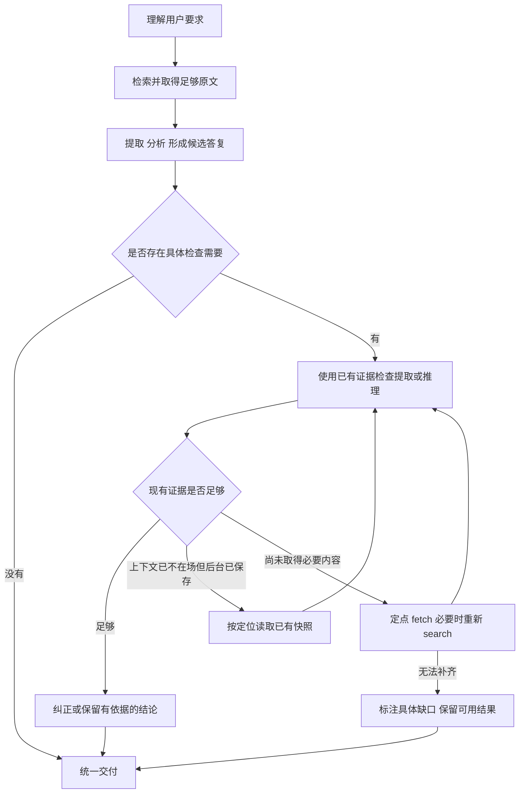

# 团队 Harness 编排与交付收敛计划

日期：2026-11-15。状态：待实施计划，不代表代码已完成或验收通过。

本计划针对团队运行反复出现的证据交接、任务状态、最终交付与恢复问题。实施范围是三个内部模块的职责收敛：任务与执行状态、证据快照、交付与恢复。保留通用运行内核、AgentBus、现有检索分页和送达账本，不新增模型必须调用的工具或必经核验阶段。

**默认流程是取得足够原文后直接分析并回答。检查优先使用已有证据；只有证据不足才补充获取。独立核验按明确要求或具体问题触发，不能把重新读取同一篇文章当成默认质量保证。**

## 1 目标与范围

### 1.1 完成目标

1. 同一证据通过 job、handoff 引用进入后续工作时，版本、来源、覆盖限制和允许的回查能力保持一致。
2. 工具实时执行、正常收尾、异常恢复和历史恢复消费同一套规范化状态与结果。
3. 模型只负责研究判断、任务意图和必要修订，不负责重建内部坐标、重复搬运正文或记住工具执行顺序。
4. 保留可用研究结果；必需检查未完成时诚实交付部分结果，不以空答案、重复研究或冗长诊断作为默认退路。
5. 同样的用户要求和证据标准下，减少重复全文获取、重复生成和无效派遣，不靠取消必要检查获得更短耗时。

### 1.2 本次保留的能力

- `frontier_agent` 的通用循环、调度、工具执行、模型适配和 AgentBus。
- corpus 的文档版本、句柄、分页预算、送达账本与覆盖映射。
- 必需核验不能被取消掩盖、证据版本不能混用、失败提交不能部分提交等现有保护。
- 单 Agent 的既有工作方式。共享证据代码有改动时做兼容验证，但不借此重写整个 ReAct 工作流。
- 现有文件授权、只读范围和来源撤回策略；后台缓存不能成为越权读取或绕过撤回的入口。

不在本次增加：新的检索产品、全库重建、OCR 重构、通用 DAG 调度器、第二套事件数据库、通用插件平台、默认第三方审阅。模型供应商的流式异常仍可能发生，本计划保证可控恢复，不承诺消灭模型失败。

### 1.3 与既有计划的关系

本计划负责团队编排、交接与交付的实现收敛；[上下文精简方案](corpus-context-and-report-delivery-optimization.md) 继续约束 search/fetch 的可见返回与后台保存。较早的[研究链路讨论](corpus-research-chain-redesign.md)不作为本次扩大范围的依据。

实施起点是当前工作区，而不是直接回退到 HEAD。编写时 HEAD 为 `7f0a85d2`，工作区已有未提交修复；实施前应记录具体差异和基线。历史审查发现先验证是否已修复，已修复的只保留为回归用例，不重新实现。

## 2 默认执行流程与检查触发条件

这里的判断不需要模型调用一个额外的“决策工具”。它由已有任务说明、研究行为和运行时校验共同承担。

| 情况 | 应采取的动作 | 是否启动独立 verifier | 是否重新检索 |
|---|---|---|---|
| 原文已足够，提取和分析没有具体疑点 | 正常形成答复，后台验证引用与结构 | 默认不启动 | 不需要 |
| 数字抄错、单位丢失、遗漏“乐观情景”等条件 | 对照已有原文纠正提取 | 通常不需要 | 不需要 |
| 算式、比较口径或推理强度有疑问 | 使用已有输入复算或检查推理 | 仅在检查需要独立判断时 | 通常不需要 |
| 原文已保存，但当前上下文只剩摘录 | 读取已绑定快照的必要部分 | 不因回查本身而新增 | 不需要 |
| 缺表头、脚注、上下段或冲突段落 | 按已有句柄定点补读 | 按问题性质决定 | 先 fetch；来源不明才 search |
| 判断“全文没有某信息”而读取范围不足 | 补足所需范围，或收窄缺席断言 | 不强制 | 只补必要范围 |
| 用户明确要求独立复核 | 登记并执行指定检查，复用已捕获原文 | 需要 | 只有缺证据才获取 |
| 多来源实质冲突影响主要结论 | 针对冲突检查；必要时取第三方证据 | 可按必要支持登记 | 按具体缺口决定 |

search 结果中的 preview 仍只是预览。若当前工具协议已经交付可引用原文，可直接复用；不能把所有 search 都改成强制 fetch，也不能把纯导航结果升级为原文。

低成本检查不等于逐条调用模型：引用匹配、版本一致性、数值表达式计算、结构完整性尽量使用确定性程序。语义蕴含、预测归属和推理是否充分仍需模型判断，程序不能因字符串相同就宣布事实正确。也不能仅依赖模型“自认有疑问”才发现错误。

## 3 三个内部模块的职责

以下名称表示职责，不要求立即建立同名目录或新的框架抽象。现有工具保留为入口，通过当前 runtime 接入内部实现。

| 模块 | 唯一负责的事实和规则 | 输入 | 输出 |
|---|---|---|---|
| 任务与执行状态 | 原始要求、任务关系、派遣、检查义务、阶段准入、批量状态转换 | 模型变更意图、执行事实、已接受检查结果 | 规范化状态、可执行动作、具体阻塞原因 |
| 证据快照 | 已捕获原文、来源身份、版本、定位、展示选择和覆盖限制 | 已授权工具观测、已有 handoff 与来源关系 | 可引用内容、受限摘录、可回查引用 |
| 交付与恢复 | 候选版本、证据关联、处置、发布、恢复和展示 | 候选答复、状态投影、检查结果 | 已接受交付或待修复候选、用户答复、独立审计记录 |

模块内部可以拆小函数，但调用者不应再知道若干文件中的先后顺序、全局变量或私有字段。通用运行内核只消费中性的工具结果和停止信号，不导入 corpus 或团队业务规则。

## 4 任务与执行状态契约

### 4.1 分开维护四类事实

| 事实 | 依据 | 不能推出的结论 |
|---|---|---|
| 成员执行结束 | AgentBus 的 job 结果 | 用户要求已满足、核验已通过 |
| 用户要求满足 | 原始要求、结果依据和必需条件；模型作出有依据的处置 | 所有来源事实被独立核实 |
| 指定检查完成 | 绑定对象、范围和版本的有效结果 | 未检查内容或后来改写的正文也通过 |
| 答复已发布 | 成功提交的规范化交付记录 | 答复一定完整，或其中每个观点都正确 |

继续允许普通解读 `complete + not_assessed`。需要独立核验却未完成时，受影响的必需目标不能标记完成。字段含义应在任务板、summary、恢复和 UI 中一致。

### 4.2 统一变更入口

将校验与状态应用收敛为内部的“校验整批意图、计算结果、提交结果”过程，`add_task/update_task/assign_task/deliver_answer` 使用该过程，不各自维护不同完成规则。

- 同批父子更新按最终拟议状态校验，结果不依赖输入排列。
- 派遣前检查完成再入队；成功后记录实际 job 与冻结的任务定义。
- 拆分父项保留原始目标，子项是执行分工。父项不再重复派遣同一研究，但允许执行其原有的独立核验。
- 父项或任一相关子项开始执行后，冻结原始完成要求和已采用的必需检查；notes、gap、limitations 仍可更新。
- 已有成员结果可以承接其他工作项，但必须记录具体依据，不能用“读过全文”替代内容要求，也不要求为形式上的 owner 再执行一遍。
- 可选增强不能自动升级成必需事项；已采用的必需检查不能因失败、改名或换 kind 被抹掉。
- 原文缺失与未执行核验是不同缺口；不能把运行状态自动解释成来源缺失。

父项完成仍是对用户要求的判断，不是“所有子项结束”的机械计数。运行时约束声明的一致性，模型负责说明已交付结果如何满足要求。

### 4.3 核验生命周期

把“登记了检查”“允许派遣”“实际已派遣”“形成有效结果”分开记录。重试成功后，当前准入状态应反映本次成功，历史拒绝保留在审计中，不能长期显示旧的 `packet_too_large`。

核验采用现有绑定机制，记录目标结论、证据版本和检查范围。原有检查 ID 的归属保持稳定；优先允许父项的核验派遣，避免引入一套任意转移检查所有权的能力。

核验员返回 `unchecked` 是有效的未完成结果，不是工具故障，也不是自动失败事实。接受一个检查的结果后保存进度，后续提交只处理仍待完成的检查，避免重传所有已接受结果。

### 4.4 恢复必须使用已接受事实

新协议保存规范化的成功变更，恢复调用同一状态应用逻辑。模型原始调用和自然语言回执只用于审计，不能成为新协议恢复状态的唯一依据。

旧记录通过显式版本兼容转换读取；缺少父子关系、证据或成功回执时保持未知，不猜测补造。沿用现有持久化归属，不向 framework 的 no-op EventStore 添加另一套存储。

Web 连续对话仍以 `session_conversations` 及既有 continuity carrier 为准。不创建 `history.txt`，不把 UI turns 再渲染进模型上下文。

## 5 证据快照与按需回查契约

### 5.1 先修正 handoff 空包

最新轨迹表明：直接绑定 job 会得到 272 条记录并触发包大小限制；改为 handoff ref 后，`build_review_packet` 跳过带 ref 的来源，得到空 `sources`。这不是合理裁切。

实施时将以下规则作为一个整体：

1. handoff 绑定保存其所属 job 和已有原文快照的版本关系。
2. handoff 文件正文明确属于模型研究产物；附带的原文记录才是原文，两者不能混为一类。
3. 对声明依赖原文的检查，派遣前验证至少存在相应的可访问、已绑定证据；存在引用但没有可读来源时返回准确原因。
4. 不能通过换成文件 ref 绕过预算，也不能让空包作为“低负载”通过。
5. 若 handoff 引用了多个 job，按已记录的关联解析；不按文件路径、文件名或模型自由文本猜测来源。

### 5.2 保存与读取位置

继续使用 run 内现有产物：`run/corpus/` 下的原文与引用账本、`run/agent/team-results/` 下的研究结果，以及已有 handoff 产物。优先保存指向不可变原文的引用，不为每个检查复制整份全文。

允许补充小型版本化索引，但本期不新建数据库。索引至少能确定来源 job、文档/来源版本、原文定位、文本摘要和覆盖限制。存储路径由 runtime 决定，模型只拿稳定句柄。

后台快照保留已授权的捕获范围；展示层生成按用途选择的摘录。`read_bound_evidence` 从该快照读取，不能隐式查询资料库最新版本。快照损坏、版本不符、来源撤回或权限不允许时返回类型化原因，模型再按任务允许范围决定是否补取证据。

后台存在原文不等于当前模型已读过原文。继续区分：已捕获、已送达当前消费者、已引用、已检查。读取完整性只覆盖明确范围内的入库内容，不能升级为原 PDF 图表或抽取完整性。

### 5.3 三种预算分开计算

| 预算 | 用途 | 不能混用的口径 |
|---|---|---|
| 后台快照容量 | 存储、生命周期和回查 | 不能直接视为模型必须阅读的工作量 |
| 模型可见内容预算 | 本次输入的正文、必要身份与限制 | 裁切不能删除回查能力或决定性条件 |
| 当前检查工作量 | 当前结论范围、所需证据、计算量和阶段剩余时间 | 不能按一个 ref 算一次，也不能只数字符或条目 |

首版不引入复杂预测模型。采用透明的有限上限和保守估算，检查过大时拆分实际结论范围或减少无关绑定。原有 160 条门槛不能简单改大；应明确它限制本次检查选择的记录，而不是所有可供回查的后台记录。

模型当前上下文已经有足够原文时，直接使用；没有必要为了“登记已检查”再调用一次回查工具。

### 5.4 提取与推理检查

保留现有引用匹配和计算工具；修正输入参数与计算结果的误分类。例如“ε=0.95；反推温度……”不能只因同句出现“反推”就把 0.95 登记成计算输出。

引文匹配通过只证明引用关系；算式通过只证明给定输入下的计算。实体、日期、期间、条件、归属和因果判断不能被这些机械结果替代。条件缺失优先使用已有上下文修正；确实没读到条件才补读。

## 6 统一交付与恢复契约

### 6.1 一份规范化交付结果

内部交付对象保留正文及版本、证据关联、任务处置、必需检查状态、必要限制和发布状态。审计信息单独保存。现有 `deliver_answer` 是入口，不再要求模型重新提供系统已知的完整状态。

模块输出三类结果：已接受交付、可修复候选、无法继续的明确原因。观察者从已接受交付取得最终正文，不从最后一次工具参数重建正文。

### 6.2 候选、修订与原子提交

- 首次收到结构有效的正文就保存候选；后续任务状态、锚点或终结检查失败也应能恢复候选。
- 空参数、损坏 JSON 或只有内部诊断不是有效候选，不能伪造正文或宣布已交付。
- 已有候选时，字段修复引用其版本。即使调用者省略版本，也不能默默覆盖旧正文；返回明确的修订要求。
- 修改正文产生新版本；复用不受影响的证据与检查，受影响结论重新校验。不能沿用旧检查认证新断言，也不必重新核验整篇未变内容。
- 保存候选不改变任务完成状态。全部必要校验通过后，统一提交规范化处置、清单和发布结果。
- 使用已有事务机制与持久化设施实现幂等；同一次提交重放不能重复发布。写入失败不能留下“任务已完成但没有交付记录”的状态。
- 正常运行和恢复读取相同的已接受结果。历史恢复必须包含合并后的完整处置，不能只恢复最后一次增量参数。

持久化方案在实施时优先复用已有运行记录。若当前没有可承载候选的持久字段，建议在 `run/agent/delivery/` 增加版本化候选与成功回执文件；这是拟新增位置，不是当前已存在能力。正文按版本保存，字段修复不重复复制正文；写入采用原子替换并记录协议版本。

### 6.3 在截止前形成可用候选

已有报告到达后，协调者应开始整理答案；只等待会影响必要结果的工作。不要把“收集完所有报告”作为开始构思正文的唯一时点。

首版在现有 runtime 中保存实际产生的、可识别的候选或已接受部分结果，不新增模型必须调用的草稿工具，也不把隐含推理或成员报告直接宣布为用户最终答复。

交付预算要同时容纳正文、必要清单和一次有限修复。进入交付阶段后不再为可选增强派工；判断一次重试是否值得时，考虑剩余时间、请求上限和既有可用候选。调高 token 上限不能作为唯一措施。

若第一次输出就在形成合法正文前截断，字段修复机制无法挽救。此时使用已有研究结果进入统一的部分交付路径；不要反复要求生成同一个巨大工具参数包。

### 6.4 恢复与展示

正常提交、模型超时、核验未完成、clean-context 恢复和 reporter 后处理使用同一交付状态计算与展示规则。恢复模型可以撰写受约束的部分答复，但不能重置检查状态、改变原始要求或重新获得研究权限。

用户正文保留：结论、必要论据、可用来源标识、影响解释的条件和具体缺口。普通答复不直接展示内部 job ID、chunk/unit/offset、哈希、工作目录、原始英文异常和整份任务板。

引用呈现由后台将证据句柄映射为简洁来源编号及可读页码/章节；没有公开 URL 时不伪造链接。完整内部引用仍可从审计中访问。用户明确要求执行审计时可展示相应细节。

没有可用分析内容时，给出简短、准确的未完成说明。存在可用部分结果时，保留该结果并在受影响结论旁说明限制，不拼接重复横幅和长篇诊断附录。

## 7 提示词与预算的同步收敛

提示词使用同一份简短的运行契约，覆盖 standard/research、combined/planning/execution、普通交付/reporter/恢复。各角色可以保留工作方法差异，但不能重复定义父项派遣、核验必要性、完成条件和证据权限。

必须删除或改写与新契约冲突的要求：对每个任务都派遣成员、所有答案必须经过 final_verifier、全文读取后必须再 fetch、收尾必须先 update_task、恢复时直接复制完整核验诊断。

提示词需要明确：研究任务正式定义来自绑定的工作项；自由派遣说明不能暗中改写范围；已知 handoff 引用用于复用，不要求重新制作同一份报告。

测试生成后的完整提示词，而不只测试某个字符串常量。检查工具 schema、工具错误提示和恢复提示是否与同一契约一致。

预算继续由 `TeamPhaseBudget` 提供。派遣入口、等待、核验修复、交付观察者使用同一剩余预算与准入结论。原始研究、核验、最终生成和恢复分别计时，避免把等待时间与成员执行时间重复相加。

## 8 实施工作包与顺序

以一条完整纵向链路收敛，不同时重写所有模块。每个工作包交付可独立审查的变更和针对性证据。完成后再迁移下一个入口；遇到历史已修复实现直接复用。

| 工作包 | 内容与主要代码落点 | 退出条件 |
|---|---|---|
| W0 固定当前契约与基线 | 保存工作区差异；整理真实轨迹 fixture；核对历史缺陷是否仍存在；记录现有入口 | 每个问题有可复现用例或明确未覆盖说明，业务代码尚未改动 |
| W1 修通证据复用纵向链路 | `_bound_evidence.py`、`read_bound_evidence.py`、`_verification.py`、`assign_task.py`；复用 corpus 账本及来源记录 | job/handoff 都能按原版本回查；无新检索；大包不会变空包；身份、条件、覆盖限制保留 |
| W2 收敛任务转换与恢复 | `task_board.py`、`_task_board_contract.py`、`assign_task.py`；通过现有 runtime 接口集中规则 | 父子顺序无关；父项核验可执行；要求冻结；实时与回放快照等价 |
| W3 收敛候选与最终发布 | `delivery.py`、`nodes/main_agent.py`、终结观察者、清单入口 | 真循环字段重试可得到正文；所有可修复失败保留候选；正常/恢复都消费规范化交付 |
| W4 统一提示、恢复展示与准入 | `prompts.py`、`prompt_standard.py`、`final_report.py`、`nodes/reporter.py`、`recovery_evidence.py`、`phase_budget.py` | 所有启用模式无冲突；普通解读不强制复核；恢复不回流内部诊断；预算口径一致 |
| W5 固定样本验收与切换 | 定向集成、故障注入、历史回放和有限真实运行 | 满足第 10 节门槛；保留可回滚版本；删除已替代的重复实现 |

W1 修复当前已证实的回查断链，并确定后续交付依赖的证据接口。W2/W3 每次迁移都必须同步修改该入口的提示与测试；W4 是完整模式矩阵和恢复路径的收口，不是把所有提示修正拖到最后。

代码落点表示职责范围，不要求这些大文件全部重写。工具入口保留，内部实现逐步迁移；不得只在旧路径上再包一层、让新旧路径分别判断相同事实。

## 9 验证矩阵

以调用者使用的真实接口为主，保留必要的纯函数测试。直接调用 `.func` 的单测不能替代“工具执行—观察者—最终结果—恢复”的集成测试。

| 编号 | 场景 | 必须观察到的结果 |
|---|---|---|
| E1 | 普通解读已有足够原文 | 不要求独立 verifier，不重复获取全文 |
| E2 | 同一来源分别以 job 和 handoff 绑定 | 可回查同一原文版本，文件产物不被冒充为原文 |
| E3 | 展示只保留部分摘录 | 被省略但后台已有的原文仍可定点读取，无外部调用 |
| E4 | 真正缺原文、快照损坏、版本变化或撤回 | 类型化失败，缺口与原因保留，不混成“资料不存在” |
| E5 | 引用范围局部但结论声称全文无某信息 | 拒绝超范围证明，补范围或收窄结论 |
| E6 | 同句含原文参数和推导结果 | 参数不误登记为计算目标，推导值检查使用正确单位和输入 |
| T1 | 父子同批完成，枚举两种顺序 | 得到相同最终状态，无额外协调轮次 |
| T2 | 父项保留必需核验，子项已执行 | 可派遣父项检查；不能削弱父项原始要求 |
| T3 | 可选增强、普通研究与必需核验 | 各自保持完成条件，不按名称自动互相升级 |
| T4 | 失败提交后增量修复成功再恢复 | 父子关系、全部合并处置及核验结果与运行时一致 |
| D1 | 省略 content 或传空字符串进行合法候选重试 | 真实循环输出保存的完整正文并正确结束 |
| D2 | 候选存在但省略版本后改正文 | 必须明确修订，不能绕过正文约束 |
| D3 | 锚点、状态、终结校验或持久化失败 | 不部分提交；可恢复候选；准确报告失败位置 |
| D4 | 成功提交重复调用或恢复 | 不重复发布，不能恢复旧版本覆盖新版本 |
| D5 | 模型空参数、length、流式空参数、截止时间 | 保留已接受结果；可用候选不丢失；无候选则诚实部分交付 |
| D6 | 恢复模型、reporter 修改已核验段落 | 受影响检查不被沿用认证；审计仍保留原检查 |
| P1 | 全部启用提示模式与阶段 | 无强制多读、强制 verifier、父项派遣等冲突 |
| P2 | 正常答复与恢复答复 | 相同证据标准和展示规则，无默认内部坐标/路径/诊断回流 |

测试入口优先复用现有文件：`test_team_atomic_delivery.py`、`test_team_delivery_retry_fields.py`、`test_team_board_restore_contract.py`、`test_team_task_split_convergence.py`、`test_task_completion_contract.py`、`test_team_verification_requirement_contract.py`、`test_team_verification_admission_budget.py`、`test_verification_publication_excerpt.py` 和 `test_team_run_replay_regressions.py`。

只修改测试预期确实代表新契约的部分，不能把运行异常直接改成“期望行为”。失败需要区分实现缺陷、旧契约预期、环境和样本缺失。不得删除失败记录或更换样本来宣称通过。

## 10 基准与完成门槛

### 10.1 验证分层

1. 每个工作包只跑相关单测、真实循环集成与受影响静态检查，不运行全量。
2. 使用已保存数据离线重放交接、提交、恢复故障；不调用外部模型或重新检索语料。
3. W1—W4 收敛后，再做有限真实运行：普通解读、明确独立复核、必要内容缺失三个场景。
4. 全量测试保留给后续统一阶段。本计划和本轮文档交付不授权现在启动全量测试或付费大规模 benchmark。

本次引入的是小型固定回归与成本基线，不接入新的公共 benchmark 平台。每个真实对照固定问题、来源版本、模型/服务、预算、导航开关、核验要求和输出目标；对每个场景做少量重复，逐次报告结果。不得拿“零核验”的 complete 与“必需核验”的 partial 直接比较改进率。

### 10.2 指标

| 维度 | 记录内容 |
|---|---|
| 要求满足 | 原始必需结果是否交付，未完成原因是否准确 |
| 证据复用 | 外部 search/fetch 次数、唯一读取范围、重复读取字符、快照回查次数 |
| 核验 | 是否必要、范围大小、准入拒绝原因、已接受结果、真实缺证据与交接失败分别计数 |
| 交付 | 首份有效候选时间、提交次数、整篇重传次数、发布成功与恢复来源 |
| 成本 | 分阶段耗时、输入/缓存/输出 tokens、模型重试；并发等待不重复求和 |
| 展示 | 内部字段回流、诊断附录、引用可用性、必要限制是否保留 |
| 恢复 | 执行状态与恢复状态差异、重复发布、已接受结果丢失 |

### 10.3 退出标准

- 所有已确认缺陷都有通过的定向回归；E/T/D/P 矩阵没有未解释失败。
- 任何来源绑定方式都不能把可读原文变成静默空包；裁切不破坏回查和范围限制。
- 普通解读无默认独立核验和重复全文获取；必需检查不被弱化以改善完成率。
- 成功执行与恢复后状态等价；失败提交不改变已接受状态。
- 在可用候选存在的故障注入中，不丢失正文、不重复发布、不冒充核验通过。
- 正常和恢复路径都符合简洁引用、具体限制、独立审计的展示契约。
- 小样本对照逐项说明收益与退化；不预先承诺耗时减半、固定 token 节省或模型零失败。
- 同一规则只剩一个权威实现。旧入口已迁移或明确退出，不留两套长期并行判定。

## 11 迁移与回滚

按 run 固定协议版本。新任务可选择新版本，运行中不能切换协议；旧记录由兼容读取器解释。切换前可对保存的输入比较新旧纯校验结果，但不能为影子验证再执行一遍外部工具、模型调用或发布副作用。

新状态落盘使用既有运行存储的生命周期和访问控制。候选与审计在后台，不写入 UI turns 作为新的上下文载体。失败写入需要有可辨识状态，不以“工具已返回成功”代替持久化确认。

回滚针对后续运行的协议选择，保留已生成的新版本记录和读取能力；不重写历史轨迹，不删除待审计证据。出现发布正文丢失、证据版本混用、必需检查被绕过或回放状态不等价时停止扩大使用范围，先回到固定样本复现。

最主要的迁移风险及控制方式：

- 去掉默认 verifier 后降低质量：以用户要求和必要支持定义检查，保留低成本提取/计算检查，验收看内容要求而不只看 complete。
- 复用快照变成盲目信任旧内容：固定原版本，保留捕获时间、来源限制和撤回规则；需要新时点事实时明确取新版本。
- 集中状态逻辑形成新的巨型模块：分别维护状态、证据和交付职责，接口返回类型化结果，不让一个模块承担所有 I/O 和研究判断。
- 新旧测试同时存在且语义冲突：按协议版本区分兼容行为，删除已经退出入口的实现专属测试，保留用户可观察行为测试。
- 为候选持久化增加正文复制：正文按版本存储，增量修复复用同一正文，保留元数据而不重复扩充模型上下文。

## 12 实施交付清单与证据

每个工作包交付：变更文件、被合并或删除的旧规则、相关测试结果、剩余风险、一次可重复运行的验收命令。执行日记只记录事实与决定，不把历史讨论再次复制进提示词或最终报告。

建议实施记录放在 `.scratch/team-harness-convergence/`，按仓库约定在实施开始时建立 `spec.md` 和独立 issue 文件。本文是完整计划，不另行维护第二套实施状态台账。

已核查事实和回归来源：

- `09d61b8ead4b4720b1785455232a3e09`：重复绑定工作项、派遣窗口耗尽、父项取消与锚点修复；最终 complete，但未注册独立核验。
- `ce4d80904a3946d09d027db460f7f788`：已捕获 272 单元、17,997 字；handoff 绑定核验后空 sources；两项 unchecked；空 deliver 调用后截止，恢复产生部分答复。这些是该次轨迹事实，不是对当前所有修复状态的断言。
- [handoff 原文回查复现](../../.scratch/delivery-validation-20261115/repro_bound_handoff_packet.py)。
- [交付循环回归探针](../../.scratch/delivery-validation-20261114/test_review_retry_integration.py)。
- [父项契约回归探针](../../.scratch/delivery-validation-20261114/repro_parent_contract_spec.py)。
- [计算目标误分类复现](../../.scratch/delivery-validation-20261113/repro_calculation_target.py)。

实施前重新运行相应探针并更新基线：已经通过的保留为防回归证据，仍失败的再定位，不能把历史红灯自动当作当前代码仍有相同缺陷。
