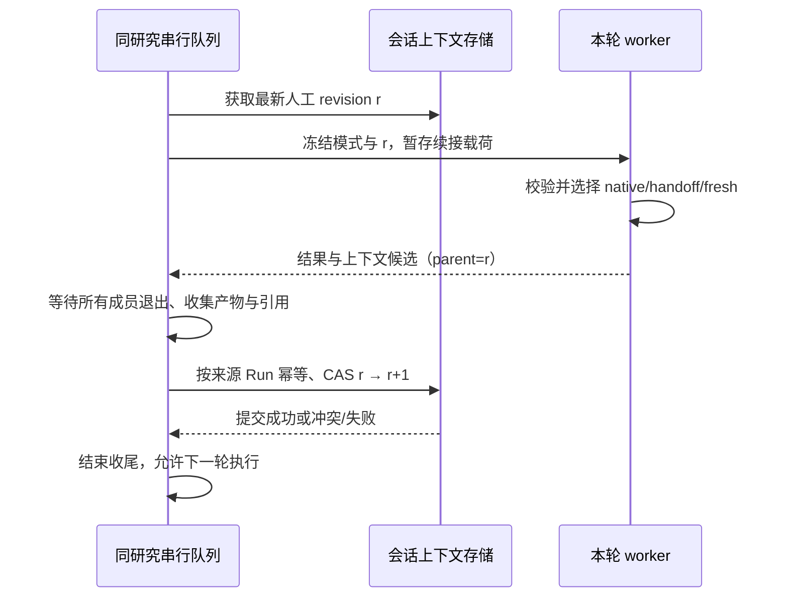

# Web 团队研究与逐次运行模式切换方案

> **历史 / 已被替代（2026-10-22）**：本文保存 v1.4 讨论过程。当前唯一有效方向见
> [当前逐轮切换方案](web-agent-team-run-mode.md)。下文的有效状态、交接存储、任务与验收均为历史描述，不再指导实施；v3.0 不直接恢复本文的全部设计。

| 项 | 内容 |
|---|---|
| 版本 / 日期 | v1.4 · 2026-10-22（优先保护现有 single 链路，续接架构修订见 §5.0—5.3、§5.9） |
| 状态 | **历史 · 已被 v2.0 替代，未实施、未验收** |
| 需求 | PR-RUN-08（本次新增）；关联 PR-RUN-01—06、PR-DATA-04、PR-BIZ-04 |
| 产品依据 | [产品需求基线](../product-requirements.md) · [业务流程](../business-process.md) · [工作台交互规格](../design/investment-research-workbench-prd.md) |
| 历史依据 | [CLI → Web 复刻](cli-web-parity.md)：原阶段一至三的实施记录，不是团队首版的范围约束 |
| 本次交付 | 完整设计、接口与数据契约、任务拆分、验证和发布门槛；本次不修改运行代码、不部署 |

## 1. 产品决定与首版边界

**模式属于每次运行，同一研究可以按“团队研究 → 单 Agent 追问 → 团队研究”的顺序继续。**
“一个研究固定团队模式”仅是过去降低首版实现成本的建议，本方案不采纳。跨模式上下文衔接属于首版交付条件，不能将只有选择框和两条独立工作流的版本称为完成。

确定的产品行为：

1. 发送问题前选择“单 Agent / 团队研究”；提交后该 Run 的模式不可变。
2. 研究 ID、消息、关联账户、投资计划、补数请求、业务回执和历史产物归属不因模式改变。账户仍是独立资料，投资计划仍只属于一个研究。
3. 当前运行不原地切换。正常等待本轮结束；需要立即调整时先停止，服务端确认收尾完成后再发送另一模式。
4. 两种模式都必须理解此前的研究目标、用户修正、结论、依据、不确定性和未完成事项，并能按权限读取历史交付物。
5. 一个研究仍串行执行；不同研究受全局容量控制。团队内部可以并行，不能因此把同一研究的多轮运行并行化。
6. “团队研究”表示采用 coordinator + 子 Agent 的协作流程，不承诺每道简单问题都强制派出固定数量的成员。
7. **账户和投资计划的讨论、业务研究整合、补数及最终个性化分析由主 Agent（coordinator）统一负责。** 子 Agent 只执行分配的研究任务，向主 Agent 报告发现与资料缺口，不独立向用户发起账户/计划请求，不竞争修改会话业务状态。
8. **团队功能是可隔离的增量能力，不得使已有单 Agent 上下文能力退化。** 未切换的 single 研究沿用现有原始回放、工具和提示词、压缩窗口及缓存亲和策略，不强制迁移到团队交接协议，不额外生成交接摘要。混合模式研究的团队原始工具消息、成员状态不得写入 single 原始快照。

首版纳入：模式选择与持久化、双向续接、团队同模式续接、团队过程展示、成员级审批及全队停止、全队用量、历史产物只读取用、刷新恢复、迁移与回滚。成员级取消由 coordinator/运行时使用，首版不额外承诺用户逐成员停止按钮。

首版不纳入：运行中换工作流、跨轮复活旧团队进程、用户直接对某个子 Agent 聊天、用户编辑拓扑/成员模型、自动判断并切换模式、对外开放任意 pipeline、`agent_team_report` 独立选项、跨研究合并上下文。首版 reporter 关闭，由 coordinator 输出最终回答。

本方案只调整团队首版的边界，不表示此前暂缓的所有 Web 工作一并重启。排期由本方案任务依赖决定，不借此重排材料与数据链路。

## 2. 代码现状与实际缺口

以下为 2026-10-22 的源码核对，不代表运行验证已经完成。

| 位置 | 已有事实 | 本次必须补齐 |
|---|---|---|
| `server/routes/runs.py`：`RunRequest`、`_parse_submit` | JSON/multipart 都没有逐 Run 模式；创建记录使用 `cfg.pipeline_id` | 两种编码、普通/业务提交统一解析模式并冻结执行配置 |
| `server/store.py`：Run、SessionConversation | Run 已有 `pipeline_id`；`session_conversations` 每研究一份 opaque payload、revision 和来源 Run | 使用已有 Run 字段；为续接补充明确的版本、来源与原子提交语义 |
| `server/orchestrator.py`：`_spawn`、`_launch` | 启动前读会话载荷；实际 worker 命令仍用 `self._cfg.pipeline_id` | 排队、重启恢复、派发和重试全部使用已提交 Run 的配置 |
| `server/worker.py`、`server/profile.py` | worker 接收 pipeline；当前覆盖配置主要是 ReAct 的 `agent_tools` | 按模式构建 coordinator/sub-agent 的工具与预算配置 |
| `workflows/stateful_react_agent/nodes/main_agent.py` | 已有原始会话快照读写、replay 决策及长会话窗口 | 保留现有同模式回放，增加中性上下文导入/导出 |
| `tests/test_context_inheritance.py` | 明确测试 pipeline、工具 schema 不匹配时拒绝回放 | 不放松校验；增加双向切换及往返测试 |
| `workflows/agent_team/nodes/main_agent.py`、`subagent_runtime.py` | 主节点支持额外 observers；子 Agent 有独立 observers、轨迹和工具配置 | 不能假设主节点 observers 自动传给子节点；补团队续接与角色化接线 |
| `server/relay.py`、`server/usage.py` | 回放/计量入口围绕 `react_agent.jsonl` | 支持多来源轨迹、成员身份、重连和全队计量 |
| `web/src/components/ResearchComposer.vue` | “深度研究/快速追问”等 chip 只插入 prompt 模板 | 独立的真实模式选择器，不能让模板冒充工作流配置 |

`turns` 仍是展示和审计记录；不会将其重新拼成模型历史。`history.txt`、`conversation_history` 均不恢复。运行时轨迹继续是过程审计和计量事实来源；服务器只传输 opaque 工作流快照，不解析其内部 messages。

### 2.1 轨迹与通道兼容性评估补充

**评估结论：可以在同一研究中共存，但当前 Web 消费链路不能直接兼容团队；已完成源码与设计层评估，尚未完成双模式真实运行验证。**

研究包含多个独立 Run，每轮保留自己的轨迹；无需把前一轮 single 的轨迹改写成 team，也无需将所有轮次合并成一个轨迹文件。“同研究兼容”分为历史展示、实时/控制通道和模型续接三件事，不能以其中一件成立推断其余也成立。

| 层面 | 源码依据与兼容判断 | 必须完成的适配 |
|---|---|---|
| 轨迹记录基础 | 两种工作流均使用 `TrajectoryFileObserver`，基础记录生产机制可复用；single 文件名为 `react_agent`，team 主节点为 `main_agent`，成员在 `subagents/` 下按成员/任务写入，字段详略配置也不同 | 统一来源 manifest，兼容缺省字段；强制 Web 所需 JSONL 格式，不依赖可变轨迹格式环境配置 |
| Web 回放与计量 | `server/relay.py::_TRAJ` 固定指向 `react_agent.jsonl`；`usage_for_run()` 依赖同一读取器 | 改为按 Run 的实际 pipeline 与 manifest 读取多来源，不能只改团队主文件名而漏掉成员 |
| 实时传输 | worker stdout JSONL → server → SSE 的传输机制可复用；当前 bridge 的增量只有局部 turn 等字段，没有成员身份 | 每成员独立 observer、带身份事件；同一 Run 的多个来源复用同一传输通道 |
| 前端内容与用量归并 | `stores/runs.ts` 的 `turnTexts`、`usageTurns` 按数字 turn 聚合，步骤按 kind/turn、工具按 call ID 查找 | 加 Agent/任务执行/attempt 身份，防止两个成员的 turn 1 文本覆盖、用量漏算；保留现有 F10 完整回放替换增量的修复语义 |
| 生命周期与控制 | `BridgeObserver.on_loop_start/end` 使用 Run 级事件；审批后端 gate 已有多请求映射，但前端仍只有单个 `pendingApproval` | 区分成员终态和 Run 终态；UI 审批队列及成员路由；stop 覆盖全队，steer 定向 coordinator |
| 模型续接 | 原始快照有 pipeline/工具兼容校验；team spec 的主节点 `include_fields` 当前也没有 `replay_payload` | 经 §5 中性包衔接并显式传入 spec；原始轨迹/工具消息不跨模式直接回放 |

实现前的最小验证必须包括：同研究 single→team→single；team 至少两个并发成员都从 turn 1 开始；两成员同时待审批；流中断后恢复全部轨迹与用量；停止一个成员不会误结束整个 Run；停止整个 Run 后再切模式无遗留执行。对应 A03/A04、A08—A11 等验收项。

## 3. 交互与业务流程

### 3.1 输入和模式默认值

- 新研究默认“单 Agent”；已有研究默认最近一次**人工提交** Run 的模式，无历史则单 Agent。前端草稿可暂存选择，但请求必须显式携带模式，最终显示以服务端响应为准。
- 选择器与 prompt 模板分开。选择“团队研究”不改用户正文；点“快速追问”不偷偷切模式。
- 团队选项附简短说明“可并行研究，耗时与用量通常更高”；不伪造固定价格、人数或完成时间。
- 每个研究回合和运行详情显示该 Run 的实际模式。查看旧回合不改变下一次发送的选择。
- 当前 Run 为 queued/running 或收尾未完成时，首版 UI 禁用模式提交，保留草稿；仍可停止或补充方向。待后端释放研究执行锁后恢复发送。
- API 保留同研究排队能力：其他客户端已经排队的下一轮可以使用另一模式，但不会改变当前 Run。排队时冻结模式，真正执行时才确定上一轮可用上下文。

### 3.2 典型序列

| 回合 | 模式 / 用户行为 | 必须表现 |
|---|---|---|
| 1 | 团队：“研究公司 A，比较增长与现金流风险” | 展示任务与成员进度；形成最终回答、证据及产物 |
| 2 | 单 Agent：“只解释现金流风险，不重新做整份研究” | 读取上一轮结论及出处，回答范围收窄，不默认重新派团队 |
| 3 | 单 Agent：“时间范围改为最近两个季度；不要使用旧预测” | 记录新约束及被替代的旧范围 |
| 4 | 团队：“按新范围复核，再补反方证据” | 新团队继承第 2、3 轮约束；不能恢复第 1 轮旧范围 |
| 5 | 停止团队后改单 Agent | 先确认成员和工具收尾；标明哪些结果完整、哪些未验证，再继续 |

团队过程中，主对话只承载用户与 coordinator 的对话及最终回答；子 Agent 的报告、过程文本位于活动区，不能被当成多条最终助手回答。首版不要求逐 token 展开所有成员，成员状态、工具结果、部分失败和可回放详情必须可见。

## 4. 运行契约与配置归属

### 4.1 对外 API

`POST /api/runs` 新增可选枚举字段 `mode: "single" | "team"`。JSON 与 multipart 同义；未传时按兼容默认值解析，解析结果入库。上线默认 single；不能在入队后再读取可变全局配置决定模式。

```json
{
  "session_id": "研究 UUID",
  "message": "基于前面的结论解释现金流风险",
  "mode": "single"
}
```

服务端映射固定为 `single → stateful-react-agent`、`team → agent_team`；不允许客户端提交任意 profile、工具集合或内部 dotted path。非法枚举返回 422；未启用 team 返回可操作的能力错误，不静默降级。所有权与投资输入校验沿用既有路径；幂等保护需扩展到普通聊天和附件提交，不能假设已有业务幂等覆盖所有入口（§4.3）。

提交响应、Run 详情、历史 Run 摘要、`run_started` 同时返回 `mode` 与 `pipeline_id`。同一提交幂等键重放不同模式视为冲突，不能创建第二次运行。前端提交失败保留正文、附件和模式。

能力通过现有服务能力接口扩展或新增 `GET /api/run-capabilities` 提供：允许模式、默认值、团队暂不可用原因。客户端只展示已启用能力，服务端仍独立校验。

### 4.2 持久化和后台运行

- `runs.pipeline_id` 是执行选择真源，不再增加可独立漂移的 mode 数据列；mode 是白名单映射的产品视图。
- 在现有 Run 配置快照中记录 profile 版本、解析后的角色工具集合/哈希、模型引用、预算和 reporter 开关。秘密仍经环境/受控解析传递，不写快照、argv 或 SSE。
- 覆盖所有入口：普通聊天、multipart、带业务输入、补数后的续接、重试、dispatcher 恢复、watch 触发。不能只改 `POST /runs` 主分支。
- “重新运行”创建新 Run，默认保留原模式与问题，使用当前业务绑定重新冻结快照、启动时读取最新可用人工上下文，记录 `retry_of_run_id`。不能将原业务快照与最新聊天历史无提示混用。精确复现旧上下文不在首版；SSE 重连与上下文保存重试均不创建新 Run（§4.3）。
- watch 首版固定 single，不跟随用户最近选的 team；配置冻结到 watch Run。仍读取最新人工研究上下文，绝不推进人工上下文 revision，也不影响编辑器默认模式。
- 同研究串行不仅覆盖模型执行，还覆盖上下文提交、成员清理与业务收尾；UI 的终态展示不等于已允许下一 worker 抢跑。

### 4.3 提交、取消、重试与配置时点

- **统一提交幂等**：新 Web 客户端每次发送生成 `Idempotency-Key`，普通 JSON、multipart 和业务请求走同一提交登记。指纹包含规范化研究 ID、问题、mode、附件内容哈希和业务输入版本；同键同指纹返回原 Run，同键不同指纹返回 409。与既有 `investment_input.idempotency_key` 同时出现时要求一致，不能各自创建一次。旧客户端缺键维持旧协议，但不能宣称该请求防重复已生效。
- **持久派发**：人工提交的 Run、用户消息、幂等回执、必要业务快照及 outbox 在同一事务登记；附件先暂存和校验，再随提交绑定，失败/重复请求清理无主暂存，不依赖内存队列确保最终派发。未完整入库的上传失败不能留下可执行 Run。
- **排队取消**：扩展现有 stop 控制，对未启动的 Run 原子标记 stopped、取消 outbox；与领取/启动竞争时由同一执行所有权裁决。取消成功后不能再启动，重复 stop 幂等。已排队不等于已采纳问题：从未启动的已取消请求留在审计中，但不自动晋升成下轮有效约束。
- **三种“重试”分别命名**：恢复连接只重订阅；“重试保存上下文”只幂等提交同一候选，不重调研究模型；“重新运行”按 §4.2 新建 Run。当前 `stores/runs.ts::retry()` 的连接恢复行为不能被改成隐式重跑。
- **迟到插话**：当前 `/steer` 在没有 live worker 时返回 409。首版明确保留未送达/未采纳文本并提示“未生效，可作为下一轮发送”，由用户发送前选择模式；不自动以旧模式启动团队。这是本方案相对历史 CLI 自动 follow-up 的明确范围差异。已采纳的插话不得再次默认送出。
- **配置冻结**：模式/profile/角色模型配置引用在接纳 Run 时固定；业务显式输入在提交事务冻结，普通聊天无显式快照时沿用首次启动冻结绑定的时点，并记录 `snapshot_frozen_at`。已经冻结的值不在排队期间刷新。重新运行按新 Run 的同一规则冻结，UI 可核对所用版本。
- **模型漂移**：worker 解析接纳时绑定的模型配置及非秘密版本，不再重新选择“当前默认模型”。密钥可按绑定配置的有效凭据解析，但配置被删除/撤销或模型能力不符时明确失败；禁止悄悄切到其他用户配置或服务端模型。coordinator、子 Agent、总结调用均适用。

### 4.4 执行所有权与“可继续”状态

单进程的 `_session_queues` 和上下文 CAS 都不足以单独保证多实例执行互斥。复用并扩展既有 outbox 的研究行锁、领取版本及执行所有权，让普通/业务/watch 三类入口都经过同一裁决；不得一条路径锁数据库、另一条只锁内存。

- 研究从领取到成员退出、产物登记、上下文提交完成始终有唯一执行所有者。增加持久化收尾状态/执行占用，不能仅以 Run 是否 queued/running 判定研究空闲；现有 `dispatch_outbox._research_has_active_run` 必须覆盖此状态。
- 执行代次标识与上下文 parent revision 都写入候选，旧所有者的迟到完成不得发布答案、产物索引或新上下文。进程内队列键使用认证后的规范研究 UUID，避免同一研究多种字符串标识各自排队。
- 所有者失联时先确认/终止旧 worker 及受管工具，再释放执行占用；租约超时本身不证明旧进程已经停止。无法确认时阻塞该研究并给出原因，不能并发再跑一次有副作用的任务。
- Run 详情补 `finalization_status`，研究状态提供 `can_start_next_run`、阻塞 Run 与 `blocked_reason`。前端刷新、收到终态或 SSE 关闭后读取这些权威字段，不根据本地 streaming=false 解锁。允许 API 接纳排队不等于允许 worker 立即执行。
- SSE 可以先展示模型结果，但必须最终对齐收尾状态；队列等候、执行、收尾分别有超时与原因。收尾失败的修复入口应受所有权校验、幂等及退避限制；修复成功无需重新研究。

## 5. 跨模式上下文：中性研究交接内容

### 5.0 single 保护基线与两条接入路径

v1.4 按用户要求调整此前“所有人工 Run 都写统一 envelope”的设计，确立 **single 原生链路优先、交接按需接入**。保护的是现有可回放窗口及其压缩记忆、既有请求语义和行为，不是承诺超过模型上限的无限完整历史。

- **未进入团队的研究**：继续读写现有 `session_conversations` 原始 payload，走既有 `select_replay`、压缩与轨迹通道；不初始化团队上下文 head、不调用交接总结、不新增团队工具或 system prompt、不因交接服务故障而阻断。已有错误/降级语义保持原基线，另行加固不能偷偷算作团队接入的必需修改。
- **混合模式研究**：首次进入 team 时才初始化独立的交接记录，记录从哪份 single 快照开始覆盖。团队只写自己的轨迹和交接内容，不能覆盖 single 快照。回到 single 时由入口适配器合并最新交接内容，之后仍由 single 工作流输出合法原始快照。
- **共用平台改造**：模式参数、队列、审批/事件类型等采用兼容扩展；single 默认分支必须有旧行为契约回归。修复公共层缺陷确有必要时单独列变更与验证，不能为了团队便利统一替换 single 的消息协议。

### 5.1 选定的方案

采用**原始 single 快照保持原格式 + 首次切换时启用的独立交接记录**。`session_conversations` 继续保存仅由 single 工作流产生的 opaque 原始 payload；team 不写入或改写它。新增交接存储（物理表/字段在 M0 冻结）保存中性材料、来源覆盖范围及混合研究的逻辑 head，不把新 envelope 强塞进旧 payload。

这两份材料不是两套可以任意恢复的“最新历史”：single 快照标明它覆盖到哪个人工 Run/研究 revision；混合研究唯一逻辑 head 指向最新已完成的人工上下文来源。若 head 已由 team 推进，旧 single 快照只可作为保留前缀的基底，必须补齐其后交接增量才能继续。不能仅按选择模式去读取各自最近一份快照。

工作流共享模块负责中性结构及导入/导出，两个工作流各自适配内部状态；server 校验外层版本、大小、所属研究、来源 Run 和 revision，原始快照仍是不透明内容。共享实现放在 `workflows/_shared/` 或等价共享边界，框架内核不导入 Web 或评测层。

不采用以下捷径：跨模式改写 `pipeline_id` 绕过原始校验；将所有子 Agent messages 拼接给下轮；只把最终回答当成全部记忆；分别保存两份互不校验覆盖范围的历史后轮流恢复。仅增加数据存储隔离，不牺牲同研究最新上下文的一致性。

### 5.2 概念结构（字段名待 M0 冻结）

```text
research-continuity/v1
  session_id, revision, parent_revision, source_run_id, source_pipeline_id
  source_status, complete_through_run_id, quality, omissions
  research
    objective
    user_directives[]     # 原文/来源/采纳次序/生效或被替代状态
    findings[]            # 结论/依据引用/适用时点/状态/冲突与替代关系
    open_questions[]      # 未解问题、失败或未完成事项
    evidence_refs[]       # 有类型的来源标识、版本、定位、时间、必要摘录
    artifact_refs[]       # 产物 ID、来源 Run、路径标识、摘要/哈希
    recent_interactions[] # 有界的用户问题与已交付结果，来自工作流输出
  single_snapshot_ref?   # 引用原格式 single 快照，不内嵌或改写其 messages
  single_coverage?       # 该快照已覆盖的 revision / Run，用于计算待导入增量
  materialized_through   # 中性投影实际覆盖的来源，不等同于逻辑 head
```

中性载荷是续接的派生材料，不是新证据库、账户库或投资计划真源。`user_directives` 来自真实用户输入与已采纳 steer；正文里引用的网页指令不能升级成用户约束。用户明确修正原文和来源不得被有损总结抹掉。

结论保留“已验证/待验证/冲突/被替代/部分”的区别，不把模型观点变成事实。证据引用按类型携带定位：语料文档/块/版本、市场来源 Run + 逻辑调用 ID + quote 时点、网页 URL + 访问时点及已有快照定位、附件或产物 ID。无法定位的引用保留缺口，不编造 ID。

### 5.3 每次启动的决策

| 前一人工上下文 → 本次模式 | 导入策略 |
|---|---|
| 无历史 → 任一模式 | 新上下文，记录 `fresh`；仅 team 初始化交接记录 |
| 纯 single → single | 完全沿用原始校验、回放及既有失败语义，不经过交接协议 |
| 混合研究 single → single，原始校验通过且覆盖最新 head | 原始回放，记录 `native`；交接投影即使滞后也不改变或阻断这条原生续接 |
| 混合研究 single → single，原始快照不兼容 | 用已校验且覆盖最新 head 的中性材料启动，记录 `handoff`；缺失则修复/报错，不能悄悄清空 |
| single → team | 按需从权威 single 快照及已有交接基线生成最新中性材料；新 coordinator 重新规划，不复用单 Agent 工具消息 |
| team → single，有兼容 single 基底 | 回放 single 原有消息，再追加未覆盖的团队交接增量和当前问题，记录 `native_with_handoff`；不导入团队内部工具消息 |
| team → single，无兼容 single 基底 | 以最新中性材料启动合法 single 循环，记录 `handoff`；不假装保留了不存在的原始历史 |
| team → team | 首版也新建团队，以最新中性材料续接；不恢复旧 AgentBus、成员进程或未完成工具调用 |
| single → team → single | 原有 single 消息作基底且必须补齐中间 team 的最新增量；不能只恢复第一次 single 的旧快照而跳过团队期间的信息 |

现有原始快照读取器校验 schema、pipeline/node/session、thinking 格式、工具 schema/顺序、system prompt 与消息合法性；模型配置兼容还需结合冻结配置单独核定，不能将现有校验说成已经覆盖所有 provider/model 变化，也不能未经回归改变纯 single 的判定。切回 single 时优先保留通过校验的原始基底，在末尾附加新信息；它提供前缀复用条件，不保证缓存仍驻留。预算不足或配置不兼容时使用有明确原因的合法续接，不为复用旧基底跳过最新修正。

中性材料放在目标工作流约定的历史上下文区，先于本次用户问题；`native_with_handoff` 中放在原始基底之后，不重写旧 system prompt 或伪造缺少调用方的 tool 消息。纯 single 不新增这一块。当前用户指令覆盖旧目标约束，当前业务快照覆盖旧资金/计划叙述。交接数据区分真实用户修正及模型研究产物，保留出处，不能将子 Agent 建议提升成用户指令或系统权限。

### 5.4 生成、合并与上下文预算

1. 纯 single 按现有机制保存原始快照，不增加中性导出。进入混合模式后，team 导出采纳要求、交付答案、报告及引用并合并基线；single 保存原始快照并推进其覆盖标记，中性投影可按需从权威快照/增量补齐，不要求每轮同步 LLM 总结。服务端不从 `turns` 重建材料。
2. 先确定性收集关键来源与引用，再按需要进行一次有界总结；优先复用现有总结能力，避免同轮为 native 和 neutral 各做一次相同总结。调用及其 token 必须单独计量。
3. 总结输出按 schema 校验，引用 ID 只允许引用已知集合；用户修正原文和业务来源不由模型改写。旧结论若冲突，追加替代/冲突关系，不能直接覆盖来源。
4. 团队只导出 coordinator 已接收的结果和明确状态；未采纳子报告可以作为待验证材料索引，不可冒充全队最终结论。原始推理和冗长工具输出不进中性交接。
5. 预算由目标模型实际输入上限决定，扣除系统/工具、本次问题、业务快照和输出预留；建议首版中性注入上限 `min(16k tokens, 可用输入预算的 25%)`，上线数值由 M0 实测冻结。
6. 优先保留有效用户约束、最新结论、冲突、未完成项和出处；长正文降为可取用引用。包内内容不够时通过授权只读工具取回。若连不可丢约束都放不下，明确返回上下文过大，不静默截断后声称完整续接。
7. 保留 `REPLAY_MAX_TURNS / REPLAY_MAX_TOKENS / REPLAY_MAX_TURN_STEP` 对原始回放的约束及现有长对话回归。中性预算和 native 预算各有统计，不能把两份材料全量叠加。

### 5.5 混合研究提交时序与异常

本节只约束已启用交接的混合研究；纯 single 保持原有保存和恢复路径。混合研究中，原始 single 快照提交与逻辑 head/coverage 在同一事务推进，中性投影允许滞后但须记录 `materialized_through`。若 head 指向最新 single 且该原始快照完整，下一 single 不依赖投影补齐；启动 team 前才要求投影追平。head 指向 team 时，回到 single 所需交接不可省略。



- Run 执行终态与 `continuity_status` 分开：后者建议为 `pending/ready/degraded/failed/not_applicable`。模型成功但上下文保存失败不能显示“已完整继承”。
- 提交候选先原子写本轮文件再入库；DB 提交确认后才清理候选。上下文、来源 Run 与 revision 在同一事务推进；重复完成帧不重复推进，旧进程迟到写入通过 CAS 拒绝。
- 若权威上下文/head 提交失败，已完成报告仍可查看；保留候选并可幂等重试。依赖该轮的后续 worker 不得默默跳过，队列以可见原因等待修复；修复超时后明确结束派发失败。仅派生中性投影失败不能被误判为最新 single 原始上下文丢失，也不能阻断不依赖该投影的连续 single。
- 总结调用失败但确定性材料完整：可产生 `degraded` 包，注明省略并可取回原文；不能丢失已采纳修正。材料不完整或来源无法验证则 `failed`，不以空包覆盖上一有效 revision。
- 停止/超时：使用最后完整的循环边界与已提交报告，标明 partial 和未完成成员；丢弃悬空工具协议。用户本次问题及已采纳 steer 需作为带采纳状态的输入事实保留，不能从审计 transcript 猜测是否采纳。
- SIGKILL 没有候选：可从已持久化的结构化 Run 输入、control adoption 记录与工作流检查点恢复最小包，不能把半截流式文本当最终结论；缺口明确显示。
- 无历史是合法 `fresh`；有历史但读取失败不是无历史，必须显示失败原因。此处有意收紧当前“读失败就全新启动”的 best-effort 行为，避免切换时假装记得上下文。
- watch 只读 r，不导出会覆盖人工载荷的候选。下一人工运行继续读取最近人工 revision。

### 5.6 长期完整性与中断恢复的来源

纯 single 不为未来可能使用的团队功能增加第二套记忆写入。首次切换从当时可验证的原始快照建立交接基线，不能还原已被原有压缩丢掉的细节。进入混合模式后保留中性基线及其后尚未物化的 single 权威增量引用；在原始快照滚动清理前确保待交接增量可恢复。中性包的覆盖水位与逻辑 head 分开，不以“尚未总结”冒充“没有新内容”，也不为了更新摘要改写 native 请求。

- 原始用户要求在受控的运行输入/采纳记录中保存稳定 ID；明确区分待执行、已采纳、被替代、已撤回。总结不因某字段本轮未再出现就删除旧约束，不把失败前尚未采纳的请求当作已经执行的决定。
- legacy 快照已经压缩掉的细节不能凭摘要重新创造。迁移标注实际覆盖范围与遗漏；可读取仍保留的工作流结构化记录补齐，但不读取展示 `turns` 作为模型历史。关键约束无法确认时说明缺口，不标为完整迁移。
- 候选包必须有有界、原子写入的检查点：本轮输入已采纳、steer 已采纳、完整工具/报告边界和最终收尾。一次性只在成功结束导出不足以支持 SIGKILL 恢复；checkpoint 不记录悬空工具协议。
- 子成员 report 引用先对应临时稳定 ID，父进程在产物登记后完成 ID/哈希映射，再提交 final 包；不能先写会话包再发现 artifact ID 尚未存在。只有已登记且可读取的引用可标为 available。
- 混合研究保留输入/输出 revision、载荷摘要哈希、导入策略与来源覆盖区间。为保留期内的审计保留不可变输入包引用，可使用去重内容存储；逻辑 head 只有一个，single 原始快照以 coverage 描述它覆盖的范围，不作为另一个互不关联的“最新历史”。Run 目录清理不得连带删除仍在引用的 head、待物化增量或有效审计载荷。
- 对同一组人工输入比较连续 single 与交替 single/team 的有效要求、关键事实、冲突、证据引用和待办，验收语义义务而非要求生成文案逐字一致；至少覆盖超过默认 10 轮窗口的连续对话，以及 30 轮反复切换，防止逐次总结漂移。

### 5.7 上下文连贯性的保证边界

**首版必须保证正确的上下文来源、版本、组装与失败可见；不能承诺模型经过有损总结后仍逐字记住无限历史，或每次理解都完全正确。** 当前跨模式链路尚未实施，也不能表述为已经保证。

| 层次 | 必须实现的约束 | 验证方式 |
|---|---|---|
| 业务资料 | 主 Agent 使用本轮冻结的账户/计划及有效待办、回执；旧聊天不能覆盖；子 Agent 只获得必要任务切片 | 快照 ID/版本与工具输入对账，验证非法资金回填失败 |
| 用户要求 | 当前有效目标、限制、明确修正/撤回、未完成事项可定位到真实输入；每轮交接维护这些项目，不仅保存最终报告 | 导入清单与原始输入 ID 对照；缺失关键项时不假称连续 |
| 研究结论与证据 | 保留来源、时间、状态、分歧和替代关系；总结只是派生内容，细节按引用取回 | 引用定位/版本校验、已知冲突与过期来源用例 |
| 模型理解 | 在规定场景下正确应用上述输入；摘要和推理仍有误解风险 | 固定语义义务、连续/交替模式对照及长对话测试，不能只验 schema |
| 历史完整性 | 有界窗口和摘要的覆盖/省略可见；不保证无限原始内容常驻模型输入 | 覆盖区间、omissions、超限/损坏/缺失恢复测试 |

混合研究每次主 Agent 启动前产出内部 `context_receipt`：来源 revision、导入策略、有效要求 ID、当前业务快照版本、证据/产物引用及可用状态、历史覆盖区间与裁剪原因。运行时先确定性校验来源和必须保留项目，缺失时修复/阻塞或明确降级，不能仅让模型自报“我记得”。纯 single 继续现有 replay 诊断，不新增交接依赖。该回执是受控诊断资料，不把完整私有上下文直接回传浏览器。

同一轮内，主 Agent 传给子 Agent 的任务约束也绑定该 revision/任务版本；成员迟到报告保留其输入版本，由主 Agent决定是否仍适用。新用户修正优先于旧指令，有冲突而无明确替代关系时保留冲突、由主 Agent 澄清，不能依靠“后出现的摘要句子”推定用户改变计划。

即使后端完全冷缓存、缓存被清空或请求被路由到新实例，发送的有效上下文仍必须完整。上下文不可用是续接故障；缓存未命中是性能事件，两者不得混用为同一种错误或降级条件。

### 5.8 KV cache 与前缀复用策略

#### 机制与现有基础

`session_conversations` 保存的是应用层消息/研究材料，不是模型 KV 张量；重启 worker 后重放消息可以提供同样的信息，但不等于恢复了推理服务内存中的 KV。

以 SGLang 为例，其前缀缓存按 token 序列及可选命名空间匹配；session 引用只改善缓存保留优先级，内存压力下仍可能被淘汰。参见 [SGLang Unified Radix Cache](https://github.com/sgl-project/sglang/blob/main/python/sglang/srt/mem_cache/unified_cache/components/README.md) 与 [Session-Aware Radix Cache](https://github.com/sgl-project/sglang/blob/main/docs/docs/advanced_features/session_radix_cache.mdx)。这些资料说明机制，不表示当前部署已启用相关新特性；实际版本/后端配置在 M0 核实。

仓库已有三项相关基础，但都不构成“所有模式百分之百命中”的保证：

- ReAct 的 `render_stable_system_prompt_notes` / `render_per_run_tail_notes` 已把每轮目录等动态内容移到尾部；`tests/test_context_inheritance.py` 覆盖未压缩期间的前缀稳定和分段裁剪。
- `bind_session_id` 与 `openai_client._session_query` 支持网关粘性路由；single 使用研究 session ID，team 通过 `identity.llm_session_id` 为 coordinator/成员构造不同路由键。路由键不是 KV 内容，也不是跨角色共享记忆的授权。
- `scripts/replay_stats.py` 可记录 replay 决策、cache read 与摘要消耗；当前统计主要面向单轨迹，不能原样用于团队整体并断言跨模式缓存保持。

#### 各序列的缓存预期

| 运行序列 | 上下文策略 | KV / 前缀缓存预期 |
|---|---|---|
| single → single | 兼容时保留原始消息前缀，追加本轮输入 | 有较好的复用条件；裁剪、配置变化、缓存淘汰/路由变化均可能降低命中 |
| single → team | 新 coordinator 角色与工具，导入最新研究材料 | 不复用 single 的整条执行历史；只有实际相同的 token 前缀具备复用条件 |
| team → single | 优先保留兼容 single 原始基底，在末尾追加团队增量；无基底时中性续接 | 有基底时可能复用较长原始前缀；不能跳过团队新信息，缓存驻留仍不保证 |
| team → team | 首版新建团队，继续使用最新中性内容 | 固定角色/工具前缀可能复用；不承诺上一轮 coordinator/成员全部执行历史复用 |
| 同一 Run 内同一 Agent 多次调用 | 工具调用与结果按有效消息历史追加 | 模式未变且前缀稳定时可复用；压缩、重试修复和淘汰仍影响命中 |
| 改模型/后端或缓存被清空 | 重新构造合法完整请求 | 按冷缓存执行；不得因此丢失研究记忆或越过权限边界 |

前缀相同须以 provider 渲染后的 token/模板为准；同义摘要、相同 session ID、相同 JSON 字段名都不够。角色 system prompt 或工具定义在前部发生变化后，即使后面的研究正文相同，也不能默认复用那段正文此前的 KV。是否命中还取决于模型/模板版本、服务端命名空间、容量、路由和保留策略。

#### 首版具体约束

1. **按角色稳定前缀**：single、coordinator、sub-agent 各自固定 system/tool schema 内容与顺序；主 Agent 专属业务工具不为追求命中而开放给子 Agent。真正配置变化显式记录新版本，不能藏在缓存键不变的旧配置中。
2. **动态内容在尾部**：Run ID、时间、目录、业务数据版本、当前问题及本轮新增研究内容放在适当的动态消息区。仅用于审计的 revision/hash 不必反复插入稳定 system prompt；业务事实必须仍在有效上下文中，不能为缓存删除它。
3. **维护材料不等于重写请求前缀**：纯 single 不生成团队交接包；混合研究维护 coverage/权威增量，派生投影按需补齐，native 兼容时不把新摘要重复插入旧消息前面。handoff 使用确定性顺序与原样保留的未变材料；只在需要时总结，不为每次写 revision 重写整份研究摘要。强制预算上限优先于缓存保持。
4. **路由与身份分离**：审计身份保留 Run/任务/attempt，provider 亲和键按认证研究与角色稳定构造，在同一成员的执行生命周期内稳定；不能仅用每轮随机 Run ID，也不能把全部成员强行路由为同一个身份。子成员跨轮复用属于性能实验，不承诺通过复用名字恢复旧上下文；路由亲和与全队并发负载需一起测量。
5. **不持久化或跨工作流搬运 KV**：首版依赖推理服务自身缓存，不下载/上传 KV，不假设跨模型 KV 兼容。provider 专有缓存控制字段仅由对应适配器和已验证配置启用，不能向所有兼容接口盲发。
6. **正确性优先**：缓存丢失不触发重新创建研究、不切回旧快照、不扩大角色权限。上下文兼容失败走中性续接或显式错误，不为缓存放松原始消息合法性校验。

#### 测量与验收

扩展 replay 统计到角色/来源/物理调用，分开报告 `native/native_with_handoff/handoff/fresh`、输入 token、provider 报告的 cache read/write、摘要调用消耗、首 token 延迟和运行总用量。真实命中比使用同一 provider 口径的 `cache_read / 本次可计量输入`，缺失计数字段记 unavailable；不同 provider 的字段先核定包含关系，不能直接相加。

原脚本的 `cache_read / 上一轮 prompt_tokens` 是历史复用参考指标，不等于标准缓存命中率；模式变化后分母尤其不可比，应按同角色、同配置连续段分组，并单列切换轮。前缀哈希/最长共同前缀是本地复用条件，不能代替 provider 的实际命中；同样，延迟改善也不能单独证明 KV 命中。

M0/M5 用相同语义任务分别测连续 single、连续 team、两种往返序列，覆盖冷/热缓存、窗口裁剪、模型/工具变化、路由变化和并发成员争抢缓存。受控隔离环境中关闭或清空缓存验证业务语义不变，不清理生产共享缓存。每组记录多次样本的延迟/成本范围，不用一次热命中给出全局承诺。

首版可以承诺“切换不静默丢失有效上下文，缓存未命中仍可正确续接”，不能承诺“自由切换且保持完整 KV、零额外预填充成本”。如果 M0 测得 team 连续对话的成本/延迟不达门槛，需评估仅保留 coordinator 原始会话或统一主 Agent 的进一步设计；该方案涉及协调工具历史与角色权限，尚不属于已确认的实现，不能通过复活旧成员简单替代。

### 5.9 single 不退化的发布门槛

“保护现有 single”必须能对照验证，不能只靠代码中增加一个开关：

1. **请求等价**：相同模型/profile/业务绑定和既定输入下，纯 single 的 system prompt、工具 schema/顺序、历史 messages、thinking 格式和上游亲和键保持原行为。用确定性 fixture 与旧版本比较实际组装请求；不要求随机生成回答逐字相同。
2. **零附加交接工作**：纯 single 的额外交接模型调用数为零，不新增团队摘要写入，不提前裁剪旧消息，不引入团队工具/成员事件；保留原有正常压缩产生的总结调用。
3. **故障隔离**：交接解析器、投影任务或团队专属存储不可用时，纯 single 与已有最新 native coverage 的连续 single 仍能运行。团队刚执行后的回切若缺必需增量则明确报错，不以“隔离”为名悄悄忽略团队这轮。
4. **原始快照独占写**：team 导出失败、取消、重试或迟到完成均不能写 `session_conversations` 的 single payload。只有完成校验的 single 工作流结果可写入；回切使用的是“旧基底 + 已覆盖校验的新增量”，新 single 输出随后成为新原始快照。
5. **导入一次**：交接增量以来源区间/hash 标识；首次回切后记入 single coverage，后续 single 不重复注入。原有有效用户要求与团队期间的新修正同时可定位，旧要求明确被替代时不再次生效。
6. **停用可退**：关闭 team 提交后纯 single 完全沿用原路径；混合研究仍保留必要的交接读取器。不得把“回退旧二进制直接读取旧 single 快照”当作混合研究安全回滚。

在业务不改变、相同后端条件下比较原有长对话、压缩次数、首 token 延迟与用量；纯 single 不接受由团队接入造成的额外摘要费用或上下文丢失。公共平台改造导致的非模型开销单列测量。任何一项不满足，团队功能不能作为默认可用能力发布。

## 6. 历史产物与业务数据的连续性

保持研究归属不等于共享所有 Run 的可写磁盘。每个 Run 继续独立 `/inputs`、`/workspace`、`/outputs`；历史交付物通过同研究、同所有者的引用取用。

- 增加受控的历史研究引用读取能力（例如 `research_context_fetch`），或复用等价的现有受控读取通道。worker 只持有该 Run 的受限引用清单/能力，不获得数据库凭据或任意历史目录访问权。
- 引用先按用户 → 研究 → 来源 Run → 产物/证据核验，再解析路径；复用既有路径解析、防越界和软删除策略。可将选定历史材料只读暂存到本轮 inputs 的独立命名空间，不能可写挂载旧 outputs。
- 新产物仍登记在新 Run，研究画布可聚合历史列表；需要修改旧报告时生成新产物及 `derived_from`，不能覆盖原始审计内容。首版不自动继承所有旧附件，只继承授权引用及实际读取所需文件。
- 历史市场证据保留原 Run 与逻辑调用 ID，不能伪装成本轮市场调用以绕过现有校验。跨 Run 读取是独立只读引用路径；需要当前价格/仓位决策时按本轮规则重新取数、验证。
- 账户与计划从本轮认证绑定及冻结快照读取；历史“资金 100 万”的叙述不能覆盖最新已保存的 80 万。缺失字段保持缺失，不能用旧总结补足。
- 历史引用超期、删除、撤权或文件不存在时返回 `unavailable` 与原因；上下文不能声称原文仍可验证。保留策略及删除传播覆盖会话包、受限引用清单和暂存副本。

### 6.1 引用取回、变更与删除

历史引用读取必须有可实现的 worker → parent 通路。首版建议通过受限 broker 帧请求引用 ID，由父进程核验当前所有权、研究状态、来源版本及允许清单，再返回限量文本或只读暂存文件标识；禁止把数据库凭据、宿主绝对路径或用户访问令牌交给成员。请求使用独立 request ID、超时、取消和最大响应限制，不能阻塞 stop/approve 控制帧。

若新增 `research_context_fetch`，同时接入 `plugins/tools` 显式注册允许清单及两种 profile，纳入工具 schema 兼容校验；函数存在不代表 Agent 可调用。

历史产物并非永远不变：现有 revert 可修改来源 Run 文件。引用需绑定哈希/版本；取回时重校验，不一致则标为 changed/unavailable，不能用同一路径的新内容验证旧结论。保留旧版内容或重新派生引用必须显式留痕，不能静默改写。

研究删除时在事务内阻止新接纳/领取，取消待派发项，并向活跃执行所有者发送全队停止；完成后禁止迟到候选重新建立该研究的可见上下文。删除、revert 或引用撤销发生在两轮之间时，启动前重新校验受影响引用：必要时使用带失效说明的中性包替代旧 native 回放，不能只更新文件列表而让模型继续把已失效证据当已验证事实。删除操作的用户可见状态与后台清理进度分别报告。

## 7. 团队运行接入与控制

### 7.1 Profile、工具与权限

Web 按模式构建 profile overrides：single 保留现有行为；team 分别设置 `main_agent_tools` 与 `sub_agent_tools`，保留团队协调工具和 `submit_report`。不能把 ReAct 的 `agent_tools` 原样传入后宣称团队已接通。

coordinator 负责拆解、约束传达、收集、冲突处理与最终回答，并独占账户/计划相关的用户沟通、资料补充和个性化分析责任。子 Agent 可以研究公司、行业、行情、论据和反方风险，以及主 Agent 下发的明确分析问题；它获得必要的只读上下文切片与证据引用，不自动接收完整账户/计划资料或完整会话历史。

业务工具 `investment_context`、`request_investment_input`、`investment_position_sizing`、`investment_strategy_lint` 仅向主 Agent 暴露。子 Agent 不获得这些工具，也不获得原始 `position_sizing` / `strategy_lint` 作为绕过入口；子报告中的研究假设不能自行变成用户账户事实或已批准计划。主 Agent 必须通过绑定本轮冻结快照的工具计算与校验，不能自行编造资金/持仓输入。

权限同时落实到角色工具白名单、执行时授权和业务结果接收端，身份由运行时绑定，不能靠模型传入 `role=coordinator` 获权。清理子任务继承的业务 ContextVar/补数写入能力；同时审查 `original_question`、任务后缀、历史引用读取与 sandbox 文件挂载，防止主 Agent 的完整业务上下文从另一条路径直接注入子 Agent。验证真实子节点调用及伪造主角色均被拒绝，不能只检查 prompt 或 schema。

首版建议最多 3 个并发子 Agent、禁止递归组队；作为服务端可配置上限，不向用户暴露自由拓扑。总 wall-time、全队 token/费用预算和全局模型并发槽是共享预算，不能给每个成员各自一份完整 Run 预算。最终数值由容量试验冻结。

### 7.2 角色化 observer 接线

新增每 Agent 的 observer 工厂或等价适配器；共享授权 gate 的受控协调能力，但不共享有可变 turn/工具计时状态的 observer 实例。

| 能力 | coordinator | 子 Agent |
|---|---|---|
| 实时/轨迹事件 | 带自身身份输出 | 独立身份与任务执行 ID，接入统一出口 |
| 审批 | 逐调用审批 | 同样逐调用审批，不能绕过主节点之外的写操作 |
| steer | 在安全边界采纳并确认 | 首版不直接注入；由 coordinator 决定更新或撤销任务 |
| stop | 取消规划/等待/当前循环 | 取消所有 queued/running 成员及其受管工具进程 |
| Diff | 主代理显式变更记录 | 成员显式变更也纳入 Run 的审计，冲突写入需串行保护 |
| 业务约束 | 独占完整冻结快照读取、补数与个性化业务计算 | 仅接收主 Agent 下发的只读任务约束及其版本，不读取或变更完整业务绑定 |

审批标识必须含 Run、Agent、任务执行和 tool_call 的稳定关联。UI 支持多条待审批项，不能沿用单个 `pendingApproval` 覆盖先前请求。拒绝只影响对应调用，停止则关闭所有未决审批；硬拒绝、超时拒绝和全局权限边界保持不变。

stop 先协作式取消 AgentBus 及工具，超过现有宽限再终止整个进程组；全部清理完成才允许另一模式开跑。子成员 `on_loop_end` 只能更新成员状态，不能提前把整个 Run 标记 completed。

同一输出路径的并发显式写入要有锁或独占归属，Diff 记录与 revert 基线需一致；bash 扫描仍只展示，不扩大可 revert 范围。团队不能通过并发写破坏现有“仅显式文件改动可回退”的规则。只锁文件工具不够覆盖 bash：成员交付目录需要由 sandbox 挂载/写权限隔离，每个成员写自己的命名空间，由 coordinator 受控汇总。bwrap 与 container 都必须验证；缺少这一能力的后端不得开放并发写同一输出树。

### 7.3 主 Agent 业务意图、审批范围与收尾预算

- **替代 v1.1 的多成员业务意图方案**：不让各子 Agent 调用补数工具后再合并竞争请求。成员只在内部报告中标注 `needs_context` 或研究缺口，主 Agent 汇总判断是否需要向用户补数，再使用唯一业务工具入口。主 Agent 自身仍可能并行调用工具或跨轮重复请求，因此按 Run/用途/快照版本幂等、按研究关联待办去重，并保留已存在请求 ID；服务端仍逐用途裁决缺失字段，某用途资料足够不能清除其他用途。单个 `requested` 槽是否需要扩为多用途集合在这一主 Agent 专属范围内实现，不再承担子 Agent 竞争写入。
- `once` 审批仅覆盖指定调用；本 Run 范围的记忆授权必须有明确的工具/参数/角色范围，不能因共享 gate 自动扩大到全队所有命令。所有授权绑定 Run，跨轮或切模式不继承；仍需遵守既有安全规则。当前 Web 自动允许的受控低风险操作保持原政策，不把所有文件写入都改成人工弹窗。
- 将研究预算与收尾预留分开计入同一总限额：研究耗尽后仍能写检查点、收集已完成结果、登记产物并提交上下文。用户 stop 后禁止再启动新的总结 LLM 请求，使用确定性部分包；已有调用取消后如实际消费未知，用量标记 partial。全队成本上限是本地可控调用预算，不承诺 provider 取消后绝无尾部费用。

### 7.4 账户/计划的唯一业务协调者

这是用户明确要求的首版规则，不是可选的并发优化。主 Agent 负责围绕绑定账户和计划讨论与研究，子 Agent 提供被分配的事实、证据、情景和风险分析；最终如何应用到用户账户和计划由主 Agent 统一整合。服务器负责认证、快照、校验与持久化，主 Agent 不是数据库真源，也不因此获得自动切换账户、修改计划或交易的额外权限。

| 行为 | 主 Agent | 子 Agent | 服务端 |
|---|---|---|---|
| 读取绑定账户/计划 | 通过授权工具读取本轮冻结资料 | 无完整业务读取工具；只读必要任务约束 | 验证归属、版本及字段权限 |
| 发现资料不足 | 判断是否影响本次分析，统一向用户沟通/调用补数工具 | 向主 Agent 报内部缺口；不向用户创建表单/待办 | 判定真正缺失字段并幂等建立请求 |
| 基础研究 | 分配问题、处理分歧、补充必要研究 | 并行检索、计算公开指标、分析假设与风险，返回证据 | 提供已授权的数据与文件工具 |
| 个性化仓位/计划结论 | 用冻结业务快照进行受控计算、校验并交付 | 不自行给出账户仓位结论或宣称计划已更新 | 确定性校验；业务写入沿用既有授权流程 |
| 账户/计划变更与补数回执 | 面向用户统一解释处理结果 | 不调用业务写接口、不处理用户补数回执 | 校验版本、持久化、产生回执及后续 Run |

典型流程：主 Agent 读取账户/计划并确认目标 → 下发基本面/估值/风险等研究任务及必要约束 → 成员汇报证据或缺口 → 主 Agent 汇总后至多形成同用途的一个有效补数请求 → 服务端保存用户明确提供的资料 → 按既有业务续接路径创建使用新快照的后续 Run → 主 Agent 统一输出个性化结论。

本轮快照不可被用户后续修改静默更新。新资料进入后续 Run，已有成员若基于旧任务约束产出，只能作为带旧版本的研究材料，由新主 Agent 判断是否需重做；不能直接沿用旧版本的个性化结论。切回 single 时该单 Agent 接替主 Agent 责任，切回 team 时新 coordinator 接替，绑定关系、有效补数请求和已保存业务回执仍属于同一研究，不重新竞选或复制业务所有权。

子 Agent 的 `needs_context` 只是一条内部报告，不等于创建用户待办，也不直接进入持久化业务意图。主 Agent 未采纳的建议保持未采纳状态；主 Agent 失败或停止时，成员不能自行晋升为业务协调者。重启/重新运行仍由新的主 Agent 经服务端读取已有待办和回执，防止重复询问。

该约束不取消研究工具本身的审批：成员执行受控文件/命令时仍按 §7.2 独立审批；“工具安全审批”和“账户/计划补资料请求”是两条不同流程。

## 8. 事件、回放与用量

### 8.1 身份与展示

事件扩展 `run_id / agent_id / parent_agent_id / task_id / attempt_id / role`。LLM 文本去重键至少为 `(run, agent, task execution, turn, message_kind)`，工具键再含 tool_call_id。不能继续只用 `turn=1` 聚合，否则并行成员会互相覆盖。

团队任务状态与成员运行状态分别表示；建议任务保留 queued/running/completed/failed/cancelled，成员另有 ready/idle。一个成员可处理多个任务，展示不能把成员完成等同于所有任务完成。

新增逻辑事件包括成员/任务状态变化、报告就绪、上下文准备状态；复用现有工具、审批、usage 与 Run 终态事件。团队内部 `response.swarm.*` 等标识保持兼容，通过 Web 适配层映射，不重命名运行时协议。

### 8.2 多轨迹恢复

首版采用**受控轨迹 manifest + 每来源游标**，复用 runtime 轨迹作为内容真源，不另造 Web 内容事件日志：

- 每个 Run 的 manifest 记录稳定 `source_id`、角色/任务身份、相对轨迹路径及状态；仅注册 runtime 明确产生的文件，禁止对全磁盘 glob。
- SSE/trace v2 的 opaque cursor 编码 manifest 版本与各 source 的已完成记录位置，绑定 Run 并校验大小/来源；不能让前端传任意文件路径。
- 同一轨迹行映射多个 UI 事件时，还要有稳定事件子序号或原子批次提交规则；断线在半行事件间发生也不能漏结果。
- 实时 delta 与回放完整消息按身份合并；完整记录能够补齐丢失 delta，不能因收到过一个片段就跳过全文。重试生成使用新的 attempt 身份，避免与已撤销文本拼接。
- 订阅期间新建成员时刷新 manifest 并从该 source 起点读取；服务端重启后从 manifest/运行时结构化记录恢复任务状态。必要的任务生命周期由 runtime 落盘，而非只存在 SSE。
- 旧 single Run 继续兼容数值 `after` 游标；team/v2 使用新游标，两者通过版本区分。实现前审查现有 F13 断线/分页约定，不能更改数值游标的原有含义。

跨来源仅保证各来源内部顺序；UI 可按时间与来源稳定排序，不声称拥有真实的全局因果顺序。慢消费者可以丢增量，但已落盘内容可补齐；控制状态应从持久化记录重新对齐。所有出口统一脱敏。

### 8.3 用量与部分失败

全队用量 = coordinator + 各子 Agent 的真实调用（含重试/失败/取消前已消费部分）+ 交接总结。按来源/调用去重，不叠加实时计数和离线同一条记录；沿用现有 cache/reasoning 口径，不重复计算包含在总 token 中的子项。

每来源缺失用量用 unavailable/partial 表示，不能当零成本。运行整体终态由 coordinator/worker 结果裁决；部分子任务失败但仍可交付时，最终回答与 `quality` 明示覆盖缺口，不把红色成员自动等同于全 Run 失败，也不掩盖它。

### 8.4 通道收尾与压力控制

扩展轨迹身份之外还要定义通道的结束条件。完整结果落盘、成员清理完成、manifest 封口后生成最终游标；实时 Run 终态与已缓存成员 delta 到达顺序不同，不能导致提前关闭回放而丢掉尾部记录。新增来源、部分 JSONL 行、文件截断/轮转和损坏行均有显式处理：游标绑定 source generation，半行不推进，文件替换不能沿用旧 offset。

worker 的 `live_events` 当前是无界队列，团队放大流量后不能只依赖 server 端 SSE 背压。worker 侧也需有界合并/丢弃可回放 delta、限制帧大小并保证 stop/approve/引用响应不饥饿；工具大结果通过有界预览和受控引用读取。生命周期与控制先持久化再通知，不能通过“无限队列确保不丢”维持可靠性。

断线恢复后核对持久化任务/审批状态、最终轨迹游标和 Run 详情。若终态后的上下文收尾仍 pending，保留状态查询直到 ready/failed；不能因 SSE 已结束停止对账。验收记录队列峰值、丢弃 delta 数及恢复结果。

## 9. 存储升级、兼容与发布

1. **原格式保留**：single 读取器继续处理现有 `conversation-dump/*`；新交接记录由独立适配器读取，不替换原始 payload。旧研究未切换时不需要交接数据迁移。
2. **按需启用**：首次切换时，由工作流适配器验证 single 快照并生成交接候选，原子登记交接 head 及基底引用；保留原 single 快照。不能在 server 直接解析 messages，更不能重建 `turns`。交接构造失败时不启动 team，也不改变原有 single 上下文，用户可以继续 single。
3. **新 Run 写入与恢复**：记录输入 revision、输出 revision、续接策略、摘要质量、预算及失败原因；字段优先扩展现有快照/summary，必要索引或状态列用新的 Alembic revision。不能编辑已经应用的迁移。
4. **灰度顺序**：先通过 single 旧行为对照，再仅对隔离 fixture/明确加入灰度的研究验证交接，最后开放选择器。不得给所有线上 single 运行加影子总结费用。功能开关默认关闭，完整验收前不对外声称可用。
5. **紧急关闭**：只禁止新的 team 提交，已经接纳的 Run 按冻结配置收尾；team 产生的中性包仍必须能由 single 读取。单纯关闭 UI 不能成为回滚策略。
6. **版本回退**：混合研究最低回退目标必须理解逻辑 head 与 single coverage，否则旧二进制可能误把旧 single 快照当最新。纯 single payload 格式不变不代表整个混合研究可无条件回退。保留启用前备份并在隔离库演练，未经验证不降级生产 schema。
7. **留存与隐私**：上下文按现有研究所有权、软删除和保留策略治理；原始包不作为普通前端调试响应返回。历史文件删除后的引用状态同步标注。

### 9.1 协议版本与上线可观测性

- 能力响应声明事件、上下文和 worker 帧协议版本。API 与 worker 在模型调用前握手，版本不支持则不启动研究；不能依赖“未知字段被忽略”保证兼容。
- 前端提交支持的事件版本；旧前端仍可发 single，不能获准启动其无法处理多成员审批/恢复的 team。浏览器缓存旧 bundle、滚动发布的新旧 API/worker 组合都要验收。团队开关关闭后，已产生的团队历史与中性包读取能力不能一起关闭。
- 受控兼容矩阵至少覆盖实际使用的 provider 协议、模型工具调用/流式能力以及 bwrap/container 两个后端。未实测组合标为未验证，不从一个 OpenAI-compatible 实验推断所有 provider 可用；M0 明确首版开放组合。
- 记录 mode、pipeline、配置版本、执行代次、上下文输入/输出 revision、native/handoff 决策、总结质量、全队用量完整度、收尾等待时间和失败原因；指标不记录原始敏感上下文。
- 灰度检查切换成功率、上下文义务保留率、收尾失败/孤儿成员数、审批丢失数、回放缺口和相同题目的延迟/成本。发布硬门为：验收用例中关键用户约束丢失、越权、重复执行、审批错配与孤儿执行均为零；延迟、包大小及用量增加的容忍值在 M0 以测量基线冻结，不以功能演示代替。

## 10. 实施分解与依赖

以下均为待实施；阶段内部可独立开发，但发布门槛是整条链路通过。建议先做最小纵向闭环，再扩全量控制与表现。

| 阶段 | 任务与交付物 | 依赖 / 完成门槛 | 初步工程量 |
|---|---|---|---|
| M0 契约与风险验证 | 核定两套 profile/schema、上下文包、角色 observers、轨迹 manifest、预算、legacy 迁移；小规模真实 worker spike 及上下文/缓存冷热点对照 | 证明 team 可用目标模型/沙箱/工具；关键路径无未解释绕过；冻结续接与缓存性能门槛 | 2–3 人日（原估，补项后重算） |
| M1 每 Run 模式 | API 双编码、所有创建路径、冻结配置、能力接口、恢复/重试/watch 行为 | DB pipeline 与实际 worker 一致；非法/禁用模式显式拒绝 | 2–3 人日 |
| M2 研究续接 | 原格式 single 保护、独立交接记录/唯一逻辑 head、coverage、两端适配、CAS、故障恢复、预算及历史引用读取 | single 旧行为对照通过；双向切换保留有效基底且补齐新修正；原始快照不被 team 覆盖 | 5–8 人日（原估，架构修订后重算） |
| M3 团队控制 | 角色工具/业务绑定、审批队列、全队停止、steer 路由、输出写入协调、容量限制 | 子节点权限与主节点同样有效；终态后无活跃工具/成员 | 4–6 人日 |
| M4 事件与前端 | 多来源回放/游标、全队计量、模式选择器、任务/成员卡、终态与续接状态 | 刷新/掉线不串消息；审批不覆盖；用量可核对 | 4–6 人日 |
| M5 验收与灰度 | 下面的矩阵、真实 provider/沙箱、旧数据、重启/故障与回滚演练 | 所有首版必选项通过且证据归档 | 3–5 人日 |

v1.0 粗估合计 **20–31 人日**，是基于初步代码缺口的设计估算，不是交付日期承诺；不包含外部服务故障等待、大规模 UI 重做或数据平台重构。v1.1 补齐了 §13 的跨入口互斥、恢复和协议契约，不能认为原估算已完整覆盖这些工作；M0 必须重新核算任务与依赖。若压缩范围，优先延后逐 token 子过程展示、额外 reporter 和拓扑定制，不能删除双向续接、成员审批或全队停止。

建议落点：

- `server/routes/runs.py`、配置/Run 快照、dispatcher/watch 派发：模式冻结与所有入口一致性。
- `server/profile.py`、`worker.py`、`bridge.py`、`approval.py`、`steer.py`：角色适配与控制。
- `workflows/_shared/` 新增研究续接契约；两套 workflow 的 spec/context policy 显式传入新字段，避免被过滤掉；节点和子运行时负责转换与导出。
- `server/store.py`、`history.py`、`orchestrator.py` 与新迁移：载荷版本、提交状态、CAS 和恢复。
- `server/relay.py`、`events.py`、`usage.py`：多来源身份、回放与计量。
- `ResearchComposer.vue`、`ChatView.vue`、`stores/runs.ts`、类型/API、Activity/Plan/Approval/运行详情：选择、展示、恢复与交互。

## 11. 验收矩阵

| ID | 场景 | 必须证明的结果 |
|---|---|---|
| A01 | JSON、multipart、业务输入分别提交两种模式 | 落库、排队参数、worker 实际 pipeline 一致；附件/投资输入不被模式字段吞掉 |
| A02 | single→single 与旧研究不切换 | 原回放、长对话窗口与 prefix 稳定性不退化，无重复历史 |
| A03 | team→single→team | 复用结论与出处；中间人工追问/修正进入第三轮；研究及业务归属不变 |
| A04 | single→team→single | 最后 single 保留兼容原始基底并补齐 team 最新增量；不能只恢复旧快照遗漏团队这轮 |
| A05 | team→team | 新团队不复活旧成员/未决工具，但记住最新要求和未完成事项 |
| A06 | 同研究排队、双标签提交、服务重启 | 冻结模式不变；后轮启动在前轮上下文收尾之后，CAS 不发生倒退 |
| A07 | steer 正常/过晚/停止竞争 | 只记录实际采纳状态；coordinator 接收，旧子任务不会被假称立即改向；后续处理有明确回执 |
| A08 | 多成员同时要求审批 | 每次调用独立可辨；拒绝不串调用，硬拒绝不能绕过；stop 关闭所有挂起项 |
| A09 | 模型/工具运行中 stop、超时、SIGKILL | 无遗留成员/工具进程；部分答案/产物保留；新模式不会与旧写入重叠 |
| A10 | 成员同 turn、工具 ID 冲突、半流重试 | 事件按 Agent/任务/attempt 区分，文本不串台或重复 |
| A11 | SSE 断线、慢消费者、动态增加成员 | 游标补齐各 source，包括一行多事件；刷新后任务状态一致 |
| A12 | 部分成员失败、总结失败、用量缺失 | 结果覆盖范围和上下文质量真实；计量不是零也不重复 |
| A13 | DB 故障、完成帧重放、迟到候选 | 上下文不被空包覆盖；幂等提交/可恢复；后轮不静默跳过人工修正 |
| A14 | 旧载荷迁移、schema/模型/工具不兼容 | 保留原拒绝校验，经中性材料续接或清晰报错，不伪造兼容 |
| A15 | watch 插在两个人工回合间 | 读取最近人工上下文；watch 不推进它，不改变下次默认模式 |
| A16 | 切换后账户资金/主计划已修改 | 主 Agent 使用新 Run 的冻结快照；旧历史不能回填资金；成员仅使用主 Agent 下发的带版本任务约束 |
| A17 | 历史产物、跨 Run 市场引用、越权 ID、路径逃逸 | 合法同研究引用可读；跨用户/研究拒绝；旧引用不冒充本轮验证 |
| A18 | 超长交接、已删除来源、恶意网页文本 | 约束不被截断或提升权限；缺口可见；预算超限明确处理 |
| A19 | 全队 token/时间/并发上限 | 同研究串行、不同研究公平排队；超限全队有界收尾且用量可核对 |
| A20 | 灰度关闭、兼容版回退 | 已接受 Run 可收尾；single 能继续最近 team 上下文；无数据格式回退破坏 |
| A21 | 普通/业务/multipart 请求重发、上传失败、排队取消竞争 | 同幂等键只有一个 Run；异指纹 409；无无主可执行任务，取消后不启动 |
| A22 | 两个 API/dispatcher、终态后仍收尾、所有者失联 | 同研究只有一个实际执行者；收尾占用不提前释放；迟到旧 worker 不能发布 |
| A23 | 连接恢复/保存重试/重新运行，排队时修改默认模型或业务资料 | 前两者不重跑；新 Run 使用明确的新快照；已冻结配置不漂移，凭据撤销不静默回退 |
| A24 | 迟到/未采纳 steer、排队取消后下一轮 | 未生效文本可恢复为草稿；不自动开启旧模式；未采纳要求不冒充有效约束 |
| A25 | 超过默认回放窗口、30 轮模式往返、压缩过的旧研究迁移 | 中性基线持续维护；关键要求保留且原文可定位；历史遗漏诚实标注 |
| A26 | 每个采纳边界 SIGKILL、产物登记失败、Run 目录清理 | 检查点保留已采纳内容；引用不早于登记发布；现用上下文及保留期内审计引用可读 |
| A27 | 历史读取、revert 改源文件、研究删除与启动/收尾竞争 | broker 无任意路径权限；哈希变化可见；删除后无新派发或迟到复活 |
| A28 | 多成员发现业务缺口、授权记忆、bash 同名输出 | 成员只内部报告，主 Agent 独占补数入口且同用途不重复创建；授权不跨 Run 扩散，成员输出隔离真实有效 |
| A29 | 用尽预算、stop 后收尾、超大工具帧、轨迹半行/轮转 | 不再启动总结模型；可提交部分上下文；队列有界、控制不饥饿、游标不丢尾部 |
| A30 | 旧浏览器、新旧 API/worker、不同 provider/沙箱组合 | 不兼容在执行前被识别；已开放组合真实验证；灰度指标可定位失败层 |
| A31 | 子 Agent 调用业务工具、伪造主角色、继承 ContextVar 或从历史/文件读取完整业务资料 | 白名单与执行时权限双重生效，越权被拒绝；合法只读研究任务仍可完成 |
| A32 | 两成员同时报告不同资料缺口，主 Agent 重试或并行补数调用 | 用户只看到主 Agent 统一沟通；服务端按用途裁决、幂等并关联已有待办，不覆盖另一用途或重复询问 |
| A33 | 团队执行中用户更新计划/回答补数，再切换模式 | 本轮快照不变；后续主 Agent 使用新快照并承接已有请求/回执；成员旧版本报告不会直接成为新计划结论 |
| A34 | 冷/热缓存下两种模式往返与长对话 | context_receipt 覆盖有效约束/业务版本/证据；缓存全失效时语义义务仍通过，不要求生成文字逐字一致 |
| A35 | 未裁剪的连续 single、角色前缀、动态字段及交接投影刷新 | 原始回放前缀稳定；纯 single 不生成交接包；混合研究物化投影不重复注入/无谓总结；真实变化和裁剪有原因记录 |
| A36 | team 各角色路由、多实例/并发缓存压力、模型/工具配置变化 | 亲和键与执行身份分离；没有缓存也不丢历史或串研究；不以旧快照/越权工具换取命中 |
| A37 | 缓存统计缺字段、切换轮与总结消耗 | 指标按角色/配置/物理调用归集；缺失为 unavailable，旧复用比例不冒充命中率；缓存开销纳入成本评估 |
| A38 | 团队功能关闭/开启但未切换，纯 single 与旧版本对照 | 组装请求、原始快照格式、回放/压缩/工具与亲和策略保持基线；额外交接调用为零 |
| A39 | 交接专属存储/适配器故障、首次 team 构造失败、team 迟到写入 | 纯 single 不受影响；首次切换失败不破坏 single；team 无权覆盖原始快照 |
| A40 | single→team→single→single，增量重复投递、预算裁剪或配置不兼容 | 有效基底保留、新修正仅导入一次；必要压缩/降级有明确原因，不能跳过团队增量或反复导入 |

验证分层：

1. 确定性契约测试验证身份、revision、导入材料、幂等和错误路径；不能只靠最终回答看起来合理。
2. 工作流/worker 集成测试验证真实注册、工具绑定、spec 字段过滤、observers 与 sandbox；mock coordinator 不算子 Agent 权限已验收。
3. 隔离 PostgreSQL 验证迁移、串行/CAS、恢复；不得默认使用生产库。
4. 浏览器测试验证两种模式、成员活动、多人审批、停止、刷新与错误可见性；加入移动窄屏及键盘发送。
5. 真实 provider 的固定多轮脚本要求模型复述关键新约束、定位历史证据并读取历史产物；记录 prompt 导入证据、输出、用量、耗时及失败，不以一次演示替代稳定性结论。

实施阶段至少运行相关上下文与 Web 回归、团队/子 Agent 控制测试、前端 typecheck/单测/build；提交前执行仓库要求的 preflight、两阶段 import smoke 和 symbol closure。涉及 LLM 的检查按测试环境配置执行并记录调用数。本次仅文档变更，不宣称这些运行验证通过。

## 12. 首版发布判据与风险收口

首版完成需同时满足：同研究双向多次切换、上下文修正不丢、业务与证据权限不退化、队伍全量停止、成员审批独立、事件可恢复、用量可核对、旧研究可迁移、关闭 team 后 single 仍能续接。

| 风险 | 处理 / 发布阻断条件 |
|---|---|
| 中性总结遗漏或歪曲用户要求 | 原文约束和引用确定性保留；关键修正丢失阻断发布 |
| 恢复旧模式时上下文倒退 | 只有一个人工 revision head；往返测试未通过阻断发布 |
| 子 Agent 绕过授权或业务包装 | 独立 observer 与工具绑定测试；任一角色绕过即阻断 |
| 团队并发放大资源消耗 | Run 与全局共享预算；无有界取消和计量不得开放 |
| 轨迹回放遗漏成员或重复计费 | manifest、身份和 per-source cursor 对账；只展示主节点不算完成 |
| 旧数据无法生成可靠交接 | 可解释失败与迁移路径；不能静默清空历史继续 |
| 存储失败造成表面连续、实际断档 | 显式 continuity 状态和恢复门；禁止假成功 |

M0 需要冻结的是工程参数（包大小、总结模型、预算、游标格式、引用读取通道和保留策略），而不是再次讨论是否允许同研究切换。逐 Run 模式和双向续接已经是本方案的首版要求。

## 13. v1.1 全链路遗漏复核记录

本节记录设计审查发现及补齐位置，**“补齐”表示方案已有明确约束，不表示实现已修复**。本次未跑真实团队或故障注入，不将源码检查标为系统验收。

| 编号 | 原方案遗漏或不够明确之处 / 依据 | 本次补齐 | 执行阶段 / 验收 |
|---|---|---|---|
| G01 | 将业务幂等概括为所有提交都已有；普通聊天仍有直接 create/submit 路径，queued stop 也不能仅依赖 live handle | 统一提交幂等、事务派发、附件失败清理、排队取消 | M1 / A21 |
| G02 | 只写“串行到收尾”却没有持久化就绪契约；现有 outbox busy 判据主要看 queued/running | 跨入口执行所有权、收尾占用、规范研究 ID、权威 can_start_next_run、失联隔离 | M1/M2 / A22 |
| G03 | 原建议重跑沿用旧业务快照却读取最新上下文；启动时还可能读取已变化的默认模型 | 区分三种重试，重跑重新冻结业务资料，按已绑定模型配置启动 | M1 / A23 |
| G04 | 迟到插话只有“明确处理”而无产品决定；历史 CLI 自动 follow-up 与现 Web 409 不同 | 保留文本、人工作为新轮发送和选模式；未采纳要求不更新有效约束 | M1/M3/M4 / A24 |
| G05 | 仅说明增量总结，未约束 native 连跑时交接覆盖；旧压缩历史可能缺细节 | v1.4 改为纯 single 不受交接影响，混合研究保留基线及待物化权威增量、原文要求 ID、覆盖声明和长对话对照 | M2 / A25、A38—A40 |
| G06 | 有 SIGKILL 恢复目标，但没有检查点触发与产物 ID 提交顺序；只有当前 head 难以追溯旧输入 | 原子检查点、先登记引用后提交包、不可变输入引用与保留关系 | M2 / A26 |
| G07 | 引用读取只是概念；revert 可改变旧文件，删除研究与迟到完成仍有竞争 | 父进程受限 broker、工具注册、引用哈希/版本、删除与启动/发布隔离 | M2/M3 / A27 |
| G08 | `investment_input_request` 单槽共享状态会覆盖，审批记忆作用域和 bash 并发写尚未明确 | v1.2 按用户要求改为主 Agent 独占业务入口，成员只报内部缺口；主 Agent 按用途幂等、Run 内授权范围、真实文件写隔离 | M3 / A28、A31—A33 |
| G09 | 有全队预算和 SSE 背压，但未明确 stop 后总结、worker 无界队列及终态先到的尾部恢复 | 收尾预留、stop 后确定性导出、worker 背压与最终游标 | M2/M3/M4 / A29 |
| G10 | 有灰度与回滚，缺旧浏览器/worker 协议协商及可量化的发布观测 | 协议版本握手、provider/沙箱矩阵、首版失败指标与硬门 | M0/M4/M5 / A30 |

M0 的退出条件新增：上表每项有责任模块、数据迁移/协议落点和可执行测试入口；共享队列、冻结配置、上下文 head 与收尾状态不能由不同模块各自推断。若代码验证发现约束冲突，先修订契约再实现；不得只完成选择器与主流程后将 G01—G10 当作无关加固延期。

v1.2 用户裁决：§7.1、§7.3、§7.4 明确账户/计划由主 Agent 统一讨论、整合研究和发起业务请求，替代 v1.1“各成员可发补数意图再合并”的设计；验收扩展至 33 项。该调整已落实在方案，尚未修改运行时权限或完成真实运行验证。

v1.3 上下文与缓存复核：补 §5.7—5.8，明确持久化来源/组装完整性与模型理解质量、KV 性能的不同保证边界；修正“切回 single 一定失去全部缓存”的绝对说法，新增角色亲和、稳定前缀和冷/热缓存对照；验收共 37 项。本轮仅源码与文档核对，未进行真实 provider 调用、缓存基准或故障实验。

v1.4 用户裁决：优先保证已有 single 上下文链路不因团队接入退化。替代“所有人工 Run 统一 envelope、每轮维护中性投影”的方案：保留 single 原始存储，首次切换才启用独立交接记录；回切优先保留合法 single 基底并一次性追加最新增量，禁止 team 写原始快照。新增 §5.0、§5.9 与 A38—A40，验收共 40 项。仍为设计，未修改运行代码；旧版本及本次基线对照尚待实施验证。
