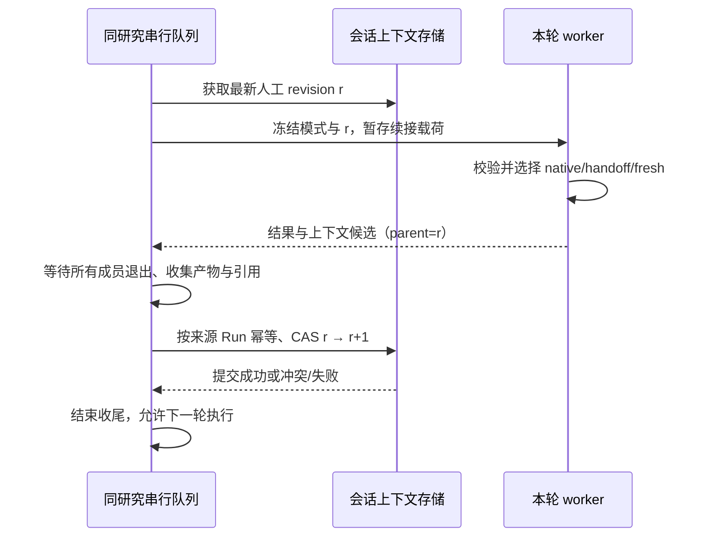

# Web 团队研究与逐次运行模式切换方案

| 项 | 内容 |
|---|---|
| 版本 / 日期 | v1.0 · 2026-10-22 |
| 状态 | **有效 · 方案草案，未实施、未验收** |
| 需求 | PR-RUN-08（本次新增）；关联 PR-RUN-01—06、PR-DATA-04、PR-BIZ-04 |
| 产品依据 | [产品需求基线](../product-requirements.md) · [业务流程](../business-process.md) · [工作台交互规格](../design/investment-research-workbench-prd.md) |
| 历史依据 | [CLI → Web 复刻](cli-web-parity.md)：原阶段一至三的实施记录，不是团队首版的范围约束 |
| 本次交付 | 完整设计、接口与数据契约、任务拆分、验证和发布门槛；本次不修改运行代码、不部署 |

## 1. 产品决定与首版边界

**模式属于每次运行，同一研究可以按“团队研究 → 单 Agent 追问 → 团队研究”的顺序继续。**
“一个研究固定团队模式”仅是过去降低首版实现成本的建议，本方案不采纳。跨模式上下文衔接属于首版交付条件，不能将只有选择框和两条独立工作流的版本称为完成。

确定的产品行为：

1. 发送问题前选择“单 Agent / 团队研究”；提交后该 Run 的模式不可变。
2. 研究 ID、消息、关联账户、投资计划、补数请求、业务回执和历史产物归属不因模式改变。账户仍是独立资料，投资计划仍只属于一个研究。
3. 当前运行不原地切换。正常等待本轮结束；需要立即调整时先停止，服务端确认收尾完成后再发送另一模式。
4. 两种模式都必须理解此前的研究目标、用户修正、结论、依据、不确定性和未完成事项，并能按权限读取历史交付物。
5. 一个研究仍串行执行；不同研究受全局容量控制。团队内部可以并行，不能因此把同一研究的多轮运行并行化。
6. “团队研究”表示采用 coordinator + 子 Agent 的协作流程，不承诺每道简单问题都强制派出固定数量的成员。

首版纳入：模式选择与持久化、双向续接、团队同模式续接、团队过程展示、成员级审批与停止、全队用量、历史产物只读取用、刷新恢复、迁移与回滚。

首版不纳入：运行中换工作流、跨轮复活旧团队进程、用户直接对某个子 Agent 聊天、用户编辑拓扑/成员模型、自动判断并切换模式、对外开放任意 pipeline、`agent_team_report` 独立选项、跨研究合并上下文。首版 reporter 关闭，由 coordinator 输出最终回答。

本方案只调整团队首版的边界，不表示此前暂缓的所有 Web 工作一并重启。排期由本方案任务依赖决定，不借此重排材料与数据链路。

## 2. 代码现状与实际缺口

以下为 2026-10-22 的源码核对，不代表运行验证已经完成。

| 位置 | 已有事实 | 本次必须补齐 |
|---|---|---|
| `server/routes/runs.py`：`RunRequest`、`_parse_submit` | JSON/multipart 都没有逐 Run 模式；创建记录使用 `cfg.pipeline_id` | 两种编码、普通/业务提交统一解析模式并冻结执行配置 |
| `server/store.py`：Run、SessionConversation | Run 已有 `pipeline_id`；`session_conversations` 每研究一份 opaque payload、revision 和来源 Run | 使用已有 Run 字段；为续接补充明确的版本、来源与原子提交语义 |
| `server/orchestrator.py`：`_spawn`、`_launch` | 启动前读会话载荷；实际 worker 命令仍用 `self._cfg.pipeline_id` | 排队、重启恢复、派发和重试全部使用已提交 Run 的配置 |
| `server/worker.py`、`server/profile.py` | worker 接收 pipeline；当前覆盖配置主要是 ReAct 的 `agent_tools` | 按模式构建 coordinator/sub-agent 的工具与预算配置 |
| `workflows/stateful_react_agent/nodes/main_agent.py` | 已有原始会话快照读写、replay 决策及长会话窗口 | 保留现有同模式回放，增加中性上下文导入/导出 |
| `tests/test_context_inheritance.py` | 明确测试 pipeline、工具 schema 不匹配时拒绝回放 | 不放松校验；增加双向切换及往返测试 |
| `workflows/agent_team/nodes/main_agent.py`、`subagent_runtime.py` | 主节点支持额外 observers；子 Agent 有独立 observers、轨迹和工具配置 | 不能假设主节点 observers 自动传给子节点；补团队续接与角色化接线 |
| `server/relay.py`、`server/usage.py` | 回放/计量入口围绕 `react_agent.jsonl` | 支持多来源轨迹、成员身份、重连和全队计量 |
| `web/src/components/ResearchComposer.vue` | “深度研究/快速追问”等 chip 只插入 prompt 模板 | 独立的真实模式选择器，不能让模板冒充工作流配置 |

`turns` 仍是展示和审计记录；不会将其重新拼成模型历史。`history.txt`、`conversation_history` 均不恢复。运行时轨迹继续是过程审计和计量事实来源；服务器只传输 opaque 工作流快照，不解析其内部 messages。

### 2.1 轨迹与通道兼容性评估补充

**评估结论：可以在同一研究中共存，但当前 Web 消费链路不能直接兼容团队；已完成源码与设计层评估，尚未完成双模式真实运行验证。**

研究包含多个独立 Run，每轮保留自己的轨迹；无需把前一轮 single 的轨迹改写成 team，也无需将所有轮次合并成一个轨迹文件。“同研究兼容”分为历史展示、实时/控制通道和模型续接三件事，不能以其中一件成立推断其余也成立。

| 层面 | 源码依据与兼容判断 | 必须完成的适配 |
|---|---|---|
| 轨迹记录基础 | 两种工作流均使用 `TrajectoryFileObserver`，基础记录生产机制可复用；single 文件名为 `react_agent`，team 主节点为 `main_agent`，成员在 `subagents/` 下按成员/任务写入，字段详略配置也不同 | 统一来源 manifest，兼容缺省字段；强制 Web 所需 JSONL 格式，不依赖可变轨迹格式环境配置 |
| Web 回放与计量 | `server/relay.py::_TRAJ` 固定指向 `react_agent.jsonl`；`usage_for_run()` 依赖同一读取器 | 改为按 Run 的实际 pipeline 与 manifest 读取多来源，不能只改团队主文件名而漏掉成员 |
| 实时传输 | worker stdout JSONL → server → SSE 的传输机制可复用；当前 bridge 的增量只有局部 turn 等字段，没有成员身份 | 每成员独立 observer、带身份事件；同一 Run 的多个来源复用同一传输通道 |
| 前端内容与用量归并 | `stores/runs.ts` 的 `turnTexts`、`usageTurns` 按数字 turn 聚合，步骤按 kind/turn、工具按 call ID 查找 | 加 Agent/任务执行/attempt 身份，防止两个成员的 turn 1 文本覆盖、用量漏算；保留现有 F10 完整回放替换增量的修复语义 |
| 生命周期与控制 | `BridgeObserver.on_loop_start/end` 使用 Run 级事件；审批后端 gate 已有多请求映射，但前端仍只有单个 `pendingApproval` | 区分成员终态和 Run 终态；UI 审批队列及成员路由；stop 覆盖全队，steer 定向 coordinator |
| 模型续接 | 原始快照有 pipeline/工具兼容校验；team spec 的主节点 `include_fields` 当前也没有 `replay_payload` | 经 §5 中性包衔接并显式传入 spec；原始轨迹/工具消息不跨模式直接回放 |

实现前的最小验证必须包括：同研究 single→team→single；team 至少两个并发成员都从 turn 1 开始；两成员同时待审批；流中断后恢复全部轨迹与用量；停止一个成员不会误结束整个 Run；停止整个 Run 后再切模式无遗留执行。对应 A03/A04、A08—A11 等验收项。

## 3. 交互与业务流程

### 3.1 输入和模式默认值

- 新研究默认“单 Agent”；已有研究默认最近一次**人工提交** Run 的模式，无历史则单 Agent。前端草稿可暂存选择，但请求必须显式携带模式，最终显示以服务端响应为准。
- 选择器与 prompt 模板分开。选择“团队研究”不改用户正文；点“快速追问”不偷偷切模式。
- 团队选项附简短说明“可并行研究，耗时与用量通常更高”；不伪造固定价格、人数或完成时间。
- 每个研究回合和运行详情显示该 Run 的实际模式。查看旧回合不改变下一次发送的选择。
- 当前 Run 为 queued/running 或收尾未完成时，首版 UI 禁用模式提交，保留草稿；仍可停止或补充方向。待后端释放研究执行锁后恢复发送。
- API 保留同研究排队能力：其他客户端已经排队的下一轮可以使用另一模式，但不会改变当前 Run。排队时冻结模式，真正执行时才确定上一轮可用上下文。

### 3.2 典型序列

| 回合 | 模式 / 用户行为 | 必须表现 |
|---|---|---|
| 1 | 团队：“研究公司 A，比较增长与现金流风险” | 展示任务与成员进度；形成最终回答、证据及产物 |
| 2 | 单 Agent：“只解释现金流风险，不重新做整份研究” | 读取上一轮结论及出处，回答范围收窄，不默认重新派团队 |
| 3 | 单 Agent：“时间范围改为最近两个季度；不要使用旧预测” | 记录新约束及被替代的旧范围 |
| 4 | 团队：“按新范围复核，再补反方证据” | 新团队继承第 2、3 轮约束；不能恢复第 1 轮旧范围 |
| 5 | 停止团队后改单 Agent | 先确认成员和工具收尾；标明哪些结果完整、哪些未验证，再继续 |

团队过程中，主对话只承载用户与 coordinator 的对话及最终回答；子 Agent 的报告、过程文本位于活动区，不能被当成多条最终助手回答。首版不要求逐 token 展开所有成员，成员状态、工具结果、部分失败和可回放详情必须可见。

## 4. 运行契约与配置归属

### 4.1 对外 API

`POST /api/runs` 新增可选枚举字段 `mode: "single" | "team"`。JSON 与 multipart 同义；未传时按兼容默认值解析，解析结果入库。上线默认 single；不能在入队后再读取可变全局配置决定模式。

```json
{
  "session_id": "研究 UUID",
  "message": "基于前面的结论解释现金流风险",
  "mode": "single"
}
```

服务端映射固定为 `single → stateful-react-agent`、`team → agent_team`；不允许客户端提交任意 profile、工具集合或内部 dotted path。非法枚举返回 422；未启用 team 返回可操作的能力错误，不静默降级。所有权、幂等与投资输入校验沿用既有路径。

提交响应、Run 详情、历史 Run 摘要、`run_started` 同时返回 `mode` 与 `pipeline_id`。同一提交幂等键重放不同模式视为冲突，不能创建第二次运行。前端提交失败保留正文、附件和模式。

能力通过现有服务能力接口扩展或新增 `GET /api/run-capabilities` 提供：允许模式、默认值、团队暂不可用原因。客户端只展示已启用能力，服务端仍独立校验。

### 4.2 持久化和后台运行

- `runs.pipeline_id` 是执行选择真源，不再增加可独立漂移的 mode 数据列；mode 是白名单映射的产品视图。
- 在现有 Run 配置快照中记录 profile 版本、解析后的角色工具集合/哈希、模型引用、预算和 reporter 开关。秘密仍经环境/受控解析传递，不写快照、argv 或 SSE。
- 覆盖所有入口：普通聊天、multipart、带业务输入、补数后的续接、重试、dispatcher 恢复、watch 触发。不能只改 `POST /runs` 主分支。
- “重试本次”创建新 Run，默认保留原模式与业务快照引用；执行时读取最新可用人工上下文，详情展示输入 revision。精确复现旧上下文是单独审计能力，不能与普通重试混用。
- watch 首版固定 single，不跟随用户最近选的 team；配置冻结到 watch Run。仍读取最新人工研究上下文，绝不推进人工上下文 revision，也不影响编辑器默认模式。
- 同研究串行不仅覆盖模型执行，还覆盖上下文提交、成员清理与业务收尾；UI 的终态展示不等于已允许下一 worker 抢跑。

## 5. 跨模式上下文：中性研究交接内容

### 5.1 选定的方案

采用**同一会话载荷中的中性研究内容 + 可选的当前原始快照**。扩展 `session_conversations` 的载荷版本与外层元数据，不新建第二套互相争夺“最新历史”的会话存储。

工作流共享模块负责中性结构及导入/导出，两个工作流各自适配内部状态；server 校验外层版本、大小、所属研究、来源 Run 和 revision，原始快照仍是不透明内容。共享实现放在 `workflows/_shared/` 或等价共享边界，框架内核不导入 Web 或评测层。

不采用以下捷径：跨模式改写 `pipeline_id` 绕过原始校验；将所有子 Agent messages 拼接给下轮；只把最终回答当成全部记忆；分别保存两份互不更新的单/团队历史后轮流恢复。

### 5.2 概念结构（字段名待 M0 冻结）

```text
research-continuity/v1
  session_id, revision, parent_revision, source_run_id, source_pipeline_id
  source_status, complete_through_run_id, quality, omissions
  research
    objective
    user_directives[]     # 原文/来源/采纳次序/生效或被替代状态
    findings[]            # 结论/依据引用/适用时点/状态/冲突与替代关系
    open_questions[]      # 未解问题、失败或未完成事项
    evidence_refs[]       # 有类型的来源标识、版本、定位、时间、必要摘录
    artifact_refs[]       # 产物 ID、来源 Run、路径标识、摘要/哈希
    recent_interactions[] # 有界的用户问题与已交付结果，来自工作流输出
  native_snapshot?        # 仅当前兼容工作流的 opaque 原始快照
  native_coverage?        # 原始快照覆盖的 revision，避免重复注入
```

中性载荷是续接的派生材料，不是新证据库、账户库或投资计划真源。`user_directives` 来自真实用户输入与已采纳 steer；正文里引用的网页指令不能升级成用户约束。用户明确修正原文和来源不得被有损总结抹掉。

结论保留“已验证/待验证/冲突/被替代/部分”的区别，不把模型观点变成事实。证据引用按类型携带定位：语料文档/块/版本、市场来源 Run + 逻辑调用 ID + quote 时点、网页 URL + 访问时点及已有快照定位、附件或产物 ID。无法定位的引用保留缺口，不编造 ID。

### 5.3 每次启动的决策

| 前一人工上下文 → 本次模式 | 导入策略 |
|---|---|
| 无历史 → 任一模式 | 新上下文，记录 `fresh` |
| single → single，原始校验通过且覆盖最新 revision | 沿用原始回放；中性材料不重复注入；记录 `native` |
| single → single，原始快照不兼容 | 用中性材料启动新循环，记录 `handoff` 及不兼容原因 |
| single → team | 新 coordinator 接收中性材料，重新规划/分工；不复用单 Agent 工具消息 |
| team → single | 新单 Agent 接收团队结论、证据、用户约束和未完成项；不携带旧团队工具状态 |
| team → team | 首版也新建团队，以最新中性材料续接；不恢复旧 AgentBus、成员进程或未完成工具调用 |
| single → team → single | 使用中间 team 已推进的最新 revision；不能恢复第一次 single 的旧快照 |

所有原始快照仍校验 schema、pipeline、模型/格式、工具定义与完整工具消息配对；具体兼容项沿用当前实现。切回 single 的第一轮会失去旧原始前缀缓存，后续连续 single 恢复正常回放；不承诺跨模式缓存命中。

中性材料放在目标工作流约定的历史上下文区，先于本次用户问题；角色/系统提示与本轮工具定义由目标工作流重建。当前用户指令覆盖旧目标约束，当前业务快照覆盖旧资金/计划叙述。把历史研究内容明确标作数据，不能注入成系统权限。

### 5.4 生成、合并与上下文预算

1. 每个人工 Run 完成后，工作流导出本轮实际采纳的用户要求、交付答案、已收集报告、证据和产物引用；与读取的上一 revision 增量合并。服务端不从 `turns` 重建这份材料。
2. 先确定性收集关键来源与引用，再按需要进行一次有界总结；优先复用现有总结能力，避免同轮为 native 和 neutral 各做一次相同总结。调用及其 token 必须单独计量。
3. 总结输出按 schema 校验，引用 ID 只允许引用已知集合；用户修正原文和业务来源不由模型改写。旧结论若冲突，追加替代/冲突关系，不能直接覆盖来源。
4. 团队只导出 coordinator 已接收的结果和明确状态；未采纳子报告可以作为待验证材料索引，不可冒充全队最终结论。原始推理和冗长工具输出不进中性交接。
5. 预算由目标模型实际输入上限决定，扣除系统/工具、本次问题、业务快照和输出预留；建议首版中性注入上限 `min(16k tokens, 可用输入预算的 25%)`，上线数值由 M0 实测冻结。
6. 优先保留有效用户约束、最新结论、冲突、未完成项和出处；长正文降为可取用引用。包内内容不够时通过授权只读工具取回。若连不可丢约束都放不下，明确返回上下文过大，不静默截断后声称完整续接。
7. 保留 `REPLAY_MAX_TURNS / REPLAY_MAX_TOKENS / REPLAY_MAX_TURN_STEP` 对原始回放的约束及现有长对话回归。中性预算和 native 预算各有统计，不能把两份材料全量叠加。

### 5.5 提交时序与异常



- Run 执行终态与 `continuity_status` 分开：后者建议为 `pending/ready/degraded/failed/not_applicable`。模型成功但上下文保存失败不能显示“已完整继承”。
- 提交候选先原子写本轮文件再入库；DB 提交确认后才清理候选。上下文、来源 Run 与 revision 在同一事务推进；重复完成帧不重复推进，旧进程迟到写入通过 CAS 拒绝。
- 若上下文提交失败，已完成报告仍可查看；保留候选并可幂等重试。依赖该轮的后续 worker 不得默默跳过，队列以可见原因等待修复；修复超时后明确结束派发失败，避免永久 queued。
- 总结调用失败但确定性材料完整：可产生 `degraded` 包，注明省略并可取回原文；不能丢失已采纳修正。材料不完整或来源无法验证则 `failed`，不以空包覆盖上一有效 revision。
- 停止/超时：使用最后完整的循环边界与已提交报告，标明 partial 和未完成成员；丢弃悬空工具协议。用户本次问题及已采纳 steer 需作为带采纳状态的输入事实保留，不能从审计 transcript 猜测是否采纳。
- SIGKILL 没有候选：可从已持久化的结构化 Run 输入、control adoption 记录与工作流检查点恢复最小包，不能把半截流式文本当最终结论；缺口明确显示。
- 无历史是合法 `fresh`；有历史但读取失败不是无历史，必须显示失败原因。此处有意收紧当前“读失败就全新启动”的 best-effort 行为，避免切换时假装记得上下文。
- watch 只读 r，不导出会覆盖人工载荷的候选。下一人工运行继续读取最近人工 revision。

## 6. 历史产物与业务数据的连续性

保持研究归属不等于共享所有 Run 的可写磁盘。每个 Run 继续独立 `/inputs`、`/workspace`、`/outputs`；历史交付物通过同研究、同所有者的引用取用。

- 增加受控的历史研究引用读取能力（例如 `research_context_fetch`），或复用等价的现有受控读取通道。worker 只持有该 Run 的受限引用清单/能力，不获得数据库凭据或任意历史目录访问权。
- 引用先按用户 → 研究 → 来源 Run → 产物/证据核验，再解析路径；复用既有路径解析、防越界和软删除策略。可将选定历史材料只读暂存到本轮 inputs 的独立命名空间，不能可写挂载旧 outputs。
- 新产物仍登记在新 Run，研究画布可聚合历史列表；需要修改旧报告时生成新产物及 `derived_from`，不能覆盖原始审计内容。首版不自动继承所有旧附件，只继承授权引用及实际读取所需文件。
- 历史市场证据保留原 Run 与逻辑调用 ID，不能伪装成本轮市场调用以绕过现有校验。跨 Run 读取是独立只读引用路径；需要当前价格/仓位决策时按本轮规则重新取数、验证。
- 账户与计划从本轮认证绑定及冻结快照读取；历史“资金 100 万”的叙述不能覆盖最新已保存的 80 万。缺失字段保持缺失，不能用旧总结补足。
- 历史引用超期、删除、撤权或文件不存在时返回 `unavailable` 与原因；上下文不能声称原文仍可验证。保留策略及删除传播覆盖会话包、受限引用清单和暂存副本。

## 7. 团队运行接入与控制

### 7.1 Profile、工具与权限

Web 按模式构建 profile overrides：single 保留现有行为；team 分别设置 `main_agent_tools` 与 `sub_agent_tools`，保留团队协调工具和 `submit_report`。不能把 ReAct 的 `agent_tools` 原样传入后宣称团队已接通。

coordinator 负责拆解、约束传达、收集、冲突处理与最终回答。子 Agent 根据分配任务获得必要的中性上下文切片、共同约束及受控证据引用，不默认接收其他成员全部历史。

两类角色都只能获得明确允许的工具；需要业务计算的角色使用同一份绑定快照及包装工具，禁止暴露可由模型填写资金的原始 sizing/lint 入口。绑定 ContextVar、异步任务继承、每个角色的工具实例及缺料意图合并都必须有真实运行验证；不能只验证主节点。

首版建议最多 3 个并发子 Agent、禁止递归组队；作为服务端可配置上限，不向用户暴露自由拓扑。总 wall-time、全队 token/费用预算和全局模型并发槽是共享预算，不能给每个成员各自一份完整 Run 预算。最终数值由容量试验冻结。

### 7.2 角色化 observer 接线

新增每 Agent 的 observer 工厂或等价适配器；共享授权 gate 的受控协调能力，但不共享有可变 turn/工具计时状态的 observer 实例。

| 能力 | coordinator | 子 Agent |
|---|---|---|
| 实时/轨迹事件 | 带自身身份输出 | 独立身份与任务执行 ID，接入统一出口 |
| 审批 | 逐调用审批 | 同样逐调用审批，不能绕过主节点之外的写操作 |
| steer | 在安全边界采纳并确认 | 首版不直接注入；由 coordinator 决定更新或撤销任务 |
| stop | 取消规划/等待/当前循环 | 取消所有 queued/running 成员及其受管工具进程 |
| Diff | 主代理显式变更记录 | 成员显式变更也纳入 Run 的审计，冲突写入需串行保护 |
| 业务约束 | 本轮冻结快照 | 同一快照与所需最小权限 |

审批标识必须含 Run、Agent、任务执行和 tool_call 的稳定关联。UI 支持多条待审批项，不能沿用单个 `pendingApproval` 覆盖先前请求。拒绝只影响对应调用，停止则关闭所有未决审批；硬拒绝、超时拒绝和全局权限边界保持不变。

stop 先协作式取消 AgentBus 及工具，超过现有宽限再终止整个进程组；全部清理完成才允许另一模式开跑。子成员 `on_loop_end` 只能更新成员状态，不能提前把整个 Run 标记 completed。

同一输出路径的并发显式写入要有锁或独占归属，Diff 记录与 revert 基线需一致；bash 扫描仍只展示，不扩大可 revert 范围。团队不能通过并发写破坏现有“仅显式文件改动可回退”的规则。

## 8. 事件、回放与用量

### 8.1 身份与展示

事件扩展 `run_id / agent_id / parent_agent_id / task_id / attempt_id / role`。LLM 文本去重键至少为 `(run, agent, task execution, turn, message_kind)`，工具键再含 tool_call_id。不能继续只用 `turn=1` 聚合，否则并行成员会互相覆盖。

团队任务状态与成员运行状态分别表示；建议任务保留 queued/running/completed/failed/cancelled，成员另有 ready/idle。一个成员可处理多个任务，展示不能把成员完成等同于所有任务完成。

新增逻辑事件包括成员/任务状态变化、报告就绪、上下文准备状态；复用现有工具、审批、usage 与 Run 终态事件。团队内部 `response.swarm.*` 等标识保持兼容，通过 Web 适配层映射，不重命名运行时协议。

### 8.2 多轨迹恢复

首版采用**受控轨迹 manifest + 每来源游标**，复用 runtime 轨迹作为内容真源，不另造 Web 内容事件日志：

- 每个 Run 的 manifest 记录稳定 `source_id`、角色/任务身份、相对轨迹路径及状态；仅注册 runtime 明确产生的文件，禁止对全磁盘 glob。
- SSE/trace v2 的 opaque cursor 编码 manifest 版本与各 source 的已完成记录位置，绑定 Run 并校验大小/来源；不能让前端传任意文件路径。
- 同一轨迹行映射多个 UI 事件时，还要有稳定事件子序号或原子批次提交规则；断线在半行事件间发生也不能漏结果。
- 实时 delta 与回放完整消息按身份合并；完整记录能够补齐丢失 delta，不能因收到过一个片段就跳过全文。重试生成使用新的 attempt 身份，避免与已撤销文本拼接。
- 订阅期间新建成员时刷新 manifest 并从该 source 起点读取；服务端重启后从 manifest/运行时结构化记录恢复任务状态。必要的任务生命周期由 runtime 落盘，而非只存在 SSE。
- 旧 single Run 继续兼容数值 `after` 游标；team/v2 使用新游标，两者通过版本区分。实现前审查现有 F13 断线/分页约定，不能更改数值游标的原有含义。

跨来源仅保证各来源内部顺序；UI 可按时间与来源稳定排序，不声称拥有真实的全局因果顺序。慢消费者可以丢增量，但已落盘内容可补齐；控制状态应从持久化记录重新对齐。所有出口统一脱敏。

### 8.3 用量与部分失败

全队用量 = coordinator + 各子 Agent 的真实调用（含重试/失败/取消前已消费部分）+ 交接总结。按来源/调用去重，不叠加实时计数和离线同一条记录；沿用现有 cache/reasoning 口径，不重复计算包含在总 token 中的子项。

每来源缺失用量用 unavailable/partial 表示，不能当零成本。运行整体终态由 coordinator/worker 结果裁决；部分子任务失败但仍可交付时，最终回答与 `quality` 明示覆盖缺口，不把红色成员自动等同于全 Run 失败，也不掩盖它。

## 9. 存储升级、兼容与发布

1. **扩展读取器先行**：识别旧 `conversation-dump/*` 与新 envelope。旧载荷通过来源 Run 判定模式，不伪造完整中性内容；旧 single 仍可沿用现有回放。
2. **惰性迁移**：旧研究首次需要切换时，由拥有消息格式知识的工作流适配器验证旧快照并生成交接候选，成功后原子替换。不能在 server 直接解析 messages，更不能重建 `turns`。无法迁移明确提示上下文不可用，用户仍可查看旧研究内容。
3. **新 Run 写入与恢复**：记录输入 revision、输出 revision、续接策略、摘要质量、预算及失败原因；字段优先扩展现有快照/summary，必要索引或状态列用新的 Alembic revision。不能编辑已经应用的迁移。
4. **灰度顺序**：先影子生成/验证中性包且不影响现有 single 输入，再启用指定研究的 team，最后开放选择器。功能开关默认关闭，完整验收前不对外声称可用。
5. **紧急关闭**：只禁止新的 team 提交，已经接纳的 Run 按冻结配置收尾；team 产生的中性包仍必须能由 single 读取。单纯关闭 UI 不能成为回滚策略。
6. **版本回退**：最低回退目标必须是支持新 envelope 的兼容版本；不能把新载荷交给只认识旧 dump 的旧二进制。保留迁移前备份并在隔离库演练，未经验证不降级生产 schema。
7. **留存与隐私**：上下文按现有研究所有权、软删除和保留策略治理；原始包不作为普通前端调试响应返回。历史文件删除后的引用状态同步标注。

## 10. 实施分解与依赖

以下均为待实施；阶段内部可独立开发，但发布门槛是整条链路通过。建议先做最小纵向闭环，再扩全量控制与表现。

| 阶段 | 任务与交付物 | 依赖 / 完成门槛 | 初步工程量 |
|---|---|---|---|
| M0 契约与风险验证 | 核定两套 profile/schema、上下文包、角色 observers、轨迹 manifest、预算、legacy 迁移；小规模真实 worker spike | 证明 team 可用目标模型/沙箱/工具；关键路径无未解释绕过 | 2–3 人日 |
| M1 每 Run 模式 | API 双编码、所有创建路径、冻结配置、能力接口、恢复/重试/watch 行为 | DB pipeline 与实际 worker 一致；非法/禁用模式显式拒绝 | 2–3 人日 |
| M2 研究续接 | 单一存储 envelope、两端 exporter/importer、CAS、故障恢复、预算、历史引用读取、旧研究迁移 | single→team→single 与 team→single→team；新修正不丢、旧快照不复活 | 5–8 人日 |
| M3 团队控制 | 角色工具/业务绑定、审批队列、全队停止、steer 路由、输出写入协调、容量限制 | 子节点权限与主节点同样有效；终态后无活跃工具/成员 | 4–6 人日 |
| M4 事件与前端 | 多来源回放/游标、全队计量、模式选择器、任务/成员卡、终态与续接状态 | 刷新/掉线不串消息；审批不覆盖；用量可核对 | 4–6 人日 |
| M5 验收与灰度 | 下面的矩阵、真实 provider/沙箱、旧数据、重启/故障与回滚演练 | 所有首版必选项通过且证据归档 | 3–5 人日 |

粗估合计 **20–31 人日**，是基于当前代码缺口的设计估算，不是交付日期承诺；不包含外部服务故障等待、大规模 UI 重做或数据平台重构。M0 后按实际复用程度重新估算。若压缩范围，优先延后逐 token 子过程展示、额外 reporter 和拓扑定制，不能删除双向续接、成员审批或全队停止。

建议落点：

- `server/routes/runs.py`、配置/Run 快照、dispatcher/watch 派发：模式冻结与所有入口一致性。
- `server/profile.py`、`worker.py`、`bridge.py`、`approval.py`、`steer.py`：角色适配与控制。
- `workflows/_shared/` 新增研究续接契约；两套 workflow 的 spec/context policy 显式传入新字段，避免被过滤掉；节点和子运行时负责转换与导出。
- `server/store.py`、`history.py`、`orchestrator.py` 与新迁移：载荷版本、提交状态、CAS 和恢复。
- `server/relay.py`、`events.py`、`usage.py`：多来源身份、回放与计量。
- `ResearchComposer.vue`、`ChatView.vue`、`stores/runs.ts`、类型/API、Activity/Plan/Approval/运行详情：选择、展示、恢复与交互。

## 11. 验收矩阵

| ID | 场景 | 必须证明的结果 |
|---|---|---|
| A01 | JSON、multipart、业务输入分别提交两种模式 | 落库、排队参数、worker 实际 pipeline 一致；附件/投资输入不被模式字段吞掉 |
| A02 | single→single 与旧研究不切换 | 原回放、长对话窗口与 prefix 稳定性不退化，无重复历史 |
| A03 | team→single→team | 复用结论与出处；中间人工追问/修正进入第三轮；研究及业务归属不变 |
| A04 | single→team→single | 最后 single 读取 team 最新 revision，不能回到第一轮原始快照 |
| A05 | team→team | 新团队不复活旧成员/未决工具，但记住最新要求和未完成事项 |
| A06 | 同研究排队、双标签提交、服务重启 | 冻结模式不变；后轮启动在前轮上下文收尾之后，CAS 不发生倒退 |
| A07 | steer 正常/过晚/停止竞争 | 只记录实际采纳状态；coordinator 接收，旧子任务不会被假称立即改向；后续处理有明确回执 |
| A08 | 多成员同时要求审批 | 每次调用独立可辨；拒绝不串调用，硬拒绝不能绕过；stop 关闭所有挂起项 |
| A09 | 模型/工具运行中 stop、超时、SIGKILL | 无遗留成员/工具进程；部分答案/产物保留；新模式不会与旧写入重叠 |
| A10 | 成员同 turn、工具 ID 冲突、半流重试 | 事件按 Agent/任务/attempt 区分，文本不串台或重复 |
| A11 | SSE 断线、慢消费者、动态增加成员 | 游标补齐各 source，包括一行多事件；刷新后任务状态一致 |
| A12 | 部分成员失败、总结失败、用量缺失 | 结果覆盖范围和上下文质量真实；计量不是零也不重复 |
| A13 | DB 故障、完成帧重放、迟到候选 | 上下文不被空包覆盖；幂等提交/可恢复；后轮不静默跳过人工修正 |
| A14 | 旧载荷迁移、schema/模型/工具不兼容 | 保留原拒绝校验，经中性材料续接或清晰报错，不伪造兼容 |
| A15 | watch 插在两个人工回合间 | 读取最近人工上下文；watch 不推进它，不改变下次默认模式 |
| A16 | 切换后账户资金/主计划已修改 | 新 Run 用新冻结快照；旧历史不能回填资金；所有成员工具使用同一版本 |
| A17 | 历史产物、跨 Run 市场引用、越权 ID、路径逃逸 | 合法同研究引用可读；跨用户/研究拒绝；旧引用不冒充本轮验证 |
| A18 | 超长交接、已删除来源、恶意网页文本 | 约束不被截断或提升权限；缺口可见；预算超限明确处理 |
| A19 | 全队 token/时间/并发上限 | 同研究串行、不同研究公平排队；超限全队有界收尾且用量可核对 |
| A20 | 灰度关闭、兼容版回退 | 已接受 Run 可收尾；single 能继续最近 team 上下文；无数据格式回退破坏 |

验证分层：

1. 确定性契约测试验证身份、revision、导入材料、幂等和错误路径；不能只靠最终回答看起来合理。
2. 工作流/worker 集成测试验证真实注册、工具绑定、spec 字段过滤、observers 与 sandbox；mock coordinator 不算子 Agent 权限已验收。
3. 隔离 PostgreSQL 验证迁移、串行/CAS、恢复；不得默认使用生产库。
4. 浏览器测试验证两种模式、成员活动、多人审批、停止、刷新与错误可见性；加入移动窄屏及键盘发送。
5. 真实 provider 的固定多轮脚本要求模型复述关键新约束、定位历史证据并读取历史产物；记录 prompt 导入证据、输出、用量、耗时及失败，不以一次演示替代稳定性结论。

实施阶段至少运行相关上下文与 Web 回归、团队/子 Agent 控制测试、前端 typecheck/单测/build；提交前执行仓库要求的 preflight、两阶段 import smoke 和 symbol closure。涉及 LLM 的检查按测试环境配置执行并记录调用数。本次仅文档变更，不宣称这些运行验证通过。

## 12. 首版发布判据与风险收口

首版完成需同时满足：同研究双向多次切换、上下文修正不丢、业务与证据权限不退化、队伍全量停止、成员审批独立、事件可恢复、用量可核对、旧研究可迁移、关闭 team 后 single 仍能续接。

| 风险 | 处理 / 发布阻断条件 |
|---|---|
| 中性总结遗漏或歪曲用户要求 | 原文约束和引用确定性保留；关键修正丢失阻断发布 |
| 恢复旧模式时上下文倒退 | 只有一个人工 revision head；往返测试未通过阻断发布 |
| 子 Agent 绕过授权或业务包装 | 独立 observer 与工具绑定测试；任一角色绕过即阻断 |
| 团队并发放大资源消耗 | Run 与全局共享预算；无有界取消和计量不得开放 |
| 轨迹回放遗漏成员或重复计费 | manifest、身份和 per-source cursor 对账；只展示主节点不算完成 |
| 旧数据无法生成可靠交接 | 可解释失败与迁移路径；不能静默清空历史继续 |
| 存储失败造成表面连续、实际断档 | 显式 continuity 状态和恢复门；禁止假成功 |

M0 需要冻结的是工程参数（包大小、总结模型、预算、游标格式、引用读取通道和保留策略），而不是再次讨论是否允许同研究切换。逐 Run 模式和双向续接已经是本方案的首版要求。
