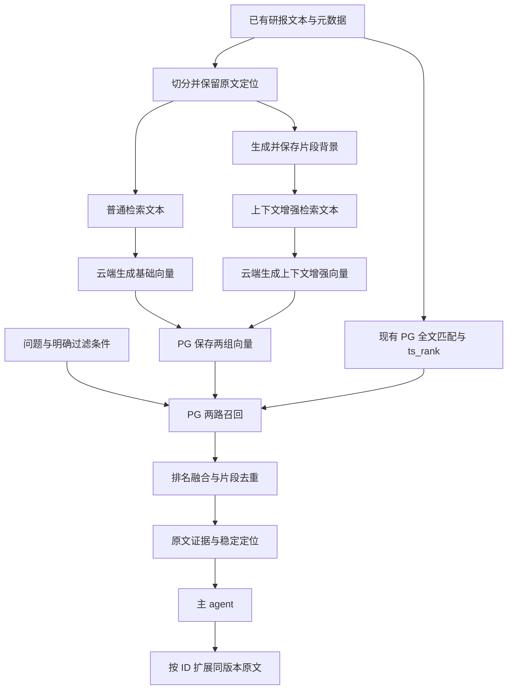

# 基于 PostgreSQL 的研报上下文感知混合检索试验方案

状态：**已失效，保留为早期草案**。日期：2026 年 10 月 20 日。

用户随后指定了实际 WSL 项目及资料库说明。结合其 `corpus` PG 九表、现有来源覆盖排序、选带和 search/fetch 取证协议，已在实际项目中重写方案：[当前待审核方案](//wsl.localhost/Ubuntu/home/administrator/FrontierAgent/docs/plan/corpus-contextual-vector-retrieval-pilot.md)。以下旧草案中的项目定位、身份设计和接入设想不再作为实施依据。

本次先用 10～20 份有可用文本的研报，在现有 PostgreSQL（PG）全文检索与 `ts_rank` 排名基础上增加 Doubao 稠密向量召回，验证是否能找到更准确的原文证据，并减少主 agent 的重复搜索。先比较原有全文检索、加入向量后的混合检索、向量侧增加片段上下文后的混合检索，再决定是否扩大使用。本文是实施提案，本轮不修改业务代码、不调用付费模型、不导入资料。

用户已确认：现有本地检索使用 PG 的 `ts_rank`；本次增加向量检索。全文检索沿用现有实现，不替换成独立 BM25，不引入模型生成的稀疏向量。

## 1 已确定的范围

| 项目 | 本次约定 |
| --- | --- |
| 运行环境 | 本地开发与验证；云端部署单独规划 |
| 资料规模 | 首批 10～20 份代表性研报；不将 500 份设为系统容量上限 |
| 文本来源 | 优先复用现有解析结果；必要时仅使用已有文本层提取能力 |
| Embedding | 用户提供 Doubao Embedding Vision API；仅发送文本 |
| 数据框架 | 复用现有 PostgreSQL；新增试验表或 schema 隔离衍生数据 |
| 检索方案 | 现有 PG 全文召回与 `ts_rank` 排名，加 Doubao 稠密向量召回，结合元数据过滤 |
| 上下文增强 | 在检索文本中补充片段背景，与原文分别保存 |
| Agent 接入 | 检索证据、按片段 ID 扩展原文、保留可追溯引用 |
| 数据更新 | 小样本手动触发新增、去重、修订、撤回与恢复验证 |

本次不引入 OCR、图片或视频向量、GraphRAG、独立 reranker、自动每日调度、完整 Web 页面改造或云端容量优化。扫描件和只有图片的表格记录为解析覆盖缺口，不把它们计为文本检索失败。

多模态 embedding 不替代 PDF 解析或上下文生成。研报文本和问题会发送至 embedding 服务；生成片段背景时，相应研报文本还会发送至选定的生成模型。

## 2 当前代码依据与接入前提

当前工作区为 FrontierAgent，已确认以下可复用或需检查的位置：

| 位置 | 已确认的行为 | 对实施的影响 |
| --- | --- | --- |
| `config/providers.yaml` | 提供文本生成模型的服务商配置 | 可参考配置习惯，但 embedding 需要独立适配 |
| `workflows/_shared/research/evidence.py` | 定义 EvidenceCard、Assertion 和来源信息 | 后续考虑映射检索证据，不能直接等同于用户所述 claims |
| `workflows/_shared/research/observers/evidence_observer.py` | 搜索摘要和网页访问摘要会形成证据卡 | 新检索要明确区分原文摘录与生成文本 |
| `workflows/agent_team/report_fast_select.py` | 候选证据要求 URL，并按 URL 保留一份片段 | 本地来源可能被丢弃，同一研报的多个有效片段可能被合并 |
| `workflows/agent_team/prompts.py` | 包含补证与独立验证要求 | 需区分重复查找、原文扩展和独立交叉验证 |

尚未在当前工作区定位到实际研报入库、R2 items 和用户所述 claims 实现。因此：

- 先确认实际项目、分支、数据入口和主 agent 使用的工作流。PG 与 `ts_rank` 已由用户确认，具体连接、表结构、中文分词配置和 SQL 尚未检查。
- 检索试验可以独立运行；业务接入位置在确认后再落实。
- 本次不删除、迁移或重新定义 R2 items／claims。检索结果以稳定来源 ID 与现有记录关联。
- 如果目标系统不在此仓库，沿用本方案的数据和检索约定，重新列出代码接入位置，不把演示工作流当成实际产品。

## 3 试验架构与技术选择

复用现有 PG、数据库驱动、连接池和迁移方式。新增试验 schema 或关联表保存片段、背景、向量与运行记录，通过文档 ID 对接原资料库，不另建 SQLite 或应用侧主向量库。先检查 PG 是否已有 pgvector 扩展及其版本，确认支持后再实施迁移。

| 职责 | 默认提案 | 原因 |
| --- | --- | --- |
| 原始资料 | 保留原文件或现有存储引用 | 原文始终可回查 |
| 文档、片段、状态和缓存 | PG 试验 schema 或关联表 | 复用现有框架，通过事务发布一致的数据版本 |
| 向量保存 | pgvector 保存按模型与配置版本区分的稠密向量 | 向量与来源定位在 PG 中关联，不需要本地模型 |
| 向量搜索 | pgvector 精确余弦距离搜索 | 小样本先排除近似索引误差 |
| 全文搜索 | 现有 `tsvector`／`tsquery` 匹配与 `ts_rank` 排名，具体以现有 SQL 为准 | 保留当前中文分词、字段权重、查询构造与归一化配置 |
| 结果融合 | Reciprocal Rank Fusion，简称 RRF | 按排名融合，避免直接相加两类不可比的分数 |
| 实验入口 | 命令行或可调用 Python 模块 | 先验证证据质量，无需建设新 Web 页面 |

这些选择仅服务本次小样本试验，不代表长期容量承诺。通过检索接口封装存储与召回，后续可以替换索引实现。

`ts_rank` 是 PG 的全文排名函数，本身不是向量模型，也不等于 BM25；召回匹配与排序分别检查。查询解析、中文词典、字段权重和 normalization 沿用现状并记录版本，本轮不额外引入 rank_bm25 或 jieba。重点检查公司名称、证券代码、年份、数字单位和否定词在现有全文链路中的处理。[PG 全文检索说明](https://www.postgresql.org/docs/current/textsearch-controls.html)

小样本使用 PG 内精确向量搜索，先验证过滤和召回效果，不默认建立 HNSW／IVFFlat 索引。当前 pgvector 官方文档对普通 `vector` 的 HNSW／IVFFlat 索引列出 2,000 维上限；2048 维输出不能直接套用这类索引。存储与精确查询能力需按已安装版本检查，后续若需要近似索引，再单独评估 1024 维或半精度等方案，不在本轮静默降维。[pgvector 官方说明](https://github.com/pgvector/pgvector)

## 4 样本与数据约定

### 样本选择

选取 10～20 份已有可用文本的研报，包含同公司不同日期、不同机构研究同公司、相似措辞涉及不同公司，以及数字和预测年度容易混淆的内容。样本用于覆盖失败模式，不作为大规模效果的统计证明。

先输出样本清单及可用性检查：文件来源、解析方式、页数或章节范围、可用文字范围、表格缺失和异常页。部分页面不可读的文档仍可参与，但每个评测问题都要标记其证据是否在可用文本中。

### 最小数据结构

| 对象 | 主要字段与约定 |
| --- | --- |
| 文档 | `doc_id`、标题、机构、发布日期、来源引用、公司列表 |
| 文档版本 | `version_id`、内容哈希、解析器版本、提取文本哈希、当前状态 |
| 片段 | `chunk_id`、版本 ID、原文、章节路径、页码或段落定位、前后片段 ID |
| 时间信息 | `published_at` 与片段涉及的 `data_period`／`forecast_period` 分开；缺失时为空 |
| 增强文本 | `context_text`、生成模型与提示词版本、来源范围、生成状态 |
| 向量记录 | 片段 ID、索引变体、模型版本、维度、指令版本、输入哈希、向量 |
| 运行记录 | 阶段、请求 ID、状态、耗时、API usage、缓存命中、异常与重试 |

文档 ID 表示稳定来源身份，不直接等于文件内容哈希；版本 ID 表示该文档的一次内容快照。不同机构、不同日期的独立研报是不同文档，只有同一份文档的修订才建立新版本。

片段 ID 由文档版本、切分配置和位置共同确定。页码只有在解析结果提供可靠页映射时填写；否则保留章节、段落和提取文本偏移，并明确定位类型。偏移对应所保存的提取文本，不伪装成 PDF 字节位置。

研报涉及多家公司时，文档公司列表不能自动被当作每段的主语。公司级过滤默认表示“相关文档范围”，返回结果明确实际过滤层级；片段级实体信息只有可靠时才用于严格过滤。

### 原文切分与上下文生成

1. 优先使用已有章节和段落结构。初始片段目标为 600～1,000 个中文字符，长段落按句子切分，重叠约 100 个字符；这些是开发集可调参数，不是模型输入上限。
2. 尽量保留表头、单位和脚注。无法可靠提取表格时标记缺口，不生成猜测数字。
3. 标题、机构、发布日期和章节路径作为确定性背景字段；原始文字单独保存。向量输入独立组装；全文侧沿用现有清理、分词与字段权重逻辑。
4. 上下文增强组额外生成约 80～150 个中文字符的片段专属说明，说明代词指向、主题和必要口径。输入不包含评测问题或标准答案。
5. 小文档在预算允许时提供完整已解析正文；超过预算时使用标题层级、所在章节及邻近段落，并记录实际输入范围。这是受限上下文实现，不能宣称已理解全文。
6. 不确定的公司、年份和口径不补全。生成失败或无法支持的背景退回确定性背景，并标记退回状态。
7. 新版本全文变化后，重新检查受文档背景影响的说明；即使某段原文未变，也不能盲目复用旧上下文。

所有生成背景都与原文区别展示，不能作为逐字引用。小样本阶段人工检查全部背景中的公司、机构、日期和数值归属；修正规则仅在开发集上确定，再冻结后评测。

## 5 模型适配与调用控制

默认候选为 `doubao-embedding-vision-251215`，以用户实际开通的版本或接入点为准。先固定 2048 维单个稠密向量；本次不同时开展降维、稀疏向量或多向量优化。

官方模型列表列出该版本的文本输入与 2048／1024 维支持；多模态向量化使用独立接口，接入不能仅替换生成模型名称。使用稠密 `embedding` 输出，不开启 `sparse_embedding`；现有 PG 全文检索承担词项召回。[模型列表](https://console.volcengine.com/ark/region%3Acn-beijing/docs/model-list)、[接口说明](https://console.volcengine.com/ark/region%3Acn-beijing/docs/multimodal-vectorization-api)

实施时先完成两段文本和一个问题的冒烟调用，核对：

- 实际端点、鉴权、模型 ID、返回维度、有限数值和非零向量。
- 文档与查询编码指令按官方文本检索用法分别配置并版本化，使用同一个兼容向量空间。
- 明确一个请求返回几个检索单元的向量。多模态 `input` 数组不能未经验证就当作独立文档批处理；先一片段一请求，确认批处理语义后再优化。
- 按接口限制处理长度、限流、超时和重试；不静默截断原文。
- 文档向量与查询向量采取一致归一化约定。PG 按余弦距离升序召回，检查排序方向、输出维度、过滤以及结果与参考计算一致。

上下文生成复用已配置且适合文本处理的生成模型，具体模型在实施前确定。所有组保持相同生成回答模型，embedding 服务不负责生成背景。

缓存键包含实际输入、服务商、实际模型版本、维度、编码指令及其他影响输出的参数。背景缓存另包含所用文档／章节范围的内容哈希和生成配置。成功结果落盘后复用；记录请求 ID 和失败状态，避免反复重跑成功内容。

API 超时但服务端可能已经完成的请求，可能重复计费，不能承诺网络异常下恰好一次计费。费用按实际 usage 和执行时确认的单价计算；无法取得 usage 时明确为估算。生成背景、文档 embedding、查询 embedding 和主 agent 回答分别统计。

## 6 检索与主 agent 接口

### 检索流程

1. 接收问题和明确的过滤条件，应用当前有效版本和未撤回状态。
2. 公司、机构、发布日期过滤作用于两路相同的候选集合。预测年度与发布日期分别处理；字段未知时显式过滤不自动放宽，返回缺失提示。
3. 两路独立召回：全文侧按现有匹配条件和 `ts_rank` 排名，向量侧对问题调用 embedding 后按余弦距离搜索，各取最多 30 个片段。全文无匹配时仍可返回向量结果；不得先用全文命中集合限制向量候选。全文分数和向量相似度不作为真实性或置信度。
4. 以等权 RRF 融合，初始常数设为 60，按片段 ID 去重，最终返回最多 10 个片段。参数只在开发集调整。
5. 保存召回分支、各路排名、融合分数和过滤条件，便于解释漏召回。
6. 缺少充分证据时返回候选与证据不足标记，由 agent 根据原文判断；不把“存在 top-k 结果”视为问题必然有答案。

基础混合组的向量输入为确定性背景加原文；上下文增强组在此基础上增加生成背景。两组的全文检索完全相同，先只验证向量侧上下文增强的增益。生成背景不写回现有 `tsvector`；如后续希望同时增强全文侧，作为单独实验，不与本轮混在一起。

融合前，两路必须使用相同的证据单位。如果现有全文检索返回的是文档或 R2 item，先确认其与原文片段的对应关系；必要时建立沿用现有分词和排名配置的片段级试验投影。原有文档排名与片段排名不能未经转换直接按 ID 融合。实际系统基线与该投影的差异单独记录。

向量 API 不可用时，业务接口可显式降级为现有全文检索，返回 `retrieval_mode` 和失败原因。评测中降级运行单独统计，不计为正常混合检索结果。

### 对外接口提案

| 接口 | 行为 |
| --- | --- |
| `search_reports(query, filters, limit)` | 返回原文、背景、来源、文档版本、片段 ID、定位及检索信息 |
| `read_report_context(chunk_id, before, after)` | 返回同一文档版本中相邻片段，受字数预算限制 |

主 agent 先使用返回的原文证据。只有指代、限定条件或上下文不完整时，调用扩展阅读；确实缺证、跨来源冲突或需要独立核验时才发起新的检索。独立交叉验证不按重复搜索处理。

引用以文档版本和片段为单位，读取时再核对状态。撤回内容可按权限保留用于历史追溯，但不能作为新的有效证据。修订前的引用仍定位旧版本并显示已替代，不悄悄跳到新版本。

若接入当前 FrontierAgent，先解决本地来源显示及引用映射，并验证同一文档多段证据不会被 URL 去重丢失。不得为通过校验而伪造网页 URL。具体适配取决于实际使用的报告链。

## 7 增量更新与恢复

本次提供手动运行入口及状态记录，不建设定时任务平台。

| 场景 | 预期行为 |
| --- | --- |
| 同一输入重复入库 | 配置与输入未变且成功缓存完整时，不新增片段，不重复调用模型 |
| 新增研报 | 只处理新增文档及其衍生内容 |
| 同一文档修订 | 创建新版本；准备完成后再原子切换有效版本；旧引用可追溯 |
| 独立的新日期研报 | 作为独立文档保留，不以公司相同为由覆盖旧报告 |
| 撤回 | 状态立即阻止新查询返回；两路召回和按 ID 读取都检查状态 |
| 中途失败 | 保留成功步骤与缓存，恢复时继续缺失部分；部分索引不发布 |
| 模型或切分配置变化 | 创建新索引配置版本，准备完整后切换，不混用不兼容向量 |

PG 中的元数据、向量及检索配置按构建代次关联，完成后通过事务切换有效代次。查询只读已完成代次，并检查文档有效状态；两路读取使用一致快照或明确的同一代次，返回前再核对撤回状态。缓存结果也需重新检查文档状态。模型调用在数据库长事务之外完成，避免等待 API 时持续持锁。

全文侧沿用现有 `tsvector` 更新与索引维护机制，核实修订和撤回能同步生效；向量只计算缺失或失效的输入。上下文增强仅更新相应向量记录，不改变现有全文字段。程序重启后从 PG 恢复状态，成功缓存不依赖进程内存。

## 8 评测设计与通过条件

### 对照组

| 组别 | 方案 | 回答的问题 |
| --- | --- | --- |
| A | 现有 PG 全文匹配与 `ts_rank` 排名 | 当前词项检索能找到哪些证据 |
| B | 保留 A 的全文逻辑，加确定性背景与原文的稠密向量，RRF 融合 | 增加向量是否优于现状 |
| C | 保持 B 的全文侧，向量输入额外增加片段专属生成背景 | 向量侧上下文是否值得其成本 |

A 必须能在同一资料快照上运行，冻结现有 SQL、全文配置和权重。实现路径尚未定位时，先完成接入确认，不能用临时 BM25 代替 A。如果 A 的返回粒度不同，按原文证据范围对齐比较；另外在相同片段级全文投影上比较仅全文与混合检索，以区分切分和向量各自的收益。

同一实验固定文档快照、解析结果、切分方式、过滤条件、全文配置、最终片段数及交给 agent 的总文本预算；B／C 另固定 embedding 模型与维度。核心检索评测先不运行 agent；端到端比较时固定 agent 模型、提示词和工具预算。

为隔离“检索质量”的收益，主要端到端对照给各组相同格式的原文及确定性背景。若另测将生成背景也交给 agent，需要单独标记为附加实验。

### 问题与标注

建议准备 30 个问题：6 个开发问题用于检查流程和调参，24 个冻结验收问题，其中 20 个在可用文本中有答案，4 个没有充分证据。题型覆盖同义表达、明确名称、公司消歧、日期与预测期、机构观点差异和需要上下文才能理解的片段。

每题记录标准来源、版本、原文位置、允许的等价证据、必要限制和是否需要多个证据。金标准标在原文段落或范围上，再映射到片段，避免重叠切分造成重复计分。纯图片证据单列为解析缺口，不混入文本召回分母。

### 指标

| 指标 | 定义 |
| --- | --- |
| Hit@5 | 有答案的问题中，前 5 个候选至少包含一处有效证据的比例 |
| Evidence Recall@10 | 每题所需证据单元被前 10 个候选覆盖的比例，另报跨文档题完整覆盖率 |
| 归属与口径错误 | 答案和引用中的公司、机构、年份、预测／实际、单位错配次数 |
| 引用可追溯性 | 返回引用能否打开正确版本和原文位置 |
| 无答案行为 | 无充分证据时是否明确说明，而非强行生成事实 |
| 重复回查 | 对同一证据需求重新搜索已有充分证据的次数；原文扩展与独立核验另计 |
| 速度与资源 | 查询端到端及分阶段耗时、冷暖缓存区别、本地峰值内存 |
| 成本 | 入库、上下文生成、查询向量、回答成本分别列出，并记录缓存命中 |

### 建议验收门槛

以下门槛是供用户审核的试验目标，不是已测得的效果：

- 正确性门槛：引用定位全部可回查；显式过滤条件违规、撤回记录泄漏、未完成版本泄漏均为 0；重复导入和失败恢复通过。
- 可用性目标：20 个有答案验收题中，至少 18 个达到 Hit@5；最终回答不出现已标注的公司／机构／时间／数字口径错误；4 个无充分证据题均不得伪造答案。
- 向量采用条件：B 相比可比的全文基线找回原先缺失的有效证据，且没有新增归属错误；同时展示损失题和新增成本。若只有切分变化带来改善，或没有观察到向量增益，则继续保留 A，扩大针对性样本后再决定。
- 上下文采用条件：C 相比 B 至少修复 2 个前五候选缺证的问题，且没有新增缺证题或归属错误。若 B 已接近满分，则扩大针对性样本再判断，不凭总体高分强行采用 C。
- 若 B 达标而 C 没有稳定增益，采用 B，停止增加上下文生成成本；若两者都未达标，先检查解析、切分、分词和标注，保持现有检索。
- 速度和费用先实测并提交逐项结果，由用户决定是否接受；不在未知 API 延迟和计价时承诺固定响应时间或金额。

小样本结果用于决定下一阶段方向，不外推为全库准确率。展示逐题成败及错误原因，不能只汇报平均分。边界题必要时重复端到端运行，记录模型输出波动。

## 9 分阶段实施与交付

| 阶段 | 工作 | 完成标准与交付 |
| --- | --- | --- |
| P0 确认接入 | 定位实际仓库与数据入口，检查 PG、pgvector、现有全文 SQL 与返回粒度，确认模型、样本和预算 | 输入清单、PG 兼容性结果、代码接入表、固定评测问题 |
| P1 整理证据 | 导入已有文本，保留定位与版本，检查缺失，固定切分 | 样本清单、片段预览、原文定位检查结果 |
| P2 普通混合检索 | 保存 A 基线；API 冒烟验证、PG 缓存与精确向量检索、复用全文侧及 RRF 融合 | B 可独立检索，向量可找回全文未匹配的片段；A／B 可比较 |
| P3 上下文对照 | 生成与检查背景，建立独立 C 索引，冻结测试 | B／C 逐题报告、费用和延迟；决定是否保留增强 |
| P4 生命周期 | 验证重复、新增、修订、撤回、失败恢复及重启 | 自动化测试与更新演示记录 |
| P5 Agent 接入 | 接入两个工具及引用映射，保持原检索可切回 | 同原文预算的端到端结果、回查统计、最终验收报告 |

核心检索实验先于 agent 改造。B 优于 A 而 C 未改善 B 时，后续接入 B；B／C 均无增益时保留 A，不扩大业务接入。P4 的基本状态与缓存结构在 P1／P2 就建立，此阶段专门验证更新与恢复。

实现预计包含一个研报检索模块、一个 embedding 适配器、两个 agent 工具入口、一个试验配置和一套评测入口。具体文件路径在 P0 确认，不在未知实际项目的情况下预先改动框架。

原文保留现有存储位置；向量与试验记录保存在 PG 的试验 schema 或关联表。密钥与连接凭据通过环境变量或现有配置注入；导出文件保存在 Git 忽略目录。提交代码、迁移、配置模板和去敏评测结构。结果保留模型／提示词／切分／全文配置版本，以便复现。关闭向量分支即可回退原有全文检索，不覆盖现有资料库。

必要自动化检查覆盖：真实片段定位、跨版本读取、严格过滤、撤回状态、同文档多段引用、PG 事务发布与恢复、维度与排序方向、全文零命中时的向量召回、全文降级、缓存失效、接口异常和中断恢复。数据库测试运行在隔离的 PG 试验环境，不以 SQLite 替代。效果以人工标注的真实样本验证，不用模拟 embedding 的测试结果证明召回质量。

## 10 审核项目与实施前输入

本次请审核以下默认提案：

1. 先以 10～20 份可提取文本的研报验证，范围保持无 OCR、无图检索、无独立重排模型。
2. 基于现有 PG 和 `ts_rank` 全文检索，增加 pgvector 精确稠密向量召回并做 RRF 融合；保留现有全文配置和回退路径。
3. 先验证 Doubao 2048 维单稠密向量与已安装 pgvector 的兼容性，复用现有生成模型；比较 A／B／C 后再决定是否保留向量侧上下文增强。
4. 按上述阶段、指标和建议门槛推进；效果无增益时保留较简单方案。

实施前需要落实的输入：

| 输入 | 提供方式或处理方式 |
| --- | --- |
| 实际研报项目与入口 | 项目／分支／路径，以及主 agent 使用的工作流 |
| PG 环境与检索实现 | 连接配置位置、PG／pgvector 版本、相关表与迁移入口、全文分词配置、`ts_rank` SQL 和返回粒度 |
| 样本与元数据 | 本地文件或现有记录位置；原始文本和来源可对应 |
| API 配置 | 实际服务地址、模型或接入点 ID；密钥放环境变量，提供变量名 |
| 上下文生成模型 | 确认可复用的文本生成模型及其配置位置 |
| 评测问题 | 用户提供真实问题；也可先由实施方从样本拟题，再由用户核对证据 |
| 调用预算 | 设置本轮金额或请求／token 上限；先估算，再批量运行 |

审核通过代表认可试验方向与范围。缺失输入只阻塞依赖它的阶段；不影响先整理样本格式、接口约定和离线测试。
